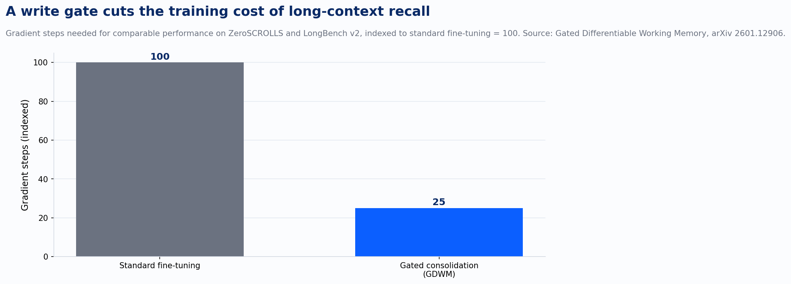
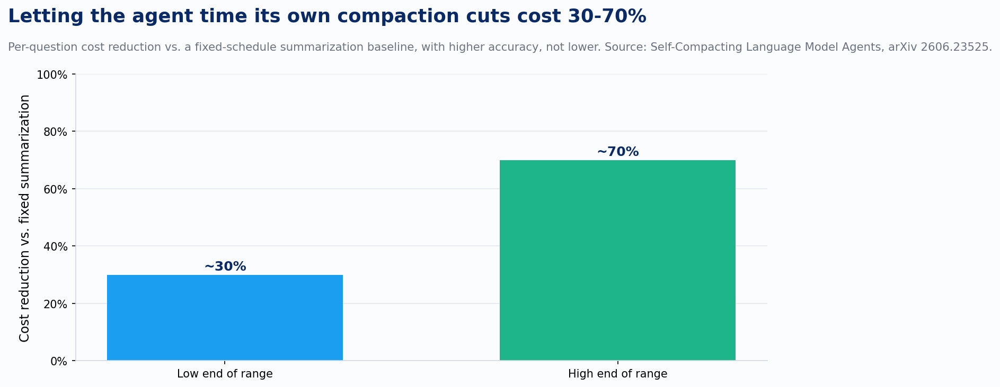
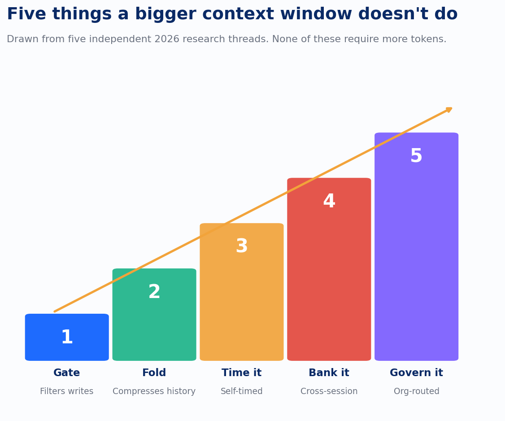

Ask a team running AI agents in production what their context window is, and they answer in seconds. A million tokens, sometimes two. Ask the same team what their agent's memory architecture is, and the room goes quiet. Nobody built one. They bought a bigger window and assumed it was the same thing.

It isn't, and 2026 has produced a run of research that finally says so with numbers instead of intuition. A context window is how much a model can attend to right now. Memory is what survives past right now: what gets kept, what gets compressed, what carries across sessions, and what gets thrown away on purpose. A bigger workbench doesn't put anything in the filing cabinet. It just means you can spread more out before you have to clean up, and eventually you still have to clean up.

The clearest evidence that attention alone doesn't solve retention comes from a paper on gated differentiable working memory, published for ACL 2026 (arXiv 2601.12906). The authors start from a problem anyone who has used a million-token context window has felt: attention scores dilute across thousands of tokens, information in the middle of a long context gets lost, and the model struggles to adapt to something genuinely new that shows up late in the window. Their fix is a write controller that scores each chunk of input for what they call Contextual Utility, an information-theoretic measure of how much long-range dependence that chunk actually carries, then spends its consolidation budget on the chunks that earn it. On ZeroSCROLLS and LongBench v2, that gating gets comparable or better long-context performance using a quarter of the gradient steps a standard fine-tune needs.

That number matters for a specific reason. Four times fewer gradient steps for the same retention means most of what a huge context window "remembers" was never worth remembering in the first place. The model was spending capacity finding that out the hard way, every single time, with no gate to tell it in advance.

KLong (arXiv 2602.17547) attacks a related but different gap: the distance between benchmark tasks, which run in one sitting, and real enterprise workflows, which run for hours across dozens of steps. KLong trains the agent for that gap directly instead of hoping a wider window covers it. Long trajectories get split into overlapping windows during supervised fine-tuning, each one carrying a fixed prefix of the earliest context forward, so the model learns to fold a long history into something that still fits. Progressive reinforcement learning then extends the timeout in stages, so the model earns longer-horizon competence the way a person would: by practicing at a length it can already handle before the length increases. Context folding is the mechanism here, distinct from simply expanding the window.

The compaction question sits one layer below that: when should an agent compress its own history, and who decides? Self-Compacting Language Model Agents (arXiv 2606.23525) gives the agent a rubric and lets it call its own compaction tool: fire when a sub-task has resolved or a line of reasoning has converged, suppress when it's mid-derivation or stuck. Against a fixed-schedule summarization baseline, that self-timed compaction runs 30 to 70 percent cheaper per question, and it also scores better: up to 18.1 points higher on math tasks and 5 to 9 points higher on agentic search. A separate paper, Slipstream (arXiv 2605.08580), solves the systems problem next to it: overlapping the act of compacting with continued execution on the original context, so most of the compaction time hides inside work the agent was already doing. The two get conflated in casual summaries because they attack the same moment in an agent's life, but they're different papers solving adjacent problems. Timing the compaction well and hiding its latency are two separate engineering decisions.

None of what's above survives past the session unless something writes it down on purpose. ReasoningBank (arXiv 2509.25140) distills generalizable reasoning strategies from an agent's own self-judged successes and failures, retrieves the relevant ones at the start of a new task, and folds new lessons back in when the task ends. Anthropic shipped a production version of the same idea in Claude Managed Agents: a scheduled "Dreaming" process that runs between sessions, scans past transcripts for recurring mistakes and workflows that keep converging, and writes curated, condensed memory updates rather than raw logs. The session history itself stays untouched; Dreaming only writes to memory. That distinction is the whole discipline in miniature: an agent that merely logs everything drowns in its own history, and an agent that never writes anything down repeats every mistake at full price. The valuable step is the one in between, deciding what's worth keeping.

Every mechanism above assumes a single agent deciding what to do with its own context. That assumption breaks at the scale most enterprises actually operate at, where dozens of agents draw on the same internal knowledge base with different permissions and different freshness requirements. Context Kubernetes (arXiv 2604.11623) names that as an orchestration problem structurally similar to the one Kubernetes solved for compute a decade ago: a registry tracking what context exists, a router matching context to the agent asking for it, a permission layer where an agent's authority is always a strict subset of the human it acts for, and a freshness manager expiring stale context on a schedule instead of letting it linger. Memory, at that scale, is an infrastructure layer with its own access control and expiration policy, sitting between the knowledge base and every agent that touches it.

None of this is settled. These are 2026 papers and one production feature, not a decade of hardened defaults, and a rubric that fires compaction on "convergence" or a gate that scores "Contextual Utility" both depend on judgment calls a research team made that won't transfer cleanly to every workload. But five separate groups, working on training objectives, systems latency, reasoning transfer, and enterprise infrastructure, arrived at the same structural answer without coordinating: retention needs a mechanism that decides what to keep, what to fold, when to compact, what to carry forward, and who gets to see it. A bigger window only ever bought space. Making those five calls on purpose was always going to take a separate mechanism.
