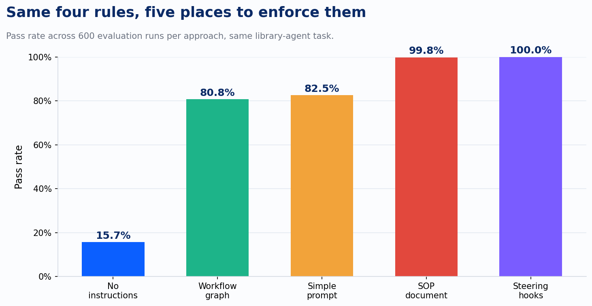
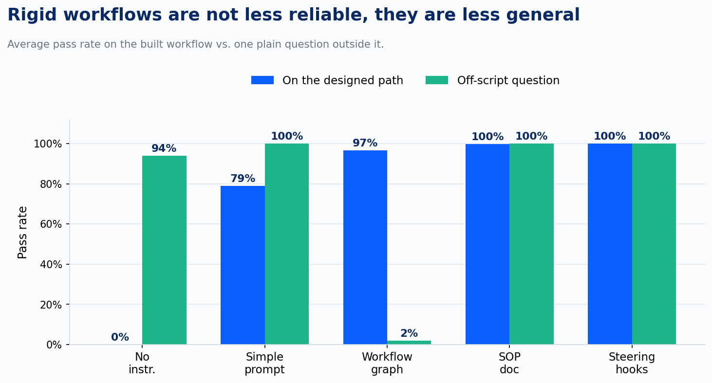
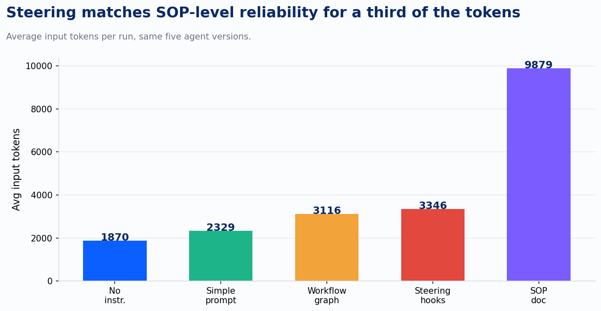

Put four rules in an agent's system prompt. Check the book isn't recalled before renewing it. Confirm the library card on the request matches the one on file. Cap the renewal at thirty days. Keep the tone encouraging, even if the customer is rude. Test it a dozen times on your laptop. It follows every rule, every time. Ship it.

Then it runs a few hundred times in production, and one time in six, it breaks a rule you told it not to break.

That's not a hypothetical. It's the result of an actual evaluation AWS published in March, and the number is uncomfortably specific: an agent given those four rules as plain instructions in its system prompt passed 82.5% of 600 test runs. The rule was there, in writing, every single time. The agent still missed it in one run out of every six.

The researcher, Clare Liguori, built five versions of the same library-book-renewal agent, each enforcing the same four rules through a different mechanism, and ran each one 100 times across six scenarios (600 runs per version, 3,000 total). The scenarios covered the normal case, an over-length renewal request, a recalled book, a mismatched library card, a customer trying to bait the agent into a rude response, and a plain informational question that had nothing to do with renewing anything. The five mechanisms: no guidance at all, the rules as simple prompt instructions, a detailed standard operating procedure document, a rigid graph-based workflow, and something AWS calls steering hooks, code that intercepts the agent right before it calls a tool and right after the model produces a response, checks the action against the rule, and either lets it through or sends it back with a correction.

Steering hit 100%. Zero failures across 600 runs. The SOP document came close at 99.8%. The plain prompt and the rigid workflow landed within a point of each other, at 82.5% and 80.8%. No guidance at all managed 15.7%, and every one of those passes came from the scenario that didn't require following any rule.

The gap between the plain prompt and steering is the part worth sitting with, because the prompt version wasn't missing information. It had the rule. In 43% of its failed runs, the agent skipped checking whether the book was recalled before renewing it anyway, despite "recalled books cannot be renewed" sitting directly in its instructions. It wasn't ignorant of the rule. It just didn't reliably turn the rule into an action at the exact moment the action mattered, and over hundreds of runs, that gap between knowing a rule and applying it shows up as a measurable failure rate. A rule stated in a prompt is competing with everything else in the model's context for attention at the moment it decides what to do next. Most of the time it wins. Not all of the time.

Steering hooks don't ask the model to remember anything. A handler reads a ledger of exactly which tools have already been called, with what inputs, and it runs a plain, testable check: was the book's status verified before this renewal call, does the card number in this request match the one on file, is the requested period thirty days or less. If the check fails, the agent doesn't get scolded in the abstract. It gets sent back with a specific correction, "check the book's status first," and it tries again. The rule stopped being something the model had to keep in mind. It became something that gets verified at the one moment it applies.

It would be easy to read that and conclude the fix is to remove the model's judgment entirely and hard-code the steps, which is exactly what the rigid workflow version did. It didn't work as well as it should have, and the reason why is the more interesting finding in the whole study.

On its own designed path, the workflow held up fine, averaging 97% across the five renewal-related scenarios, competitive with steering. It fell apart the moment a customer asked something the graph hadn't been built to handle: a plain question about which books they currently had checked out, no renewal involved. Pass rate on that one scenario: 2%. The graph had no node for "answer the question and stop," so it tried to force the request through a renewal workflow that didn't apply. Every other approach, including the prompt with no rules enforced at all beyond the base instructions, handled that same off-script question at 94% or better, because a model left free to reason can recognize when a request falls outside its defined process. A graph can't recognize that. It can only execute the process it was given.

That reframes the finding. The real variable is where the check sits relative to the model's own reasoning, not whether rules exist or how rigidly they're enforced. Steering leaves the model free to reason about anything a customer says, and adds an independent, mechanical check at the instant the model is about to act on that reasoning. A workflow removes the model's freedom to reason at all, everywhere, in exchange for certainty on the one path someone thought to draw.

The SOP document is the case that keeps the picture honest. A well-written procedure document, still natural language, still living in the context window, got to 99.8%, a hair under steering's 100%. It did it by spending roughly three times as many input tokens on every single call, because the entire procedure has to ride along with every request. Steering earned the same reliability by writing the check once, in code, and paying for the correction only in the runs where the model actually needed it. That's not a small difference at agent scale. A tool that fires thousands of times a day pays that token bill thousands of times a day.

I built RTCC, Role, Task, Context, Constraints, to get more of a rule stated clearly and early, before an agent starts on a task. It's still worth doing, and the 82.5% pass rate on the simple-prompt version of this study is real, usable performance for plenty of internal tools where the cost of an occasional miss is low. But RTCC's constraints live in the same place a hallucinated tool call lives: inside the context the model is interpreting. There's no mechanism checking it. This data says the next lever past a well-structured prompt isn't a fifth letter. It's moving the constraint somewhere the model can't quietly drift away from it by the two-hundredth run.

AWS didn't leave this as a research finding. Two weeks before Liguori published the evaluation, Amazon Bedrock AgentCore Policy reached general availability, on March 3, 2026: a policy engine that sits at the gateway between an agent and its tools, evaluating every tool call against rules written in Cedar, AWS's open policy language, authored in natural language and compiled down automatically. Those rules live completely outside the agent's code and outside its prompt. Liguori's own writeup frames the two as complementary, not competing: steering handlers inside the agent for workflow sequencing and tone, a policy engine at the gateway for the constraints you want enforced even if the agent's code changes under you next sprint. Two independent teams at the same company shipped two different mechanisms in the same month, converging on the same underlying idea: the rule that actually matters shouldn't live somewhere the model has to remember it. It should live somewhere the model has to pass through it.

A prompt is where you tell an agent what you want. A hook, or a gateway policy, is where you find out whether it listened. Most of the agent guardrail conversations I have are still about the first one.

---

*Sources: Clare Liguori, "How Steering Hooks Achieved 100% Agent Accuracy Where Prompts and Workflows Failed," strandsagents.com, March 18, 2026. AWS, "Policy in Amazon Bedrock AgentCore is now generally available," March 3, 2026.*
