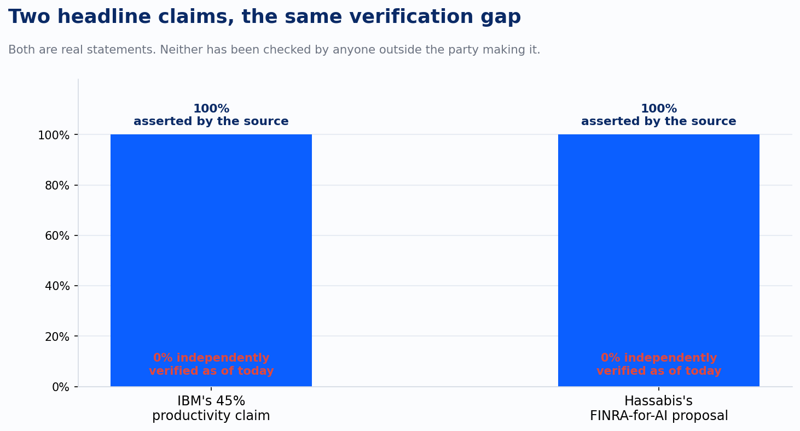
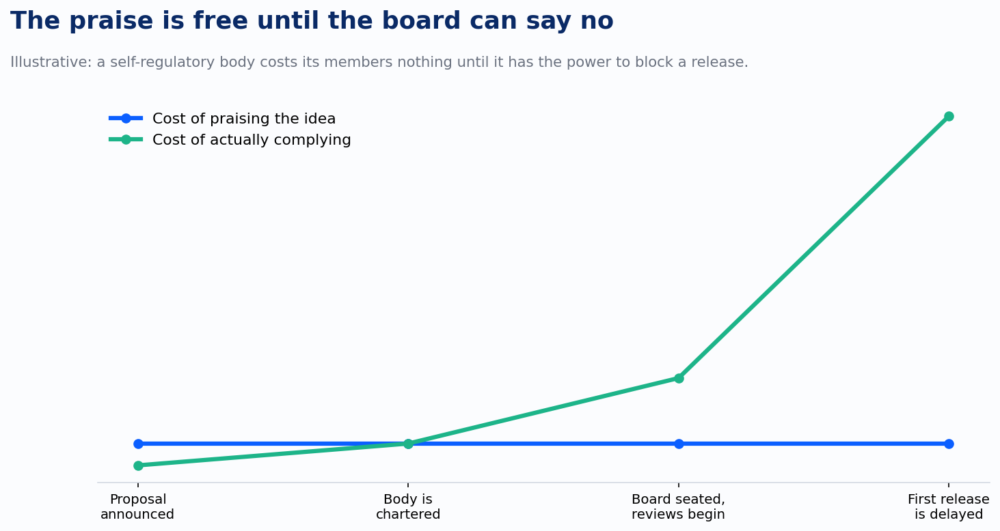

When IBM says its new coding tool lifted developer productivity 45 percent, run that number through the same test you'd run a benchmark slide through. Who checked it. Under what conditions. Compared to what baseline. If the answer is "nobody, IBM measured IBM," treat it as a hypothesis, not a fact, exactly the way you'd treat an unaudited SWE-bench score.

That's the easy case. IBM formalized an Agent Development Lifecycle around Claude last October, embedding the model into a multi-model IDE and reporting an average 45 percent productivity gain across more than 6,000 internal adopters. The tool is still in private preview. The adopters are IBM employees using an IBM product inside IBM's own workflow. Nobody outside the company has reproduced the number, defined what "productivity" was measured against, or ruled out the plainest explanation: early adopters of a new internal tool tend to be the people most motivated to make it look good.

None of that means the 45 percent is wrong. It means it's unverified, and those are different claims. I've watched Improving run both kinds of process on our own SOC 2 program: continuous internal monitoring we do ourselves, and a separate annual audit an outside firm, RSM, runs against us. The internal number tells you something. The external one is the number a client can actually rely on, because someone with no stake in the answer went and checked. IBM's 45 percent has only had the first kind of process run against it so far.

The second case is stranger, because it isn't a performance claim at all. In July, DeepMind's Demis Hassabis proposed a "FINRA for frontier AI": an independent, industry-funded body that would review models up to 30 days before release for cyber, bio, and deception risk, starting on a voluntary basis with a majority-independent board that includes Turing Award winners. The reaction was almost uniformly positive. Sam Altman called it thoughtful. Elon Musk called it a thoughtful framework and a good starting point. David Sacks, who has spent his time in AI policy pushing back against direct government regulation, said the idea had real merit. The Trump administration is reportedly developing something close to it, with Treasury Secretary Scott Bessent involved and the proposal under review by the White House chief of staff.

That is a remarkable amount of agreement for an idea this consequential, and the agreement itself is the tell. Every one of those endorsements costs its speaker nothing today. There is no board yet. No funding commitment. No model that has actually been delayed or blocked because a review body said the cyber risk wasn't acceptable. Praising a self-regulatory structure before it exists is the safest position in the industry: you get credit for taking safety seriously, and you have agreed to precisely zero binding constraints on your own release schedule.

This is the same instinct as IBM's 45 percent, wearing a different costume. A number a company reports about itself and a proposal that competitors praise before it has teeth are both statements that face no real cost if they turn out to be wrong. The productivity claim has selection bias standing in for peer review. The safety proposal has unanimous applause standing in for a track record. Neither has been tested against the thing that would actually validate it: an outsider with something to lose from getting the answer wrong.

The real FINRA, the one that regulates broker-dealers, is worth the comparison precisely because it took decades to earn its bite. It exists because Congress backed it with statutory authority, and because it has spent that authority barring individual brokers and fining firms, not because the finance industry once agreed the idea sounded reasonable. A self-regulatory body is exactly as strong as the first time it costs a member something to comply. Right now, an AI standards body modeled on FINRA has cost its most enthusiastic supporters nothing, because it doesn't exist yet in any form that could say no to a release date. The test isn't the week of praise. It's the first time the board is seated, a lab has a launch scheduled, and the review comes back asking for a delay the lab didn't want to give.

I don't think either of these claims is dishonest. IBM plausibly built something that helps its own developers, and Hassabis plausibly designed a proposal serious enough that people who disagree on almost everything else in AI policy are willing to say a kind word about it. But plausible and verified aren't the same status, and the industry has a habit of letting the first one borrow the credibility of the second. A vendor's number about its own product deserves the same posture as a lab's number about a benchmark: real until someone checks it, then either confirmed or revised. A near-unanimous endorsement of a governance proposal deserves the same posture as the proposal itself: encouraging, and still unproven, until the body it describes has actually said no to something a lab wanted.

The 45 percent might hold up under an outside audit with a control group and a defined baseline. The FINRA-for-AI proposal might survive its first real test: a launch date a lab actually wanted, delayed by a board with the standing to enforce that delay. Neither test has run yet. Until one does, a vendor's number about its own product and a week of unanimous industry praise carry the same weight: real statements, made by parties with every incentive to be right, and no cost yet if they aren't.
