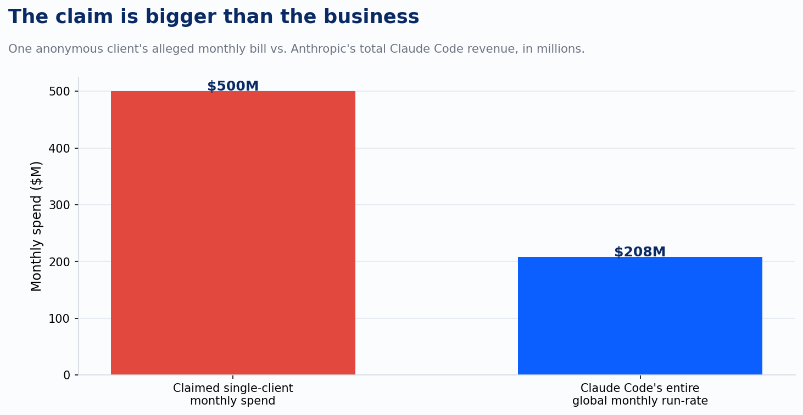
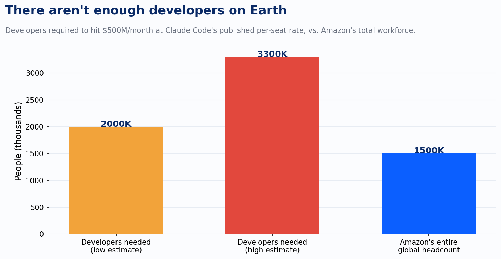

*This piece originally ran as a shorter post on my LinkedIn on May 29, 2026. I'm moving it to the blog, with a couple of added charts.*

I saw the headline, read the article, and couldn't believe it. So I did the math. I still couldn't believe it.

The story: an unnamed "AI consultant" told a reporter that an unnamed client burned $500 million on Claude in a single month, because nobody capped employee usage. Every outlet ran with it. It has the shape of a perfect cautionary tale, the kind that makes a CFO's blood run cold and gets forwarded to every VP with "AI" in their title.

It also doesn't survive five minutes of arithmetic.

Spending $500 million in 30 days means moving $193 every second, without pause, for the entire month. To do that on tokens alone, even at the most expensive output rates on the market, a company would need to generate somewhere between 7.7 and 38.6 million tokens every second, day and night, for 30 straight days. That's 20 to 100 trillion tokens. Put in human terms, it's the output of roughly 14 million people typing nonstop, or finishing a full coding session every fraction of a second, for a month straight.

No client did that. No client's infrastructure could route that.

Run it through the vendor's own published pricing instead of the token math, and the story gets worse for the headline. Anthropic lists Claude Code at $150 to $250 per developer per month. Hitting $500 million at that rate takes 2 to 3.3 million developer seats.

Even if you assume every one of those seats belonged to the heaviest 10% of all users, you'd still need around 800,000 power users inside a single company. Amazon employs about 1.5 million people total, across every function, most of whom never write a line of code. There is no organization on Earth with two to three million developers on staff, let alone two to three million all pointed at one AI vendor.

That comparison alone should end it, but there's a cleaner one. Claude Code's reported run-rate is about $2.5 billion a year, roughly $208 million a month, across every customer on the planet. The story asks us to believe one anonymous client, in one month, outspent the entire global Claude Code business by more than two to one, and stayed anonymous while doing it.

Set aside whether the story is even physically plausible for a moment, and ask whether Anthropic's infrastructure could absorb a demand spike like that without every engineer at the company noticing. It couldn't, and they would have.

This is a fake story sitting on top of a real problem.

The anxiety underneath the headline is legitimate. AI spend does scale quietly, and it does compound fast. Token cost is one of the most under-instrumented lines in the technology budget right now, and most teams have exactly one lever: point a single large model at everything and hope the invoice stays reasonable. That's not a controls failure that requires a $500 million fable to justify fixing. It's a controls failure that shows up at $50,000, and then $500,000, and nobody notices until finance asks a question nobody can answer.

The fix isn't a cap on a dashboard somewhere. It's measurement built in from the start: which workflows are actually consuming tokens, which of those workflows need frontier-model reasoning versus a smaller model that's ten times cheaper and just as accurate for that task, and which requests should never have reached a model at all. You can't control spend you haven't instrumented. You can't defend a model choice you haven't tested against the alternative. Cheaper only counts once you can prove it still performs.

A viral number is easier to share than a query against your own token logs. It's also less useful. The real $500 million story isn't about one client's runaway bill. It's about how many companies are one unexamined workflow away from a bill they can't explain, and how few of them would catch it before the invoice did.
