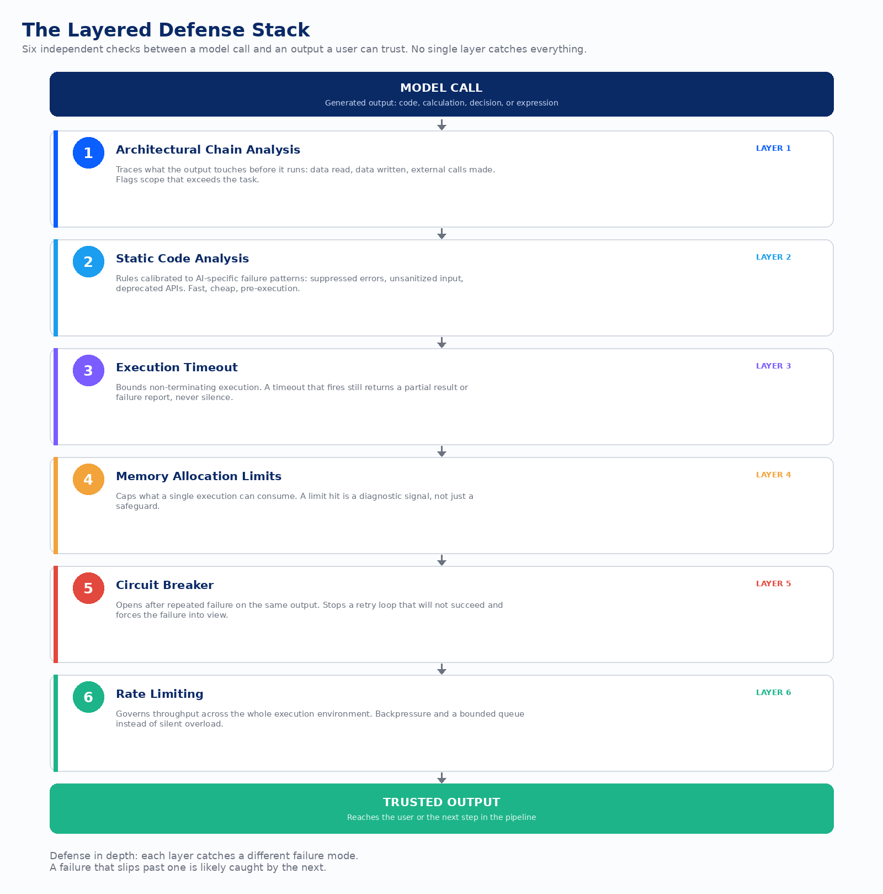
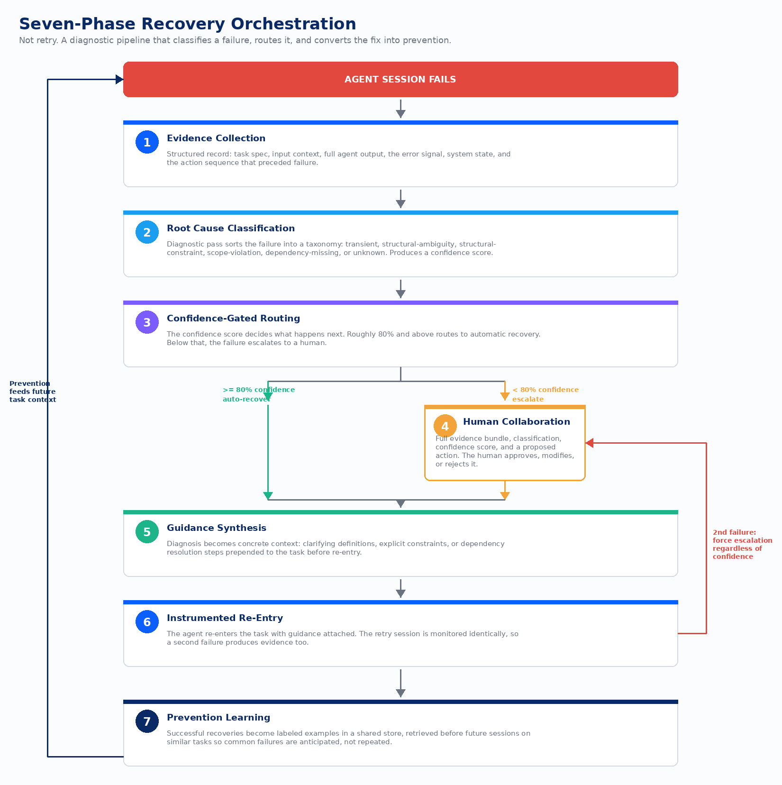
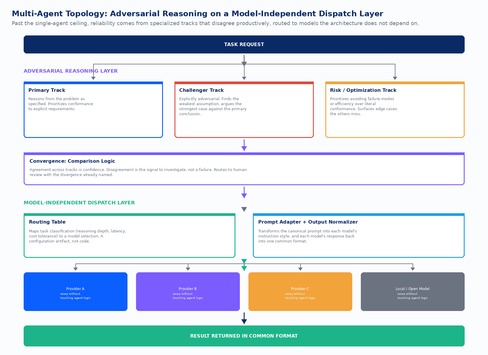

Take a ten-step autonomous agent pipeline. Give every step a 95% accuracy rate, which is a number most teams would be happy to report to leadership. Multiply it out: 0.95 to the tenth power is about 0.60. Six times out of ten, the whole pipeline completes correctly. Four times out of ten, it does not.

Nobody built anything wrong to get that number. Each step is doing exactly what it was measured to do. The failure is arithmetic, not incompetence. Robert Lusser worked this out formally in the 1940s while diagnosing why German rockets with thousands of individually reliable parts still failed constantly: the reliability of a chain is the product of the reliability of its links. Multiply enough numbers just under one together and you get a number well under one, no matter how good each individual number looked in isolation.

This is the fact that should end the debate about whether autonomous agents are “ready.” They are ready in exactly the sense that a rocket built from reliable parts is ready: not automatically, and not by getting a bigger model. Reliability at the system level has to be engineered in, the same way it was engineered into rockets, into aircraft, into distributed databases, into every other domain that had to get dependable outcomes out of imperfect components. What follows is the architecture for doing that with AI agents, walked as a stack: the defenses between one model call and a trusted output, what happens when one of those defenses fails, the mechanism that keeps quality gates from sliding backward, and the reason a single agent cannot hold the whole system no matter how good it gets.

## The Problem Is Not the Model, It’s the Chain

The instinct when a pipeline underperforms is to blame the model. Swap in a better one, tune the prompt, add a few examples. That instinct is answering the wrong question. A single 95%-accurate step is fine. [Stack twenty of them](https://www.devlinliles.com/stacking-errors-the-hidden-math-that-makes-governance-non-optional/) and you are down to 36% end-to-end reliability, a little better than one in three. The problem was never the step. It was treating a chain like a single measurement.

John von Neumann saw the same shape in 1956, from the other direction. He was not diagnosing failure, he was designing around it, asking how you build a reliable computer out of components that individually break. His answer was redundancy and checking: don’t trust one path, verify, and structure the system so a single failure gets caught rather than propagated. Every mechanism in this piece descends from that answer.

The practical framing that follows from the math is a design principle, not a warning label: prefer short, well-bounded pipelines with a quality gate at every transition over long pipelines that try to minimize human touchpoints. A twenty-step pipeline that runs end to end with no checks looks the most autonomous and is the least reliable. A five-step pipeline with a real gate at each handoff, run four times in sequence to cover the same twenty steps of work, delivers the same total output at a fraction of the failure rate. The pipelines that look most impressive on a slide are often the ones nobody should trust.

Two objections come up whenever I walk through this math, and both deserve a straight answer rather than a dismissal. The first is that pipeline steps do not fail independently in the real world, a bad input often fails at several steps at once, and a well-built step can absorb an upstream mistake. That is true, and it does not save the argument. The independence assumption is a simplification, and what survives simplification is the shape of the curve: reliability decays as chains get longer, whether the exponent is exact or approximate. Nobody who has run a long pipeline in production disputes the decay, they just argue about the slope.

The second objection is that self-correction dissolves the problem: have the agent check its own work, or have a second model verify the first, and you don’t need external governance. I don’t disagree with this one, I just think it’s already the argument. A verifier model is a quality gate. A self-consistency check is a confidence threshold. Governance was never a proposal for committees and sign-off meetings bolted onto an agent pipeline. It’s checking machinery between steps, and it does not matter whether the checker is a rule, a model, or a person, only that something with different failure modes than the step itself sits at every transition.

## The Six Layers Between a Model Call and an Output You Can Trust

Start at the smallest unit: a single model call that produces something that will execute, whether that’s code, a calculation, or a decision. The output can be syntactically perfect and still be dangerous, because the properties that matter (does it terminate, does it stay in scope, does it consume a sane amount of memory) are properties of execution, not of the text the model produced. You cannot catch them by reading the output more carefully. You catch them by putting checks in the execution path itself.

The first layer is architectural chain analysis, run before anything executes. It traces what the generated output actually touches: what data it reads, what it writes, what external calls it makes, and compares that against what the task was supposed to need. An output that reaches for a database table or an API nobody expected gets flagged before it runs, not diagnosed afterward.

The second layer is static analysis calibrated specifically to how AI-generated code fails, which is measurably different from how human-written code fails. Models suppress errors more readily, skip input sanitization more often when their training data skipped it, and reach for deprecated patterns that were common when the training corpus was assembled. A lint configuration tuned for these specific tendencies catches more than a generic one, and it’s cheap enough to run on everything.

The third and fourth layers are timeout and memory limits, and they exist for the same reason: an agent has no idea at generation time how large a file will be or whether a recursive function it wrote will terminate. The execution environment knows. A timeout that fires should produce a partial result or a failure report, never silence, because silence is what makes a failure expensive to diagnose later.

The fifth layer is the circuit breaker, borrowed directly from Michael Nygard’s work on distributed systems. One failure is a data point. The same generated output failing repeatedly is a pattern, and retrying it again is not troubleshooting, it’s wasting compute on something that has already told you it won’t succeed. The breaker opens, execution attempts stop, and the failure history gets logged as something that needs a human, not something that needs another attempt.

The sixth layer is rate limiting across the whole environment, which matters once you have more than one agent generating executable output concurrently. Without it, a burst of generation activity becomes a burst of execution requests that can exhaust connection pools or blow through a budget. Backpressure, a bounded queue, and an explicit capacity response when the queue is full: unglamorous, and it is what keeps a cost-sensitive system from finding out about its limits at the worst possible time.

None of these six layers depends on the others. That is the design property that matters. A failure that slips past the chain analysis is likely to get caught by static analysis. A failure that slips past both will hit a timeout or a memory ceiling. Defense in depth is not a slogan here, it’s the mechanism: each layer has a different blind spot, and stacking them means the blind spots mostly don’t line up.

## When a Layer Fails: Recovery, Not Retry

Every one of those six layers will eventually catch something. The question is what happens next, and the honest answer for most teams early on is “retry and hope.” That works for a specific, narrow category of failure and fails silently for everything else.

Jim Gray drew the relevant distinction back in 1985, studying why computers stop: Heisenbugs are transient faults that vanish when you retry them, and Bohrbugs are deterministic faults that reproduce every time. A network hiccup is a Heisenbug. An ambiguous task specification, a constraint the agent was never told about, a dependency the task assumed but didn’t state: these are Bohrbugs. Retry a Bohrbug and you get the same wrong answer, or a different wrong answer, either way without touching the actual cause.

At low agent counts, a developer can eyeball each failure and sort it into the right bucket. That stops being practical anywhere past ten or so parallel agents running with only periodic human attention, which is where the volume of failures outpaces what a person can triage by hand. What replaces manual triage is a seven-phase recovery pipeline, not because seven is a magic number but because that’s how many distinct concerns the process actually has.

**Evidence collection** comes first, and it’s the phase teams underinvest in because early on, failures are rare enough that someone can just go read the logs. The bundle needs the task spec, the input context, the full output, the error signal, system state, and the sequence of actions that led to the failure. This is what separates recovery from retry: retry resends the same input, recovery uses the evidence to understand why that input produced a failure.

**Root cause classification** takes that evidence and sorts it into a defined taxonomy: transient, structural-ambiguity, structural-constraint, scope-violation, dependency-missing, or unknown, each with a confidence score attached. Using a model to diagnose a model’s own failure sounds circular until you notice the diagnostic model isn’t continuing the original task, it’s answering one narrow question about classification, which is a different job with different failure modes.

**Confidence-gated routing** is where that score earns its keep. High confidence routes to automatic recovery. Low confidence escalates to a person. Eighty percent is a reasonable starting threshold, tuned per task type based on what a wrong automatic recovery actually costs you in that context.

**Human collaboration**, when it triggers, should never be a bare alert. “Agent 7 failed on task 42” tells a developer nothing. The full evidence bundle, the classification, the confidence score, and a proposed recovery path turn a human review from an investigation into a decision: approve, modify, or reject. The system has done the diagnostic work; the human is spending judgment, not time.

**Guidance synthesis** translates whatever was learned, whether from the automatic path or the human one, into structured additions to the task context: explicit constraints, clarifying definitions, dependency resolution steps. This is more precise than rewording a prompt, because it’s targeted at the specific cause rather than a general hope that clearer language helps.

**Instrumented re-entry** sends the agent back in with that guidance attached, monitored exactly as the original attempt was. If the retry fails too, it produces the same quality of evidence, which matters because a task that fails twice is itself a signal: two failed attempts, even with different guidance, means escalate regardless of what the confidence score says. The automated path has had its shot.

**Prevention learning** is the phase that makes the other six cheaper over time. A successful recovery becomes a labeled example: this failure type, this resolution. When a new session starts on a task that resembles a past failure, that history surfaces before the agent even begins, converting a recovery into a constraint that heads off the same failure next time. The pipeline is most expensive when the project is new and the store is empty, and it gets cheaper every time it runs.

A seven-phase pipeline is real infrastructure, and building it for two or three agents with a developer watching the whole time is over-engineering. The case for it gets compelling around ten or more parallel agents, particularly once humans are only checking in periodically. Below that line, manual triage is the right answer. Above it, the pipeline is what converts triage time into routing time, and it’s the only thing that produces a usable record of failure patterns instead of a pile of one-off incidents nobody has time to learn from.

## The Ratchet: Keeping Quality Gates From Sliding Backward

Recovery handles the failures you catch. There’s a second category of degradation that doesn’t announce itself as a failure at all: test coverage drifting down two points a sprint, lint warnings piling up in files that were clean a month ago, type errors reappearing in modules nobody remembers touching. No single merge causes a visible regression. The decline is the sum of many small ones, and it moves faster with AI agents in the loop, because what a human team might accumulate over a quarter, a team running parallel agents can accumulate in two weeks.

The fix is mechanical rather than cultural, which is the point. Quality metrics get stored in a checked-in file that records the current floor for each one: branch coverage, lint violation count, type errors, import boundary violations, whatever the team has decided to track. The file updates when a merge improves on the floor. It never updates downward. Before every merge, the pipeline measures the incoming change against that floor, and anything that would drop a metric below its recorded value gets blocked, with a report showing exactly what regressed and by how much.

The name is literal. A ratchet is a gear with a pawl that allows rotation in one direction and locks against the other. Quality can climb. It cannot slip back, not because a reviewer remembered to check, not because of a team norm about coverage that depends on people remembering, but because the floor is enforced automatically on every single merge, with zero per-PR configuration required.

Setting the initial floor is simpler than it sounds: measure where the codebase actually is today, use that as the starting floor, and let improvements accumulate from there. This means the ratchet doesn’t require any pre-existing discipline. It only requires that things not get worse from wherever you’re starting, which is a bar every codebase can clear on day one. Codebases with legitimately uneven quality expectations, legacy code nobody’s testing, generated files excluded from coverage, can carry per-directory floors instead of one global number.

There’s a companion move that runs earlier in the pipeline: checking structural constraints, import boundaries, dependency direction rules, before an agent session even starts, rather than catching the violation at merge time. If a task as specified would require crossing a boundary the architecture doesn’t permit, that’s cheaper to catch before a session burns compute on work that was never going to land.

The ratchet has real limits worth naming plainly. It works for anything you can measure and aggregate, and it has nothing to say about code clarity or architectural coherence, which still need a human. And Goodhart’s law applies without exception: once a measure becomes a target, it stops being a good measure. High coverage is not the same as good tests. A low lint count is not the same as readable code. The ratchet enforces the floor on whatever you choose to measure, which makes the choice of what to measure the actual decision, not a footnote to it.

## The Single-Agent Ceiling

All of this, [the six layers](https://www.devlinliles.com/execution-safety-architecture-for-ai-generated-outputs-a-layered-approach/), [the seven-phase recovery](https://www.devlinliles.com/structured-recovery-orchestration-for-ai-agents-beyond-retry/), [the ratchet](https://www.devlinliles.com/unidirectional-quality-gates-in-ai-assisted-development-the-ratchet-pattern/), addresses failures inside a pipeline. There’s [a separate ceiling](https://www.devlinliles.com/the-single-agent-ceiling-why-one-ai-cant-hold-your-whole-delivery-lifecycle/) that shows up regardless of how well any single step is instrumented, and it comes from asking one agent to hold every concern in a delivery lifecycle at once.

A single agent optimizes for a single objective. Prompt it to implement a feature and it’s optimizing for: does the code compile, does it satisfy the prompt, does it pass the tests it can see. That’s useful and it’s narrow, because software delivery isn’t one optimization problem, it’s a dozen overlapping ones that compete with each other. Performance competes with readability. Security competes with speed of implementation. A senior developer holds these tensions simultaneously, informed by experience. A single agent collapses them into whichever concern the prompt happened to emphasize, and the concerns that got collapsed away don’t disappear, they ship. The security vulnerability ships with the feature. The architectural boundary violation ships with it. Nobody catches it at generation time because the agent that wrote the code is not positioned to review it for what it wasn’t optimizing for.

This produces a specific, well-documented pattern: an explosive first quarter with AI coding tools, velocity spikes, output doubles, and then the curve flattens as quality issues compound and technical debt accelerates. Teams get fifteen to fifty percent more code output and do not get fifteen to fifty percent more delivered value, because the downstream cost of single-perspective code eats the gain in review cycles and rework.

Software teams solved the human version of this problem decades ago, by specializing roles rather than asking one person to be the developer, the QA engineer, the security auditor, and the architect. Fred Brooks made the case explicitly in 1975: his surgical team proposal staffed a chief programmer with specialists around them because no single person holds every concern at full attention. A security review looks different from a performance review because it’s optimizing for something different, not because the reviewer is smarter.

The strongest objection to treating this ceiling as permanent is that it’s temporary: models keep improving, context windows keep growing, and eventually a single agent should be able to hold every concern. I think this objection misreads what’s actually limiting. The ceiling is a correlation problem, not a capability problem. An agent reviewing its own output shares its own blind spots, and a wrong assumption made at generation time survives a self-review performed by the model that made the assumption in the first place. A bigger model is a smarter author. It is still one author, and organizations learned this lesson about single authorship long before AI existed.

## Past the Ceiling: The Brain as an Architecture Pattern

Breaking through the ceiling means distributing concerns across specialized agents instead of consolidating them into one, and the brain turns out to be [a genuinely useful source of design primitives](https://www.devlinliles.com/biological-coordination-patterns-applied-to-multi-agent-software-delivery/) here, not as a metaphor but as a set of coordination mechanisms shaped by an enormous amount of selection pressure on exactly this problem: how do you run many parallel processes without the coordination overhead eating the benefit of parallelism.

Four mechanisms translate directly. **Specialization as interface definition**: an implementation agent, a review agent, and a security agent aren’t just differentiated by task assignment, they’re differentiated by the artifacts they produce and consume, with defined interfaces between them. Agents don’t need to understand each other’s internal reasoning, only the shape of what crosses the boundary. **Inhibition as conflict prevention**: an agent actively working a module suppresses other agents from starting conflicting work in that scope, which is a broader idea than file locking, because it prevents two individually-correct changes from producing an incorrect combination. **Checkpoint synchronization**: rather than agents coordinating after every change or running fully independently until integration, defined sync points at major transitions (after requirements, after a batch of implementation, after review, before merge) bound how much uncoordinated work can pile up before conflicts get resolved while they’re still small. **Convergence as a distinct phase**: the step, often skipped, that reviews the combination of all specialized outputs for system-level coherence, because a security review and an architecture review can each pass independently while their combination produces a failure neither one would catch alone.

The objection that biological metaphors in computing have a bad track record is fair and beside the point here. Each of these four mechanisms stands on its own as a distributed-systems primitive regardless of where the idea came from: specialization is interface design, inhibition is a generalization of locking, checkpoint synchronization is a barrier, convergence is integration review with system-wide scope. The brain was a search heuristic that pointed at good design targets. The engineering case for each one holds without it.

## Adversarial Reasoning: Making Disagreement the Detector

Specialization solves for agents that do different jobs. There’s a narrower and harder failure mode that specialization alone doesn’t catch: an agent that is internally consistent and wrong. It reasons correctly from a premise that happens to be the wrong premise, or it optimizes for a proxy that quietly diverges from the actual goal. A specification that says minimize memory usage becomes make the data structure as dense as possible, which trades away correctness for compactness nobody asked for. The output compiles, passes the tests it wrote for itself, and reads fine in review, because none of those checks were built to catch a well-reasoned answer to the wrong question.

The detection mechanism for this specific failure is [adversarial reasoning](https://www.devlinliles.com/adversarial-reasoning-architecture-a-multi-track-approach-to-ai-agent-reliability/): run multiple independent reasoning paths against the same prompt, each taking a genuinely different approach, and treat disagreement between them as the signal worth investigating. This has precedent outside AI. Avionics systems run critical decisions through independent logic channels and compare results, treating any disagreement as a failure indicator to resolve before proceeding, not as noise to average away.

A primary track reasons from the problem as specified, prioritizing conformance to the explicit requirement. A challenger track is deliberately adversarial: its job is to find the weakest assumption in the primary’s reasoning and build the strongest case against its conclusion, not to produce a better answer of its own. This has a real institutional precedent: the Catholic Church formalized the advocatus diaboli centuries ago as the official role in canonization proceedings whose entire job was arguing against the candidate. A third track can approach the same problem from pure risk, prioritizing avoidance of failure modes over literal conformance to the spec, which tends to surface the edge cases the other two miss because it’s looking for exactly that.

Agreement across all three tracks is strong evidence the specification is clear and the implementation is sound. Disagreement is not a failure, it’s data about where the requirements are ambiguous or where optimization criteria are quietly in conflict. In practice, the most useful disagreement is between the conformance-first track and the risk-first track, because that divergence usually means the specification as written introduces a failure mode nobody anticipated when they wrote it. That is worth catching before merge, not after.

This costs real compute, roughly three times a single pass for three full tracks, and the honest answer is that it should not run on everything. Route it by consequence: architectural decisions, security-sensitive code, ambiguous specifications, and task types that have already produced a failure once. Run it less as specifications lock and confidence in the approach builds. The three tracks also don’t require three separate models, a single model guided through different prompting toward different reasoning postures produces genuinely independent paths, provided the prompting is calibrated so the challenger produces real objections instead of either trivial ones or reflexive agreement with the primary.

The role of human review changes under this architecture rather than disappearing. Instead of reading an implementation cold and deciding whether it’s correct, a reviewer is handed three approaches and the specific dimension where they diverge, and is answering a narrower question: does this particular disagreement matter. That is a lower cognitive load than reviewing without knowing what to look for, and it’s a better use of the reviewer’s judgment than asking them to find a problem nobody has told them might exist.

## The Dispatcher: Decoupling the Architecture From Any One Model

Everything above, the layers, the recovery pipeline, the ratchet, the specialized agents, the adversarial tracks, gets built against specific models. That coupling is a liability on a timeline most teams don’t plan for, because model providers update APIs, release new versions, deprecate old ones, and have availability incidents on a cadence of months, while the agent logic built on top of them tends to change much more slowly.

David Parnas named the general principle in 1972: isolate the decisions most likely to change behind an interface that doesn’t change with them. Most production systems already draw this line between application logic and the database it talks to, precisely because the database host changes more often than the logic does, and nobody wants that coupling. Model selection has the identical shape, just compressed onto a faster clock.

Coupling to a specific model shows up in predictable places: model names as string constants scattered through the codebase, prompts tuned to one model’s instruction style that degrade on another, response parsing calibrated to one model’s output format that fails silently on a different one, retry logic built around one provider’s specific error responses. Every one of these is a migration cost that materializes the moment the model changes, and [the dispatcher pattern’s](https://www.devlinliles.com/decoupling-ai-agent-logic-from-model-providers-the-dispatcher-pattern/) entire job is moving all of them out of agent logic and into a dedicated layer where they can be managed independently.

The routing layer takes a task classification, reasoning depth required, context size, latency sensitivity, cost tolerance, and maps it to a model selection through a routing table that’s configuration, not code. Moving a task type to a different model becomes a table update instead of a deployment. A prompt adapter sits underneath, translating a canonical internal prompt format into whatever instruction style each specific model responds to, so agent code never has to know or care which model is about to receive its prompt. Output normalization does the same work in reverse, converting each model’s particular response shape back into one common structure the rest of the system expects.

None of this implies models are interchangeable, and that’s the misunderstanding worth heading off directly. The routing table explicitly encodes which model is good at which task type and at what cost, updated continuously as evaluation data accumulates. A fast, cheap model handles simple classification because it performs well there, not because anyone assumes it’s equivalent to a larger one. The dispatcher makes that judgment a visible, reversible configuration decision instead of an assumption buried in code.

The operational payoff shows up the first time a provider degrades. Elevated latency, a spike in error rates, brief unavailability: without a dispatcher, the options are accept degraded service or push an emergency code change under pressure. With one, it’s a routing table update, made calmly, reversed just as easily once the provider recovers. For a team running more than one model, or operating in an environment where model updates arrive often, the dispatcher tends to pay for itself by the first or second model transition it absorbs without a scramble.

## The Argument, Restated

The math at the top of this piece is the whole case in miniature. A chain of steps, each individually reliable, is not automatically reliable end to end, and no amount of hoping or model upgrading changes that fact, because it’s arithmetic, not a limitation of any particular model generation. What changes it is architecture: six independent layers standing between a model call and an output worth trusting, a seven-phase pipeline that turns a caught failure into a diagnosed and prevented one instead of a retried and repeated one, a ratchet that makes quality monotonic instead of hoping nobody notices the slow decline, specialized agents replacing the single generalist that was quietly collapsing a dozen competing concerns into one, adversarial tracks that turn disagreement into the signal instead of averaging it away, and a dispatch layer that keeps the whole structure from being hostage to whichever model happens to be state of the art this quarter.

None of these pieces is exotic. Timeouts and memory limits are an afternoon of configuration. A ratchet file is a few hundred lines and a CI check. The dispatcher pays for itself by the second model transition. What’s exotic is treating reliability as something a bigger model eventually delivers on its own, rather than something built the way every other engineering discipline has always built it: layer by layer, gate by gate, with the expectation that any individual piece can fail and the system should survive that failure anyway.

Governance, in this framing, was never overhead standing between an organization and its autonomous agents. It’s [the engine of trust](https://www.devlinliles.com/governance-is-not-overhead-it-is-the-engine-of-trust/) that makes the autonomy usable at all. Double-entry bookkeeping did not slow down Venetian trade in 1494, it created the auditability that let merchants extend credit across oceans to people they had never met. The control was the growth mechanism, not a tax on it. The same logic runs through every layer in this piece. An organization that has built the checks can extend more autonomy to its agents with more confidence than one that hasn’t, for the same reason a company with strong financial controls can extend more spending authority than one without them: not because failure becomes impossible, but because failure becomes visible, contained, and recoverable when it happens. That is the entire trade, and it is a good one.

---

**Sources:** [Six Layers Between Your AI and a Wrong Answer](https://www.devlinliles.com/execution-safety-architecture-for-ai-generated-outputs-a-layered-approach/); [Seven Phases of Failure: Recovery Orchestration for AI Agents](https://www.devlinliles.com/structured-recovery-orchestration-for-ai-agents-beyond-retry/); [The Ratchet: Quality Gates That Only Move Forward](https://www.devlinliles.com/unidirectional-quality-gates-in-ai-assisted-development-the-ratchet-pattern/); [Adversarial Reasoning Architecture: A Multi-Track Approach to AI Agent Reliability](https://www.devlinliles.com/adversarial-reasoning-architecture-a-multi-track-approach-to-ai-agent-reliability/) / [Left Brain Right Brain Synthesis](https://www.devlinliles.com/adversarial-reasoning-architecture-a-multi-track-approach-to-ai-agent-reliability/); [The Single-Agent Ceiling](https://www.devlinliles.com/the-single-agent-ceiling-why-one-ai-cant-hold-your-whole-delivery-lifecycle/); [The Brain as an Architecture Pattern for Multi-Agent SDLC](https://www.devlinliles.com/biological-coordination-patterns-applied-to-multi-agent-software-delivery/); [Model Independence: The Dispatcher Pattern](https://www.devlinliles.com/decoupling-ai-agent-logic-from-model-providers-the-dispatcher-pattern/); [Stacking Errors: The Compounding Math Behind AI Governance (T29)](https://www.devlinliles.com/stacking-errors-the-hidden-math-that-makes-governance-non-optional/); [Governance Is Not Overhead. It Is the Engine of Trust. (T38)](https://www.devlinliles.com/governance-is-not-overhead-it-is-the-engine-of-trust/)
