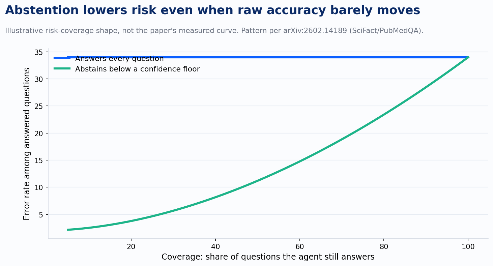
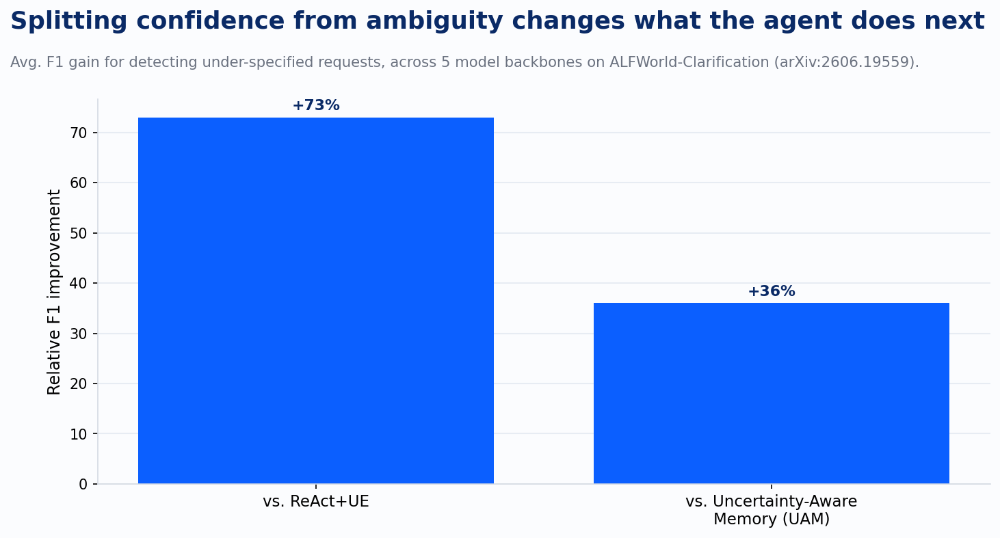

Ask most agent frameworks how they decide when to hand a task to a human, and the answer is a threshold on a single number. The model reports a confidence score, something crosses 0.7 or fails to cross it, and the system either proceeds or escalates. That number is standing in for three different questions the agent hasn't actually separated: is this decision hard, is the evidence missing, and is the request itself unclear. Three papers published this year go after that gap directly, and together they make a case I hadn't expected going in. A single scalar can't carry the information an escalation decision needs, no matter how well it's calibrated. Precision was never the problem.

Start with the plainest version of the problem. A paper out of Texas A&M and Hamad Bin Khalifa University, "Knowing When Not to Answer," tested language models verifying scientific claims against SciFact and PubMedQA, the kind of task where a confident wrong answer does more damage than an honest non-answer. The setup decomposes each claim into its minimal supporting conditions, checks each condition against the available evidence using natural language inference, and only then decides to support, refute, or abstain. Six models went through this: some encoder-decoder, some open-weight chat models, others proprietary APIs. Raw accuracy barely moved between them. What moved was the abstention behavior: confidence-based abstention cut risk substantially at moderate coverage, even in cases where the underlying model wasn't measurably more accurate than the others. That finding inverts the instinct most teams bring to this problem. The lever is the machinery that knows when the evidence in front of the model justifies an answer at all. Picking a smarter model was never where the leverage sat.

That's the shape worth sitting with. Answer every question and the error rate is fixed at whatever the model's raw accuracy allows. Let the system abstain on its least-supported answers first, and the error rate among what's left drops fast, well before much coverage is given up. The paper doesn't hand over a precise curve like the one above. The chart illustrates the pattern being described, using representative values instead of the paper's own measured data, and the direction it shows is still the finding: abstention is doing work that model selection isn't.

A second paper, out of a group spanning Wisconsin, Berkeley, and USC, asks why single-turn uncertainty methods break down once a model gets tools and a multi-step task. Their answer names four separate technical problems, and the first one is the one that matters most for anything running in production today. There are three families of uncertainty estimator: probability-based methods, which are free to compute but require access to the model's raw output probabilities; consistency-based methods, which sample the model several times and check agreement, at real latency and cost; and verbalized confidence, which simply asks the model to state a number. Verbalized confidence is the only one of the three with no theoretical grounding behind it, and it's also the only one that works against a black-box API with no logprob access and no budget for repeated sampling. Which means the confidence score most production agents actually report, the one behind that 0.7 threshold, is specifically the version the paper's own comparison table flags as unfounded. Teams didn't choose badly. The cheap, available option and the well-grounded option were never the same option, and most agent stacks built on commercial APIs never had the well-grounded one on the table to begin with.

The same paper names three more challenges worth knowing exist even without a fix in hand yet: uncertainty behaves differently depending on whether it's attached to an action, an observation, or the state of the environment the agent is operating in, and collapsing all of that into one number loses the distinction. Uncertainty also isn't static across a multi-step task, it evolves as the agent acts and observes, which single-turn methods were never built to track. And there's no fine-grained benchmark yet that isolates any of this cleanly enough to compare methods against each other with confidence. The paper names clinical decision support, software engineering agents, and embodied agents in physical systems as the three domains where getting this wrong costs the most, which is a fair description of where a lot of enterprise agent spend is actually going right now.

The third paper is the one that turns this from a diagnosis into something closer to an architecture. It starts from an argument a group of researchers made in an earlier position paper: the textbook split between aleatoric uncertainty, the kind that stays fixed no matter how much more evidence arrives, and epistemic uncertainty, the kind that shrinks as more evidence arrives, doesn't hold up cleanly for an interactive agent. Their own example is exactly the ambiguity: a chatbot deciding whether to ask a follow-up question has uncertainty that's aleatoric from one angle, irreducible in this exact moment, and epistemic from another, reducible the instant it asks. The category depends on what the agent does next, not on some fixed property of the situation.

The paper's fix is a decomposition simple enough to run as a prompt, not a retrained model: separate action confidence, how hard the current step is to execute, from request uncertainty, how well-specified the task itself actually is. Those two numbers call for opposite responses. Low action confidence on a clear task means proceed carefully. Low request uncertainty resolution, meaning the task itself is underspecified, means stop and ask. Collapse both into one confidence score and the agent will get the response backward roughly half the time, cautiously grinding through a task it should have paused on, or interrupting a user over a step that was merely hard rather than ambiguous.

They tested this against two existing prompt-based methods, ReAct with uncertainty estimation and Uncertainty-Aware Memory, on two new benchmarks built specifically to force the issue: WebShop-Clarification and ALFWorld-Clarification, each with half of its tasks deliberately underspecified. Averaged across five model backbones, from GPT-5.1 down to open-weight options like GLM-4.7 and GPT-OSS-120B, separating the two signals improved clarification detection by 73 percent over the ReAct baseline and 36 percent over the memory-based one. It won outright on every backbone on one benchmark and four of five on the other, which is close enough to universal to trust the mechanism, not close enough to call it solved everywhere.

None of these three papers describe a shipped capability. The abstention framework needs evidence decomposed into checkable conditions before it can decide anything. The uncertainty estimator problem has no fine-grained benchmark yet to even measure progress against. The clarification decomposition is prompt-only by necessity, because the practical constraints on production deployment, black-box APIs, latency budgets, no labeled trajectories to train against, rule out every method with a stronger theoretical foundation. That's a real limit, not a footnote. What all three converge on instead is a shared diagnosis: an agent that reports a single number and calls it confidence has already thrown away the information an escalation decision actually needs. Building that decision correctly means asking three separate questions before a task ever reaches a human queue: is there enough evidence to answer, is the difficulty in the execution or in the request, and does the reported number even have a theoretical claim to meaning. Right now, for most agents with tool access, the answer to that third question is no.

---

*Sources: Abdaljalil, Serpedin, and Kurban, "Knowing When Not to Answer: Abstention-Aware Scientific Reasoning" (arXiv:2602.14189). Oh, Park, Kim, et al., "Uncertainty Quantification in LLM Agents: Foundations, Emerging Challenges, and Opportunities" (arXiv:2602.05073). "Uncertainty Decomposition for Clarification Seeking in LLM Agents" (arXiv:2606.19559).*
