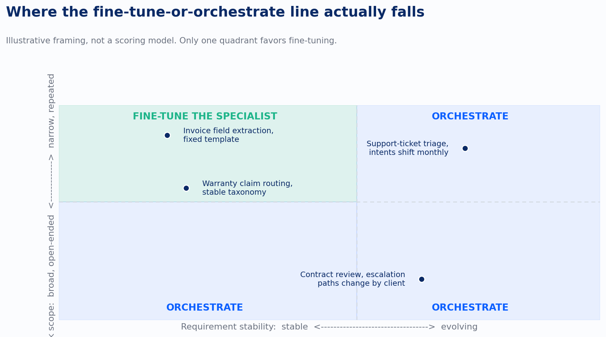
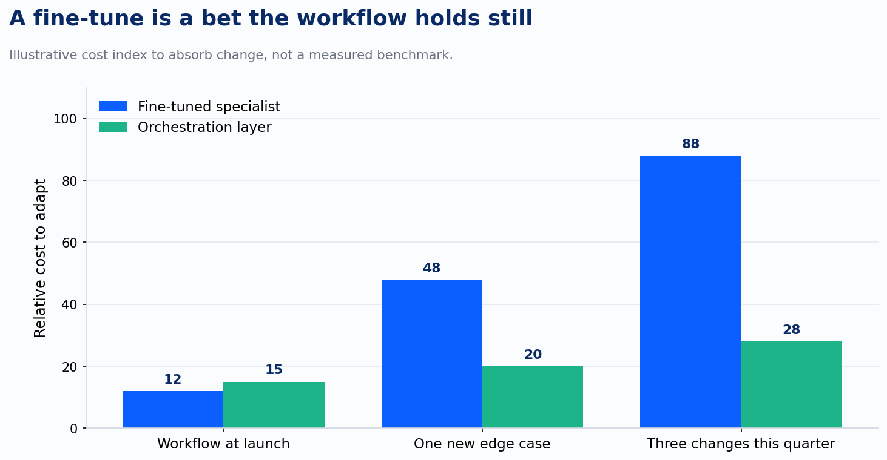

Pull up the last agent engagement I scoped and look for the sentence where I decided whether we were fine-tuning a model or building an orchestration layer around one. Most of the time that sentence isn't there. The decision got made anyway, by default, usually in favor of whichever approach the demo happened to use.

That's a bad way to land on an architecture decision, and I don't think I'm the only one making it that way.

A survey on agentic reasoning, twenty-nine names on the byline, published in January, gave me the vocabulary to see the mistake clearly. The paper organizes the entire field of AI agents around one governing split: post-training approaches, where reinforcement learning or supervised fine-tuning bakes a capability directly into a model's weights, against in-context reasoning, where the same capability gets assembled at runtime through prompts, tool calls, and a pipeline wrapped around a model that never gets retrained. The authors use that split to organize three layers of agent capability: foundational reasoning like planning, tool use, and search in a stable environment; self-evolving agents that refine themselves through feedback and memory; and multi-agent coordination. Every one of those layers can be built either way. The paper's real contribution, for my purposes, is naming that each layer is a choice, not a given.

The paper doesn't tell a consultant which one to pick for a client. That part is mine, built from watching the wrong call get made in both directions.

Here's the version I'd write down if I were scoping the same three engagements again. A workflow that is narrow and repeats the same shape call after call is a candidate for a fine-tuned specialist: invoice field extraction against a fixed template, warranty claims sorted against a taxonomy that hasn't changed in two years, an intake classifier for a well-defined set of categories. Train it once, and after that it runs cheap and fast, getting better at exactly the thing it will keep doing. A workflow whose requirements evolve, where the steps, the tools, or the edge cases shift every few weeks, is a case for an orchestration layer instead: a general model wrapped in prompts, tools, and routing logic that can be edited overnight. The world changes and the system gets reconfigured, not retrained.

The chart above is illustrative, not a scoring rubric, but the shape of it is the point. Narrow and stable is the only quadrant where fine-tuning wins outright. Move along either axis, broaden the task or let the requirements drift, and the math flips toward orchestration, even when the task still looks narrow on the org chart. A support-ticket triage agent is narrow in scope. It still belongs in the orchestration column the moment the intent taxonomy gets revised monthly, because a monthly revision means a monthly retrain, and paying for a monthly retrain is really paying for a subscription to model babysitting.

That's the part of the decision most engagements skip, and it's the expensive part. Fine-tuning looks cheap on the SOW because the number attached to it is a one-time training cost. That number is really a bet: that the workflow underneath the model holds still long enough for the training cost to pay for itself before the requirements move again.

I built the chart above off that logic, not off measured data, so the numbers are directional. A fine-tuned specialist really is the cheaper option on day one. What changes is the shape of the cost curve after launch. Absorbing a new edge case on a fine-tuned model usually means re-labeling data, re-running a training job, and re-validating the model before it touches production again, so each requirement change shows up as a jump in the curve. An orchestration layer absorbs the same change by editing a prompt, adding a tool, or adjusting a routing rule, which is why its curve stays close to flat. Three requirement changes into a quarter, the fine-tuned specialist has often spent more absorbing drift than it saved by being narrow in the first place.

None of this argues against fine-tuning. Where the workflow really is stable, a specialized model still beats a general one wrapped in machinery, on cost per call and often on accuracy, because it isn't spending tokens re-deriving a skill it already has baked in. The survey's self-evolving layer, where a system refines its capabilities through feedback and memory over time, sits on this same axis without settling it: the refinement can happen inside the weights through continued training, or inside the context through accumulated memory that never touches the weights at all. Either way, the tradeoff between narrow depth and cheap adaptability doesn't disappear. It just moves to wherever the refinement is happening. A fine-tuned model asked to handle something outside its training does what every narrow specialist does when it's out of its depth: it answers anyway, confidently, forcing the actual problem into the shape of its training data.

The harder admission is that this isn't a decision made once. A workflow that's stable at kickoff doesn't stay that way for the life of an engagement. Regulations change. A product line gets added. A client reorganizes a department and the escalation paths baked into the model's training data stop applying. The survey's own three-layer structure, moving from foundational capability to self-evolving to multi-agent coordination, is really a description of environments getting less stable as the systems built on top of them get more ambitious. The architecture call that was right at the start of an engagement is a call that needs revisiting every time the workflow's shape changes underneath it, not a box checked once in a kickoff deck.

What I keep coming back to is how rarely that revisit happens on purpose. Most teams notice a fine-tune has stopped fitting only after it's already failed in production, usually on the exact edge case that should have triggered a re-scope months earlier. The engagements that get this right treat the axis as a running question: which quadrant is this workflow sitting in today, and has anyone actually checked since it moved.

---

*Sources: Wei, Li, Liu, et al., "Agentic Reasoning for Large Language Models," arXiv:2601.12538 (submitted 18 Jan 2026).*
