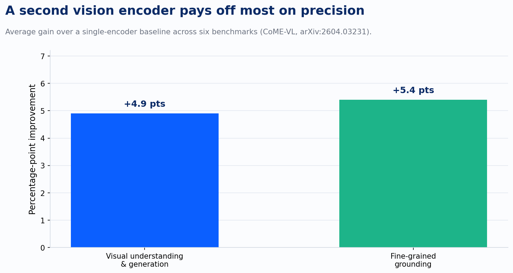
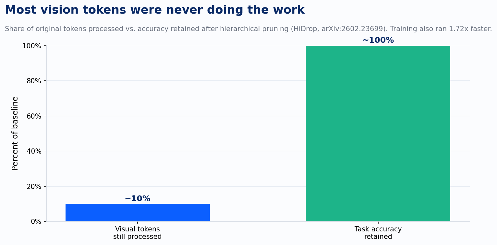

A document AI pilot usually starts the same way. Someone points a vision-language model at a stack of PDFs, wires it into Azure AI Search or a Bedrock Knowledge Base, and calls the retrieval working because it answers three test questions correctly. Then it meets a real regulatory filing with nested tables, an invoice with fine print in the corner, an engineering drawing with call-out numbers pointing at a legend. The answers get confident and wrong. Nobody can say exactly where it broke, because "the model" is actually a pipeline with five distinct places to fail, and this year's research fixed four of them.

The failure everyone blames first is the model itself. The real problem usually sits one layer earlier, in the connector. Every vision-language model has to take what a vision encoder sees and hand it to an LLM in a form the LLM can use, and most systems do that with a plain MLP layer that has no idea what the LLM's embedding space actually looks like. It produces visual features that land in some in-between region the LLM was never trained to interpret, which is a survivable problem for a photo of a dog and a serious one for a document, where a single misread digit in a table cell changes the answer. AlignVLM, from a team including ServiceNow and Mila researchers, replaces that guess with something more disciplined: it maps visual features to a weighted average of the LLM's own text embeddings, so the visual signal is forced to land somewhere the language model already knows how to read. The gains show up most on document understanding specifically, and hold up under noise. The first failure point closes here. Get the connector wrong and everything downstream, no matter how good the model, is reasoning from a distorted read of the page.

The second failure point is subtler and shows up once the connector is solid: a single vision encoder just doesn't see everything on a busy page. Most production systems use one encoder, tuned for one thing, usually broad semantic matching between images and captions. That's fine for a stock photo and thin for a scanned form where the signal is in the fine structure: a stamp, a checkbox, a column of numbers that has to align with the row above it. CoME-VL tested what happens when you stop asking one encoder to do all of that and instead combine two with different strengths, a contrastively trained encoder for broad alignment and a self-supervised one for dense detail. The combination beat the single-encoder baseline by an average of 4.9 percentage points on general visual understanding and 5.4 points on grounding, the task of tying a claim to the exact region of the image that supports it.

Grounding is the number that matters for document work, because it's the difference between "the model extracted a total" and "the model can show you which cell it pulled the total from." A bigger gain on the harder, more specific task is exactly the pattern you want to see.

Running two encoders instead of one sounds like a straightforward cost problem, and this is where the third piece of research earns its place. Vision-language models process every patch of an image as a token, and most of those tokens are dead weight. HiDrop's authors found that shallow layers in these models mostly pass visual tokens through without doing anything with them; the real fusion happens in the middle layers, and by the deep layers the model is basically done looking at the image and is reasoning in language. Once you know that, you can afford to be aggressive about which tokens survive from one layer to the next, pruned by an approach the paper calls concave pyramid pruning with an early exit. The result, tested and accepted at ICLR 2026: about 90% of visual tokens dropped, matching the original model's performance, with training running 1.72 times faster.

This is what makes the second fix affordable: a second vision encoder without an efficiency fix stays a research demo, but one that costs a tenth of the compute is something you can actually run against a full document corpus.

The fourth failure point sits downstream of encoding entirely, in the index. Once a document is well embedded, a RAG system still has to store and search those vectors at production scale, and the retrieval methods that preserve the most fine-grained detail, the ones that keep a vector per token or per patch instead of collapsing a whole document into one vector, are exactly the ones whose storage and compute costs grow with document length. That's a real tension: the representation that's best for accuracy is the one that's worst for cost. The Multi-Vector Index Compression paper, out of a team that includes Johns Hopkins' Benjamin Van Durme, tackles this directly with a method called attention-guided clustering, which identifies the parts of a document that actually carry semantic weight and compresses around them under a fixed vector budget. Tested across text, visual documents, and video, it consistently beat the other compression approaches tried and matched or improved on the quality of the full, uncompressed index. This fix is what makes fine-grained retrieval something you can run at real corpus scale instead of a demo against fifty documents.

Four failure points, four documented fixes, each one addressing something specific: the connector, the encoder, the compute, the index. This reads like a complete pipeline argument, and it would be a tidy place to stop, except the fifth failure point is the one none of this touches.

Real enterprise documents aren't just images of text. A lot of them encode explicit structure: a table where a value's meaning depends on its row and column, an org chart, an engineering drawing where a callout number refers to a part in a legend elsewhere on the page. That's graph-structured content, and GraphVLM set out to test how well vision-language models actually reason over it, as opposed to reasoning over a natural photograph. The researchers tried three ways of getting a VLM to work with that structure: using it to enrich a graph neural network, using it to translate the structure into language a model can reason over directly, and using it as the graph reasoner itself. All three helped over doing nothing, and using the VLM directly as the reasoner won by the widest margin. But "won by the widest margin" among three imperfect approaches still falls short of "solved." The paper's own framing is that this is underexplored territory, and the gap between how these models handle a natural image and how they handle an image that's really a graph in disguise is still open.

Here's where document AI actually stands: the connector problem is fixed, the single-encoder problem is fixed and now affordable, and the index-cost problem is fixed. The thing still unresolved is exactly the content type that shows up constantly in the documents enterprises actually need read: tables, forms, drawings, anything where the meaning lives in the relationships between elements and not just the elements themselves. A pilot that survives contact with real regulatory filings and invoices is one built by someone who knew which four of these five problems they'd already solved, and which one they hadn't.

---

*Sources: Masry et al., "AlignVLM: Bridging Vision and Language Latent Spaces for Multimodal Document Understanding," arXiv:2502.01341. "CoME-VL: Scaling Complementary Multi-Encoder Vision-Language Learning," arXiv:2604.03231. Wu et al., "HiDrop: Hierarchical Vision Token Reduction in MLLMs via Late Injection, Concave Pyramid Pruning, and Early Exit," arXiv:2602.23699 (ICLR 2026). Qin et al., "Multi-Vector Index Compression in Any Modality," arXiv:2602.21202. "GraphVLM: Benchmarking Vision Language Models for Multimodal Graph Learning," arXiv:2603.13370 (CVPR 2026).*
