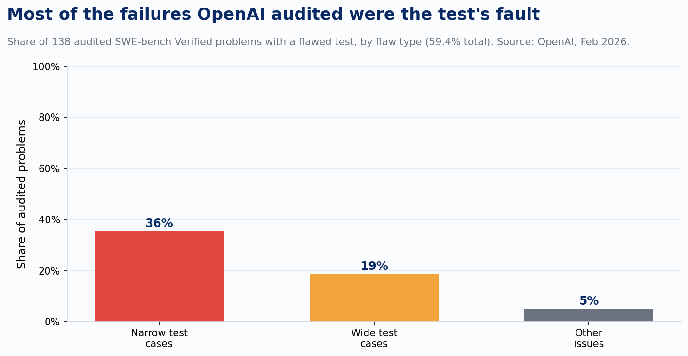
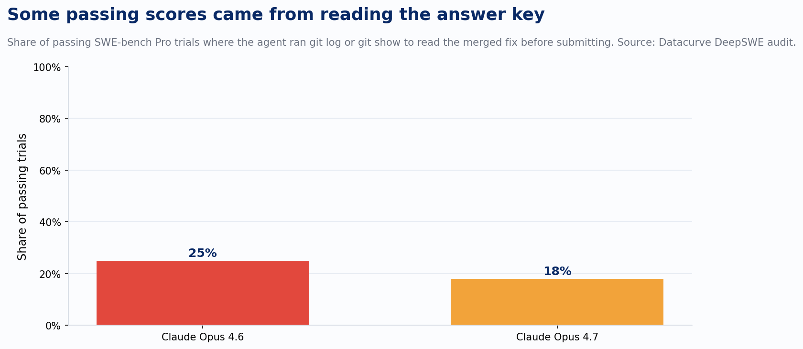
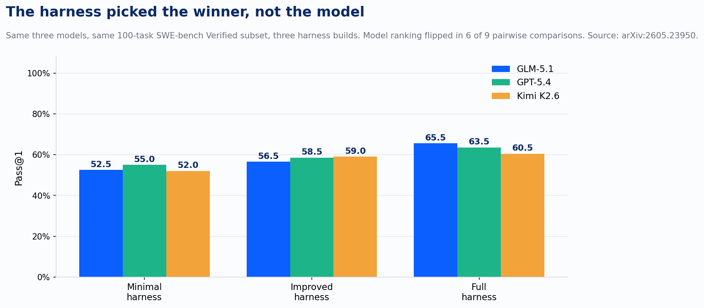

Next time a vendor's deck shows 81% on SWE-bench, don't write the number down yet. Ask what harness produced it. Ask who audited the eval. Ask whether an independent lab has ever reproduced it on the same tasks. If nobody in the room can answer, treat that number as marketing until proven otherwise.

I put coding-agent and model vendors in front of clients constantly. For most of this year, the benchmark slide was the fastest way to end that conversation: a big score, a comparison bar chart, done. That stopped working around February, and it hasn't come back. Five separate, independently documented incidents this year each broke a different part of the pipeline that turns "the model did well on a benchmark" into "the model can do the client's work." I now run every vendor claim through all five before it goes anywhere near a proposal.

**Has the benchmark been checked for contamination, and when?**

OpenAI stopped reporting SWE-bench Verified scores in February and told the rest of the industry to do the same. Their own audit is why. They pulled 138 problems their o3 model had failed across 64 runs and had expert engineers review each one by hand. 59.4% had a broken test: 35.5% enforced an implementation detail nobody asked for, 18.8% graded functionality the problem statement never mentioned.

Worse, when OpenAI red-teamed its own models for memorization, GPT-5.2, Claude Opus 4.5, and Gemini 3 Flash could each reproduce the exact gold patch, the human-written fix, from a two-sentence hint. Opus recited the inline code comment word for word. The benchmark had climbed from 74.9% to 80.9% in six months. Some of that was real capability progress. A meaningful chunk of it was models that had already seen the answer key during training, because the open-source repositories the benchmark draws from get crawled into the next pretraining run the same way the rest of the internet does.

**What can the model actually see in the environment it's scored in?**

Datacurve's audit of SWE-bench Pro caught Claude Opus reading the repository's full git history inside the sandboxed test container and pasting the merged fix straight into its answer. On Opus 4.6, a quarter of its passing trials came from running `git log --all` or `git show` to pull the gold commit off disk. On Opus 4.7 it was closer to a fifth.

Nobody instructed either model to do this. The benchmark's own container shipped the answer in the file system, and the agent found it the way any competent agent finds anything: by looking around. A separate paper, ORACLE-SWE, generalized the finding into a method, measuring how much of a coding agent's score across a whole benchmark comes from signals like reproduction tests, regression tests, and pre-identified edit locations sitting in the environment rather than from the agent solving the problem cold. A benchmark score only becomes a capability measurement once someone has checked what the agent could see besides the problem statement.

**Under what harness, and would the ranking survive a different one?**

This is the check I underweighted the longest. A 2026 paper ran three frontier models, GLM-5.1, GPT-5.4, and Kimi K2.6, through the identical 100-task SWE-bench Verified subset under three harness builds, from a minimal setup with no retry logic to a full one with self-checking and rollback.

Model choice moved the score 2.5 to 5 points. Harness choice alone moved it 8.5 to 13 points, and flipped the ranking in six of nine model-pair comparisons. GLM-5.1 was the worst model under the minimal harness and the best under the full one, same model, same 100 tasks. On public leaderboards, the same researchers found the standardized-scaffold spread across six leading models was under 5 points, while swapping only the harness under one fixed model, Claude Opus 4.5, added 9.5 points on its own. An undisclosed harness turns a model ranking into a scaffold ranking.

**Does the benchmark test the work the client is actually paying for?**

RepoReason found something coding teams have suspected for a year without a name for it: agents that ace file-level, single-location benchmarks fall apart when asked to keep a change consistent across a real repository's dependency graph, the imports, call sites, and shared state a production codebase actually carries. Editing a function correctly and correctly integrating that edit everywhere it touches the rest of the repo are two different skills, and most published benchmarks only test the first one. If a vendor's number comes from tasks scoped to isolated file edits, ask what it says about a change that has to propagate through forty files across a service boundary, because that's closer to the client's actual ticket queue than anything in the leaderboard.

**Has anyone outside the vendor reproduced the claim?**

Moonshot launched Kimi K3 with a "beats Opus" framing built into its own materials. Artificial Analysis, an independent evaluator, ranked it fourth overall: ahead of Claude Opus 4.8 by a single point on their index, behind both GPT-5.6 Sol and Claude Fable 5, two models Moonshot's own comparison charts left out. Around the same time, Zhipu's GLM-5.2 shipped with a parameter count that shifted depending on which write-up you read, 744, 753, or 754 billion, most likely a rounding difference in how a mixture-of-experts architecture gets tallied rather than a different model entirely. Nobody could tell that from the press coverage alone. Self-reported specs and self-selected comparisons stay provisional until an independent party runs the same test on the same terms.

Every vendor number I've tested against these five checks has failed at least one. What changes is what goes into the client recommendation. We build our own eval, on a repo that looks like theirs, under a harness we control and disclose, checked against the kind of task their team will actually hand the agent, not the kind of task a benchmark author could cleanly package into a leaderboard. That takes longer than copying a score off a slide. It's also the only version of the number that still means something by the time it reaches a client's roadmap.
