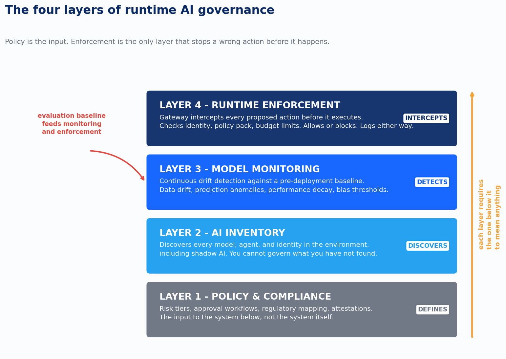
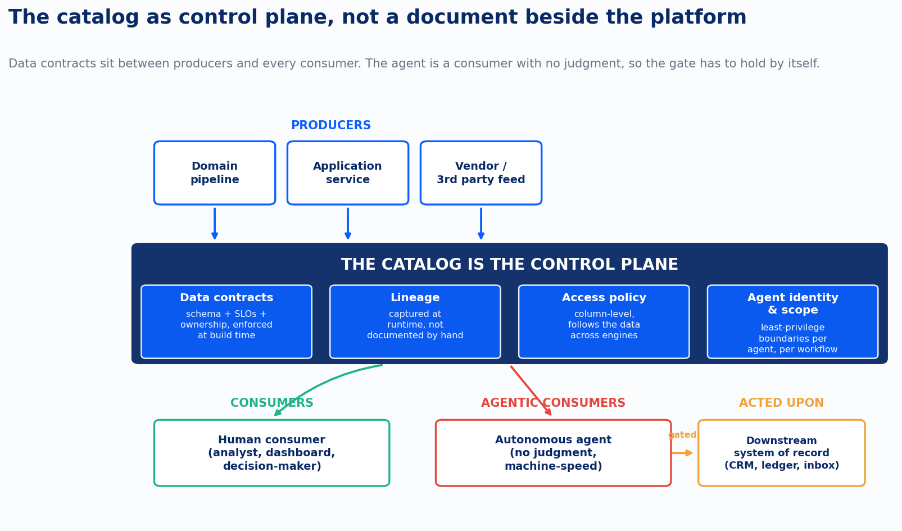
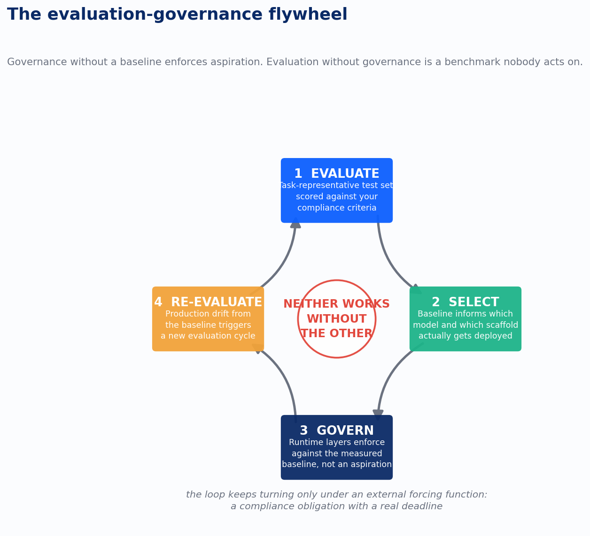

In 2020, TDWI asked data professionals why their governance programs weren’t working. The top answer wasn’t budget or tooling. It was “convincing employees to adhere to governance policies.” Only 8% of organizations with a formal governance program rated it highly successful. They had the frameworks: DAMA-DMBOK 2’s eleven knowledge areas, the EDM Council’s scoring model. None of it moved the number, because none of it was in the room when an engineer built a pipeline.

Six years later I sat in a meeting where a CTO walked me through his AI governance framework. Forty-two slides. Acceptable use policy, data classification tiers, a list of prohibited applications, sign-off from Legal, HR, and the CISO. Three months earlier, a team in his finance department had been routing live vendor contracts through a personal AI account. The framework had been sitting there the entire time.

Same failure, different decade, same root cause. A policy document is not a system. It cannot see what’s happening, cannot stop what’s happening, and does not know when it’s been violated until someone finds out the hard way. The 2020 version of that gap cost organizations an average of $12.9 million a year in bad data, according to Gartner. The AI version is what this piece is about, because the mechanics are identical and the consequences are worse.

Here’s the argument. Data governance failed for structural reasons that had nothing to do with policy quality. Those same reasons compound when the thing consuming your ungoverned data isn’t a person anymore but an agent, running at machine speed, with no capacity to notice it has crossed a line it never saw written down. AI governance is not a new discipline bolted onto data governance. It’s data governance with the safety margin removed, and the fix in both cases is the same fix: stop writing policy and start building a control plane.

## Why the Policy Binder Never Worked

The instinct when governance fails is to write a better policy: more detail, more specificity, more sign-off. That instinct is the mistake.

Policy governance assumes the entity being governed has moral agency. A human employee reads a policy, or doesn’t. Either way, they make a choice, and you can review that choice after the fact, pull logs, ask them what they were thinking. The entire enforcement model for a decade of enterprise governance rested on the fact that people are slow enough and visible enough to audit after they act. [The policy binder itself](https://www.devlinliles.com/the-policy-binder-didnt-change-anyones-behavior/) was never built to survive contact with that assumption breaking.

That assumption is what broke first in data engineering, before AI ever entered the picture. The dominant pattern through 2019 to 2021 was governance-as-separate-product: you ran your pipelines in Snowflake or wherever your stack lived, and separately, a Collibra or Alation catalog sat next to it, waiting for someone to document what had changed. Catalog curation was a manual task with no feedback loop. An engineer who ships a pipeline has done their job. Documenting that pipeline in a governance catalog is extra work with no broken build, no alert, no audit trail watching. The behavior that gets reinforced is the one that ships the feature, and six years of that produced catalogs full of stale metadata describing systems as they existed eighteen months earlier.

California’s Department of Healthcare Services had a vivid version of this when we partnered with them on their data platform. Behavioral health data was scattered across Excel spreadsheets, Access databases, and a Teradata warehouse carrying a decade of undocumented assumptions. DHCS wasn’t short on governance intent, HIPAA made that non-negotiable, but they lacked governance embedded in the places data actually moved. The policy existed. The pipeline didn’t know about it.

Gartner’s 2024 prediction that [80% of data and analytics governance initiatives will fail by 2027](https://www.devlinliles.com/why-80-of-governance-programs-fail-and-what-the-other-20-do-differently/) names the same root cause in different language. Programs fail from “a lack of a real or manufactured crisis,” run as “data hygiene and control” instead of tied to business outcomes. I’d break that into three specific failure patterns I see repeatedly in client engagements.

The compliance trap is a program stood up to satisfy an audit finding, which stops producing capability the moment the audit passes. [The accountability gap](https://www.devlinliles.com/the-most-important-person-in-your-ai-governance-program-isnt-in-your-c-suite/) is a governance council that meets monthly and a steward who can flag problems, with nobody who can actually compel a fix on a deadline. The tool-first failure is a catalog or observability platform deployed without the organizational infrastructure to use it, so alerts fire into a shared inbox nobody monitors.

All three share the same shape: ceremony without enforcement, a committee that reviews without power to require action. That pattern doesn’t go away when you add AI. It gets worse.

## From Cop to Coach, and Why That Reframe Mattered

The industry’s actual response to the 8% number wasn’t a better policy template. It was architectural. In August 2021, Gartner retired the Magic Quadrant for Metadata Management and replaced it with a Market Guide for Active Metadata Management, a redefinition of what a catalog is for.

Passive metadata, in Gartner’s language, “relies on human effort to curate.” Active metadata is a system that doesn’t wait for humans to maintain it. Lineage gets captured automatically when a pipeline runs. Access policy gets evaluated in real time when someone requests a sensitive table. A quality threshold breach fires a notification before the downstream consumer builds a report on stale data. The catalog stops being a reference you might check and becomes a participant in the system it describes.

Alation’s framing of the organizational consequence is the sharpest version of this I’ve seen: passive governance “perceives data through the lens of risk” and “commands who can do what.” Active governance formalizes how people already work. That’s the [cop-to-coach shift](https://www.devlinliles.com/from-cop-to-coach-when-governance-stopped-being-about-control/), and it’s not a branding exercise. A cop needs an adversary. A coach needs a shared goal. Governance framed as control puts the data team and the governance team on opposite sides of a table. Governance framed as enablement puts them on the same side, because the question is no longer “how do we stop you” but “how do we make trustworthy data the fastest path to what you’re building anyway.”

When we rebuilt DHCS’s platform on Databricks, Collibra was integrated into the pipeline architecture so metadata got populated as a side effect of the pipeline running, not a separate curation activity someone had to remember to do. The governance overhead didn’t vanish. It moved from people maintaining documentation to engineers designing systems that capture documentation automatically, a workload engineering teams are already structured to deliver.

That distinction, governance as something the system does versus something a person is supposed to remember to do, is the hinge the rest of this piece turns on.

## Stakeholders Are Not a QA Team, and Contracts Are the Fix

If active metadata is the infrastructure half of the fix, the data contract is the organizational half.

In 2023, [74% of data professionals said business stakeholders find data quality issues](https://www.devlinliles.com/your-stakeholders-are-your-data-quality-system/) before the data team does, up from 47% the year before. At most organizations, the primary data quality monitoring system was the person building the dashboard who noticed something looked off. Not a test suite, not an observability platform. A human, downstream, guessing.

The instinct was to write more tests, and it didn’t scale. Manual testing scales with engineering time; the data estate scales with business complexity. Those curves diverge, and the untested tables are usually the legacy ones nobody trusts anymore, which is exactly why they went untested in the first place.

Andrew Jones, an engineer at GoCardless, asked a more useful question in 2020: what if data had an interface the way services do? Software engineers already understand API contracts: publish an endpoint, document the schema, version it on breaking changes, and consumers build against your specification. Data never had that. A table could change schema overnight and the downstream consumer found out when their report broke.

Jones called what he built a [data contract](https://www.devlinliles.com/the-data-contract-is-an-api-for-trust/): schema, ownership, service-level objectives for freshness and availability, and compatibility guarantees for how breaking changes get signaled. The enforcement is what makes it a contract instead of documentation. At GoCardless, a pipeline producing data that violated its declared contract failed the build. The violation was caught at the producer, not discovered by the consumer. That’s the accountability shift underneath the idea: the producer is responsible for what they publish, not just for getting rows into a table.

Requiring a contract forces the ownership question that governance programs have circled for years without resolving. You cannot write a contract for a dataset without someone being accountable for what it declares, and the CI pipeline cannot validate a contract nobody wrote. This is governance working the way software governance already works: code review enforced by the PR process, testing enforced by CI, dependencies enforced by the build tool. The policy runs in the system, not in a committee.

When we partnered with Ascend, a charter school system, on their data estate, the fundamental problem wasn’t tooling. It was that they didn’t own their data. Educational data flowed through vendor systems Ascend had limited visibility into, with no clear accountability for what those systems produced. Before we wrote a single dbt model, we had a conversation about what data was whose and what would constitute a failure. The dbt models we built have explicit schema declarations, tested at build time. When the build passes, the schema is what they said it would be. When it fails, the system tells them before a stakeholder ever opens a dashboard.

That sequencing is easy to get backwards. Contracts are not a starting point, they’re a milestone. A team that doesn’t understand its own data well enough to declare its schema, ownership, and quality expectations can’t write a contract worth enforcing. Establish ownership first, understand the data, then formalize that understanding into something the system validates. Skip the first two steps and the contract is theater with extra YAML.

## The Fourth Principle Nobody Wants to Build

Zhamak Dehghani’s 2019 data mesh article had [four principles](https://www.devlinliles.com/the-fourth-principle-federated-governance-and-the-hardest-problem-in-data-mesh/), and most organizations that adopted mesh thinking quietly implemented two of them and called it done. Domain-oriented ownership and data as a product are conceptually satisfying: you can reorganize teams around them and make measurable progress without restructuring how governance itself works.

The fourth principle, federated computational governance, is the one that determines whether any of it holds together, and it’s the one most organizations skip. Central standards, domain autonomy, and enforcement that runs computationally rather than through committee review. Domains own their data products. A governance layer sets interoperability and security standards, and enforces them in code, at runtime, not through a review meeting.

The third part is where implementations stall. A study of fifteen industry practitioners found that domain employees are frequently “unaware of which data are protected and regulated.” The engineer building a data product in a domain team doesn’t know which fields are PII, which are subject to GDPR, or which outputs need regulatory review, because that knowledge used to live with the central data team. You cannot federate knowledge that was never made explicit. In the old centralized model, governance failed because one team couldn’t police everywhere. In the mesh model, governance fails because domains can’t comply with rules they don’t know exist, and there’s no central catch mechanism left standing to notice.

At Blue Cross Blue Shield of Minnesota, we were solving a version of this at real scale: eleven domains, 133 subdomains, more than 88 data suppliers, a genuinely distributed ecosystem of producers, each with their own systems and their own understanding of what their data meant. The architecture we used, a medallion model in Databricks with Unity Catalog as the governance layer, solved the enforcement half. Unity Catalog sits below the compute layer, so domain teams work in their own workspaces with their own practices while the catalog enforces access policy and lineage tracking at the storage level, before the data ever reaches an unauthorized consumer.

The onboarding framework we built solved the knowledge half. When a new supplier joins, there’s a structured process for mapping data assets, identifying sensitive fields, and establishing ownership and SLOs upfront. Governance knowledge that used to live in one team’s heads got encoded into a workflow running consistently across all 88-plus suppliers. That’s computational governance when it’s real: a platform with governance built into its floor, and enforcement that runs automatically every time data moves.

## The Catalog Becomes the Control Plane

Everything up to this point, active metadata, data contracts, federated enforcement, converges on a single architectural decision: where governance physically lives. The bolt-on era put it next to the platform. The shift between 2021 and 2024 put it inside the platform, and that relocation is the single most consequential change in this history.

Databricks announced Unity Catalog at its 2021 Data + AI Summit. Snowflake answered with Horizon. Both made the same bet: [governance belongs in the compute and storage layer](https://www.devlinliles.com/governance-belongs-in-the-platform-not-next-to-it/), not alongside it as a separate system someone has to keep synchronized. Unity Catalog governs data below the compute engines that touch it: row and column-level access control, lineage captured automatically at query execution, audit logs written for every access, regardless of which notebook or pipeline is running the query. The policy doesn’t live in the ETL tool or the BI layer. It lives in the catalog, and the catalog enforces it for everything that touches the data underneath it.

Lineage is the clearest illustration of what changes. In the bolt-on model, someone writes down that table A feeds table B feeds the dashboard, and that documentation is approximately accurate on the day it’s written and wrong shortly after. In Unity Catalog, lineage is observed at runtime: the catalog records exactly what was read and written when a pipeline executes. The graph builds itself from what actually happened, not from what someone remembered to type up.

At BCBSM, every asset across those eleven domains was governed through Unity Catalog: column-level access control for PHI and PII, automated lineage from raw ingestion through transformation to analytical output, audit logs satisfying HIPAA’s trail requirements without a separate compliance workflow bolted on top. When the data science team built AI models on that platform, the training data those models consumed was already governed, because Unity Catalog had been tracking lineage since the first pipeline run. That’s the detail that makes the next section possible instead of aspirational.

The honest caveat: if your estate spans Databricks, Snowflake, and other engines, and most enterprise estates do, you don’t have one embedded governance layer, you have several, and their policies don’t automatically synchronize. Both vendors are converging on the Apache Iceberg REST Catalog standard to fix this, but Snowflake’s own engineering documentation is candid that fine-grained policy doesn’t yet carry cleanly across catalog boundaries. That’s not a reason to retreat to bolt-on tooling, which reintroduces the exact synchronization failure embedded governance was built to solve. It’s a reason to decide, deliberately, which catalog is authoritative.

## AI Governance Is Data Governance With Consequences

Everything so far has been about data governance. Here’s where the argument turns, because [framing AI governance as a separate discipline](https://www.devlinliles.com/ai-governance-is-data-governance-with-consequences/) is the single most expensive mistake I see organizations make right now, and the EU AI Act is about to make that mistake concrete. Article 10 requires that training, validation, and testing data for high-risk AI systems be “relevant, sufficiently representative and, to the best extent possible, free of errors.” That’s not a model requirement or an algorithm requirement. It’s a data governance requirement, with fines up to €35 million or 7% of global turnover attached, activating August 2, 2026.

The absence of data governance is the absence of AI governance. Bolt-on, passive, committee-driven governance, the exact variety documented above as structurally insufficient, does not provide the foundation AI governance needs. It never did the job for a human analyst looking at a dashboard. It won’t do the job for a model trained on data nobody can trace.

NIST’s AI Risk Management Framework, released in January 2023, organized AI risk around four functions: Govern, Map, Measure, Manage. It’s thorough and voluntary, and Forrester’s analysis points out something specific: data governance “does not have an explicit reference” in the framework. A model that surfaces a bias problem in an assessment is only actionable if you can trace which training data taught it that pattern, and that trace requires the lineage infrastructure described above. Without it, Map and Measure are aspirational, not operational.

This is where the human-versus-agent distinction stops being philosophical. A policy document assumes the reader has moral agency: they read it, they choose, you can review the choice after the fact because humans are slow enough to audit. An agent does not read a policy. It does exactly what it is configured to do, at machine speed, without the capacity to recognize it has crossed a line it never saw. [Chain enough of those actions together and the math turns against you fast](https://www.devlinliles.com/stacking-errors-the-hidden-math-that-makes-governance-non-optional/): an agent completing each step correctly 95% of the time, solid performance, has roughly a 36% chance of finishing a twenty-step chain without a single error, worse than a coin flip. A single enterprise workflow can complete forty discrete actions before a human ever sees the output. By the time an auditor notices something is wrong, the agent has already sent the emails, modified the records, and generated the contract under terms nobody approved.

That’s not an argument against agentic AI. It’s an argument that you cannot govern it the way you governed a human employee, because human governance depends on a speed and visibility advantage agents don’t grant you.

At BCBSM, Unity Catalog was the mechanism that made governed AI deployment possible under HIPAA and HITRUST. Every Gold-layer dataset feeding a model was access-controlled, lineage-tracked, and audit-logged. The MLflow Model Registry captured model lineage: training data version, evaluation metrics, approver identity, deployment stage. Combined, that gave BCBSM an auditable answer to a question regulators actually ask: what data trained this model, and who approved putting it into production, backed by six SCAN security approvals across the engagement, each requiring proof that governance controls existed in the platform, not in a memo somewhere.

That’s the difference between aspirational framework alignment and auditable operational practice, and it’s what the next section builds into an explicit architecture.

## The Four Layers of Runtime Governance

If AI governance has to run at the speed of the agent instead of the speed of a quarterly review, it has to be architecture, not a document. The pattern I’ve seen work across serious enterprise AI programs is a [four-layer runtime control plane](https://www.devlinliles.com/the-four-layers-of-runtime-ai-governance/). Each layer does a distinct job, and each depends on the layer beneath it actually being done, not sketched.

Layer one is policy and compliance. This is where [your AI governance policy stops being just a policy](https://www.devlinliles.com/your-ai-governance-policy-is-not-governance/) and finally earns its keep, not as something an employee is expected to memorize but as the structured input to a system that enforces it: risk tiers, approval workflows, the rules for what’s allowed under what conditions and whose authorization each level requires. For an organization anchored on Microsoft 365 and Azure, Microsoft Purview is the sensible default, covering AI data protection, Copilot oversight, sensitivity labeling, and compliance reporting inside licensing most enterprises already hold.

Layer two is AI inventory, and it exists because you cannot govern what you don’t know you have: employees running work through personal AI accounts, browser extensions with embedded assistants that never went through procurement, AI features quietly added to SaaS tools your team evaluated before those features existed. Every one is a gap sitting outside layer one’s field of view. Microsoft Defender for Cloud Apps handles this discovery for M365 environments.

Layer three is model monitoring and drift detection. A model that was accurate and fair at approval time may not be six months later, because the population using it changed or the data distribution it was trained on shifted underneath it. This has to be continuous and automated. Quarterly manual review is not a serious answer for a production AI system, the same way it wasn’t a serious answer for the stale catalogs of the bolt-on era.

Layer four is runtime policy enforcement, and it’s where nearly every organization I’ve reviewed has almost nothing, exactly backwards given it’s the layer that matters most. A gateway sits between an agent and every tool it can call. When the agent proposes an action, writing to a database, sending an email, querying a third-party system, the gateway evaluates that action against the active policy pack, the agent’s identity and permissions, and any current budget or limit controls, before the action executes. Inside policy, it proceeds. Outside policy, it stops. The decision gets logged either way, at the moment it happens, not reconstructed afterward from whatever logs survived.

*governance-arch-four-layers*

That distinction is the whole argument in miniature. Layers one through three are about knowing the rules, knowing your surface area, and detecting problems after they’ve happened. Layer four is the only layer that intercepts a wrong action before it happens, which is also the only place “audit-ready” means the record was generated at the decision itself. And you cannot skip to it. A gateway enforcing a policy pack that doesn’t map to real risk tiers enforces nothing meaningful. If you haven’t inventoried your agents, you can’t scope their permissions correctly. If you’re not monitoring for drift, you don’t know what threshold to enforce. Policy before gating, inventory before enforcement, monitoring before enforcement. It’s a dependency chain, and jumping straight to a gateway without the first three layers gives you an expensive control that enforces nothing real.

## The Catalog as Agentic Control Plane

Here’s where the data governance thread and the AI governance thread become the same architecture. [The catalog is now the control plane](https://www.devlinliles.com/the-catalog-is-now-the-control-plane/): the same infrastructure that Unity Catalog and Snowflake Horizon built to govern human analysts querying tables governs an agent calling a tool. There’s one control plane, and it has to hold for both kinds of consumer, human and agentic, because the data underneath is the same data.

*governance-arch-control-plane*

Picture it this way. Producers, domain pipelines, application services, vendor feeds, publish into the catalog. The catalog enforces four things on everything that passes through it: data contracts specifying schema, SLOs, and ownership at build time; lineage captured automatically at runtime; access policy that follows the data across whatever engine it lands in; and, new to the agentic era, agent identity and scope, the least-privilege boundary defining exactly what a given agent is permitted to touch for a given workflow.

Downstream of that catalog sit two very different kinds of consumer, and the difference is the entire reason layer four exists. A human consumer has judgment. They can notice something looks wrong and stop. An agentic consumer has no judgment. It executes whatever the catalog’s access policy and the runtime gateway allow, at machine speed, without the capacity to pause and ask whether this looks right. That’s not a flaw in the agent, it’s the nature of the thing, which means the gate around it has to hold entirely on its own. There’s no human instinct downstream to catch what the gate misses.

This is why the BCBSM Mosaic AI Agent Framework work mattered beyond that engagement. Production agents doing multi-step reasoning and retrieval against internal knowledge bases and health plan data had their access enforced through Unity Catalog and an AI gateway: which data the agent could reach, which queries it could run, what it could include in a response, all catalog-governed decisions, not prompt instructions the agent might or might not honor. A prompt that says “don’t access sensitive records” is a suggestion. An access policy the catalog enforces before the query executes is a boundary. Only one of those is governance.

## The Evaluation-Governance Flywheel

There’s a gap in the four-layer model as described so far, and it’s the piece most programs get wrong even after building the first three layers correctly. [Neither works without the other](https://www.devlinliles.com/the-evaluation-governance-flywheel-neither-works-without-the-other/). Layer three monitors for drift. Drift from what? Without a pre-deployment measurement of how the model actually behaves, there’s no baseline to drift away from. You can monitor for statistical anomalies against population averages, but that tells you the system looks unusual, not that it has degraded from where it started. Layer four enforces policy, but which policy, specifically? It has to define what “acceptable output” means for a given task, and if you’ve never measured what acceptable looks like in practice, the policy is describing an aspiration dressed up as a control.

Evaluation data is what turns the governance framework into an actual governance system, and the research on why automated evaluation alone isn’t sufficient is uncomfortable. METR’s March 2026 study blind-reviewed 296 AI-generated pull requests that had already passed automated grading. Active maintainers from scikit-learn, Sphinx, and pytest evaluated the same PRs by hand, and roughly half would not have been merged. The gap between what the grader approved and what a skilled reviewer would accept averaged 24 percentage points across the model set, and it didn’t shrink as models improved over the study’s eighteen-month window. Automated grading is not a stand-in for human judgment. Treating it as one produces a governance system that’s confident, and confident in the wrong direction.

*governance-arch-flywheel*

The loop that fixes this has four stations, each depending on the one before it. Evaluate: build a task-representative test set from the actual work the system performs, scored against the compliance criteria that actually apply, not a vendor benchmark. Select: use that baseline to choose which model and which scaffold gets deployed, because the scaffold, the retrieval pipeline, the tool design, the prompt structure, accounts for more variance in output quality than swapping the underlying model does. Govern: layers three and four enforce against that measured baseline instead of an aspirational one. Re-evaluate: production drift from the baseline triggers a new evaluation cycle, which tightens the baseline and sharpens the next monitoring cycle.

Neither half of that loop works without the other. Governance without an evaluation baseline is enforcing a guess. Evaluation without governance wired to act on it is a benchmark result nobody does anything with. And the thing that keeps the flywheel actually turning, in my experience, isn’t discipline. It’s an external forcing function: a compliance obligation with a real deadline attached. An organization under SOC 2 Type II cannot skip layer three monitoring, because the annual audit asks for evidence of ongoing control effectiveness, and “we trusted the benchmark” is not evidence. An organization with EU AI Act Annex III exposure cannot skip the evaluation baseline, because the documentation requirement specifically covers model performance on the use cases in scope. Compliance isn’t overhead layered onto the flywheel. It’s what keeps the flywheel from stopping when organizational inertia would rather it did.

## Where This Leaves the Architecture

Put the whole thing together and it stops looking like nine separate governance initiatives and starts looking like one system with a small number of load-bearing decisions.

Governance lives in the platform, not beside it, because a catalog someone has to remember to update will always lose to the pressure of shipping the next feature. Ownership and contracts come before enforcement, because a system cannot validate a schema nobody was accountable for declaring. The catalog is the control plane for every consumer, human or agentic, because the alternative is two governance systems that drift apart the moment nobody’s watching both. Runtime enforcement is the only layer that intercepts a wrong action before it happens, and it only means anything once the layers under it, policy, inventory, monitoring, are real. None of it holds without an evaluation baseline feeding the monitoring and the enforcement, because a policy without a measured standard of “acceptable” is enforcing a feeling.

The 8% success rate TDWI measured in 2020 and the 80% failure rate Gartner predicts for 2027 are the same number from opposite ends of the same six years. The programs that moved off that number didn’t write a better policy. They stopped treating [governance as a document and started treating it as infrastructure](https://www.devlinliles.com/governance-is-not-overhead-it-is-the-engine-of-trust/): something that runs every time the system runs, whether or not anyone remembered to check.

The policy binder never changed anyone’s behavior. It was never going to. The control plane does, and the only real question left for most organizations is whether they build it before the agent that needed it is already running.

---

*Sources: *[*The Policy Binder Didn’t Change Anyone’s Behavior*](https://www.devlinliles.com/the-policy-binder-didnt-change-anyones-behavior/)*; *[*From Cop to Coach: When Governance Stopped Being About Control*](https://www.devlinliles.com/from-cop-to-coach-when-governance-stopped-being-about-control/)*; *[*Your Stakeholders Are Your Data Quality System*](https://www.devlinliles.com/your-stakeholders-are-your-data-quality-system/)*; *[*The Fourth Principle: Federated Governance and the Hardest Problem in Data Mesh*](https://www.devlinliles.com/the-fourth-principle-federated-governance-and-the-hardest-problem-in-data-mesh/)*; *[*The Data Contract Is an API for Trust*](https://www.devlinliles.com/the-data-contract-is-an-api-for-trust/)*; *[*Governance Belongs in the Platform, Not Next to It*](https://www.devlinliles.com/governance-belongs-in-the-platform-not-next-to-it/)*; *[*AI Governance Is Data Governance With Consequences*](https://www.devlinliles.com/ai-governance-is-data-governance-with-consequences/)*; *[*Why 80% of Governance Programs Fail (And What the Other 20% Do Differently)*](https://www.devlinliles.com/why-80-of-governance-programs-fail-and-what-the-other-20-do-differently/)*; *[*The Catalog Is Now the Control Plane*](https://www.devlinliles.com/the-catalog-is-now-the-control-plane/)*; *[*Your AI Governance Policy Is Not Governance*](https://www.devlinliles.com/your-ai-governance-policy-is-not-governance/)*; *[*The Most Important Person in Your AI Governance Program Isn’t in Your C-Suite*](https://www.devlinliles.com/the-most-important-person-in-your-ai-governance-program-isnt-in-your-c-suite/)*; *[*The Four Layers of Runtime AI Governance*](https://www.devlinliles.com/the-four-layers-of-runtime-ai-governance/)*; *[*The Evaluation-Governance Flywheel: Neither Works Without the Other*](https://www.devlinliles.com/the-evaluation-governance-flywheel-neither-works-without-the-other/)*; *[*Stacking Errors*](https://www.devlinliles.com/stacking-errors-the-hidden-math-that-makes-governance-non-optional/)*; *[*Governance Is Not Overhead. It Is the Engine of Trust.*](https://www.devlinliles.com/governance-is-not-overhead-it-is-the-engine-of-trust/)
