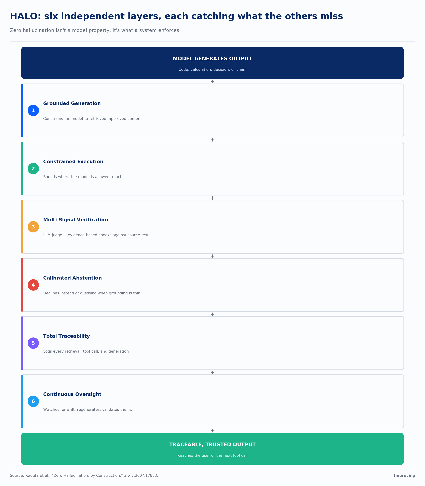
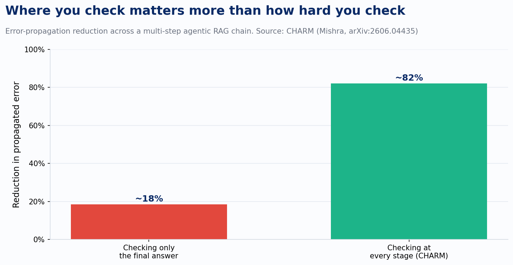
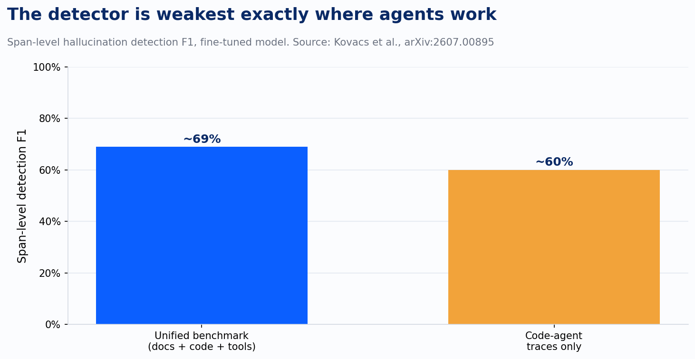

Every client conversation about AI governance eventually arrives at the same sentence: "we have a disclaimer in the system prompt." That's a permission slip, not a mitigation. It tells the user the model might be wrong, but it doesn't catch a wrong answer before the user sees it, and it has nothing to say once the model starts calling tools instead of just talking.

That gap is why this summer's hallucination research is worth reading closely. For two years the conversation was about whether a model would eventually stop hallucinating. It won't, and the newest papers on the subject have quietly stopped asking. A paper out of Romania in July, "Zero Hallucination, by Construction," states the reframe directly: large language models are, by construction, capable of generating unsupported text, and no amount of scale removes the possibility. A faithfulness judge bolted onto a raw model catches some errors and still ships others. Even well-curated retrieval pipelines have been shown to fabricate citations. Zero hallucination is a property a system enforces, not one a model possesses.

The architecture the paper proposes, HALO, is the clearest answer I've seen this year to what an enterprise actually has to build. Six layers, each independent, each catching what the others miss. Grounded generation constrains the model to retrieved, approved content instead of open recall, and constrained execution bounds where the model is even allowed to act. Multi-signal verification is the layer that matters most in practice: it scores every output for groundedness using both an LLM judge and evidence-based checks against the source text, verifying extractions against the document rather than trusting the model's own reported confidence. Calibrated abstention lets the system decline instead of guessing when the grounding isn't there. The last two layers are about what happens after generation. Total traceability logs every retrieval, tool call, and generation, so nothing that happened is invisible after the fact. Continuous oversight watches for drift, alerts on threshold breaches, and closes the loop by regenerating and statistically validating the fix.

Most of the "AI governance" I see in client environments stops at layer one, if it gets that far. Retrieval-augmented generation gets treated as the finish line: we grounded the model in our documents, so it can't make things up anymore. It can. RAG lowers the fabrication rate. The mechanism that produces fabrication is still sitting there underneath it. The remaining five layers exist because grounding a single generation step doesn't ground the system the model is now embedded in, and that system is the part clients are actually deploying.

Here's the part the governance conversation usually misses entirely: the failure doesn't stay where it starts. A separate paper this summer, CHARM, formalizes what happens when an agent hallucinates something at step two of a retrieval chain and then reasons forward from it at steps three, four, and five. Each downstream step treats the ungrounded claim as established fact and builds on it with full confidence, so the error compounds instead of staying contained to the step that produced it. CHARM's authors tested this against the obvious response, which is checking the final output before it reaches the user. That catches almost nothing, because by the time you're looking at the final answer, the ungrounded claim has been laundered through three steps of confident-sounding reasoning and no longer looks like a guess.

The gap between those two bars is the whole argument for instrumenting the chain instead of the output. An agent that retrieves, reasons, calls a tool, and reasons again has four or five places where an ungrounded claim can enter and start compounding. Checking only the last one means you're reviewing the argument after it has already been built on a bad foundation.

Stage-level checking only works if you can tell which part of a long response is actually the problem, and that's a harder detection task than it sounds. A benchmark released the same week, built by researchers largely out of Central European universities, tested exactly this: span-level detection, where the question moves from whether an answer is wrong to which exact sentence, which line of code, or which piece of tool output is the unsupported part. Their fine-tuned detector does reasonably well on the unified benchmark spanning documents, code, and tool traces. It does noticeably worse when the source narrows to code-agent traces specifically.

That gap is the honest part of the story, and it's the part worth sitting with before anyone tells a client their guardrails are handled. The hardest place to catch a hallucination right now is exactly the place enterprises are racing to deploy agents: writing code, calling APIs, taking actions with side effects. A wrong sentence in a chat response is embarrassing. A wrong function call against a production system, or a fabricated field in a document that gets extracted and acted on downstream, doesn't wait for someone to notice the prose sounds off.

The reach of this problem goes past text entirely, which is the part I didn't expect going into this. HalluSegBench, a benchmark for vision-language segmentation models, tested what happens when you swap an object in an image for a visually similar one and see whether the model's grounding holds up. Vision-driven hallucinations, where the model simply misperceives what's in front of it, turned out to be more prevalent than label-driven ones, where a leading prompt causes the error, and harder to correct once they happen. If your agent stack touches a scanned document, a diagram, or a camera feed anywhere in the chain, your text-grounding guardrails cover none of that surface. The perception layer needs its own verification, checked against the image the same way a text claim gets checked against the source document.

The throughline across all four papers is the same instinct applied to four different failure surfaces: don't trust the model's self-report, verify against the ground truth at the level where that specific modality actually operates. Text gets checked against the source document, and code and tool output get checked as their own span type, because they fail differently than prose does. Multi-step reasoning needs stage-by-stage checking for a different reason: failure at stage one becomes a false premise by stage five, and nothing downstream will flag it. Vision is the odd one out, because there's no text prompt to blame when a model is confidently, fluently wrong about what it's looking at — the image itself is the only ground truth available.

None of this is free. CHARM's own numbers show real latency overhead for stage-level checking, and a detector that's noticeably weaker on code than on prose is a limit, not a footnote. The alternative on offer here is the same failure rate you have today, minus the ability to see it coming. The next time someone tells you their AI system is governed because there's a disclaimer above the chat window, ask them which of the six layers that actually is. There's a good chance the honest answer is none of them.

---

*Sources: Raduta et al., "Zero Hallucination, by Construction: Hallucination-Aware Layered Oversight for Trustworthy Enterprise AI," arXiv:2607.17883. Mishra, "Cascading Hallucination in Agentic RAG: The CHARM Framework for Detection and Mitigation," arXiv:2606.04435. Kovács et al., "Beyond Document Grounding: Span-Level Hallucination Detection over Code, Tool Output, and Documents," arXiv:2607.00895. HalluSegBench: Counterfactual Visual Reasoning for Segmentation Hallucination Evaluation, arXiv:2506.21546.*
