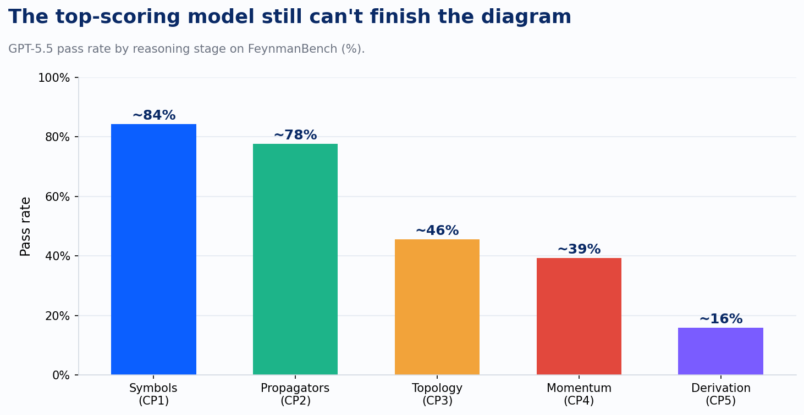
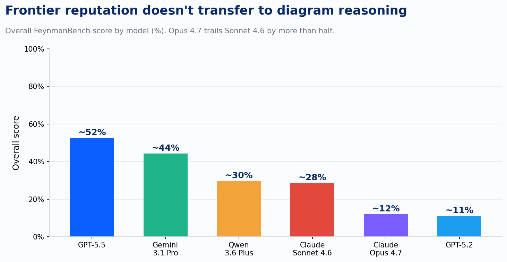

Hand a vision-language model a circuit diagram and ask it to name the components. It will get the resistor. It will get the capacitor. Ask it to trace what happens downstream of the switch, and something quietly breaks, in a way that never shows up on the benchmark slide that got the model into the building.

A benchmark called FeynmanBench, built this year to test something narrower and harder than most vision benchmarks, shows exactly where that break happens and how consistent it is across labs. Feynman diagrams are a good stress test because physicists already agree on what correct reasoning about one looks like: read off the particles, reconstruct how they connect, trace conservation of momentum and charge through the graph, then derive the actual scattering amplitude. Five checkpoints, each harder than the last, each depending on the one before it. The researchers ran nineteen models from five providers, over 2,000 diagrams, five checkpoints apiece.

The best model in the field, GPT-5.5, gets 84% on checkpoint one: identifying the particles and vertices in the picture. That is a real, respectable, vision-recognition number. On checkpoint three, reconstructing how those vertices connect into a coherent graph, the same model drops to 46%. On checkpoint five, deriving the actual physics from that graph, it drops again to 16%. Every other model in the study shows the identical shape. Claude Sonnet 4.6 goes from 65% down to 3%. Doubao Seed 2.0 Pro goes from 79% down to under 1%.

The researchers call this the CP3 cliff, and their explanation for it is precise: a model can score well on checkpoints one and two by recognizing local symbols and line styles, one shape at a time. Checkpoint three requires something structurally different, holding the whole graph in mind at once and verifying that a vertex on the left side of the diagram is still consistent with a vertex on the right. That's a different capability than symbol recognition, and current models don't have much of it.

This is the same distinction I use with clients when we talk about where an AI agent actually helps in a workflow: it helps in the boxes, not the arrows. The boxes are the discrete, recognizable units, things like an approved vendor or a line item or a part labeled on a drawing. The arrows are what connects them: the constraint that box A can't be true unless box B already is. FeynmanBench is that same gap, measured with a stopwatch. Reading the boxes in a diagram: strong, and getting stronger every model generation. Reasoning about the arrows connecting them: barely above zero on the hardest checkpoint, for every model tested.

One more detail from FeynmanBench matters more than it looks like it should. The researchers stratified results by how common each diagram topology is in physics textbooks, separate from how mathematically complex it is. Rarer diagrams score worse than more complex ones, even when the rare diagram is technically simpler to solve. Claude Sonnet 4.6 scores 16% on one rare-but-simple category and 28% on a more complex but textbook-common one. That inversion only makes sense one way: the model is pattern-matching against diagrams it has already seen, leaning on memory to fill in a graph it never actually reconstructed. A benchmark score built mostly from diagrams that resemble training data will read higher than the model's actual reasoning ability, and a client's engineering drawings, P&IDs, or as-built schematics were never part of that training data in the first place.

The overall FeynmanBench scores add a second warning, independent of the cliff itself. GPT-5.5 leads at 52%. Claude Opus 4.7, generally the strongest reasoning model on offer this year, scores 12%, behind the older Claude Sonnet 4.6 at 28% and behind Qwen 3.6 Plus at 30%. A model's standing on coding or general-reasoning leaderboards tells you almost nothing about how it will do on structured diagram reasoning specifically. The two skills are only loosely related, and a vendor citing a strong SWE-bench or MMLU score to sell diagram-review capability is citing the wrong test.

Two more findings sharpen where the failure sits. A line of ICML 2026 work on perception and reasoning in these models makes the structural case directly: when a model perceives the whole image once, converts it into a fixed set of tokens, and only starts reasoning after that conversion is done, whatever spatial and relational information didn't survive the conversion is gone for good. The reasoning step that follows reasons over that lossy summary, never the original image. That is the default architecture in most production vision-language pipelines today: one pass over the picture, then text-only reasoning from there. DeepEyes, a separate paper from earlier in the year, tested the alternative directly, training a model to pause mid-reasoning and zoom back into the image for another look when it needs more detail. A single static encoding no longer has to be the whole picture. That single change, letting the model choose what to look at again mid-thought, produced real gains on grounding and hallucination measures. The fix here was letting the model look more than once, mid-reasoning, rather than making it bigger.

A third failure mode, from a paper called OrientSAM, shows the same shortcut instinct in a different setting: models asked to reason about spatial relationships from a perspective other than the camera's own default fall back to the camera's viewpoint anyway, even when explicitly told to reason from somewhere else. An engineering drawing that specifies "as viewed from the operator's station" or an isometric exploded view assumes the reader adopts that stated frame of reference. A model with a camera-centric default is answering a question nobody asked.

I want to be careful with the last piece of this, because it touches clinical work and I'm not making a claim about diagnosis. A recent line of research on pathology vision-language models asks a narrower, methodological question: when one of these models flags a finding in a slide image, is it grounding that conclusion in the actual visual features present, or has it learned a shortcut correlation that produces the right label without looking at the right evidence. That is the identical CP3 question in different clothing. Getting the label right is checkpoint one or two. Grounding the label in the structure that actually justifies it is checkpoint three. The methodology critique is the part worth carrying into a clinical-imaging AI conversation, separate from any specific diagnostic claim.

This argues against treating a benchmark score, any benchmark score, as if it measured your diagram. Vision-language models still have plenty to offer diagram and image work. FeynmanBench tests Feynman diagrams. A vendor's number on it, or on any general vision benchmark, describes performance on that benchmark's specific graphs, drawn under that benchmark's specific conventions. An engineering P&ID has its own symbol vocabulary and its own relational structure. So does a structural steel detail. So does a network topology diagram. The CP3 cliff says the hard part of reasoning about any of them, the arrows, is exactly the part a general benchmark score is least likely to have tested. The number on the vendor's slide describes checkpoint one. The work a client is buying lives at checkpoint three.
