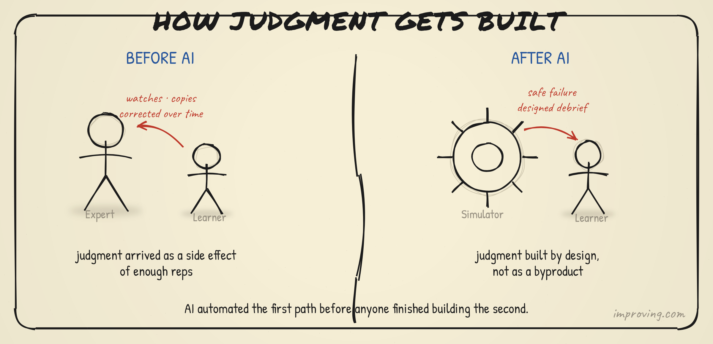
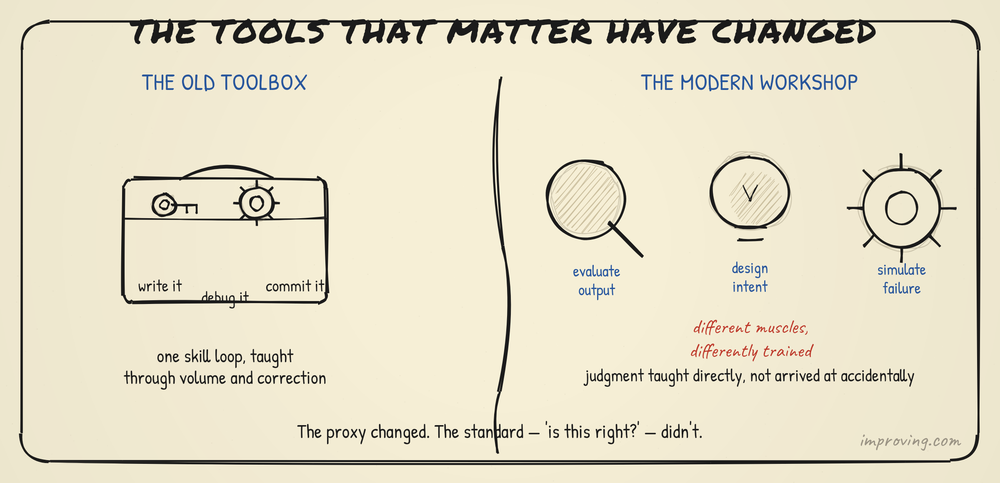
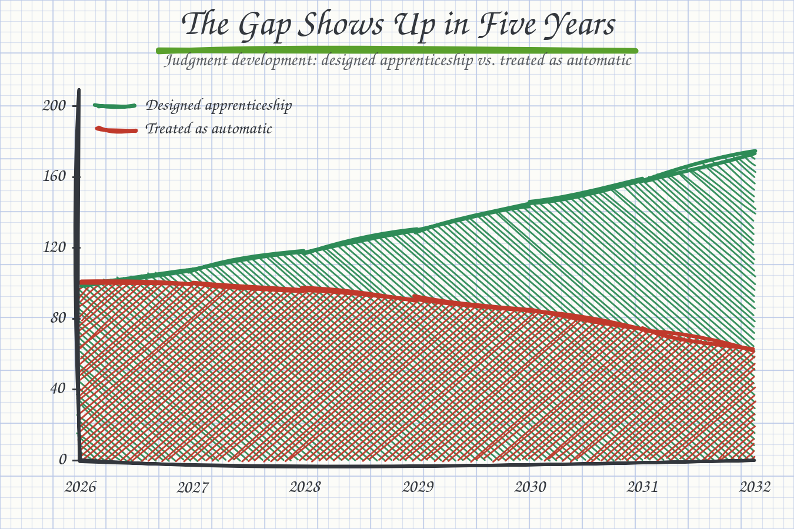

For every generation before this one, activity gave you a proxy for judgment development. You wrote a thousand mediocre loops. Somewhere in the pile, the reps gave you raw material — the feel for which loops were worth writing, the instinct for what the wrong data model looks like before it collapses. Herbert and Stuart Dreyfus mapped this path in 1980: novice to expert moves through five stages, each dependent on a trial-error-reflection cycle. The cycle is what converts activity into intuition.

But judgment was never actually free. People still hit plateaus.

The developer who wrote functions for three years and stalled there was not lacking reps. They had hit the ceiling of what their activity proxy could teach. Getting past that ceiling required something different: a mentor who named what they could not see, a deliberate cohort that exposed them to decision frameworks, someone who modeled the reasoning one level above the tactical. The entire apparatus of mentorship, high-potential programs, executive development, and emerging leaders cohorts exists because everyone who built these systems already knew this. Those programs were almost never about the tactical. They were explicitly about the judgment and consideration that living above the tactical requires — the kind that activity alone cannot reach.

AI does not change that story. It makes the first chapter of it much harder to access.

The PwC 2026 Global AI Jobs Barometer found that AI is removing the routine work that once served as apprenticeship, while increasing demand for judgment, leadership, and adaptability much earlier in careers. That sentence describes a structural problem. The work that used to give you the raw material for judgment development is the work getting automated first. The work that requires you to already have judgment is expanding. If you were never given the proxy, you never reach the first plateau. If you never reach the first plateau, there is nothing for mentorship to break through.

## The New Entry-Level Job

The junior's first job stops being "write the function." It becomes "evaluate the function the system produced, decide whether it is correct, decide whether it should exist at all."

That sounds like a smaller job. It is harder. Producing code requires knowing syntax and patterns. Evaluating AI-generated code requires understanding what correct looks like, reconstructing the intent that motivated the request, identifying the failure modes of the system that produced the output, and deciding whether the output answers the right question. It requires judgment on day one, not judgment as a reward for years of reps.

Harvard Business Review put the organizational consequence plainly in February 2026: AI creates a major challenge where experienced people get enormous productivity gains while juniors often cannot tell whether AI-generated work is any good or how to improve it. The gap between the experienced and the inexperienced widens, because the mechanism that used to close it, volume work that built the proxy for judgment, is the mechanism getting automated away.

The bundle that used to ship together has broken. Activity scaffolded judgment development up to a point. Teaching someone to write a query and teaching someone to know whether the query answers the right question were the same act up to a level. The second one arrived as a byproduct of the first, until it did not — and then you needed a mentor or a program to close that gap. AI removes even the byproduct. Now you need the mentor and the program from day one.

## What Teaching Judgment Directly Looks Like

The pattern for solving this already exists, and it did not come from software.

Aviation did not stop training pilots when the cockpit became too consequential to learn in. It built simulators, then built Crew Resource Management, which takes the simulation further than mechanics. CRM puts pilots through deliberate crisis scenarios, videotapes the decisions, and decomposes the debrief around the reasoning, not the outcome. The debrief is about the decision-making visible along the way, not whether the plane landed. You cannot get that from watching an expert work. You get it by working, with your reasoning exposed, and having someone systematically narrate what good looks like.

Anesthesiology Crisis Resource Management followed the same architecture in the 1980s. The live operating environment was too high-stakes and too unpredictable to rely on as primary training, so the profession built cadaver labs, standardized patients, and high-fidelity simulators. Real-world exposure could not manufacture the reps on demand, so medicine manufactured them. The lesson for software development is not about flight simulators. It is about honesty: the reps no longer arrive automatically, and designing the replacements is the work.

Three programs are emerging from teams that have confronted this honestly.

**Curated failure libraries.** Repositories of AI-generated code with deliberate bugs, subtle misalignments between intent and implementation, and antipatterns that pass tests but fail under load. The junior's task is identification and articulation, not repair. The answer key reads "you scoped the wrong problem" — because the scoping is the whole lesson, not the syntax error. AI confidently produces the locally correct answer to the wrong question. That is the most important pattern a junior can learn to see.

**Intent-specification drills.** Exercises where the student must translate a business requirement into a clear, constrained, evaluable specification, then see what the AI produces from it, then measure the gap between what they specified and what the system understood. The gap is where the judgment lives. Over iterations, the student learns that vagueness in the specification produces vagueness in the output, not as a principle but as a felt experience. Felt experience is how judgment gets built.

**Structured evaluation exercises.** Graded assessments where juniors evaluate AI-generated outputs against explicit criteria. The question graduates from "does this compile?" to "does this behave as intended under these edge conditions, within these performance constraints, with these architectural tradeoffs?" The assessment forces the student to hold intent and output in tension simultaneously, which is the cognitive act that develops evaluative judgment over time.

None of these programs are as efficient as writing code and getting corrected. They are more deliberate, more expensive, and slower to produce the reps. That is the point. They are manufacturing what used to arrive as a byproduct of production work.

## The Pedagogy Problem

Teaching activity looks different from teaching judgment.

Activity training has a clean answer key. The code compiles. The query returns the right rows. The design pattern applies. Feedback is specific and immediate. Teaching activity at scale is hard but tractable.

Judgment training has a different answer key: you scoped the right problem, identified the relevant tradeoffs, and asked a better question than the one you were handed. The criteria are richer, the feedback is harder to deliver, and the mentors who can give it are the ones with the judgment themselves, which means they have to be present, narrating their own reasoning out loud, showing their work in a way their own formation never required.

This is exactly what high-potential programs have always done at the senior level. An emerging leaders cohort does not teach algorithms. It teaches how to read a situation where the right answer is not obvious, how to hold competing priorities in tension, how to reason in conditions of uncertainty. It teaches judgment through exposure to the reasoning of people who have developed it. The only thing that changed is when in the career that intervention has to happen. It used to be the path from mid-level to senior. Now it has to be the path from day one to junior.

This creates a secondary problem. The generation of senior developers who built their judgment through volume reps may not know how to teach what they know. They accreted it. The process was tacit and accidental, not designed and explicit. Peter Naur named the underlying dynamic in 1985 in "Programming as Theory Building": the real product of programming is the theory the builders hold about how the system maps onto the world, and that theory never fully survives translation into text. Knowledge of the theory is tacit in the owning. Passing it along requires presence, iteration, and visible reasoning over time.

A senior developer who evaluates AI output next to a junior and narrates the reasoning out loud is doing something a documentation file cannot replicate. The apprenticeship has to be designed around that transfer, and the senior developers who can do it well need to be recognized as doing something difficult and valuable, not just doing their job while someone watches.

## The 15 Laws of Growth and Why They Matter More Now

John Maxwell's "The 15 Invaluable Laws of Growth" is not a book about AI. It is a book about the conditions under which people actually develop, and right now it is one of the more useful lenses for this problem.

The first law is the Law of Intentionality: growth doesn't just happen. You have to decide to grow. Maxwell's point is that most people assume progress is a natural consequence of experience — that showing up long enough produces wisdom. It does not. It produces tenure. Wisdom requires intent.

Before AI, this law was true and somewhat forgiving. The environment produced enough friction, enough failure, enough correction that even partially intentional learners picked something up. The reps were everywhere. You could be moderately passive and still develop because the work kept pushing back.

In an AI-native environment, the default is speed. Production cycles compress. Output volume increases. Everything that used to require a slow build-fail-reflect-rebuild loop now completes in minutes. This is the efficiency gain everyone is counting on. It is also the thing that works against the conditions for growth, because the Law of Intentionality now has to compete against a system optimized to eliminate exactly the friction that made growth happen.

The Law of Reflection is the mechanism downstream of intentionality: learning to pause allows growth to catch up with you. The Dreyfus model's trial-error-reflection cycle does not break only because AI handles the trials. It breaks because even when you get the trials, there is no structural space for the reflection and synthesis. Speed, left unchecked, eliminates the downtime that allows experience to crystallize into judgment. An engineer who evaluates one hundred AI outputs in the time it used to take to write ten functions has not automatically built one hundred units of judgment. They may have built far less than the number implies, if there was no pause to let the pattern land.

Maxwell's Law of Pain adds a third dimension: good management of bad experiences leads to great growth. This is precisely what curated failure libraries are. The failure is not accidental — it is selected, structured, and debriefed. The pain is managed by design. The lesson is the point, not the casualty. Aviation's CRM debrief culture is the same mechanism at scale: you run the difficult scenario, you watch the decision-making on video, you extract the lesson before the emotion fades. The law works when the failure is examined, not just survived.

The organizations and educators who get this right will protect reflection time as a design requirement, not a line item they offer when there is slack. That means building cohort retrospectives where teams examine what AI produced against what they actually intended. It means debriefing evaluation exercises rather than just scoring them, and structuring mentorship around making reasoning visible rather than accelerating throughput. The pause is not inefficiency. It is where the judgment gets built.

Intent to grow is more important now than it has ever been, precisely because the environment no longer provides it automatically. The proxy is receding. The friction is reduced. The growth will not happen by accident. Someone has to choose it, design for it, and protect the space it requires.

## The Gap Shows Up in Five Years

The erosion is not a cliff. It is slow enough to miss until it is not.

The teams doing the work in 2026 carry judgment built before AI replaced the reps that built it. Their successors who start in 2027, 2028, 2029, in organizations that treated apprenticeship as automatic, will not have had the same formation. The output will look fine for a while. What will feel different is architecture quality, scoping quality, and the ability to recognize when the system is confidently producing the wrong thing. By 2031, the organizations that treated this as a natural byproduct will feel it in the work. The ones that treated it as a designed program will have teams that compound.

The compounding runs the other way too. Juniors who develop evaluative judgment early move faster toward the senior work. They reach the first plateau sooner, and they have the formation that mentorship and HiPo programs can actually build on. The people responsible for those programs — the executive coaches, the emerging leaders facilitators, the senior practitioners who mentor — will find their work more legible, not more difficult, if the junior formation was deliberate. They can start the higher-level work earlier because the foundation is already there.

## What Needs to Change in Education

The pipeline runs from education into organizations, and education has the same problem compounded. Universities have historically taught activity: write the function, build the application, ship the project. They trusted that judgment would accrete through the doing. That assumption was defensible when graduates spent their first two years in volume-rep environments. It is not defensible when graduates land in AI-native teams on day one as evaluators.

The curriculum reorientation is significant. Teaching evaluation as a primary subject means building graded exercises around output critique, failure identification, and intent specification from the first semester, not as supplements to coding instruction but as the core alongside it. Engineering ethics and requirements courses already gesture at this. They need to become central, rigorous, and as heavily assessed as algorithms.

Bootcamps, apprenticeships, and corporate learning programs have more flexibility and will likely move faster than universities. The organizations with the most at stake are the ones training their own people. They have the most direct feedback loop between apprenticeship quality and work product quality. The ones paying attention are already building the curated failure libraries and the intent-specification curricula. They are not waiting for the universities.

The shift in what teaching activity looks like is concrete: the lab exercise stops being "build this feature" and becomes "here is what the AI built: is this what was asked for, is it correct, and is it the right thing to build at all?" The second exercise is harder to grade. It requires instructors who can hold the judgment discussion, not just run the test suite. That changes who can teach effectively, and that is a problem the profession has to solve in parallel.

## The Through-Line

The craftsman in 2013 held to a standard: is this right? The orchestrator in 2026 holds the same standard at a different level: is this intent clear, well-constrained, and aligned with what we should be building?

The professional obligation does not change. The formation path does. For every prior generation, the path ran through doing — imperfect, plateau-prone, requiring mentorship to break through each ceiling, but at least giving you the raw material. That path is narrowing, and assuming it will stay open is the error.

Judgment does not stop being necessary. It becomes more necessary, earlier, under higher stakes. The question is whether the next generation arrives with the formation that makes mentorship and HiPo programs effective — or arrives without the proxy that used to create the first platform to build on.

The answer is a designed program with protected reflection time. Not a curriculum addendum. Not a hope that proximity to AI outputs will somehow build the calibration the old reps used to build. A program where evaluation is the primary subject from day one, where failure is curated and debriefed rather than avoided, and where senior developers teach by making their reasoning visible rather than just doing the work.

The technology changed the path. The destination is the same.

---

*Sources: Dreyfus & Dreyfus, "A Five-Stage Model of the Mental Activities Involved in Directed Skill Acquisition" (1980); Peter Naur, "Programming as Theory Building" (1985); John C. Maxwell, "The 15 Invaluable Laws of Growth" (2012); David S. Duncan, "How Do Workers Develop Good Judgment in the AI Era?" HBR (Feb 2026); PwC, "2026 Global AI Jobs Barometer"; simulation-based training literature via PMC (ACRM, CRM); World Economic Forum, "How AI is changing the nature of entry level work" (2026).*
