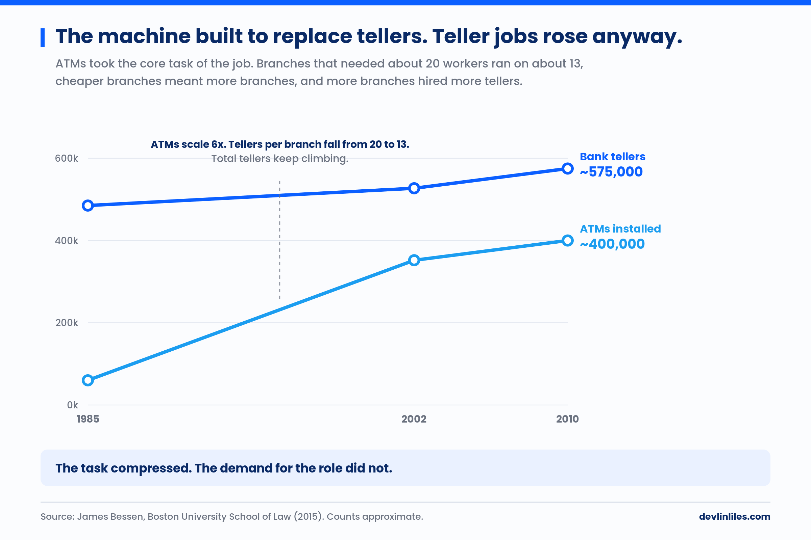
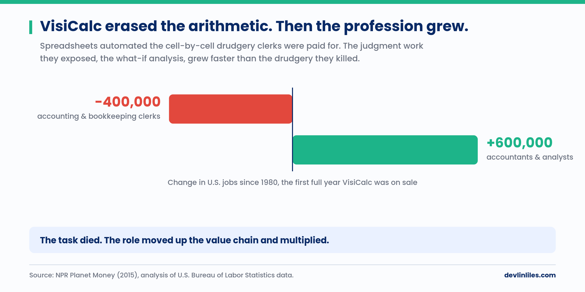
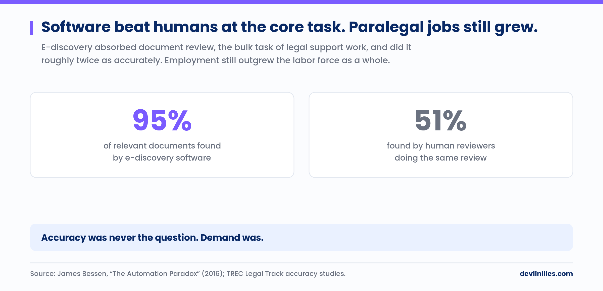

"Will AI replace our jobs?" is the question most organizations are asking, and it is a binary question. It produces binary thinking: either the threat is real and the response is defensive, or the threat is overstated and the response is dismissive. Both responses leave strategy on the table. The concept that produces strategy is labor compression.

The fear has a long pedigree. John Maynard Keynes coined the phrase "technological unemployment" in his 1930 essay "Economic Possibilities for our Grandchildren" and called it a temporary phase of maladjustment, the price of economizing on labor faster than we find new uses for it. Nearly a century of automation since has mostly vindicated the adjustment and understated how disorienting "temporary" feels from inside it. The record repays study, because what happened in those adjustments looks very little like replacement.

## What Labor Compression Is

Labor compression is the reduction of hours of effort required in a job role due to technological advancement.

Job elimination is a different phenomenon, and the historical record of automation is mostly a record of compression. The economist James Bessen documented the canonical case. After ATMs were deployed at scale, the number of bank tellers in the United States rose. The machines cut the cost of operating a branch, cheaper branches made it economical to open more of them, and the expanded network hired more tellers. The role changed character: tellers spent less time on cash transactions and more time on customer relationships. The hours required per transaction compressed. The demand for tellers did not.

The same dynamic plays out across most labor-compression events. The hours required per unit of output compress. The people freed from the compressed work get redeployed into higher-value work within the same role, or into producing more output at the same cost. The spreadsheet is the cleanest example on record: VisiCalc automated the cell-by-cell arithmetic that clerks were paid to do, and the judgment work it exposed grew faster than the drudgery it killed.

The strategic question is what happens to the freed capacity, and "will this role exist?" never reaches it.

## The Mechanisms

Labor compression operates through two distinct mechanisms, and they carry different strategic implications.

**Productivity amplification.** AI makes a worker faster or more capable at existing tasks. A developer who can produce code 30 to 40 percent faster has more time for design, review, mentorship, and architectural thinking. An analyst who can generate a first-draft report in minutes has more time for the interpretation and judgment that add the most value to the analysis. The role changes character. The demand for the role does not obviously change.

**Task automation.** AI absorbs entire tasks that previously required human effort. The task disappears from the human's workload. If the total pool of tasks requiring human effort shrinks, the organization either redeploys the freed people or reduces the size of the team. The outcome depends on whether demand expands to fill the freed capacity, as it did for the tellers, or stays fixed.

Task automation has happened before, and the result surprised everyone who predicted the obvious. E-discovery software absorbed document review, the bulk task of legal support work, and did it roughly twice as accurately as human reviewers. Paralegal employment grew faster than the labor force anyway.

The distinction matters because the strategic response differs. Productivity amplification calls for upskilling and role evolution. Task automation calls for capacity planning and workforce strategy. Organizations that treat all AI impact as one category will apply the wrong response to half of what is happening.

## The Demand Limit Problem

Labor compression stops helping when the limiting factor on value creation is demand.

Imagine a team that writes detailed technical proposals for potential clients. Each proposal takes three days to produce. AI could compress this to one day. But if the team already wins every proposal it submits and has a full project pipeline, what does the freed time produce?

If there is no additional demand to fill the freed capacity, labor compression produces surplus capacity that the organization has to either absorb into other work or convert into cost reduction. The AI investment may be real, but the value capture depends on whether the organization can actually use the freed hours.

This is why labor compression analysis has to be done at the level of specific roles and specific demand dynamics. A macro claim about whether AI will affect an industry answers almost nothing; the answer is almost certainly yes. The strategic question is which specific roles, with which demand dynamics, and with what redeployment options.

## Where the Argument Could Break

The compression frame has serious challengers, and three deserve an answer.

The first is the horse problem. Wassily Leontief observed in the early 1980s that the internal combustion engine had eliminated the economic role of horses entirely, and he warned that computers could do the same to human labor. If AI compresses cognition itself, the redeployment options that saved the bank tellers may close, because the higher-value work is being compressed at the same time. I take this seriously as a long-horizon possibility and find it unpersuasive on any planning horizon a leader actually controls. Horses could not redefine what they were for. Organizations and people can, and the work AI compresses least, judgment, relationships, synthesis, and novel problem definition, is exactly where the redeployment runs.

The second comes from Daron Acemoglu and Pascual Restrepo, who argue that much recent automation is "so-so": capable enough to displace workers, too weak to generate the productivity gains that fund new demand and new tasks. So-so automation produces the costs of compression without the compensating growth. That is a real failure mode, and it argues for the frame. Role-level compression analysis is precisely how you detect a so-so deployment before it hardens into workforce strategy.

The third is the charge that labor compression is a euphemism, softer language for headcount reduction. In demand-limited roles, compression sometimes will convert to cost reduction. The frame names that outcome as one of four options and refuses to make it the default. The euphemism critique lands on organizations that use the language and skip the analysis.

## The Right Questions for Leaders

The frame reduces to four questions for any executive thinking about AI and the workforce.

First, where in our workforce is AI producing labor compression? Identify the specific roles and tasks; the general domain is too coarse to act on. Second, for each compressed role, is the limiting factor on value creation demand or execution capacity? Demand-limited roles need new demand before the freed capacity is worth anything. Execution-limited roles should redeploy the freed capacity into higher-value work immediately. Third, what do we do with the freed capacity? Four options exist: grow demand, redeploy within the role, reduce costs, or invest in capability that creates future options. Fourth, what skills become more valuable as execution capacity compresses? The work AI cannot compress, judgment, relationship, synthesis, ethical reasoning, and novel problem definition, becomes scarcer and more valuable as the easily automated work disappears.

Organizations that answer these questions systematically will navigate the AI transition as an opportunity. Organizations that keep reacting to "will AI take our jobs?" will spend the transition being defensive while their competitors are being strategic.

## Where to Go From Here

The whole frame fits on one page. Start at the compression, run the gate, and choose the fate of the freed hours on purpose.

*Sources: James Bessen, Boston University School of Law (2015-2016); NPR Planet Money (2015); U.S. Bureau of Labor Statistics; TREC Legal Track accuracy studies.*
