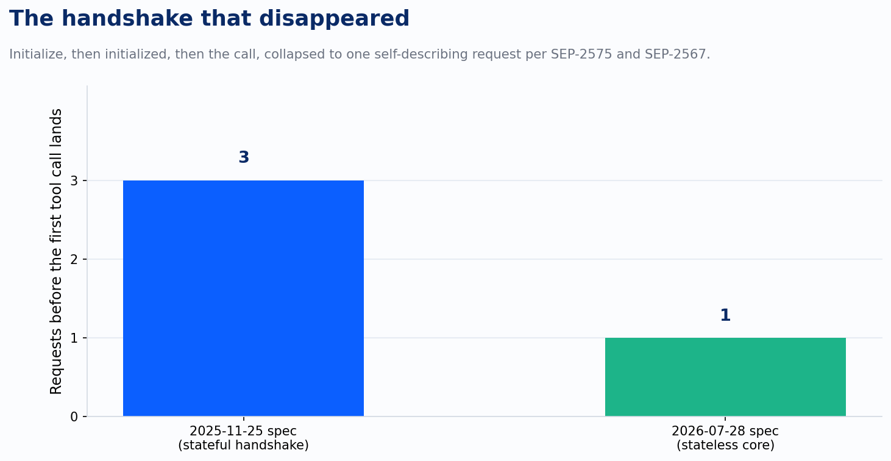
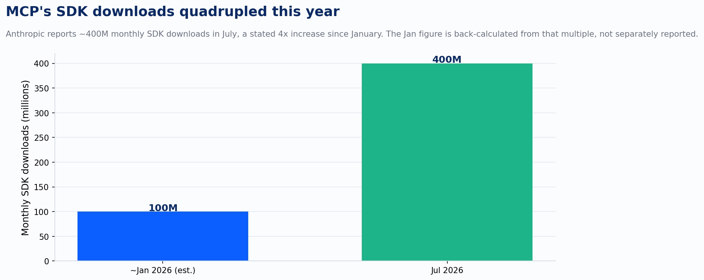

MCP crossed 400 million monthly SDK downloads in July, four times what it was moving at the start of the year, at almost the exact moment its authors ripped out the part of the protocol that was hardest to run in production. That's exactly what happens when a protocol grows past the point where its early shortcuts can keep up with how people are actually using it.

The 2026-07-28 spec is the fifth release of the Model Context Protocol, and Anthropic and the working group call it the biggest since remote MCP launched. The headline change is the one everyone building on Azure has been waiting for: MCP drops the `initialize`/`initialized` handshake and the `Mcp-Session-Id` header entirely. Every request now carries its own protocol version and client capabilities. There's an optional `server/discover` call if a client wants capabilities up front, but nothing requires it. The practical result, in the spec authors' own words, is that any request can now land on any server instance behind a plain round-robin load balancer, with no shared session store required.

That collapse matters more than it looks like on a chart with two bars. A stateful handshake means the second request to hit your MCP server has to land on the same instance as the first one, or on an instance that can see the same session store. On Azure, that has meant session affinity on Application Gateway or Front Door, or a Redis-backed session layer bridging instances that otherwise don't share memory. Both of those are solvable problems. Neither of them is free, and both of them work directly against the economics of serverless and scale-to-zero hosting, because sticky routing and consumption-plan elasticity want opposite things from your infrastructure. Collapsing three round trips into one self-describing request simplifies the protocol. It also removes the one requirement that was keeping MCP servers off Azure Functions' consumption plan and Container Apps' scale-to-zero tier.

Here's the part that matters: a stateless protocol isn't the same as having no state at all. Dropping the protocol-level session doesn't make an application stateless too. If a server needs to carry information across calls, the new pattern is to mint an explicit handle from a tool and have the model pass it back as an ordinary argument on the next call. That's a real design decision now. Someone has to decide what the handle points to, where it's stored, and how long it lives. The protocol used to hide that question inside the transport. Now it sits in the open, and someone still has to answer it.

Authorization got the same kind of honesty upgrade. The spec adds RFC 9207 issuer validation, which closes an authorization-server mix-up hole that's been a known weak point in OAuth deployments generally. It also formally deprecates Dynamic Client Registration in favor of Client ID Metadata Documents, with a twelve-month window before DCR is actually removed. Anthropic's own announcement states this plainly: authorization now aligns with how OAuth 2.0 and OIDC actually get deployed in enterprise environments, so MCP servers can sit behind identity systems like Entra without workarounds.

That line lands differently depending on whether you've tried to stand up an MCP server behind Entra ID before this release. DCR assumes a client can register itself with an authorization server at the moment it needs a token. That's a reasonable model for the open web. It's a strange fit for an Entra-governed tenant, where admins pre-provision App Registrations specifically to keep client identity a governance control from the start. CIMD's client metadata document model is closer to how Entra already works: identity declared ahead of time and approved by an admin. For Microsoft shops, the spec is finally catching up to an assumption Entra has operated under the whole time.

None of this replaces the gateway layer that Azure teams have already built to bridge the gap. Azure API Management sitting in front of an MCP backend, validating a token against Entra, then forwarding the call with a managed identity or an on-behalf-of exchange, isn't going away because the spec caught up. That pattern still does real work: rate limiting, policy enforcement, observability, credential mediation between the caller's identity and whatever the backend actually needs to authenticate with. What changes is that APIM is doing governance now, the job it should have had all along instead of patching around a protocol gap.

The scale numbers are the part that turns this from an interesting spec release into a planning item. Four hundred million monthly SDK downloads and more than 950 connectors listed in Claude's directory mean MCP has stopped being the thing one team pilots and started being default integration surface area, the same category as REST or gRPC for a lot of organizations that didn't necessarily decide that on purpose. That status comes with a cost: the spec's deprecation policy gives Roots, Sampling, Logging, and the legacy HTTP+SSE transport a twelve-month minimum support window before they're actually pulled. Twelve months sounds generous until you remember how many MCP integrations were built in the last year specifically because the protocol was new and moving fast. Anyone running one of those needs an actual line item for this, the same way any team tracks EOL dates on a database engine or a TLS version. That bookkeeping is required whether the thing being deprecated is a year-old protocol feature or a decade-old one.

What changed on July 28 is that MCP got honest about which questions belong to the protocol and which ones always belonged to the team building the server. The job itself is just as hard as before. The real obstacle was the workaround teams built to deal with Entra ID, and that workaround can finally go away.

---

*Sources: Model Context Protocol Blog, "The 2026-07-28 Specification" (blog.modelcontextprotocol.io); Claude by Anthropic, "MCP 2026-07-28 spec: stateless core, coming to Claude" (claude.com); Microsoft Community Hub and Microsoft Learn documentation on MCP authorization with Azure API Management and Entra ID.*
