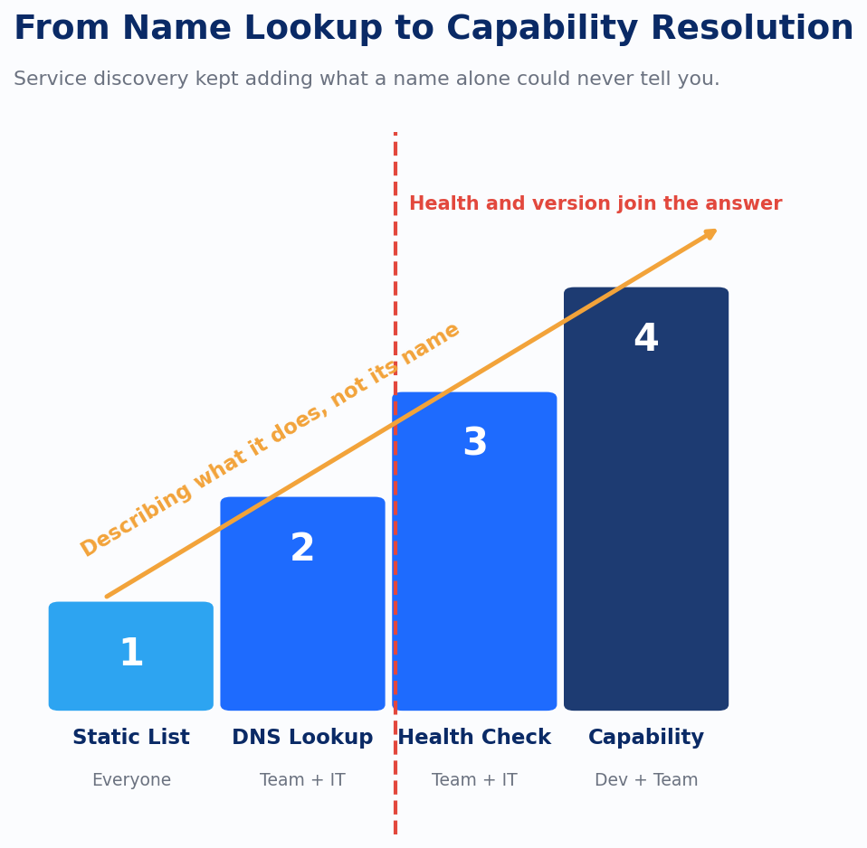

The other half of the discovery problem runs on a machine clock: a workflow engine asking, mid-pipeline, for the current, healthy, authorized version of a specific skill, with no one available to double-check the answer before it executes. Get that resolution wrong in a search box and someone rereads the results. Get it wrong inside a pipeline and the wrong thing runs. That's also not a new problem.

Distributed systems spent two decades arguing about a version of it that sounds too simple to have taken that long: how does one piece of code find another piece of code that's supposed to help it. The first honest answer was a name and a hardcoded address, and it lasted right up until the address changed, which in a system anyone actually used was constantly.

DNS solved the name part. It did not solve the actual problem, because a name doesn't tell you whether the instance behind it is currently healthy, which version is running, or whether you're allowed to call it. Client-side discovery pushed that resolution logic into every caller; server-side discovery centralized it behind a load balancer. Both were still answering "where is it," not "is it safe to call right now." The registries that came after, Consul, etcd, Zookeeper, added the piece that was actually missing: a live, health-checked index. A name stopped being enough the moment anyone needed to know if the thing behind it was actually up.

Service mesh pushed the same evolution further. It's tempting to describe that whole progression as adding features, but the more accurate read is that the field kept discovering what a name alone was never going to answer, one incident at a time.

AI asset discovery needs the same evolution, and there's a real argument for skipping straight past the part that took microservices the longest to learn. Name-based resolution was the natural starting point for services because a service name mapped cleanly to one deployable thing. A prompt, an agent, or a skill doesn't have that luxury. What matters about it is what it does: the inputs it expects, the outputs it produces, a description specific enough to embed and search against. An AI asset registry that starts with resolving a name to an endpoint and adds capability description later is repeating the slowest part of the microservices story on purpose. The registry should be capability-first from day one.

That's exactly the bet the current interoperability standards are making, from three directions that are converging fast. MCP's server and tool descriptors describe what a tool does before anything invokes it. The Agent2Agent protocol's Agent Card is a JSON document naming an agent's identity, its capabilities, its skills, and its endpoint, published so another agent or a registry can read it without a person translating first. NANDA's AgentFacts schema is an attempt at the same thing from the standards-body side: a structured, verifiable description of what an agent can be trusted to do. None of these three groups coordinated with each other to arrive at the same shape. They arrived there anyway, because it's the shape the problem actually has: describe the capability first, and identity and invocation follow from that description.

The honest caveat is that all three of these are young. A spec published in 2025 hasn't survived a decade of production incidents the way Consul's health-check model has, and betting an entire platform API on one of them by name is a bet on which standard wins a race that hasn't finished. What's worth committing to now is the underlying pattern all three share: a registry that resolves capability, not just identity, and that makes the description itself the thing another system can query. MCP, A2A, and AgentFacts are each one bet on how that pattern gets standardized. The pattern is the part that survives regardless of which bet wins.

This is also where the two halves of the discovery problem, the one a person runs into and the one an orchestrator runs into, actually collapse into a single object. A capability-based registry that emits into a shared knowledge graph, the same graph a semantic search index reads from, is no longer two systems that happen to agree today and might drift tomorrow. It's one graph, read two ways. Whatever the registry learns about a service's health, version, and authorization has to land in the same place the catalog already recorded that service's description, its owner, and its lineage, or the convergence is cosmetic.

---

*Sources: *[*Service Discovery Explained | Consul | HashiCorp*](https://developer.hashicorp.com/consul/docs/use-case/service-discovery?ref=devlinliles.com)*; *[*Service Discovery Patterns: DNS, Consul, and Kubernetes-Native Approaches*](https://www.designgurus.io/blog/service-discovery-patterns-dns-consul-kubernetes?ref=devlinliles.com)*; *[*Agent2Agent (A2A) Protocol Official Specification*](https://a2a-protocol.org/v0.3.0/specification/?ref=devlinliles.com)*; *[*AgentFacts: Universal KYA Standard | arXiv*](https://arxiv.org/pdf/2506.13794?ref=devlinliles.com)*; *[*A Survey of AI Agent Registry Solutions | arXiv*](https://arxiv.org/html/2508.03095v1?ref=devlinliles.com)*; *[*Introducing the MCP Registry | Model Context Protocol Blog*](https://blog.modelcontextprotocol.io/posts/2025-09-08-mcp-registry-preview/?ref=devlinliles.com)*; *[*GitHub - modelcontextprotocol/registry*](https://github.com/modelcontextprotocol/registry?ref=devlinliles.com)
