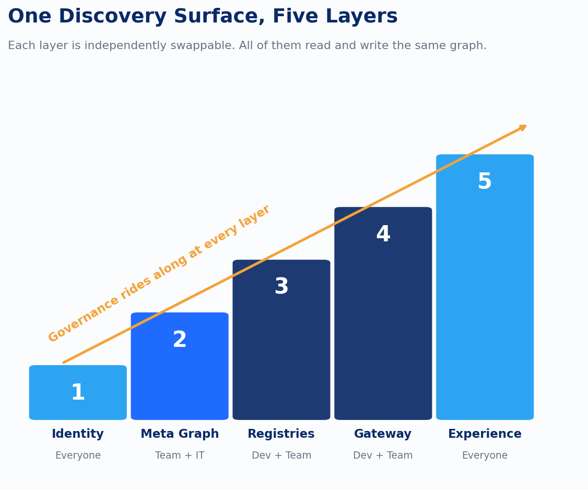

Two different fields already solved their half of this discovery problem: one for the person asking in plain language, one for the system resolving a request at runtime with no one watching. What was still open was whether those two halves need to live in one system or two, and every AI asset library conversation eventually arrives at that same design question, whether or not anyone states it out loud. The market answered it in the last year, decisively, and mostly by accident, because four platform vendors who don't coordinate with each other all converged on the same answer independently.

Databricks got there by widening Unity Catalog's three-level namespace to cover models, functions, vector search indexes, agents, and MCP services alongside the tables it already governed. That widening says something specific: an agent and a table need to be found, access-controlled, and audited through the identical mechanism, because from a governance standpoint they're the same kind of problem, something a person or a process needs to locate, trust, and be authorized to use.

Microsoft is making the identical move from the opposite direction. Entra Agent ID and Agent 365 give agents the same identity substrate that users have always had, which sounds like a small technical detail until you consider what it implies: an agent is now a principal inside the identity system, governed the same way a human account is. Purview is extending its governance surface to stream agent activity, prompt chains, retrieved documents, tool calls, into the same audit trail that already tracks data lineage. Azure AI Foundry's model catalog sits behind that same governed control plane. AWS's new Bedrock Agent Registry and Google's Agent Registry are the same convergence again, arriving late in the same year.

Read across all four and one pattern stands out: nobody serious is building a separate silo for AI assets next to the one they already have for data assets. The winning architecture is one identity layer, one governance layer, one discovery layer, and both kinds of assets live inside it.

That gives the reference architecture behind this series a concrete shape, worth naming as layers because each one is independently swappable, which matters if the goal is a platform API that doesn't lock the organization into one vendor's opinion about how discovery should work underneath it.

Identity and namespace sits at the bottom. Every asset type gets a consistent, hierarchical identifier, and agents get identities alongside users, which is why Entra Agent ID and Unity Catalog's namespace both matter: identity now has to cover non-human actors on the same terms as the accounts it already tracked. Above that sits the metadata and knowledge graph layer, the active, continuously enriched substrate that links assets to owners, lineage, and each other. This is the discovery layer this whole series has been circling, and it's also where governance objects, scenario lineage, audit logs, belong as first-class linked nodes, built into the graph from day one. OpenLineage's run, job, and dataset model is the right pattern to extend, widened to cover run, agent, prompt, and model as well.

Per-asset-type registries sit above the graph: a model registry, a prompt registry, an agent or skill registry, each with its own lifecycle, draft, staged, production, deprecated, all emitting into the shared graph so none of them accumulates the private metadata that separate systems always eventually keep. The gateway and broker layer is the single invocation surface handling authentication, health-aware routing, versioning, and observability: the API-gateway and service-mesh pattern, applied to AI assets. There's a working existence proof of this exact layer already open source: the mcp-gateway-registry project implements OAuth through Entra or Keycloak, dynamic tool discovery, and unified access for agents and coding assistants, worth pointing engineers at even without adopting it directly. The experience layer sits on top: the chat and search interface, working by hybrid semantic and structured search over the knowledge graph itself, which is what actually turns "ask in natural language, get back the right prompt or agent" into a production capability, the hardest part of the requirements document to actually deliver.

On which of these to build versus buy, the honest answer depends on what's already in the stack, and I'd resist the instinct to treat this as a generic digital asset management procurement. If there's Databricks in the picture already, Unity Catalog is the furthest along of anything on the market at unifying data and AI assets under one namespace and one governance model. Models, functions, vector indexes, agents, and MCP services already share it today, not on a roadmap. If the platform leans Microsoft, the converging equivalent is the governed agent stack Microsoft introduced at Build 2026, an identity, policy, and audit layer built on Entra, Purview, and Azure AI Foundry that treats agent invocation the way the rest of the estate treats data access. That stack is in public preview now, with general availability targeted for October 2026, moving fast enough that dismissing it as immature would be premature. Staying platform-neutral and building custom behind an internal API is the third path: OpenMetadata or DataHub supply the open-source knowledge graph and catalog layer, paired with a purpose-built gateway modeled on the pattern the MCP registry project already proved out.

A generic DAM procurement is the wrong instinct for a specific reason: prompts, agents, model indexes, and grounding data carry lifecycle and versioning needs that content-focused digital asset managers were never built for. A DAM was designed to store and tag a PDF. It was not designed to know that a prompt's fourth version was promoted to production only after it passed an evaluation gate that the third version failed.

That gate is the one piece of this whole architecture that gets underbuilt more often than any other. Prompts deserve the same registry discipline as models: versioning, evaluation-gated promotion, an audit trail showing exactly which version produced which output. Tools like PromptLayer, LangSmith, and Humanloop already show what that discipline looks like in practice: git-like versioning, diff views between prompt revisions, promotion tied to evaluation results, not to whoever remembered to update a shared doc. It's a cheap thing to get right while there are still a dozen prompts in the system. It gets expensive fast once there are a thousand.

---

*Sources: *[*Unity Catalog | Databricks*](https://www.databricks.com/product/unity-catalog?ref=devlinliles.com)*; *[*Create AI agent tools using Unity Catalog functions | Databricks*](https://docs.databricks.com/aws/en/generative-ai/agent-framework/create-custom-tool?ref=devlinliles.com)*; *[*Databricks AI Search*](https://www.databricks.com/product/machine-learning/vector-search?ref=devlinliles.com)*; *[*Microsoft Foundry | Microsoft Azure*](https://azure.microsoft.com/en-us/products/ai-foundry/?ref=devlinliles.com)*; *[*AI Model Catalog | Microsoft Foundry Models*](https://ai.azure.com/catalog?ref=devlinliles.com)*; *[*Build 2026: Microsoft's Governed Agent Stack*](https://windowsnews.ai/article/build-2026-microsofts-governed-agent-stack-locks-down-enterprise-ai-with-new-mai-models.429587?ref=devlinliles.com)*; *[*AWS Launches Agent Registry in Preview | InfoQ*](https://www.infoq.com/news/2026/04/aws-agent-registry-preview/?ref=devlinliles.com)*; *[*Unified AI registry | Collibra*](https://www.collibra.com/blog/unified-ai-registry-your-central-inventory-for-ai-use-cases-models-and-agents?ref=devlinliles.com)*; *[*GitHub - agentic-community/mcp-gateway-registry*](https://github.com/agentic-community/mcp-gateway-registry?ref=devlinliles.com)*; *[*About OpenLineage*](https://openlineage.io/docs/?ref=devlinliles.com)*; *[*GitHub - OpenLineage/OpenLineage*](https://github.com/OpenLineage/OpenLineage?ref=devlinliles.com)*; *[*Best Prompt Versioning Tools 2026 | Braintrust*](https://www.braintrust.dev/articles/best-prompt-versioning-tools-2025?ref=devlinliles.com)*; *[*Prompt Management Tool | Humanloop*](https://humanloop.com/platform/prompt-management?ref=devlinliles.com)
