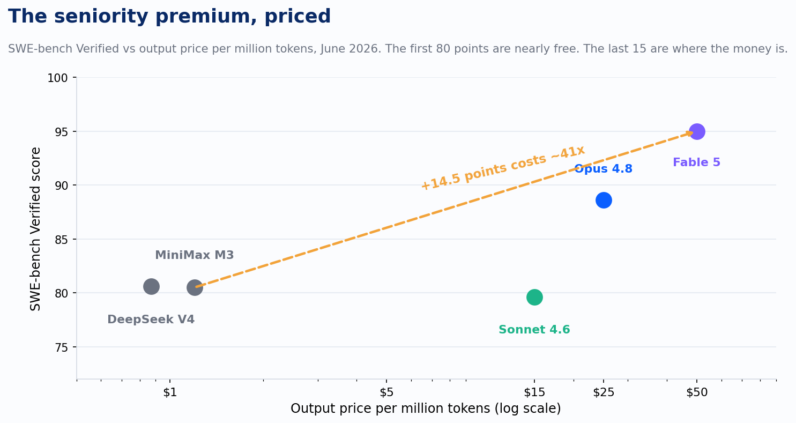
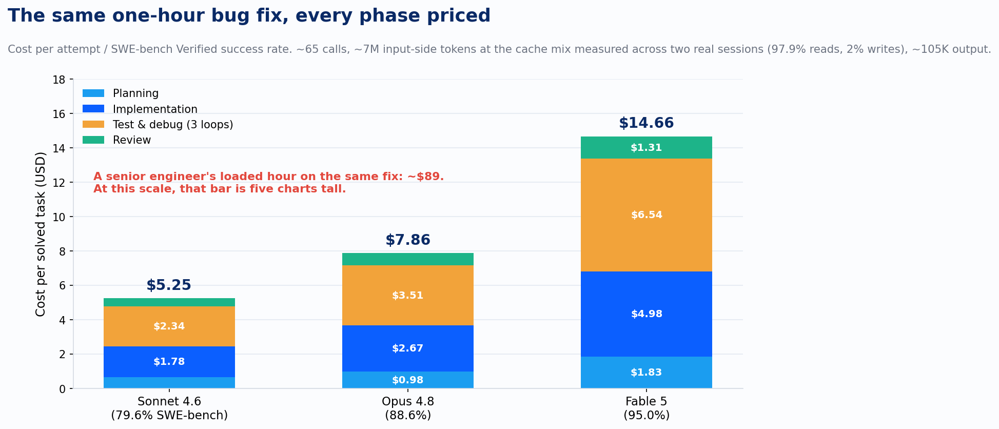
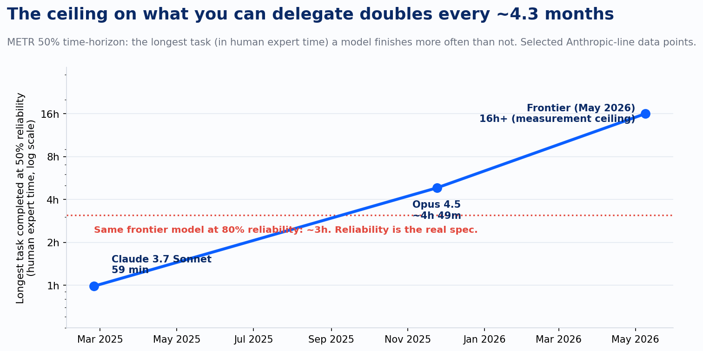

The discipline most engineering leaders already apply to people: tag every ticket with how many hours it would take a strong engineer, and the seniority of the cheapest person who could actually be trusted with it. Not whoever happens to be free this sprint. The level the work requires.

Most leaders run that discipline for humans and abandon it for AI. A senior engineer in the US averages $142,445 in base pay across 7.6 thousand job postings on Indeed, with the high end of the range at $215,412 before reaching the big-platform staff roles that clear $250,000. Nobody staffs the top of that range on a config change, because the work does not require the judgment that rate buys. Those same leaders open their AI tooling, set every request to the most capable model on the board, and call it a day. The effect is staffing the $250,000 engineer on every ticket. The invoice notices even when the leaders don't.

Here is the staffing math, with mid-2026 numbers.

Model tiers now map to seniority bands cleanly enough to price. On SWE-bench Verified, the standard benchmark for resolving real GitHub issues end to end, Claude Fable 5 sits at 95.0% and costs $10 per million input tokens and $50 per million output. Opus 4.8 scores 88.6% at $5 and $25. Sonnet 4.6 scores 79.6% at $3 and $15. Open-weights models like MiniMax M3 hit 80.5% at $1.20 per million output tokens. Read that list again as a hiring manager. Roughly 80% of standard issue-resolution is available for nearly free. The premium tiers exist to buy the last fifteen points.

*SWE-bench Verified vs output price per million tokens, June 2026. The first 80 points are nearly free. The last 15 are where the money is.*

That is the same shape as the engineering labor market. The jump from a capable mid-level to a staff engineer is not a 15% raise for 15% more output. It is a multiple, and you pay it because some work only the staff engineer can carry. Going from MiniMax's 80.5% to Fable 5's 95.0% buys 14.5 benchmark points for roughly 41 times the output price. The premium is real. So is the work that justifies it.

Benchmark score and token price are two of the three numbers you need. The ratio that actually prices the work is cost per solved task: what one attempt costs, divided by how often the attempt succeeds, so retries are baked in. And price the whole harness, because the one-pass perfect patch is a myth. A real run has four phases. Planning: the agent reads the repo, traces the bug, and writes its approach, about 10 calls heavy on file content. Implementation: about 25 calls, with conversation context growing to roughly 120K tokens. Test and debug: the harness runs the suite, reads the failures, and loops; two to five loops is normal in most harnesses, so call it three at eight calls each, with logs and stack traces piling into context. Review: a final pass over the diff before anyone merges. The full run lands near 65 calls, 7M cumulative input-side tokens, and about 105K output tokens. The cache assumption is the lever that decides whether numbers like these are real, so I refused to assume one. I pulled the mix off Claude Code's own usage accounting across two long sessions on my machine: 97.9% of input-side tokens were cache reads at a tenth of the input price, 2% were cache writes at 1.25x, and truly fresh input rounded to 0.07%. Priced at that measured mix, Sonnet 4.6 lands at $5.25 per solved task. Opus 4.8 at $7.86. Fable 5 at $14.66.

*The same one-hour bug fix, every phase priced. Cost per attempt divided by SWE-bench Verified success rate, at the cache mix measured across two real sessions.*

A senior engineer's loaded hour runs about $89. The components, so you can re-run it: $142,445 average base, a 1.3 benefits-and-overhead multiplier, 2,080 working hours. Against that, Sonnet's $5.25 is 6% of the human cost, a 17x advantage with every phase and the retries priced in. Fable's $14.66 is 16%. The lazy story, that the machine is always two orders of magnitude cheaper, does not survive the full harness; 17x is the number, and only if you route well. The tier spread is no rounding error either. At a thousand tasks a day, the gap between $5.25 and $14.66 is $3.4 million a year. Call it eighteen loaded senior engineers' worth of budget spent on capability the tickets may never have required. And notice which slice dominates every bar: the debug loops nobody budgets for, never the implementation.

If those per-task numbers look small next to your invoice, run the math backward from real bills. Two teams I work with put in the same 8-hour days on different defaults, and their invoices reverse-calculate cleanly. The team routed to Sonnet averages $1,000 a month per developer. At 260 workdays a year that is $46 a day, and eight task-hours of harness work a day makes it $5.77 per solved task-hour. The bottom-up model above computed $5.25 for the same unit. Two directions, same answer, within 10%. The math holds.

The team defaulted to Fable burns $1,300 a day per developer. Same division: $162.50 per task-hour. That is eleven times the computed $14.66 for the same nominal hour of work, and 183% of the loaded senior hour it was supposed to undercut. The machine now bills nearly double the human it assists. The delta is workload shape, and the usage panel names it: two or three agent lanes running in parallel all day on the flagship, orchestrators spawning subagents that also run on the flagship, and most of the volume sitting in contexts past 150K tokens, where even cache reads at a tenth of the price bill real dollars by the half-billion. Spread the burn across three parallel lanes and the per-lane cost drops to $54 a task-hour, still 61% of the human rate, which means the question stops being whether the model is cheap and becomes whether the parallelism actually ships three engineers' output. Sometimes it does. The panels I have seen more often show the flagship formatting JSON inside a subagent because routing was nobody's job. Annualized, these two teams pay $12,000 and $338,000 per developer for days that look identical in standup, a 28x spread, and the expensive one costs nearly twice the $185,000 loaded engineer driving it.

That gap produces the planning number I now ask every team for: how many parallel agents it takes for a developer to double their own cost. A loaded senior day runs $712. On the clean per-task math, one agent lane working a full eight-hour day costs $42 on Sonnet, $63 on Opus, $117 on Fable. So a developer doubles themselves at seventeen Sonnet lanes, eleven Opus lanes, or six Fable lanes. Nobody doubles by accident on the mid tier; you would notice seventeen lanes running. The trap is that real lanes are messier than computed ones. The Fable team's lanes, carrying their subagent fan-out and 150K contexts, run about $433 a day each, and the second lane tips the developer past costing the company double. Six lanes is a fleet you would budget for. Two is a Tuesday.

The third number is the one most teams skip: how long a task the model can actually carry. METR measures this directly. Their time-horizon metric asks, for tasks calibrated by how long they take human experts, what is the longest task a model completes more often than not. In February 2025 the answer for Claude 3.7 Sonnet was 59 minutes. By late 2025, Opus 4.5 reached roughly 4 hours 49 minutes. As of May 2026 the frontier sits at 16 hours or more, which is the ceiling of what METR's task suite can reliably measure. The capability has been doubling about every 4.3 months.

*METR 50% time-horizon: the longest task, in human expert time, a model finishes more often than not. The ceiling doubles roughly every 4.3 months.*

This is the dimension where the hiring analogy stops being a metaphor and becomes the spec. A junior engineer can close any number of 30-minute tickets and still be the wrong hire for the two-week migration. Same with models. The mid-tier model that crushes your bug-fix queue at $5.25 a task will wander off course on the 12-hour refactor, and no retry budget fixes that, because the failure is capability, not luck. The frontier tier is the only hire that can carry the long task. That is what the $50 output tokens buy. Paying them to format JSON is the exact mistake you would never make with a person.

Now the part the vendor decks skip. Three caveats keep this math honest.

First, the chart at 50% reliability flatters the headline. The same frontier model that carries a 16-hour task half the time only carries about a 3-hour task at 80% reliability. Half the long tasks fail, and someone senior has to notice which half. Second, SWE-bench numbers are vendor-reported on a benchmark widely considered contaminated for frontier models; third-party standardized scores routinely come in lower. Treat the scores as ordering the tiers, not as a promise about your codebase. Third, the cost-per-task figures are computed token math on a stated profile, and the cache mix is measured, never promised. Those two sessions of mine billed $1,053 between them, and 67% of it was cache reads even at a tenth of the price. Volume eats discounts. A harness that wastes its cache pays about five times these figures, so the mix is a number to monitor, never a number to assume forward. And the figures still leave out the most expensive line item of all: the human who signs off on the merge. The model reviewing its own diff catches the test failures; it does not catch the requirement it misread. Twenty minutes of an $89-an-hour engineer verifying the run costs $30, nearly six times the entire Sonnet task, and that math is the reason the ratio is a routing tool, never a headcount argument.

One more pressure on the math: the cheap end is the stable end. I wrote recently about frontier token prices reversing upward after years of collapse, with the newest flagship priced at double its predecessor. The premium tier is getting more expensive while the mid tier holds. Every month an organization runs everything on the flagship, the spread widens against it.

The routing table that follows from this reads like a staffing plan. Tasks under an hour with a clear definition of done belong on the mid tier, where the success rate covers the retries. Multi-hour tasks with a tight spec belong on the senior tier. Long-horizon, ambiguous, high-blast-radius work belongs on the frontier tier with mandatory human review, because at 50% reliability the model is a brilliant hire who finishes half of what it starts. Cost per solved task by tier, instrumented and reviewed quarterly, is the signal that closes the loop, because the horizon doubles every 4.3 months and the model that needs the frontier today is mid-tier work by next spring.

The teams treating model selection as a default setting are paying staff-engineer rates for intern work and intern rates for staff-engineer work, sometimes in the same hour. The teams treating it as a hiring decision have a number for every ticket. Matching capability to work is the oldest discipline in engineering management. The roster just changed.

---

*Sources: SWE-bench Verified leaderboards (swebench.com, llm-stats.com, June 2026); Anthropic API pricing (platform.claude.com, June 2026); morphllm.com cost-per-task token math and model rankings (June 2026); METR time-horizon analysis (metr.org/time-horizons, Time Horizon 1.1, May 2026 update); Epoch AI METR Time Horizons explorer; Indeed Career Explorer, senior engineer salary in United States, 7.6K postings, updated June 9, 2026.*
