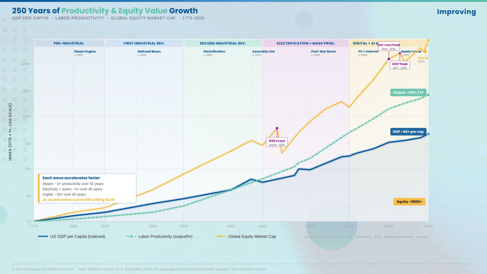

# Not That GPT: AI as a Generally Productive Technology

Say GPT today and most people hear the name of a product. Economists got to the acronym first. Since the mid-1990s, GPT has meant general purpose technology: an innovation applicable across so many domains that it restructures entire economies. The collision between the two meanings is an accident of branding, and a useful one. When I write about GPT, I mean the economists' version, with one deliberate adjustment: AI is a *Generally Productive Technology*. That framing changes what the technology demands of leaders and how much time they have to respond.

## What Is a Generally Productive Technology

The formal term comes from Timothy Bresnahan and Manuel Trajtenberg, whose 1995 paper "General Purpose Technologies: Engines of Growth?" gave a name to a pattern economic historians had been tracing for a century. Certain innovations behave differently from ordinary inventions. The steam engine, electricity, the railroad, and the internet each arrived as a specific capability and ended up reorganizing the economy around themselves.

Three characteristics define the category. A GPT is pervasive: it finds productive use across most economic activity, enabling new solutions in domains its inventors never considered. It improves continuously: adoption opens possibilities that were invisible before the technology existed, which drives further investment and further improvement. And it spawns complementary innovation: the more broadly it is adopted, the more productive it becomes for every participant, because the surrounding economy reorganizes to take advantage of it.

AI meets all three tests, and that is the claim I hold strongly. The acronym collision with the OpenAI product name has made "GPT" synonymous with a chatbot category, and that shorthand quietly miscategorizes the technology. The accurate category is macro-economic. AI is in the lineage of electricity and the internet, and it will reshape the labor market, the capital market, and the competitive landscape in every sector.

## Why the Category Changes the Questions

Treat AI as a product category, a set of tools with features and use cases, and the questions follow naturally: what can it do, what does it cost, what are the risks. These are legitimate questions. They are also downstream of the ones that matter.

Treat AI as a Generally Productive Technology and the questions change register: how does the availability of this technology restructure the economics of our industry? Which business models that were previously infeasible become viable? Which competitive positions that were previously defensible become vulnerable? Which skills and capabilities will be scarce in five years, and which abundant?

These are the questions executives faced about the internet in the mid-1990s. The organizations that answered them correctly in 1996 built Amazon. The organizations that filed the internet under "new customer service channel" were Circuit City and Borders.

## The Electricity Precedent

Electricity is the precedent I find most instructive, and the history rewards a close look.

Before widespread electrification, industrial production ran on mechanical power: water wheels, steam engines, and the systems of shafts, pulleys, and belts that distributed force through a factory. The power infrastructure dictated the factory layout. Machines clustered near the power source, arranged in fixed configurations determined by the physical transmission of mechanical force.

The economic historian Paul David studied this transition in his 1990 paper "The Dynamo and the Computer." Edison's Pearl Street station began delivering central electric power in 1882. Measurable productivity gains in American manufacturing took roughly forty years to appear. The delay had a structural cause. The first wave of adopters bolted electric motors onto their existing shaft-and-pulley layouts and captured a fraction of the value. Electricity's real contribution was the unit drive: each machine with its own motor, which dissolved the constraint that had organized factories for decades. Once that constraint was gone, the factory could be redesigned around the flow of materials, and the firms that did the redesign captured the gains.

AI puts knowledge work at the same juncture. The constraint that has organized knowledge work for a century is human execution capacity: how much analysis, drafting, coordination, and review a given team of people can produce. AI dissolves that constraint. The organizations that treat it as a faster way to run their existing processes are wiring motors to the line shaft. The redesign is where the value sits.

## Where the Argument Could Break

A position held strongly should still survive contact with its best counterarguments, and this one has three worth taking seriously.

The first comes from David's own evidence: GPT diffusion has historically been slow. Forty years from Pearl Street to measurable manufacturing productivity. If AI follows the same curve, the urgency case weakens considerably and patient followers do fine. The second is the "normal technology" view, argued most carefully by Arvind Narayanan and Sayash Kapoor: benchmark capability is a poor proxy for deployed capability, and diffusion will be gated by the slow parts of organizations, regulation, and trust. The third is Robert Gordon's broader skepticism that any modern technology rivals the great inventions of the 1870 to 1970 era in productivity impact.

Here is where I land. The electrification lag was a function of physical constraints: capital replacement cycles measured in decades, factories that had to be rebuilt, and a power distribution network that had to be constructed pole by pole. AI's distribution layer already exists. The internet, the cloud, and the browser deliver it at near-zero marginal cost to every desk that already does knowledge work. The retooling AI requires is organizational, and organizational change is slower than the optimists claim. It is also much faster than forty years. The normal-technology critique is right that deployment friction is real, and I read that friction as a description of the gap between Early Adopters and the Early Majority, which is precisely the window where competitive advantage gets made. Gordon's skepticism deserves a longer answer than this post can give, and the capability and cost evidence accumulating since 2023 has not moved in his favor.

## What This Means for Timing

GPTs do not wait for organizations to be ready. The electrification record makes the same point from the other direction: firms that had not adopted electric power past a certain point were operating at a structural cost disadvantage that made them uncompetitive regardless of their other strengths.

The capability data is clear. AI models now perform at or above human expert level on specific benchmarks: PhD-level science reasoning, professional software development, legal analysis, medical diagnosis. The cost data is equally clear. The price per unit of AI-generated output has fallen between 9x and 900x per year depending on the model tier.

Rising capability combined with falling cost is the economic condition that produces rapid adoption across markets. It does not produce uniform adoption. The Rogers diffusion curve will play out here as it has elsewhere, with Innovators and Early Adopters capturing most of the advantage before Early Majority adoption commoditizes the gains. The window for Early Adopter positioning is measured in months to low single-digit years.

The practical question has moved past "should we use AI?" The organizations still asking it are already exposed. The question worth the executive team's time is: how do we position ourselves in this transition so that we capture the advantage and someone else bears the disruption?

## Starting the Right Conversation

The reframe is simple to state. Stop asking "what can AI do for us?" Start asking "how does AI change the economics of what we do?"

The first question produces a list of tools. The second produces a strategy.

---

*Part of the Thought Leadership series — Thread 3: AI & Machine Learning.*
