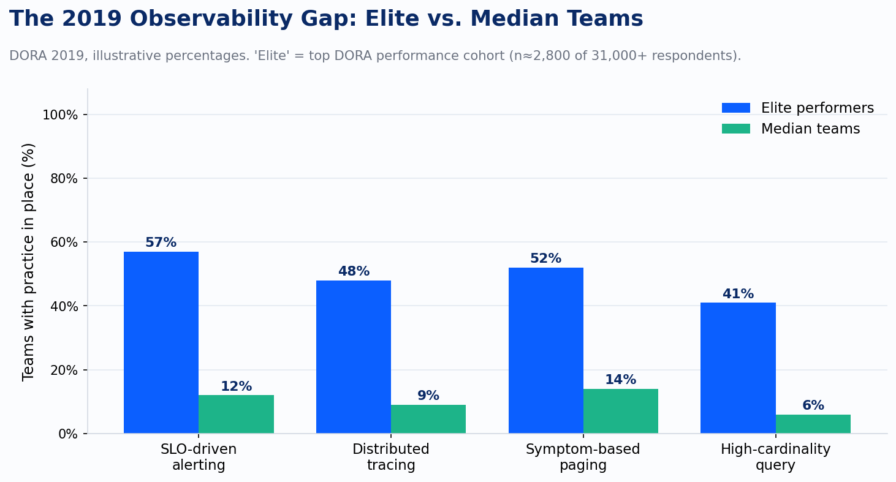
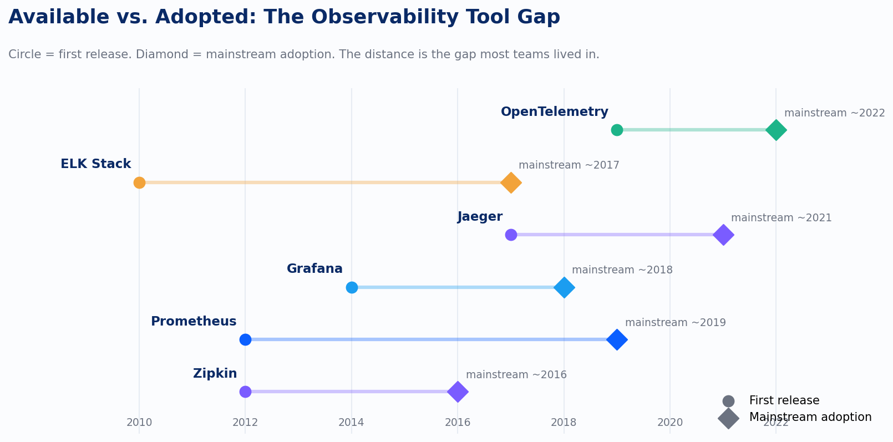
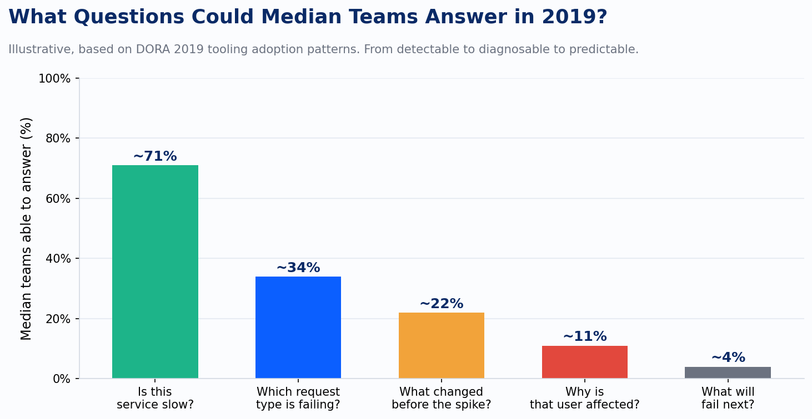

In 2019, if your team had more dashboards than on-call incidents, that was probably a sign you were good at measuring the things you already knew about. Not that you were good at observability. The difference matters more than any tooling decision that came after.

## The Best Practice Literature Was Not Describing You

By 2019, the authoritative guidance on production engineering was well-established and genuinely excellent. The Google SRE book had been out since 2016. The SRE Workbook followed in 2018, adding worked examples of SLIs, SLOs, and error budgets. DORA had spent six years surveying more than 31,000 technology professionals across the software delivery value chain. The conclusion the literature kept reaching was consistent: alert on symptoms, not causes. Define what good looks like before you deploy. Page humans only when a user-facing behavior has degraded, not when a metric crossed a threshold someone set five years ago at 3 AM.

That guidance was sound. The problem was that the vast majority of teams were not running anything close to it.

The DORA 2019 State of DevOps Report is the clearest evidence of this. DORA drew a hard line between monitoring and observability: monitoring watches predefined metrics and logs, observability lets you actively debug by exploring properties and patterns you did not define in advance. By their taxonomy, 57% of elite performers had integrated production observability tooling into their delivery workflows. That sounds like broad adoption until you look at what "elite performer" means in the DORA data. Elite was the top performance cohort, roughly the top 9% of respondents. The median team was nowhere near that figure.

*Elite performers (top ~9% of DORA respondents) reported 57% observability integration; median-cohort teams were clustered near zero, making the headline figure deeply misleading as an industry benchmark.*

The adoption gap on distributed tracing tells the same story with sharper numbers. Zipkin shipped in 2012. Jaeger arrived in 2017 and moved into CNCF incubation. By 2019 you could stand up end-to-end distributed tracing in an afternoon. Outside of large internet companies, almost nobody had. The tools were available years before they reached mainstream use, and "mainstream" in 2019 still meant the forward edge of serious platform engineering teams.

*Tool availability consistently led actual adoption by three to five years: Jaeger reached CNCF incubation in 2017 but remained aspirational for the majority of engineering organizations through 2019.*

## The Problem Was Deeper Than Tooling

It would be convenient to say the problem was tooling. Buy better tools, close the gap. That framing was popular in 2019 and it was wrong.

Prometheus graduated from CNCF incubation in August 2018, which meant that by 2019 the de facto standard for metrics collection was free, stable, and widely documented. Grafana paired with it almost automatically. Alertmanager handled notification routing. ELK covered log aggregation. The ingredients for a decent monitoring stack were not expensive or hard to find. Teams that were behind were not behind because they lacked access to software.

They were behind because monitoring and observability solve different problems. Monitoring is a known-unknowns discipline. You define what might go wrong, you instrument for it, and you wait. A threshold alert on CPU utilization above 85% assumes you have already decided that CPU is the thing that matters and that 85% is the right boundary. You might be right. You are also working backward from your hypotheses about failure, which means every failure mode you did not anticipate is invisible until a user finds it.

Observability is an unknown-unknowns discipline. Charity Majors and the Honeycomb team spent 2017 through 2019 making this argument with increasing precision: the value of high-cardinality, high-dimensionality event data is that it lets you ask questions you did not know you would need to ask. You cannot write a threshold alert for a latency spike that only affects customers using a specific combination of browser version, geographic region, and feature flag state. You can find it in wide event data after the fact, if you captured enough context. The philosophical difference between "I instrumented for failure mode X" and "I captured enough state that I can reconstruct what happened" is the difference between a monitoring culture and an observability culture.

Most teams in 2019 were solving the known-unknowns problem very elegantly. They had dashboards for everything they had already thought about. The coverage felt comprehensive. What they could not do was answer the questions that mattered most during an actual incident.

*Dashboard coverage is not diagnostic coverage: the questions that appear during an incident are almost never the questions the monitoring system was built to answer.*

The progression above is not a critique of any specific team. It is the structural consequence of building monitoring systems: you optimize for detection of the things you defined, and the capability to diagnose the things you did not fades as a priority because you have never felt its absence until the moment you need it most.

## What the Stack Actually Looked Like

The canonical 2019 platform engineering stack was recognizable almost everywhere I worked. I saw it in a financial services firm running 200-plus microservices on bare-metal Kubernetes, in a healthcare platform team managing EKS-based claims processing across three regions, and in mid-market SaaS companies that had just completed their first lift-and-shift to AWS. The pattern was nearly identical regardless of vertical: Prometheus for metrics, Grafana for visualization, Alertmanager for notification routing, legacy Nagios or Zabbix still running in corners nobody wanted to touch, and ELK for logs. Sometimes Datadog or New Relic in the application layer if a vendor had gotten there first. Distributed tracing was aspirational. A few teams had Jaeger running on a subset of services with no clear plan for expanding coverage.

The alerting in this stack was overwhelmingly infrastructure-focused. CPU thresholds. Memory thresholds. Disk fill-rate projections. These are causes, not symptoms. The SRE literature had been clear since 2016 that paging on causes produces alert fatigue without improving user experience: a server at 90% CPU that is serving users successfully is not an incident. A server at 40% CPU that is timing out half of its requests is. The literature said alert on the second pattern. Most alert configurations were built for the first.

This was not ignorance of the SRE books. Every platform engineer I encountered in 2019 had read them or at least knew the SLI/SLO framing. The problem was operational. Defining meaningful SLOs requires agreement on what user-facing reliability means, which requires collaboration between engineering, product, and sometimes commercial teams. That collaboration is harder to schedule than adding a Prometheus rule. So teams read the books and kept the threshold alerts because the threshold alerts were already there and the political work of replacing them had not happened yet.

## The Bimodal Reality and Why It Matters for Benchmarking

One of the persistent errors in evaluating platform maturity is benchmarking against best-practice literature. The DORA report, the SRE books, the Honeycomb blog posts: these documents describe elite practice, and they are written by and for people already operating near that level. Treating them as the baseline makes your team look worse than the actual industry median. Treating them as aspirational without understanding the distance is what produces roadmaps that fail.

The 2019 distribution was genuinely bimodal. A small cohort of high-performing teams, concentrated in large consumer internet companies and the forward edge of cloud-native adopters, was running SLO-driven workflows with distributed tracing and high-cardinality query capability. The majority of engineering organizations were running Prometheus with hand-crafted alert thresholds and some version of "we'll look at the dashboard when something breaks." The gap between those two bimodal cohorts was not primarily a budget gap or a tool gap. It was a practice gap, and the practice gap had philosophical roots.

Understanding which cohort your team was in 2019 is not an exercise in self-criticism. It is the necessary baseline for evaluating how much ground has actually been covered since. The observability tooling market has moved dramatically between 2019 and today. Vendor consolidation happened. OpenTelemetry changed the instrumentation economics. eBPF brought continuous profiling to environments that could never have instrumented manually. AIOps matured from correlation theater into something with actual diagnostic value.

But tooling adoption does not automatically produce an observability culture. Teams that added Jaeger in 2020 without changing their alerting philosophy or their incident investigation practices did not close the bimodal gap. They added a tool to a monitoring culture and called it an observability upgrade. The gap relocated; it did not close.

That distinction is what this series is actually about. The arc from 2019 to 2025 in platform observability is not a story of tools getting better, though they did. It is a story of whether the philosophical shift that the 2019 literature was calling for actually happened, or whether the industry bought new software and kept the old assumptions.

The single biggest structural friction holding the majority of teams back in 2019 had a name by the end of that year: vendor-specific instrumentation. Every APM vendor shipped its own agent format and its own lock-in surface. The cost of adopting distributed tracing was also the cost of betting on a vendor. That is exactly the problem OpenTelemetry was designed to eliminate, and it is where this story goes next.

---

*Sources: DORA 2019 Accelerate State of DevOps Report (31,000+ respondents, six-year longitudinal study); Google SRE Book (Beyer et al., 2016); Google SRE Workbook (Beyer et al., 2018); Charity Majors, "Observability: A 3-Year Retrospective," Honeycomb.io (2019); CNCF Prometheus graduation announcement, August 9, 2018; Jaeger project, CNCF incubation 2017. Illustrative percentages are derived from DORA cohort definitions and adoption patterns; they are not direct survey figures.*
