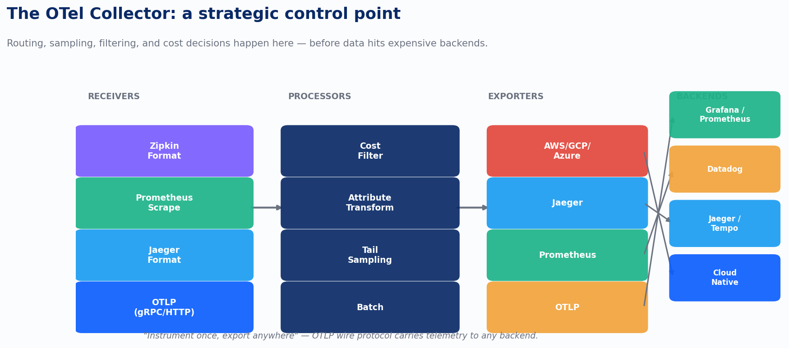
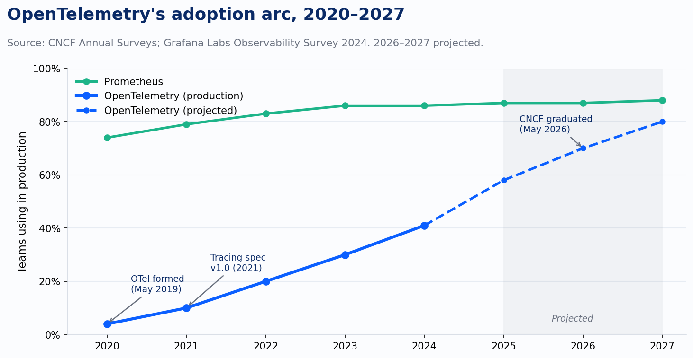
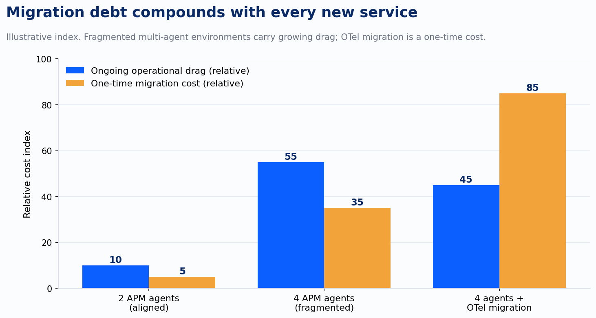

How many APM agents are running in your production environment right now? Most teams I ask can't answer that question on the first try. They come back with a number. Then they remember a legacy service, or a third-party library with its own embedded instrumentation, or a team that went off-script two years ago during a crunch. The number goes up.

That isn't an operations problem. It's a structural one, and it took a standards war to name it.

## The three pillars gave the market its vocabulary

The "three pillars" model — metrics, logs, and traces — organized a chaotic space into a cognitive framework engineers could argue about. Peter Bourgon's 2017 post gave the observability market a shared vocabulary at exactly the moment it needed one.

The pillars hold up operationally because each does something the others can't do cheaply. Traces tell you *where* in the request path something broke. Metrics tell you *how often* and *how much*, at a cost you can actually afford at scale. Logs tell you *what exactly happened* in the moment, with all the ugly detail still attached. None of these signal types replaces the others. Liz Fong-Jones, Charity Majors, and Ben Sigelman pushed back on the "pillars" framing, arguing it encoded storage topology as if it were epistemology, but even they'd grant that the three-way distinction maps onto real engineering tradeoffs.

The problem was never the model. The problem was what the market built on top of it.

By 2019, a team running a reasonably complex microservices architecture could easily have four separate APM agents in production: one from the cloud provider, one from a legacy APM vendor, one distributed tracing tool from the open-source ecosystem, and one that some engineer installed eighteen months ago and nobody remembers touching since. Each agent instrumented code. Each collected data. None of them talked to each other, and moving to a different backend meant re-instrumenting every service, every language, from scratch.

That's not vendor differentiation. That's vendor capture. And the industry had built it into the foundation.

## May 7, 2019: the merger that changed the economics

On May 7, 2019, the CNCF announced the merger of OpenTracing and OpenCensus into OpenTelemetry. The formal goal, as Ben Sigelman and Morgan McLean put it in the CNCF blog announcement, was to make "robust, portable telemetry a built-in feature of any software." That sentence is precise in a way the industry hadn't been before. Portable. Built-in. Not bolted-on-by-a-vendor.

OpenTelemetry's architecture is worth understanding at the structural level because the structure is the argument. The system has four components that work together: language SDKs and APIs for instrumentation; the Collector, which acts as a vendor-neutral pipeline; the OTLP wire protocol, which carries telemetry between components; and semantic conventions, which standardize what field names mean across languages and libraries. The summary is "instrument once, export anywhere," and the Collector is where that claim becomes concrete.

*chart*

The Collector sits between your services and your backends. Receivers pull in telemetry from any source: OTLP, Jaeger, Prometheus scrapes, Zipkin. Processors apply routing logic, tail-based sampling, attribute transformation, and cost filtering. Exporters push the result to whichever backends you've chosen: Grafana, Datadog, Jaeger, a cloud-native pipeline, any combination. The backend decision becomes a configuration change. Re-instrumentation becomes unnecessary. That is what "portable" actually means when you follow it to its operational consequence.

## Adoption moved like a standards curve, not a hype curve

OpenTelemetry didn't explode out of the gate. Four percent of teams were running it in production in 2020, per CNCF Annual Survey data. That number reached 20% by 2022, still a minority of the market. The tracing specification hit v1.0 in 2021. The project reached CNCF incubating status in August of that year. The OpenCensus repositories weren't fully archived until July 31, 2023, which tells you something about how long it takes for a predecessor to fully cede ground.

By the 2024 Grafana Labs Observability Survey, 89% of organizations reported investing in Prometheus and 85% were investing in OTel, with roughly 40% running both together. The 2025 data shows 41% in production and 38% actively investigating. OTel graduated from the CNCF on May 21, 2026, exactly seven years after its founding announcement, with over 12,000 contributors from more than 2,800 companies (as of that graduation milestone).

*chart*

That trajectory looks like consensus formation, not disruption. Seven years from founding announcement to CNCF graduation is actually the more telling comparison: the container runtime interface took four years to stabilize, BGP route convergence standards took over a decade. OTel landed in the middle, fast enough to outrun proprietary capture but deliberate enough that every major vendor had time to build OTLP support before the standard locked. When 89% of the market is investing in a tool, the question is no longer "should we adopt this?" It's "why haven't we yet, and what does the delay cost us?"

## OTel is a business decision dressed as a technical one

Most teams frame OpenTelemetry as a compliance question or a vendor-agnosticism question. Both framings are too small.

The real consequence of OTel adoption is leverage. Once your instrumentation is decoupled from your backend, you can negotiate with observability vendors from a position of actual optionality. You can route to the cheapest storage tier for high-cardinality metrics. You can switch APM platforms without a re-instrumentation project that consumes a quarter of engineering capacity. You can evaluate a new tool against your real workload instead of committing to full migration before you know if it works.

The teams not on OTel are accumulating the inverse of that. Every new service they instrument with a proprietary agent adds to a migration cost that is real but invisible in the quarterly plan. The debt doesn't hurt until you try to move, and when you try to move, you find the number of services you thought you had is always lower than the number you actually have.

*chart*

We saw this pattern in multiple platform engineering engagements with fintech and healthcare clients running 150 to 300 services across two or more cloud providers. A team would come in wanting to consolidate observability tooling and discover, partway through the audit, that they had four APM agents in production instead of the two they thought they had. The cost of fragmentation was never in the tools themselves. It was in the operational drag of maintaining context across systems that didn't share a data model, and in the re-instrumentation work that made any backend change feel like a rewrite.

OTel doesn't eliminate that work retroactively. But it stops the accumulation. That's the business case: one instrumentation investment, portable forever.

## What standardization actually solved — and what it opened

The standardization battle that OTel won was fought on two fronts. On the technical front, it produced a wire protocol, a semantic convention system, and a pipeline architecture that any vendor could target. On the business front, it decoupled the instrumentation market from the analytics market. These are now separate concerns, and that separation changes everything about how observability vendors compete.

Before OTel, winning the instrumentation layer meant winning the account. The agent was the moat. After OTel, the instrumentation layer is a commodity: language SDKs, a Collector, and OTLP. The competitive axis shifts to what you do with the data once it arrives: query languages, anomaly detection, correlation across signal types, and increasingly, the ML and AI layers that sit on top. The vendor who can instrument you is no longer the vendor you're stuck with.

That shift is still playing out. It fueled an observability vendor boom in the early 2020s, because suddenly the barrier to building a competitive backend dropped. Any tool that could receive OTLP could enter the market. The result was more choices and, for a window of time, dramatically lower switching costs. It also created a new problem: when it's trivially easy to send the same telemetry to five different tools, teams often did, and the cost structure of observability changed accordingly.

The three pillars organized the market. OpenTelemetry freed it. The freedom turned out to have its own economics.

---

*Sources: CNCF Blog, "A Brief History of OpenTelemetry (So Far)," Ben Sigelman & Morgan McLean, May 21, 2019; CNCF Annual Survey data 2020–2025; Grafana Labs Observability Survey 2024; CNCF OpenTelemetry project milestone records.*
