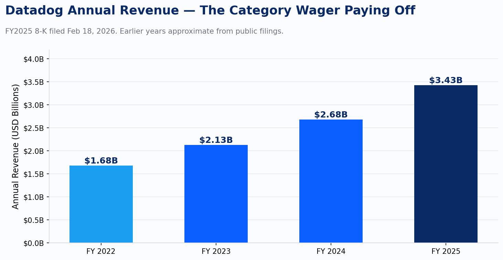
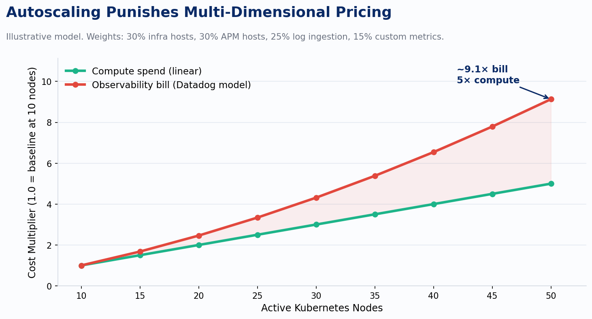

The observability market will hit $14.2 billion by 2028. That number comes from Gartner, published July 2025, and it describes a category that barely had a name a decade ago. Datadog alone reported $3.43 billion in revenue for fiscal year 2025 — up 27.68% year over year, with Q4 coming in at $953 million. Those are enterprise software numbers. The companies paying those bills are engineering departments.

I've sat in enough incident reviews to recognize a specific kind of meeting. The incident is resolved. The postmortem is civil. And then someone opens the cloud bill. That's the moment when observability stopped being a technical decision and became a financial one.

## How we got here

The three-pillars story I laid out in the last post — metrics, logs, traces, and the standardization work that followed — created something genuinely useful. OpenTelemetry gave the industry a shared instrumentation model. Kubernetes gave teams a scalable runtime. The commercial platforms stepped in to give everyone a place to send all that data and make sense of it.

Engineering teams could finally see their systems. The Datadog dashboard became a fixture of every incident channel. Dynatrace brought AI-assisted anomaly detection. New Relic consolidated. The category compounded because the problem was real and the tools solved it.

The part nobody planned for was the pricing model meeting the architecture.

*chart*

Datadog's pricing has always been multi-dimensional. Infrastructure monitoring runs roughly $15 per host per month (as of Q2 2026). APM adds another $31. Log ingestion costs $0.10 per GB plus $1.70 or more per million indexed log events. Custom metrics run about $0.05 per metric per month. Each of those dimensions is reasonable on paper. Together, they compound in ways that are not always obvious at the time you make the instrumentation call.

The Grafana Labs 2023 observability survey found that 52% of organizations use six or more observability tools. Eleven percent use sixteen or more. Datadog's own research puts the average DevOps team at twelve or more monitoring tools. That sprawl isn't random. It's what happens when you solve observability per-team, per-incident, per-quarter, and discover two years later that you've assembled an architecture nobody designed.

## The Kubernetes trap

The pricing model punishes autoscaling in a way most teams don't discover until it's too late to undo. Kubernetes is built around the idea that compute should be elastic. Pods scale up under load, scale down at night, respond to events. That's the pitch, and for compute cost, it works: your AWS bill goes up and down with traffic.

Datadog's host-based billing doesn't work that way. The infrastructure agent runs per node. APM runs per node. When your cluster scales from ten nodes to fifty, that's a 5x compute cost increase. The observability bill doesn't move in lockstep.

*chart*

Log volume scales with traffic, but it also scales with pod count: every sidecar, every init container, every service mesh proxy produces its own stream. Custom metrics hit harder still, because metric cardinality is a function of the label combinations your team emits: pod name, deployment name, namespace, environment, cluster, region, version. At ten nodes those combinations are manageable. At fifty they multiply. The cost curve bends.

In every Kubernetes migration audit we've done at Improving, the Datadog invoice grows faster than the cluster workload. Not because the team made a decision to spend more, but because the instrumentation configuration that worked on EC2 carries over unchanged. Pod count multiplies. Log sidecars multiply. Cardinality multiplies. The compute bill scales with traffic. The observability bill scales with topology. Those are different curves, and most teams don't notice until the invoice arrives.

That's not Datadog's fault. The pricing structure is published. The issue is that teams treat observability as an operational concern and cost modeling as a finance concern, and those conversations don't happen in the same room at the right time.

## The cardinality problem underneath

Charity Majors has written that the observability teams doing it well spend the majority of their time governing cardinality. That line lands differently once you've seen what uncontrolled cardinality does to a budget.

Cardinality is the number of unique time series your telemetry produces. Every unique combination of label values is a new series. User IDs in metric labels are the obvious failure mode: suddenly you have one series per user per metric, and the math gets ugly fast. The subtler version is just normal Kubernetes metadata attached to everything. If you emit thirty custom metrics per pod and you have fifty pods across fifteen deployments in four namespaces, you're generating a combinatorial surface that grows faster than your underlying system.

The ingestion-versus-indexing split that most platforms impose is a direct response to this. You can store everything; you can only search what you pay to index. Teams end up with logs they can't query, metrics they're paying to collect but not to analyze, and a dashboard that represents the subset of their telemetry they could afford to make searchable. That's not observability. That's a filing cabinet with a lock on it.

## The cost is an architecture signal

Here's the framing I use when working through this with clients: if you're spending more observing your infrastructure than running it, the architecture has failed. That's not a procurement problem. It's a design problem that showed up in the bill.

The levers exist and they're not exotic.

An OpenTelemetry Collector pipeline at the edge — before data hits the commercial backend — lets you sample, filter, and route based on signal value. Tail-based sampling on traces means you keep the interesting 5% of requests and drop the healthy 95%. Exclusion filters on logs mean you stop paying to ingest the lines that carry no diagnostic value. These aren't workarounds; they're the telemetry pipeline discipline that platform teams at scale apply from day one. On the metrics side, cardinality governance starts with the instrumentation conversation, not the billing conversation. The instrumentation review is where you ask which label combinations are actually needed for alerting and analysis, and which ones are just there because someone copied a config. The answer drives the cost more than the choice of vendor.

None of this requires switching platforms. Telemetry pipeline tools — the OTel Collector, purpose-built first-mile storage to S3 before selective promotion to indexed search — exist specifically to decouple the collection problem from the cost problem. You collect everything. You pay to query only what matters.

## What this tells us about where the category goes

The platforms that survived and grew through this period solved the collection problem completely. Datadog at $3.43 billion in annual revenue is not a company that lost. It's a company whose customers decided the value justified the cost, or more precisely, couldn't figure out how to instrument their systems without it.

The cost crisis didn't kill the category. It produced two reactions. One was a data-architecture rethink: if ingesting everything into an expensive proprietary index is the problem, maybe the right answer is a unified storage layer that separates ingestion from query. The other was an organizational one: if observability decisions are architecture decisions, they belong with the teams doing platform engineering, not scattered across individual product teams.

Both of those reactions shaped what the industry built next. The next post covers the data-architecture side: wide events, columnar storage, and why the three-pillars model turned out to be a storage artifact as much as an observability philosophy.

---

*Sources: Gartner Magic Quadrant for Observability Platforms, July 7, 2025; Datadog Form 8-K, FY2025, filed February 18, 2026; Grafana Labs 2023 Observability Survey; Datadog published pricing retrieved Q2 2026 (infrastructure, APM, logs, custom metrics); Charity Majors on cardinality governance.*
