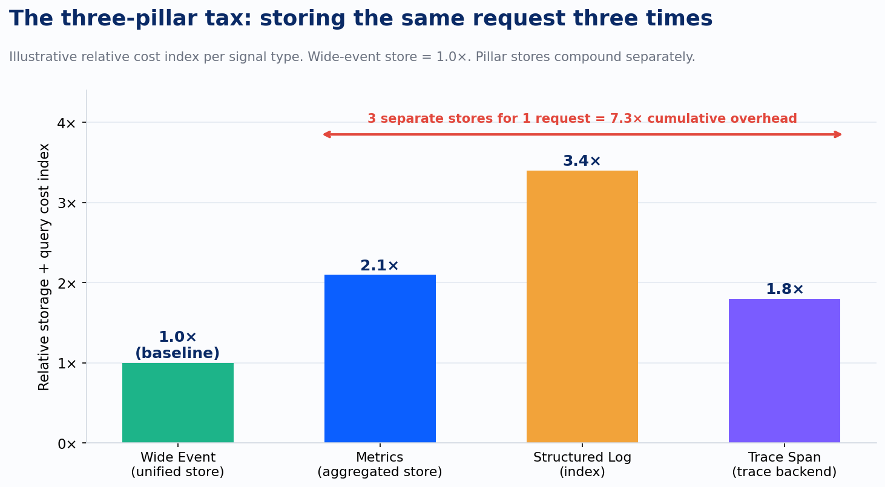
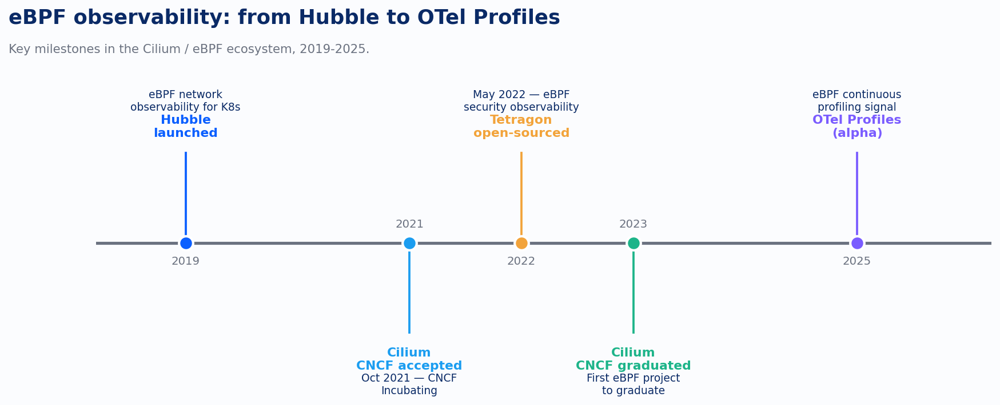

# Wide Events, eBPF, and Why the Three Pillars Are a Tax You're Still Paying

Every Kubernetes shop I've worked with in the last three years has the same infrastructure diagram. Prometheus for metrics. Elasticsearch or Loki for logs. Jaeger or Tempo for traces. Three separate clusters, three separate retention policies, three separate on-call rotations, three line items on the infrastructure bill. And every single one of them is paying to store the same HTTP request three times.

That's not an observability strategy. That's a data architecture accident that got promoted to a standard.

The industry figured this out around 2021, and the response came from two directions simultaneously. One was a storage model argument, led most vocally by Charity Majors at Honeycomb: if you capture a single, arbitrarily-wide, high-cardinality structured event per request and store it in a columnar database, you don't need three systems. You need one. The other response came from the kernel: eBPF made it possible to instrument a Kubernetes cluster at L4/L7 without touching application code, without sidecars, without SDK calls, and with overhead low enough to run in production. Both attacks target the same problem from different angles. And together they make the CNCF-native stack a credible Datadog alternative. I'll name that directly, because most teams are circling it without committing.

## The data architecture argument

Charity Majors coined "Observability 1.0" to describe the three-pillar world. Observability 2.0 is a storage model argument, not a vendor feature comparison, and that distinction changes what you actually have to build.

A wide event is what happens when you take the trace span, the structured log line, and the dimensional metric, and instead of writing them to three systems, you write one record that carries all of it: the request ID, the user ID, the service name, the build SHA, the database query latency, the downstream call count, the HTTP status, the feature flag state, and whatever else you want to attach. The event is "wide" in the sense that it has arbitrarily many attributes. The database is columnar (think ClickHouse) so queries that touch two or three of those columns don't pay for the rest.

*chart*

That chart is illustrative, but the shape of the argument is real. A metrics store aggregates your raw request data into pre-computed rollups, which is cheap to query but destroys the signal you'd need for high-cardinality debugging. A log indexer stores the full text, which is expensive to index and expensive to query at cardinality. A trace backend stores sampled spans, which means the request you most need to debug is the one most likely to have been dropped. A columnar event store does none of that pre-aggregation and none of that sampling. It stores the raw event, compressed by column, and lets you slice it any way you want at query time.

The cost story is not just storage. It's the cardinality ceiling. In Prometheus, high-cardinality labels are a footgun because each unique label combination creates a new time series. A single deployment ID label across a multi-tenant SaaS kills your Prometheus. In a columnar store, cardinality is not a bug; it's the point. You can put the request ID as an attribute on every event and query "show me all events for request abc-123 across all services" without pre-aggregating anything. That query is what distributed tracing was invented to answer. A wide event answers it without a separate tracing system.

This is why "Observability 2.0" isn't just vendor positioning from Honeycomb. The argument has legs because the cost model is structurally different, and because ClickHouse is open-source. The Grafana LGTM stack (Loki, Grafana, Tempo, Mimir) plus an OTel Collector DaemonSet plus some schema discipline is a reasonable path to unified-ish storage without paying commercial per-seat rates. It requires discipline. But the option exists.

## The kernel argument

The wide-event story assumes you can instrument your services. For greenfield code in Go or Java, that's a one-afternoon SDK integration. For a ten-year-old .NET service that three teams co-own, it's a six-month political negotiation. eBPF sidesteps that entirely.

eBPF runs sandboxed programs in the Linux kernel. The verifier checks them at load time for memory safety and termination. They attach to syscall hooks, cgroup hooks, socket hooks, and traffic control hooks. From those positions, they can see every TCP connection, every HTTP/1.1 and HTTP/2 request, every DNS lookup, every file open, every process exec. No code changes. No sidecar negotiation. No pod spec edits across a dozen application teams.

*chart*

Cilium shipped Hubble in November 2019, specifically for eBPF-based network observability in Kubernetes. Hubble gives you L3/L4/L7 flow data for every pod in the cluster from a single DaemonSet. CNCF accepted Cilium as an incubating project in October 2021. Tetragon, the security observability layer, went open-source in May 2022. Cilium graduated in 2023, the first eBPF project to reach that status. The OTel community is adding Profiles as a fourth signal type, with eBPF-based continuous profiling in alpha for 2025 and 2026.

The implication for a Kubernetes-heavy engineering team is significant. If you can get full L4/L7 visibility from the kernel, the argument for per-service instrumentation narrows to the cases where you need business-context attributes: the user ID, the tenant ID, the feature flag. Those are legitimate. But the service topology, the error rates, the latency distributions, the retry storms, the downstream dependency failures? Cilium and Hubble give you all of that with no code changes and no per-service negotiation.

The tradeoff is kernel expertise. eBPF programs are not Python scripts. Writing a custom probe requires understanding the kernel's data structures and the verifier's constraints. Cilium and Pixie (in the CNCF sandbox via New Relic) abstract most of this, but debugging a misbehaving eBPF probe is a different skill than debugging a Go service. Teams should be honest with themselves about whether they have that skill before betting the monitoring stack on it.

## The CNCF-native alternative

Let me be specific about what "CNCF-native as a Datadog alternative" actually looks like in 2025.

The collection and routing layer is an OTel Collector DaemonSet (receiving traces, logs, and profiles) paired with Prometheus Operator for metrics and alerting rules, with Cilium replacing kube-proxy and adding Hubble for network visibility. The storage and visualization layer is the Grafana LGTM stack: Loki for logs, Tempo for traces, Mimir for long-term metrics, and Grafana for dashboards and alerting, with Signoz or a self-managed ClickHouse cluster alongside if you want true wide-event columnar storage.

This stack is not simple. It's five to seven components with their own operational surface areas. The commercial appeal of Datadog is real: one agent, one bill, one support call. I've seen teams adopt the CNCF stack and spend three months tuning OTel Collector pipelines before they could redirect a single team's traffic. That's a real cost. The question is whether it's less than the Datadog bill at scale, and for clusters above roughly 200 nodes, it usually is. Significantly.

The pattern I see repeatedly in Improving's Kubernetes platform work is teams that land in the worst of both worlds: they've deployed Prometheus, ELK, and Jaeger separately, each with its own operational overhead, but they haven't achieved the cardinality or the correlation that would justify the complexity. They're paying the pillar tax without getting the pillar benefits. The move to either a unified commercial product or a disciplined unified open-source stack is the same structural move. What most teams haven't done is make it consciously.

## The decision hiding inside the architecture

Here's the uncomfortable read on this: the choice between the three-pillar model and the wide-event model is a data governance decision dressed up as an infrastructure decision.

Wide events require you to decide, upfront, what goes in the event. You need a schema. You need cardinality discipline around which attributes grow unboundedly and which ones don't. You need a team convention for attribute naming so that `user_id` in service A and `userId` in service B are the same column in the query. These are not hard problems. They are disciplines. Most teams skip them when they're moving fast, and the result is the three-pillar accident: each team reaches for the tool that answers their immediate question, and the organization ends up with seven observability tools, none of which talk to each other, and a bill that grows with every new service.

eBPF solves the instrumentation coverage problem directly. It instruments at the kernel level, no code changes and no per-service negotiation required. But business context, the "which customer's request was this and why did it matter," still has to come from the application layer, and the application layer still needs the schema discipline.

The platform teams I've watched succeed at this made both moves together. They adopted a columnar event store for wide events with a shared schema. They deployed Cilium for baseline network visibility. They treated the OTel Collector as a routing layer that could fan out to both. And they stopped paying for three systems to answer one question.

That's a platform capability, not a per-team decision. Which is exactly where this series is headed next.

---

*Sources: Charity Majors, charity.wtf (2023-2024), "Observability 2.0"; CNCF Cilium project (cilium.io); eBPF.io; Grafana LGTM stack documentation; OpenTelemetry Profiling Signal specification (alpha, 2025); Pixie CNCF sandbox project; Hubble network observability documentation.*
