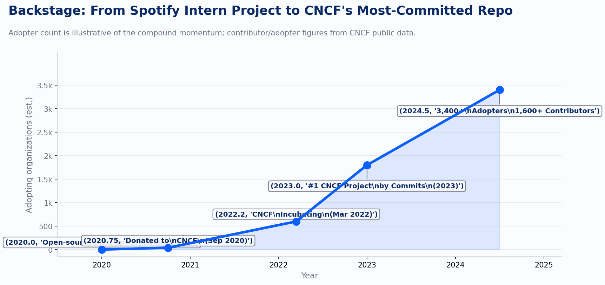
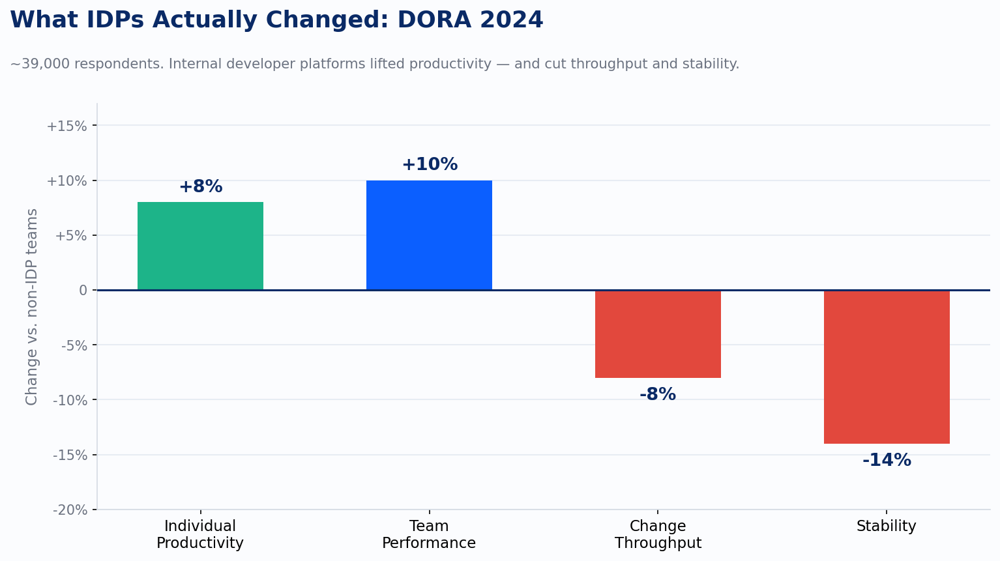

Platform engineering teams that adopted internal developer platforms (IDPs) in 2024 saw change throughput drop 8% and stability drop 14%. That is DORA's finding from roughly 39,000 respondents. The same platforms delivered an 8% individual productivity lift and a 10% team performance boost. Both of those things are true. Most platform engineering programs I encounter are measuring the second set of numbers and ignoring the first.

That is the trap I want to name before we get into everything that platform engineering legitimately fixed for observability.

---

Between 2022 and 2025, something structural shifted in how organizations thought about observability. It stopped being a tool problem and became a platform problem. The question moved from "which APM vendor should we standardize on" to "how do we make instrumentation invisible to the teams who need it." Real progress. The CNCF Platforms white paper, published in April 2023, made it explicit: automatic instrumentation and standard dashboards are a core platform capability, not an optional add-on teams configure themselves. By the time CNCF published its Platform Engineering Maturity Model in 2024, the argument was settled. Observability belongs in the golden path.

Gartner put a number on the trajectory. By 2026, 80% of large software engineering organizations will have established platform engineering teams as internal providers of reusable services, components, and tools, up from 45% in 2022. A step change, not a gradual adoption curve, driven by accumulated pain: fragmented tooling, inconsistent SLO coverage, teams reinventing the same Grafana dashboard for the fourteenth time, and the slowly dawning realization that you cannot debug a distributed system you did not instrument consistently.

The vehicle most organizations chose for this shift was Backstage. Spotify built it internally, open-sourced it in March 2020, donated it to CNCF in September of that year, and watched it reach incubating status by March 2022. In 2023 it was the most-committed-to project in the entire CNCF ecosystem. As of the most recent public data: 3,400+ adopting organizations, 1,600+ contributors, 230+ plugins. Spotify itself reports roughly 96% of R&D staff actively using it.

*chart*

The reason Backstage caught on for observability specifically comes down to four building blocks that map exactly onto the problem. The software catalog gives you service ownership: finally, a place to answer "who owns this service and how do I reach them at 2am." Software templates let you scaffold new services with OpenTelemetry SDKs wired in from the first commit, so instrumentation is not something a team adds later when they remember. It is simply present. The plugin ecosystem brought Grafana, Datadog, PagerDuty, and Argo CD into a single pane. TechDocs kept the runbooks next to the service metadata. Put it together and you have observability as a property of your platform, not a project your teams are supposed to complete.

I have seen this work. At an insurance carrier running 150+ services across two cloud providers, Improving built a Backstage implementation that moved the organization from a sprawl of vendor-specific agents, inconsistent tagging, and dashboards that meant different things in different squads to a standard template provisioning OTel-instrumented services with SLOs as code and a pre-configured dashboard on first deploy. Onboarding a new service dropped from two to three days of per-squad configuration work to under an hour. That 8% individual productivity gain DORA measured is not abstract: the on-call engineer can find the service owner in the catalog instead of paging through six Slack channels.

And then DORA published its 2024 data, and the story got more complicated.

## Where the Numbers Got Complicated

*chart*

The productivity gains are real. Individual productivity up 8%, team performance up 10%: those findings track with what practitioners report. The concerning numbers are on the right side of that chart. Change throughput dropped 8%. Stability dropped 14%. James Brookbank from the DORA team said something that explains both the adoption surge and the hidden cost in a single sentence: "We very rarely see companies doing platform engineering primarily for developer productivity reasons."

Read that again. The organizations building IDPs are building them for governance, compliance, and coverage. Legitimate reasons. But governance and compliance optimize for consistency, auditability, and control, not developer flow. When you shift from teams choosing their own tools to platforms providing standardized ones, you add coordination cost, approval layers, and the friction of filing a Jira to get a Backstage template updated. Individual engineers feel productive because the scaffolding works and the dashboard is already there. The system slows down because the feedback loop between developers and the platform has a queue in the middle of it.

This is not an argument against platform engineering. It is an argument against measuring platform success with only the metrics that flatter the platform team.

The platforms that Improving has built with strong adoption, not just strong coverage statistics, had one thing in common: they were treated as products, not infrastructure projects. A product manager who ran discovery with the engineers using the templates. A developer experience survey run quarterly, not a coverage dashboard reviewed by the platform team alone. A feedback channel that is not a Jira epic. When a platform team's only signal is "what percentage of services use the standard OTel template," they will optimize for that number and never see the friction building up underneath it.

The DORA finding about AI instrumentation is a footnote worth not ignoring. A 25% rise in AI adoption correlated with a 1.5% throughput drop and a 7.2% stability drop. The pattern holds: every technology layer added for governance or visibility extracts a coordination cost from the teams doing delivery. That cost is invisible in the metrics platforms report about themselves.

The observability golden path is genuinely valuable. Pre-instrumented templates, SLOs as code, ownership codified in a software catalog, dashboards that exist on day one: these are not incremental improvements. They are the difference between an organization that can answer "why is this slow and whose problem is it" and one that is still arguing about which team owns the service causing the cascading failure.

The hard part is that building the path is not the same as knowing whether teams are using it, why some are routing around it, and what the platform team has accidentally optimized for. The dashboard of success metrics is itself a platform engineering problem. Most platform teams have not solved it.

If you are building an IDP and you are only tracking tool coverage and service adoption rates, you are measuring what the platform provides, not what it delivers. DORA's data is telling you there is a gap between those two things. The organizations that close that gap are the ones running developer experience as a first-class measurement program alongside their coverage metrics, treating adoption as a signal of fit, not just a compliance checkbox.

The telemetry flowing through a consistent platform pipeline is, in the long run, far more valuable than the coverage number. Once it is standardized, it becomes the substrate for something beyond dashboards. That is where the next chapter of this story goes.

---

*Sources: CNCF Platforms white paper (April 11, 2023); CNCF Platform Engineering Maturity Model (2024); Gartner, "Top Strategic Technology Trends for 2024" (October 16, 2023); DORA 2024 Accelerate State of DevOps Report (November 2024, ~39,000 respondents); Backstage.io documentation and CNCF project statistics.*
