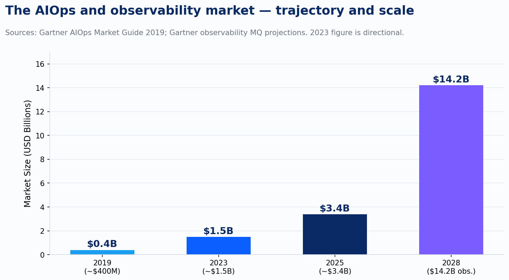
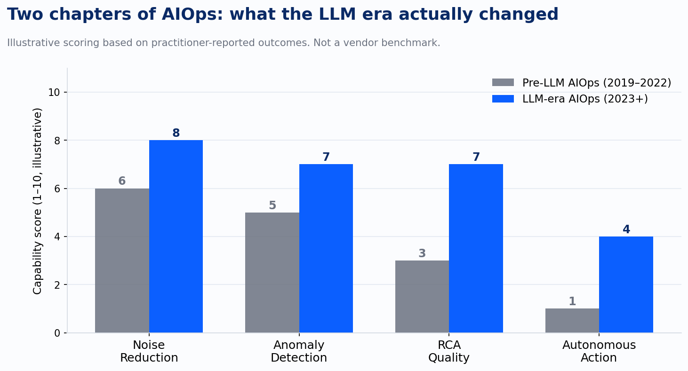
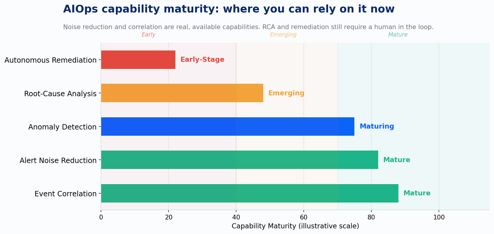

In 2019, Gartner estimated the AIOps market at $300 million to $500 million annually and predicted that 40% of DevOps teams would be augmenting their monitoring tools with AIOps capabilities by 2023. The vendors had better numbers still. "Up to 90% alert noise reduction." Automated root-cause analysis. Machine learning that would do in seconds what an on-call engineer does in forty minutes at 2 a.m.

Most of those teams bought something. Most of them got less than they expected.

That's not a vendor failure story, exactly. It's a more interesting one: a technology category that had a real idea, oversold it, underdelivered on the hardest part, and then had its core promise genuinely transformed by a different technology it didn't see coming. AIOps has two distinct chapters. Understanding where the first one broke down is the only way to use the second one correctly.

## What Gartner meant by AIOps (and what the market heard)

Gartner coined the term in 2016. The canonical capability map has five layers: cross-domain data ingestion, topology generation, event correlation, anomaly detection, and root-cause analysis with automated remediation. That's a coherent stack. Each layer is genuinely harder than the one before it.

What the market heard was a single pitch: buy this, and your alert storm goes away, and the tool tells you why things broke. The five-layer nuance collapsed into a two-line sales motion. And the sales motion was almost exclusively aimed at the bottom two layers of actual value, root-cause analysis and remediation, while the tools were genuinely good at exactly one of the five: event correlation.

Event correlation isn't nothing. Grouping 400 alerts into 12 incidents is a meaningful improvement over a pager going off 400 times. But it's not root-cause analysis. It's pattern matching on symptoms. The difference matters when the person holding the pager has to make a decision about what to fix first.

*chart*

The market grew anyway. Gartner projected AIOps reaching roughly $3.4 billion by 2025, and the broader observability market is on track toward $14.2 billion by 2028. That's a substantial category with serious investment behind it. The growth didn't happen because teams were getting exactly what was promised. It happened because the underlying problem, alert noise, slow diagnosis, operational toil, is severe enough that teams kept buying tools looking for relief, even when the first purchase didn't deliver.

## Why the first chapter underdelivered

The "90% alert noise reduction" claim deserves direct treatment: it is a marketing claim. It is not a benchmark produced by an independent organization running a controlled study against real production environments. It is a number that vendors selected from their best-case customer engagements, usually after significant tuning, often in environments where the baseline was unusually noisy. Know that before deciding how much to pay for it.

The deeper problem wasn't the marketing. It was the architecture of the tools themselves.

Pre-LLM AIOps worked primarily through static rules and supervised ML models. Both approaches have the same structural weakness: they learn from historical data, which means they break when architecture changes. Deploy a new service, rearrange a dependency graph, migrate a database. The model's understanding of normal is now wrong. Correlation rules that encoded the old topology now fire incorrectly or miss entirely. The tool needs retraining. Retraining requires labeled data. Labeling takes time that on-call engineers don't have.

The topology generation layer had its own failure mode. Accurate event correlation depends on an accurate topology map, and accurate topology maps depend on a clean CMDB. Most organizations don't have one. The CMDB was a 2005 ITIL promise that never quite arrived, and the AIOps vendors were building on top of it as if it had. When the dependency map is wrong, the correlation is wrong, and the "automated root-cause analysis" becomes a confident, automated guess that sends the engineer in the wrong direction.

We ran into this pattern across multiple platform and DevOps engagements with mid-size SaaS and financial services clients: a team would buy an AIOps tool to fix an alert storm and discover, six to nine months later, that the underlying problem was telemetry quality. In one case, a 200-person engineering organization reduced page volume by about 30% but saw no improvement in mean time to recovery. The tool had gotten better at grouping alerts that all traced back to the same misconfigured service mesh, which nobody had fixed because the correlation output looked like a diagnosis rather than a symptom. Fixing the telemetry the tool was reading from moved MTTR more than the alert grouping ever had.

## What LLMs actually changed

Honeycomb shipped Query Assistant in May 2023. That's a reasonable stake in the ground for when the second chapter started.

The change LLMs introduced is qualitative, not incremental. Pre-LLM AIOps correlated events by pattern. LLMs can generate hypotheses in natural language, test multiple hypotheses in parallel against high-cardinality telemetry, and explain the reasoning behind each one. That's a fundamentally different cognitive operation. It's the difference between a system that says "these 47 alerts are probably related" and one that says "the latency spike in the payment service correlates with a memory pressure pattern in the cache layer that started 12 minutes before the first user-visible error; here are three possible causes ranked by likelihood."

Dynatrace's Davis AI, Datadog's anomaly detection, Honeycomb's BubbleUp: these tools were all meaningful before 2023. But the LLM layer added something the prior generation couldn't do, narrative. The ability to surface a readable, reasoned explanation from unstructured, high-cardinality data and present it to an engineer who then decides what to do.

*chart*

The improvement on root-cause quality in the LLM era is measurable. But look at the autonomous action bar. It barely moved. That's intentional, and it's the part the current wave of AIOps marketing is most likely to obscure.

## The ceiling nobody in the marketing material mentions

Charity Majors put it plainly: "You can't have great observability for AI unless you start with great observability for the rest of your software." That principle scales to AIOps directly. An LLM generating hypotheses about why your service is failing is only as useful as the telemetry it can reason over. Skip instrumenting the component that broke and the model can't see it. Leave spans out of your traces and the causal chain has gaps. Keep logs as unstructured strings rather than structured events and the signal-to-noise problem just moved upstream.

This is the part AIOps marketing consistently skips. The tools are capable. The capabilities are improving. The quality of the output is bounded by the quality of your data. Buying an LLM-powered observability tool on top of bad telemetry doesn't give you good insights. It gives you well-written explanations of incomplete information.

*chart*

That chart represents where the category actually stands in mid-2025. Noise reduction and event correlation are mature, available capabilities: you should expect them to work, and if your current tooling doesn't deliver them, that's a configuration and data quality problem worth solving. Anomaly detection is maturing; it's reliable enough to trust at the first tier of triage, not reliable enough to act on without human review. Root-cause analysis is emerging: the LLM-era tools produce genuinely useful hypotheses, but "hypothesis" is the right word. Autonomous remediation is early-stage. The Grafana Labs 2024 Observability Survey found that AI in observability is still "largely aspirational" for most organizations, with anomaly detection cited as the most-wanted feature by more than three-quarters of respondents. Wanted, not delivered. That gap is real.

## How to use AIOps correctly in 2025

Noise reduction is a baseline expectation, not a differentiator. If you're running a modern observability stack with reasonably structured telemetry, alert correlation should reduce the alert volume your on-call rotation sees by a meaningful margin. That is worth optimizing for, and the tools are capable of delivering it. If you're not getting it, the problem is almost certainly upstream: alerting rules that fire on symptoms rather than causes, telemetry that lacks the context to group intelligently, or thresholds set without knowledge of the service's normal behavior.

Treat LLM-powered root-cause analysis as a hypothesis generator, not ground truth. The right workflow is: the tool surfaces three ranked hypotheses with the evidence behind each; an engineer reviews them in under five minutes; the engineer picks a direction, validates it, and acts. That is a significant improvement over the pre-LLM workflow where the engineer had to form the hypotheses themselves from raw telemetry. It is not a replacement for the engineer.

Expand autonomy incrementally, measuring false-action rates as you go. Automated remediation isn't wrong in principle, it's premature when you haven't established what the tool gets wrong. Start with automated diagnosis. Measure how often the first hypothesis is correct. When you trust the diagnosis, automate the response for the narrow class of problems where the remediation is low-risk and reversible. Expand from there. The teams that skip this step and go straight to automated remediation at scale are the ones who will have a very bad incident that wasn't in any playbook.

The telemetry investment comes first, always. This is the sequencing mistake most teams make: buying the AIOps layer before the instrumentation layer is solid. You cannot reason well over data you didn't collect. The investment in structured telemetry, wide events, semantic conventions, consistent cardinality, determines the ceiling of everything that sits on top of it. Fix the foundation before optimizing the analysis.

## What the next question is

Once machines can reliably generate the right hypothesis about what broke and why, the natural next question is whether they should also fix it. That question is harder than it sounds, not technically, but operationally. The conditions under which an autonomous system should take corrective action without a human in the loop are narrow, specific, and require a level of confidence in the diagnosis that most teams haven't yet measured. Getting the framing right there is where most autonomous remediation programs go wrong.

That's where the series goes next.

---

*Sources: Gartner Market Guide for AIOps Platforms, November 2019; Gartner observability market projections; Grafana Labs Observability Survey 2024; Honeycomb product documentation (BubbleUp, Query Assistant, May 2023); Dynatrace Davis AI product documentation; Datadog anomaly detection documentation; Charity Majors, various public conference talks and writing.*
