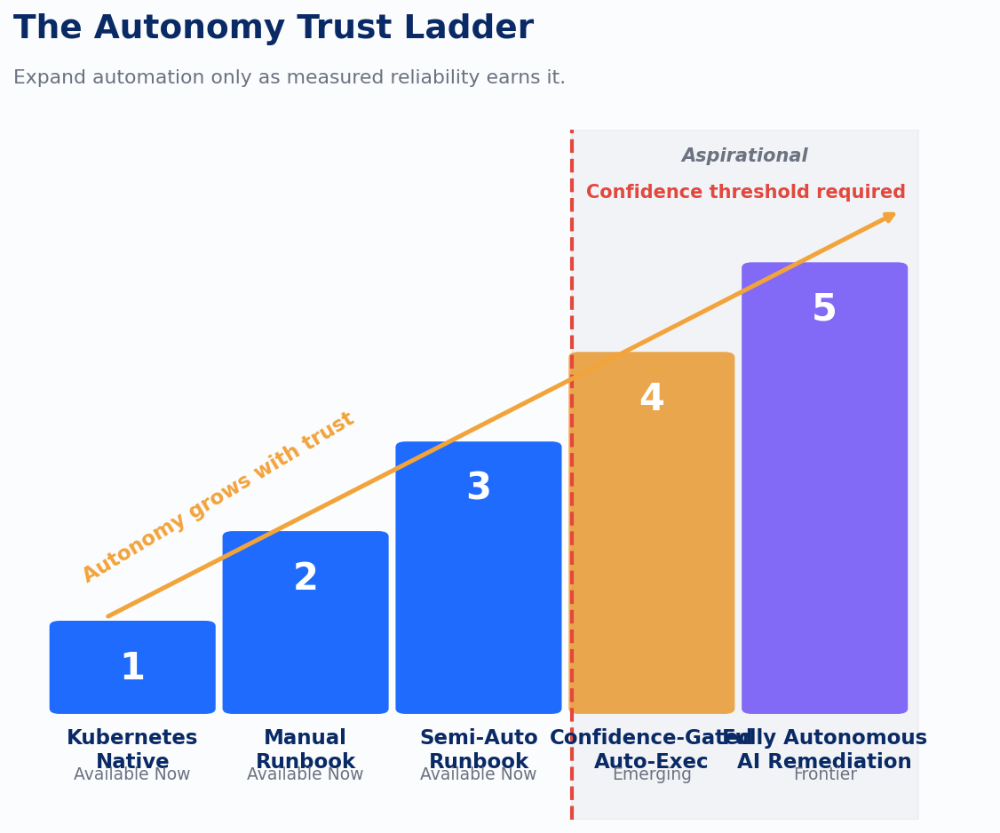
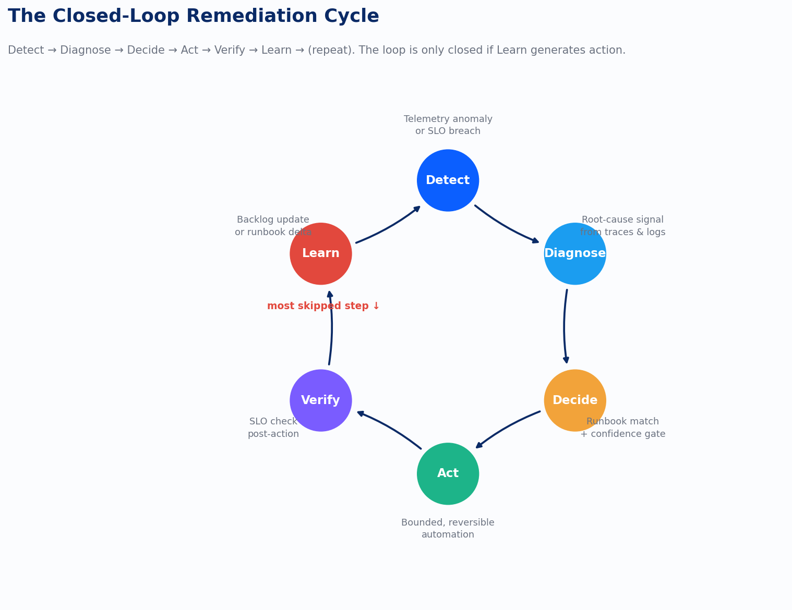

Here is the uncomfortable thing about self-healing systems: they might be solving the wrong problem.

When Kubernetes restarts a failing pod, something real happened. The system recovered. The on-call engineer stayed asleep. The SLO held. By every operational metric that teams typically track, this is a win. The problem is that nobody asked why the pod failed. If the answer is a memory leak that's been growing for six months, Kubernetes just rescheduled it into a new container where the exact same leak will run until it fails again in roughly the same amount of time. You've automated the symptom. The cause is still in the code.

This is where the enthusiasm for autonomous remediation collides with the reality of software. The enthusiasm is justified. Closed-loop remediation, systems that detect, diagnose, decide, and act without paging a human, is a genuine engineering achievement. But self-healing without learning is not automation. It's deferral with better optics.

## The baseline most teams already have

Kubernetes self-healing is not a futuristic capability. It is table stakes for anyone running containers in production. Liveness probes restart containers that stop responding. Readiness probes pull unhealthy pods from load balancer rotation before traffic reaches them. ReplicaSets replace failed pods against a desired state. Node auto-replacement handles infrastructure-level failures. If you're running Kubernetes, this layer is already working for you.

It is worth naming this explicitly because teams often underestimate it. When a client asks me whether they should invest in autonomous remediation, the first question I ask is whether they have their Kubernetes primitives configured correctly. A surprising number haven't fully tuned their health probes. A pod that fails silently and never triggers a liveness check is invisible to every automation layer above it. Get the foundation right before climbing higher.

The next layer up is runbook-driven remediation. AWS Systems Manager Automation and Azure Automanage operationalize this: a documented response to a known failure condition gets encoded as a policy, and the policy executes when the condition fires. AWS's Execution Preview is worth calling out specifically. It models the effects of a runbook before running it, which is the kind of safety mechanism that turns theoretical automation into something an SRE team will actually trust. You can see what the playbook would do before it does it.

PagerDuty's AIOps and runbook automation, Red Hat Ansible Automation Platform's event-driven playbooks, and Datadog Workflow Automation all operate at this middle layer. The pattern is consistent: an alert fires, a matching runbook is found, a human approves or the system auto-executes based on confidence, and the action runs. This is where most teams are in 2025. It's mature, it works, and it covers a meaningful percentage of the incident volume that used to require a human to touch a keyboard at 2am.

*chart*

## The trust ladder is not optional

The staircase above is not just an illustration of what exists. It is a decision model. Teams that tried to skip from Kubernetes native self-healing directly to confidence-gated auto-execution, bypassing the manual and semi-automated runbook stages, created new categories of incidents. Not the old incidents, poorly handled. New ones, born from automation acting on incomplete understanding.

The trust ladder exists because trust is earned through measurement. You don't grant autonomy because a vendor demo looked convincing. You grant it because you have run the semi-automated version long enough to know that the automation's decision matches what a senior SRE would have decided, consistently, across a statistically meaningful sample of real events. That measurement is the prerequisite. Skipping it is optimism in a config file.

The practical rule: start with low-risk, reversible actions. Restart a pod. Scale a deployment. Roll back a feature flag. Disable a circuit breaker. These actions are bounded, idempotent, and undoable. They are also the actions that cover the majority of common failure modes. For anything above that, for cross-service failures, database interventions, network configuration changes, require human approval until you can prove the system's judgment is reliable on that specific class of problem.

K. Sarda's 2023 IEEE ACSOS-C paper on LLM-driven auto-remediation in microservices architectures demonstrates that language models can synthesize runbook-style responses from telemetry context. The research is real, the results are promising, and the production applications are still early. The frontier exists. The path to the frontier runs through the intermediate rungs, not around them.

## The six-step cycle and the step nobody completes

The closed-loop pattern, the one that actually closes, looks like this: Detect, Diagnose, Decide, Act, Verify, Learn. In that order, with all six steps.

*chart*

Detect is telemetry-driven. A metric breaches its SLO threshold, a trace shows elevated P99 latency, a log pattern matches a known failure signature. Diagnose surfaces root-cause context from that same telemetry. Decide matches the diagnosis to a verified runbook and checks whether confidence is high enough to proceed without human approval. Act executes a bounded, reversible remediation. Verify checks the SLO state post-action to confirm the intervention worked. Then comes Learn.

Learn is the step teams skip, usually for the right reasons in the moment.

The post-incident review happens. The SLO recovered. The automation worked. There is no burning issue to document. The team closes the ticket and moves on. But if Learn doesn't happen, the loop is open. The remediation generated no signal that changed anything downstream. The runbook wasn't updated. The memory leak didn't get filed as a backlog item. The developer whose service caused the failure never heard about it. Kubernetes restarted the pod. The clock reset.

This is the architectural requirement that AIOps marketing underweights: remediation telemetry has to go somewhere and change something. A backlog. A runbook version. A developer's ticket queue. An SLO trend that a team lead reviews monthly. If the output of your Learn step is silence, you are not running a closed-loop system. You are running a loop that stops at Verify and calls itself done.

The arXiv paper on generative AI for self-adaptive systems (2512.04680, 2025) frames this as the gap between reactive self-healing and proactive self-improvement. Reactive systems detect and respond. Self-improving systems use the history of detections and responses to reduce future incident volume. The difference is whether Learn generates a change. That change doesn't have to be automated. It can be a human reading a report. What it cannot be is nothing.

## What the metrics are actually telling you

The standard benchmarks for autonomous remediation are mean time to recovery, alert-noise reduction, and SLO compliance trends. All three are real and worth tracking. But there is a fourth metric that most teams don't measure: recurring failure rate by root cause.

If your MTTR is improving while your recurring failure rate is flat or rising, automation is masking technical debt, not eliminating it. The pod keeps restarting. The memory leak keeps growing. MTTR looks great because the restart is fast. The leak is now six months older and in more places than it was when you first automated around it.

Recurring failure rate by root cause is the measurement that separates automation that heals from automation that hides. Run it monthly. If the same root cause shows up in your remediation logs more than twice without a corresponding code change or architectural fix, your Learn step has a gap. Something that should have landed in a developer's backlog didn't.

Improving's SRE and platform engineering teams have worked through this progression with multiple clients, including several healthcare and financial services teams running 50 to 200 services in production. The pattern is consistent: teams arrive with Kubernetes self-healing already in place and want help automating the next layer. Pod-level failures to service-level degradations to cross-service failures. The trust ladder is real, because teams that tried to skip it found out why it exists. The teams that invested in the intermediate rungs, manual runbooks first, then semi-automated with approval gates, then confidence-gated auto-execution, ended up with automation they could actually trust. Their MTTR improved. More importantly, their recurring failure rate went down, because the Learn step was producing backlog items that engineering teams actually worked.

## The decision rule

The question teams usually ask is binary: should we automate this or not? The better question is: which actions have we measured enough to trust, and at what confidence threshold?

The decision rule I use: an action is a candidate for auto-execution when it is reversible, idempotent, and bounded in scope, and when the automation's historical accuracy on that action class is high enough that a senior SRE would have taken the same action more than 95% of the time. That threshold is not a universal number. It is something you derive from your own history. And you can only derive it if the Learn step is generating data.

Confidence gates without measurement behind them are not safety mechanisms. They are aesthetics. The gate means something only if you know what your system's actual hit rate is on the decisions you're trusting it to make autonomously.

The economics of autonomous remediation, the infrastructure it runs on, the telemetry it consumes, the models it queries, all of that generates its own cost curve. That's the next conversation.

---

*Sources: Kubernetes documentation (liveness/readiness probes, ReplicaSet controller); AWS Systems Manager Automation, Execution Preview; Azure Automanage; PagerDuty AIOps and Runbook Automation documentation; Red Hat Ansible Automation Platform event-driven playbooks; Datadog Workflow Automation; K. Sarda, "Leveraging Large Language Models for Auto-remediation in Microservices Architecture," IEEE ACSOS-C 2023; arXiv:2512.04680, "Generative AI for Self-Adaptive Systems," 2025.*
