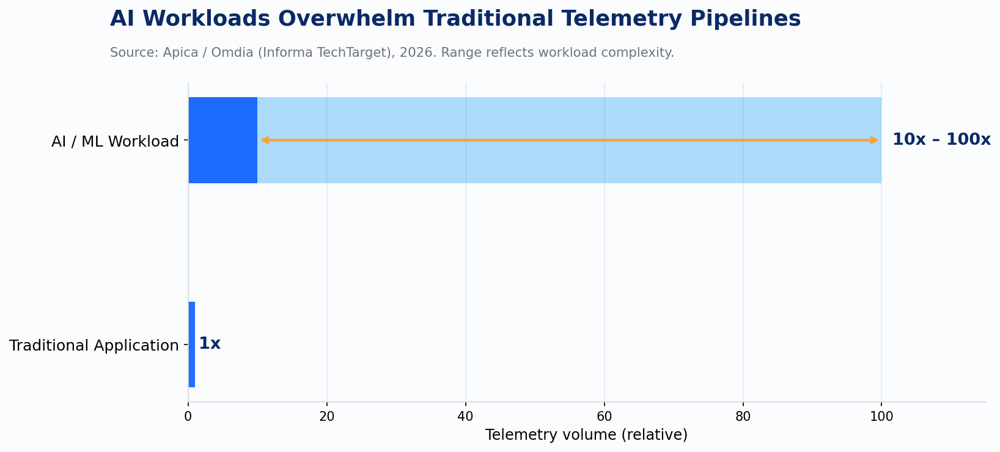
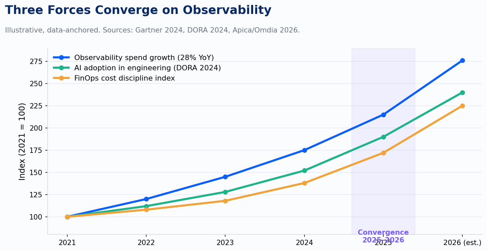

AI workloads are generating 10 to 100 times more telemetry than traditional applications. Most pipelines were not designed for that volume, most budgets were not modeled for it, and most engineering teams have not yet fully registered that it's already happening.

This is the eighth post in the Observability Arc series, and it's the one that closes the loop. We've traced this field from the raw panic of "what is Kubernetes even doing" in 2019, through the standardization wave that gave us OpenTelemetry, through the SLO discipline that finally connected metrics to business outcomes. We end here, in 2025 and 2026, where two forces converged in ways nobody predicted cleanly: observability became a FinOps problem, and AI became both the biggest new source of telemetry and the newest consumer of it.

Those two things are related. Understanding why is the whole point of this post.

---

## The Volume Problem No One Budgeted For

Apica and Omdia, researching for Informa TechTarget in 2026, put a number to something practitioners were already feeling: AI and ML workloads generate 10 to 100 times more telemetry than traditional applications. Enterprise observability spend is growing at 28% year-over-year with, as they put it, "no natural ceiling."

*chart*

Think about what that means architecturally. The Gartner data-observability market hit $346.4 million in 2024 on 20.8% growth. That's a healthy, expanding market. Now layer in the AI telemetry multiplier. You're not talking about linear cost increases as teams adopt AI workloads. You're talking about step-function spikes in log volume, trace cardinality, and metric churn that your existing sampling strategies, retention policies, and ingestion contracts were not sized for.

This is a structural mismatch between an architecture built for microservices-era telemetry and a workload profile that is fundamentally different, not a configuration problem you tune away. An LLM inference call traces every token sampled, every tool invocation, every prompt template substitution. A single user request can generate a trace tree that dwarfs what a traditional distributed service would produce in an hour. And unlike that service, the AI workload's behavior is nondeterministic. The same input does not guarantee the same output path, which means you cannot sample aggressively without losing the signal you care most about.

---

## When Observability Became a Line Item

For most of the last decade, observability spend was invisible inside engineering budgets. It was a platform cost, lumped with infrastructure, justified as necessary-but-not-strategic. The FinOps discipline, which started as a cloud-cost practice and matured into a genuine organizational capability around 2022 and 2023, changed that.

OpenCost launched as a CNCF sandbox project in December 2022, built on Kubecost's cost-allocation engine. The project's stated goal was to be the Prometheus of cloud cost monitoring: open-source, native to Kubernetes, integrating with Prometheus metrics and cloud billing APIs. IBM acquired Kubecost in 2024, which tells you everything about where enterprise interest had landed. Real-time cost allocation by namespace, pod, and container, with showback and chargeback at the same granularity as your existing metric infrastructure, became a standard expectation rather than an advanced feature.

The consequence is that observability is now a managed cost center with unit economics. Cost per request. Cost per inference. Cost per customer. If your team cannot produce those numbers, you don't understand your product's economics. And in 2026, that includes your AI features.

LLM-observability billing added a new wrinkle: some observability vendors bill on token ingestion at roughly $0.10 per 1,000 tokens. If you're tracing LLM calls and capturing full prompt and completion payloads for debugging purposes, you are paying to store the tokens twice, once to the model provider and once to your observability platform. At any meaningful scale, that's not a rounding error. It's a design decision you need to make deliberately.

*chart*

---

## The Stack Converged on OTel (Finally)

While cost pressure was reshaping how organizations think about observability spend, the instrumentation layer was reaching an inflection point of its own. AWS CloudWatch added native OTel metrics with PromQL support in public preview in April 2026. Azure Monitor and Google Cloud Observability both support OTLP ingestion. The major hyperscalers have stopped building proprietary agents for new workload types and have aligned on the OpenTelemetry wire protocol.

This matters for AI workloads specifically because the OTel GenAI semantic conventions, the `gen_ai.*` namespace, are exiting experimental status in early 2026. That's a significant moment. When a semantic convention is experimental, instrumenting against it is a bet. When it stabilizes, it becomes the standard schema for capturing model name, provider, input and output token counts, finish reason, and tool call sequences across any OTel-compatible backend. The AI telemetry your Python service emits today can land in the same pipeline as your Go service's traces, your Kubernetes cluster's metrics, and your cloud billing data, without translation.

The teams that adopted OTel early across their stack are now in a structurally better position to instrument AI workloads than those still running a mix of vendor agents. They already have the pipeline. They just need to add the `gen_ai.*` spans.

---

## AI Agents Are Now Querying Production Telemetry

Honeycomb shipped its MCP integration at general availability in March 2026, alongside an Agent Timeline view and Automated Investigations feature. The practical implication: an AI agent can now query your production telemetry directly via MCP, analyze trace data, identify anomalies, and surface hypotheses without a human writing a query. Datadog's Bits AI SRE is operating in a similar space. A cluster of startups including Resolve.ai, Cleric, Traversal, and Parity are building purpose-built "AI SRE" products on the same premise.

This is the part of the story that feels futuristic until you read the Datadog State of AI Engineering report from April 2026, based on March 2026 trace data across customer environments. Sixty-nine percent of all input tokens in those traces were for system prompts. Only 28% of calls used prompt caching. Approximately 5% of AI requests failed in production, with roughly 60% of those failures caused by capacity limits. Not hallucinations, not logic errors. Capacity limits.

That last number is the one I keep coming back to. The biggest failure mode in production AI systems right now is not model quality. It's infrastructure: rate limits, quota exhaustion, capacity constraints. That's an observability problem and an SLO problem dressed up as an AI problem. If you had SLOs on your AI inference endpoints with the same rigor you apply to your core APIs, you would have caught the capacity failures before users did.

The agents querying production telemetry aren't science fiction. They're in production, and they're looking at data that most organizations are not yet instrumenting in a way that makes those queries useful.

---

## What the Feedback Loop Actually Looks Like

The Observability Arc started in 2019 with a simple question: what is my system actually doing? Seven posts ago, the answer required dashboards, queries, and a patient on-call engineer. The arc has moved through standardization, SLO discipline, and distributed tracing at scale, and now arrives at a different question entirely: how does what my system does in production change what gets shipped next?

That is a feedback loop, and observability is the mechanism that closes it.

One platform team we're working with now, a fintech building AI-assisted underwriting tooling at several hundred deploys per month, has started treating inference error rates and cost-per-request trends as inputs to their sprint planning. Not as alerts to respond to, but as production signals that change what gets prioritized. A latency spike that shows up in trace data on a Tuesday can shift which model endpoint gets replaced in the next deploy. That feedback loop didn't exist in their process two years ago. Now it's in the team's weekly review.

That pattern is repeating. Cloud-native SaaS companies running 500 or more daily deploys are the ones closing this loop fastest, because they already have the deployment cadence and the cultural habit of trusting instrumentation over intuition. The teams that struggle are the ones where production telemetry still lives in a separate system from the development process, accessed only when something breaks.

At Improving, our AI practice is in the middle of this work right now. Helping clients instrument AI workloads with OTel GenAI conventions, build cost-allocation models that surface inference unit economics, and design the SLO frameworks that apply to nondeterministic systems. The work is not glamorous. It's schema design, pipeline architecture, and budget modeling. But it's where the real engineering return is, because an AI system you can observe is an AI system you can improve.

---

## Where the work is

Instrumenting AI workloads with OTel GenAI semantic conventions before they exit experimental status is the lower-migration-cost path. The `gen_ai.*` namespace captures model name, provider, token counts, finish reason, and tool calls in a portable schema. Teams that have it in place before the specification stabilizes aren't facing a migration project.

Telemetry cost belongs on the unit-economics dashboard, not the infrastructure line item. Cost per inference, cost per customer, cost per request sit alongside the AI feature's business metrics. When FinOps and engineering teams are working from different maps, the gap shows up in budget surprises.

The Apica/Omdia figure of 10 to 100 times current telemetry volume is the planning assumption that needs to be pressure-tested against sampling strategies, retention policies, and ingestion contracts — before the spike hits rather than after.

SLO-based monitoring for AI inference endpoints, built with the same rigor as core APIs, addresses the failure mode the Datadog trace data actually identifies: capacity limits, not model quality. Error budgets and alerting on inference endpoints are upstream of alerting threshold tuning. Defining what a healthy inference request looks like and building the error budget around that definition is where this work starts.

---

## Where the Arc Ends

Seven posts ago, observability was a dashboard problem. We watched software. We correlated metrics to understand what broke. The discipline was important and underinvested, and the tooling was fragmented.

The arc ends somewhere more consequential. Observability is now the feedback loop between what AI-generated code does in production and what gets built next, by humans and, increasingly, by agents. It's the nervous system of software delivery. The production signals it captures don't just explain the past. They shape the next iteration, whether a human engineer reads them on a Monday morning or an AI agent reads them at 3 AM and cuts a pull request before the team arrives.

Treating observability as infrastructure cost to minimize is an assumption that 2026 is making expensive. The organizations that treat it as a competitive feedback mechanism are shipping faster, spending less on inference, and catching failure modes their competitors won't see until users report them.

That is a different kind of infrastructure than anything we were describing in 2019. Treat it like one.

*Sources: Apica/Omdia 2026, Datadog State of AI Engineering 2026, OpenCost CNCF, OTel GenAI conventions, Honeycomb MCP, DORA 2024*
