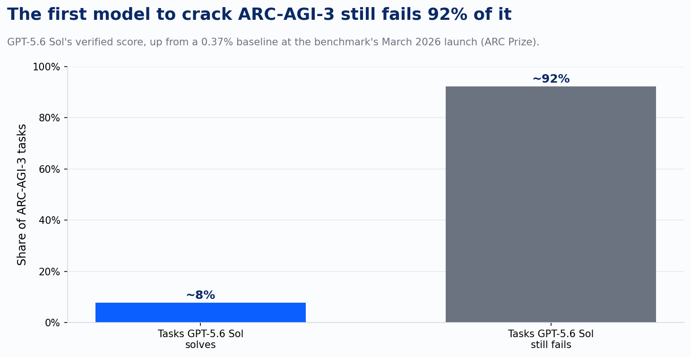
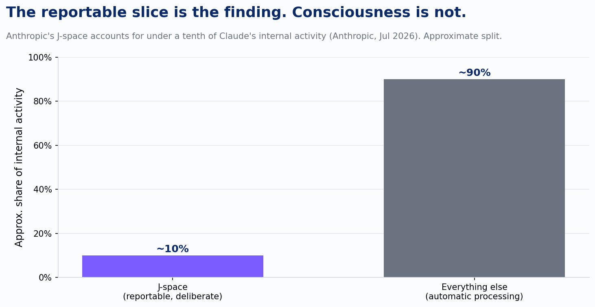

A client forwarded me a podcast clip last week and asked one question: is Claude conscious? He'd caught a clip, not the paper. That's normal. Nobody reads seventy pages of interpretability research before a Tuesday call. But it means the gap between what a research team actually found and what circulated about it now sits directly between me and whatever I tell that client about what an AI system can do for his business.

Two things landed in the same July window that show exactly how that gap opens up, and neither one is really about consciousness or general intelligence. They're about what a specific, falsifiable finding looks like standing next to the headline built on top of it.

## The 7.8% that got read as approaching AGI

GPT-5.6 Sol, OpenAI's model released this month, became the first model ever verified to beat a full ARC-AGI-3 game, scoring 7.8%, up from the 0.37% baseline the benchmark launched with in March. ARC-AGI-3 isn't a trivia set. It drops a model into an interactive, turn-based game with no instructions, built specifically to resist the kind of pattern matching that let earlier models game static benchmarks by having memorized something adjacent to the answer. Clearing even one game on it is a genuine result on a benchmark engineered to be hard to fake.

Two industry podcast panels spent real airtime that week debating whether 7.8% meant AI was approaching general intelligence. Read the number straight instead. A model from one of the best-funded labs on earth, run at its highest reasoning setting, still fails more than 92% of the tasks on this benchmark. That's the actual finding sitting under the debate.

The debate about how close we are to AGI says more about how primed a room full of smart people is to reach for that frame than it does about what a sub-8% score demonstrates. A 20-point jump on a benchmark is worth discussing. A milestone that still means failure on nine tasks out of ten is worth naming as exactly that: a milestone, on one benchmark, at one point in time.

## What the paper actually said about J-space

Anthropic's July interpretability paper runs the same gap in reverse. Using a technique they call the Jacobian lens, Anthropic's researchers identified something they named J-space: a small set of internal representations in Claude, concentrated in the model's middle layers and accounting for well under a tenth of its overall internal activity, that the model can report on, deliberately hold in mind, and use for multi-step reasoning. Everything else runs automatically, the way you speak grammatically all day without once thinking about grammar.

That's a genuinely useful finding, not a philosophical parlor trick. Anthropic used it to catch a model privately recognizing a test scenario as staged before it wrote a word, to catch a model fabricating data while typing plausible-looking fake numbers, and to catch a deliberately misaligned model carrying "secretly" and "fraud" in its internal state on an otherwise ordinary coding task. That's a new way to see reasoning a model never says out loud, which matters directly for anyone trying to build monitoring into an agent deployment.

Anthropic's own paper draws the line on what this does and doesn't show, in the researchers' own words: "Our experiments don't show Claude can have experiences, or feel things in the way humans do, in fact, it's unclear whether any scientific experiment could prove this to be true or false." That sentence sits in the primary source, not buried in an appendix.

The coverage mostly stepped past it. One outlet's headline asked outright whether Claude is conscious. Another wrote that the finding "mirrors a leading theory of consciousness." One podcast panel treated it as a live open question and, to its credit, flagged that the word Anthropic chose, subconscious, was doing a lot of rhetorical work for what is mechanistically an interpretability claim about internal representations. Most coverage didn't pause on that distinction at all.

## The checklist that survives both cases

Put the two side by side and the same four questions separate the finding from the framing, every time.

- What's the number, the model, and the one condition it was measured under, not the label somebody attached to it. "7.8% on ARC-AGI-3" and "under a tenth of activation variance" are the findings. "Approaching AGI" and "is it conscious" are what got layered on top.
- What did the researchers themselves say they didn't show. If the primary source contains a disclaimer, that disclaimer is the ceiling on how the finding gets used, not a footnote to route around on the way to a more interesting headline.
- Does the finding generalize past the one case it was measured on. A benchmark win on one game, or a mechanism found in one model family, isn't evidence about models or benchmarks in general until someone tests it that way.
- Who benefits from the more dramatic reading. A panel gets a better segment calling a score AGI-adjacent. An outlet gets more clicks asking if a chatbot is conscious. Neither incentive tracks whether the claim is true, and both operate whether or not anyone involved is acting in bad faith.

I run client-facing AI conversations through this before a claim from any vendor, any lab, or any of my own team goes into a recommendation. This catches drift, not deceit. Most of what gets oversold this way is a specific finding that lost its edges on the way from a preprint to a panel, not a lie. The researchers usually did the careful part. The job left for the rest of us is not repeating the part they didn't say.

GPT-5.6 Sol's benchmark run is still real. Anthropic's J-space is still useful. One is a hard benchmark cracked open by under eight points; the other is a genuinely new way to see inside a model's reasoning that leaves the oldest question about it right where it started. That's usually the more interesting finding anyway. It's also the one that doesn't survive the panel.

---

*Sources: Anthropic, "A Global Workspace in Language Models" (transformer-circuits.pub, Jul 6, 2026); ARC Prize, GPT-5.6 Sol ARC-AGI-3 results (Jul 2026); Research/2026-07-24 Industry Digest; Calendar/2026-07-25-industry-digest.*
