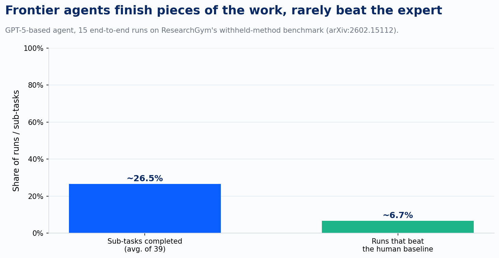
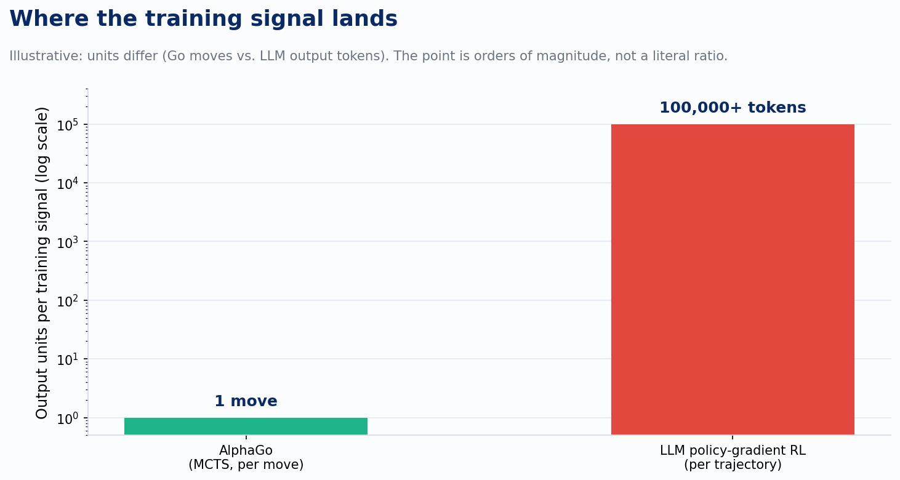

Every move AlphaGo made during a game got graded before it was played. Not at the end, not after the game resolved into a win or a loss. Right then, move by move. Monte Carlo Tree Search runs the position forward thousands of times and hands back a target: this stone, not that one, was the strictly better play. A hundred and fifty moves in a game, a hundred and fifty clean lessons.

I've been sitting with that detail since I listened to Eric Jang walk Dwarkesh Patel through rebuilding AlphaGo from scratch, a project Jang took on during a sabbatical after running AI at 1X and doing research at what's now Google DeepMind Robotics. The rebuild itself is a good story on its own. What stuck with me was the comparison Jang drew between AlphaGo's training signal and the one we use to train today's LLM agents through reinforcement learning.

A policy-gradient trajectory for an LLM agent can run to over a hundred thousand tokens. At the end of it, the model gets a single reward: the code passed, or it didn't, the answer was right, or it wasn't. Somewhere in those hundred thousand tokens is the decision that actually mattered, and the training process has to guess which one. AlphaGo never had to guess. MCTS gave it a graded target on every move, sidestepping what researchers call the credit assignment problem entirely. LLM RL walks straight into it.

That gap in how the two systems learn explains a split Jang named directly in the same conversation: which parts of AI research an agent can already do well, and which it still can't. Implementing an experiment, running it, tuning the hyperparameters once the direction is set: an agent handles that today, competently and fast. Choosing which question is worth investigating next, recognizing a dead end and turning around before spending nine hours in it: that's the part that hasn't moved nearly as much.

You don't have to take that on faith. A paper released this year built the test for it. ResearchGym takes five oral and spotlight papers from ICML, ICLR, and ACL, strips out each paper's actual proposed method, and hands an agent the stripped repository: the data, the evaluation harness, the baseline code, and a description of the research goal. The agent has to propose its own hypothesis, implement it, run it, and try to beat both the provided baseline and, ideally, the paper's own reported result. Nothing about the grading is subjective. A script computes the same metric the original authors used.

Run a GPT-5-based agent through fifteen full attempts across those five tasks and the picture that comes back is stark.

The agent completes barely a quarter of the assigned sub-tasks on average, and beats the human baseline in exactly one of fifteen runs, by 11.5 percent. Performance stops improving after roughly nine hours of work, not because the agent ran out of budget but because it stopped finding anything better to try. The researchers saw the same pattern when they swapped in Claude Code running Opus 4.5 and Codex running GPT-5.2: different scaffolding, same shape of failure.

Here's the detail that makes the credit assignment story concrete rather than theoretical. In that single successful run, the agent didn't just beat the baseline. It surpassed the human expert's own published solution to an ICML 2025 Spotlight problem. Frontier agents can occasionally land on a better research direction than the one already published. They just can't do it reliably, and the researchers' own failure log reads like a list of judgment lapses: impatience, poor time and resource management, overconfidence in weak hypotheses, trouble coordinating parallel experiments. Every one of those is a decision made too early or too late about what to try next, the kind of call that never shows up in a syntax check.

That's the credit assignment problem showing up outside the training run and inside the deployed behavior. A model trained on a sparse, end-of-episode reward learns to execute the step in front of it reasonably well, because execution is where the verifiable, dense feedback already lives: tests pass or they don't, code compiles or it doesn't. Deciding what's worth trying next is the one part of the loop where no such per-step grader exists, so the training signal that would teach good judgment there is exactly the signal AlphaGo had and LLM RL doesn't.

People are working the actual fix. AgentPRM builds a process reward model for agent tasks using temporal-difference estimation, scoring each step on how much it advances the goal while the trajectory is still running, and reports over 8x better compute efficiency than prior step-scoring approaches. A related framework out of Cornell works the same problem from a simpler actor-critic angle. Both hand an LLM agent something closer to AlphaGo's per-move target.

I want to flag the limit on that comparison before the analogy runs further than it should. Go has a complete, closed rule set. A position can be simulated forward thousands of times and scored with certainty, which is exactly what makes MCTS possible. Deciding whether a research hypothesis is worth a day of compute doesn't have that kind of simulator. There's no ground-truth verdict on a half-finished idea the way there's a ground-truth verdict on a finished Go position. Process reward models can approximate progress toward a goal in tasks with cleaner intermediate signals, like web navigation or tool use. Real research taste, the kind that tells you to abandon a promising-looking direction after two failed experiments, is a harder target, and I haven't seen anyone claim to have solved it.

That's the actual state of things inside an agentic research or R&D pipeline right now. The execution surface is real and it's improving on a normal cadence: agents write the code, run the sweep, summarize the result. The judgment surface, deciding which sweep is worth running in the first place, is still sitting with whoever set up the pipeline. A better model doesn't move that line by itself. The line moves when someone solves the training signal problem for open-ended judgment the way MCTS solved it for Go, and nobody has done that yet.

AlphaGo never had to be told which board to play on. Somebody still has to tell the agent which question is worth the next nine hours.

---

*Sources: *[*Dwarkesh Podcast - Eric Jang: Building AlphaGo from scratch*](https://podscripts.co/podcasts/dwarkesh-podcast/eric-jang-building-alphago-from-scratch?ref=devlinliles.com)*; *[*ResearchGym: Evaluating Language Model Agents on Real-World AI Research (arXiv:2602.15112)*](https://arxiv.org/abs/2602.15112?ref=devlinliles.com)*; *[*AgentPRM: Process Reward Models for LLM Agents via Step-Wise Promise and Progress (arXiv:2511.08325)*](https://arxiv.org/abs/2511.08325?ref=devlinliles.com)*; *[*Process Reward Models for LLM Agents: Practical Framework and Directions (arXiv:2502.10325)*](https://arxiv.org/abs/2502.10325?ref=devlinliles.com)
