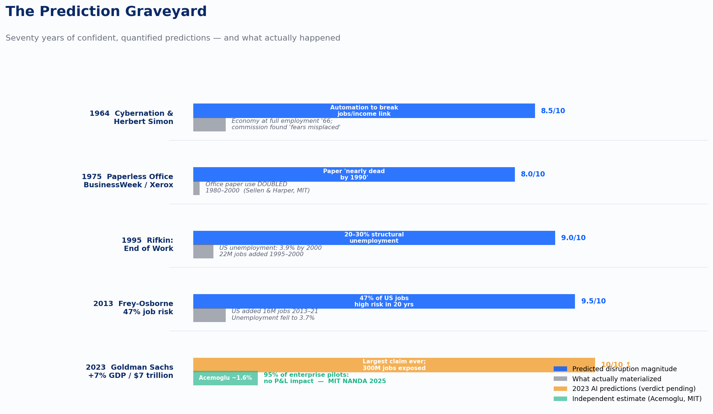
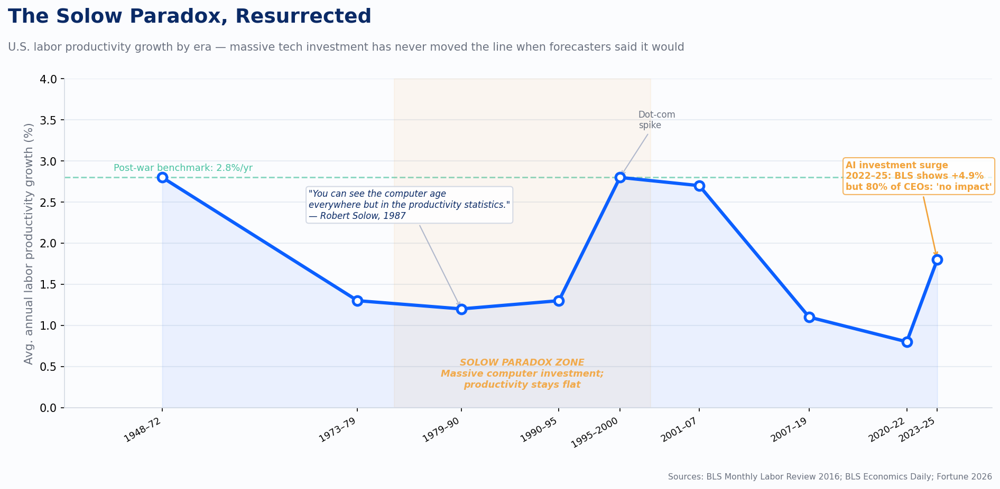
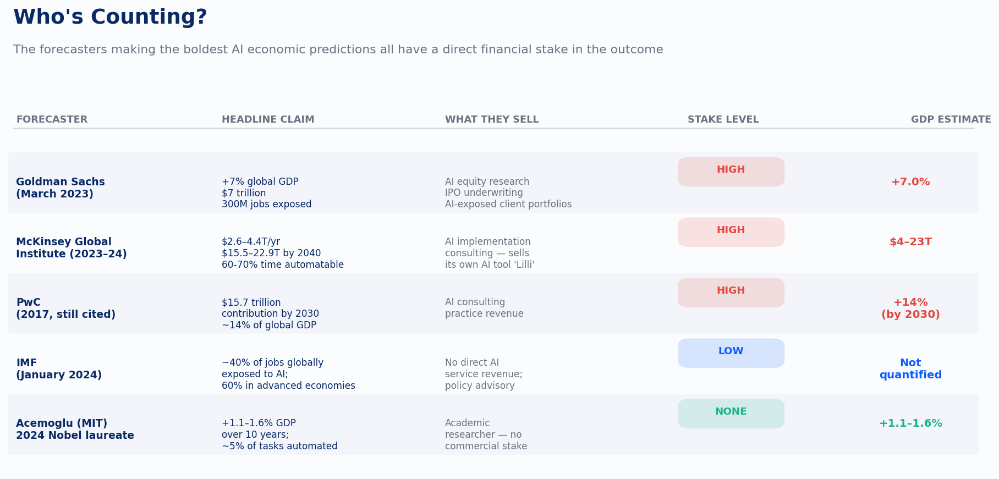

# Seventy Years of Technology Hype: What Failed Predictions Tell Us About the AI Economic Boom

## TL;DR

- **Every major wave of technology since 1950 has been accompanied by confident, quantified economic predictions from credible institutions — and almost every one of them has been wrong, usually by overestimating speed of impact and by treating "technically possible" as "economically and organizationally inevitable."** The 1960s "leisure society," the 1975 paperless office, Jeremy Rifkin's 1995 "end of work," the dot-com "new economy," and Frey & Osborne's 2013 "47% of jobs gone in 20 years" are all in the same family.
- **The 2023–2025 AI predictions from Goldman Sachs (+7% global GDP / $7 trillion), McKinsey ($2.6–4.4 trillion/year, up to $15.5–22.9 trillion by 2040), PwC ($15.7 trillion by 2030), and the IMF (40% of jobs exposed) share the same structural flaws as their failed predecessors:** they extrapolate from technical task-exposure scores rather than measured adoption; they assume frictionless deployment; they are produced by firms with a direct financial stake in selling AI services or capital to clients; and they ignore the historical ~20-year diffusion lag for general-purpose technologies. MIT Nobel laureate Daron Acemoglu's 2024 estimate of ~1.1–1.6% GDP gain over a decade is closer to historical base rates and roughly one-fifth the Goldman number.
- **Recommended posture for decision-makers:** Treat the consensus AI macro forecasts as marketing documents, not forecasts. Plan capital and workforce decisions against a base case of ~0.5–1% added annual productivity over a decade (the historical range for prior general-purpose technologies in their first decade), not the 1.5pp Goldman/McKinsey case. The MIT Project NANDA finding — that 95% of enterprise GenAI pilots show no measurable P&L impact despite $30–40 billion in spending (July 2025) — is the canary. If pilot-to-production conversion is still under 10–15% by 2027, the consensus forecasts should be considered falsified.

## Key Findings

1. **The "wrongness" of tech-economy predictions is structural, not accidental.** From 1950 through 2025, the same five errors recur: (a) confusing task-level technical feasibility with economy-wide deployment; (b) ignoring organizational and behavioral lag (the Solow paradox); (c) underestimating Jevons paradox / induced demand (worldwide office paper consumption *more than doubled* from 1980 to 2000, per FAO-derived estimates cited in Sellen & Harper's *The Myth of the Paperless Office*, MIT Press 2002); (d) treating productivity gains as automatic instead of contingent on complementary investment; (e) credentialed forecasters with commercial interests producing the loudest numbers.
2. **Three decades of "automation will end work" predictions all proved wrong on their stated timelines.** Herbert Simon (1965): "machines will be capable, within twenty years, of doing any work that a man can do." Triple Revolution memo (1964): cybernation will sever the link between jobs and income. Jeremy Rifkin (1995): tens of millions of US jobs will vanish; structural unemployment will exceed 20–30%. Frey & Osborne (2013): 47% of US jobs at high risk within 20 years. From 2013–2021 alone, the U.S. *added* 16 million jobs and unemployment fell to 3.7% (ITIF analysis, 2022).
3. **The "paperless office" is the cleanest case study in tech overconfidence.** Predicted by BusinessWeek (June 30, 1975) quoting Xerox PARC director George Pake and consultant Vincent E. Giuliano ("by 1990, most record-handling will be electronic"). The Wikipedia "Paperless office" article, citing Sellen & Harper, states plainly: "the worldwide use of office paper more than doubled from 1980 to 2000." Sellen and Harper documented that "the use of e-mail in an organization causes an average 40 percent increase in paper consumption."
4. **The current AI predictions are quantitatively bigger than any previous wave, and the early evidence is already disappointing.** Goldman Sachs (March 2023): +7% global GDP, +1.5pp annual productivity, 300 million full-time-equivalent jobs exposed. McKinsey (June 2023): $2.6–4.4 trillion annually across 63 use cases — equivalent to adding the UK's entire GDP. McKinsey's later "Next Big Arenas" estimates $15.5–22.9 trillion annually by 2040. PwC (2017, still widely cited): $15.7 trillion by 2030. But MIT Media Lab Project NANDA (July 2025) finds 95% of enterprise GenAI pilots produce no measurable P&L impact, and Acemoglu (*Economic Policy*, August 2024) models the realistic 10-year US GDP boost at 1.1–1.6%, with a ~0.05% annual productivity gain.
5. **The forecasters making the boldest current predictions have a commercial stake in the outcome.** Goldman Sachs sells AI-exposure equity research and underwrites AI company IPOs. McKinsey, PwC, EY, and Deloitte sell AI implementation consulting (McKinsey's own AI tool is "Lilli"). This is the same structural conflict that produced Forrester's, IDC's, and Jupiter's wildly inflated 1999 e-commerce forecasts.

*The Prediction Graveyard: every wave from 1964 to 2023 follows the same shape — massive claimed disruption, modest actual impact. The AI bar is the largest on record, with Acemoglu's independent estimate shown as a base case.*

## Details — A Decade-by-Decade Tour of Failed Predictions

### 1950s: The First Automation Panic

The post-war installation of mainframes (UNIVAC, IBM 700-series) and the imminent arrival of the first industrial robot (Unimate, GM, 1961) produced the first wave of credentialed "automation will destroy work" predictions. A 1958 Department of Labor automation report predicted clerical employment growth would slow sharply because office automation would displace stenographers, typists, and clerks — but its authors also (correctly) predicted that secretary, receptionist, and customer-contact roles would expand. A celebrated example of inflexible 1950s automation was Ford's Cleveland Engine Plant No. 1 (1951): an interconnected machine line that produced engine blocks with little manual labor — but which could not be reconfigured for new products without massive overhauls, the same trap that would later destroy GM's 1980s automation push.

**What actually happened:** Clerical and service-sector employment *exploded* through the 1960s. Productivity growth in the manufacturing sector did approach the predicted 3% per year, but the broader economic dislocation feared by 1950s commentators did not occur. Per BLS Monthly Labor Review (2016), labor productivity rose by an average 2.8% per year from 1948 through 1972 — strong, but not the radical leisure-creating surge predicted.

### 1960s: The Cybernation / Leisure Society Predictions

This is the richest decade for sourced, named, failed predictions:

- **TIME magazine (1966):** "By 2000, the machines will be producing so much that everyone in the U.S. will, in effect, be independently wealthy." TIME's 1965 cover story estimated that 35,000 U.S. workers were losing or changing jobs each week to automation, and that "To process without computers the flood of checks that will be circulating in the U.S. by 1970, banks would have to hire all the American women between 21 and 45."
- **Herbert Simon (1965, *The Shape of Automation for Men and Management*):** "Machines will be capable, within twenty years, of doing any work that a man can do."
- **Marvin Minsky (1967, then 1970 in *Life* magazine):** "Within a generation … the problem of creating `artificial intelligence' will substantially be solved"; and "In from three to eight years we will have a machine with the general intelligence of an average human being."
- **The "Triple Revolution" memorandum (March 1964)**, signed by 35 luminaries including Nobel chemist Linus Pauling and Nobel economist Gunnar Myrdal, sent to President Johnson: cybernation would "break the link between jobs and income," requiring a guaranteed annual income. President Johnson responded by creating the National Commission on Technology, Automation, and Economic Progress (Aug. 1964). The commission's 1966 final report concluded the fears were misplaced — the U.S. economy was at full employment.
- **Sociologist David Riesman (early 1960s):** proposed a federal Office of Recreation and a "Play Progress Administration" to manage Americans' coming surplus leisure.
- **Southwestern Bell manager R.L. Davidson (mid-1960s):** Americans of the year 2000 would have so much leisure they would consult libraries via picture phone "without leaving home."

**What actually happened:** The U.S. workweek has barely moved since the 1960s — from roughly 40 hours then to roughly 38–40 hours now in manufacturing. Productivity quadrupled but the gains went to corporate profits and the top of the income distribution, not to hours-cut for the average worker. The "rule by cyberneticians" elite predicted by sociologist Donald Michael in *The Unprepared Society* did not emerge.

### 1970s: The Paperless Office and the First Productivity Slowdown

- **BusinessWeek, "The Office of the Future," June 30, 1975:** quoted Xerox PARC director George Pake predicting "TV-display terminals with keyboards" by 1995 (accurate) and that "by 1990, most record-handling will be electronic." Consultant Vincent E. Giuliano repeated the claim verbatim. The article projected paper would be "on its way out by 1980, nearly dead by 1990."
- **Jenkins & Sherman (1979), *The Collapse of Work*:** predicted microelectronics would produce mass structural unemployment in industrialized economies.

**What actually happened:** Per Wikipedia's "Paperless office" article (citing FAO-derived estimates and Sellen & Harper, MIT Press 2002): "the worldwide use of office paper more than doubled from 1980 to 2000." The economist William Stanley Jevons's 19th-century insight — that making a resource cheaper to use *increases* total use — turned out to govern the office. The paperless office is the textbook case of confusing a *capability* prediction (you *can* store records electronically) with a *behavioral* prediction (people will *stop* printing).

Meanwhile, U.S. labor productivity growth, which had averaged 2.8% per year from 1948 to 1972 (BLS Monthly Labor Review, 2016), collapsed dramatically. Per BLS Economics Daily (March 4, 1999): "Labor productivity growth for the private business sector has averaged about 1.3 percent per year since 1973: 1.3 percent from 1973 to 1979, 1.2 percent from 1979 to 1990, and 1.3 percent again from 1990 to 1997." This collapse coincided with the most intense computer-investment decades.

### 1980s: GM's $45 Billion Failure and the Solow Paradox

This is the decade where the gap between technology hype and economic reality was made famous.

- **Robert Solow** (Nobel laureate, MIT), *New York Review of Books*, July 12, 1987: **"You can see the computer age everywhere but in the productivity statistics."** Despite a 100-fold increase in business computing capacity during the 1980s, productivity growth averaged just 1.2% per year (BLS, 1979–1990). Brynjolfsson coined this the "productivity paradox" in a 1993 paper.
- **General Motors under CEO Roger Smith (1981–1990):** spent an estimated $45 billion on factory automation per Dartmouth's Sydney Finkelstein, or up to $90 billion across all transformation efforts including the EDS and Hughes Aircraft acquisitions. Smith said in 1980: "Automation came along just in time to save us." In a now-famous 1986 internal memo, GM CFO F. Alan Smith wrote: "Since 1980 GM has spent $45 billion on the automotive business. … For $34.7 billion, given recent market valuations, GM could have purchased Toyota and Nissan. This would almost double GM's world market share." Fortune's Alex Taylor III (2013) summarized: "He wasted billions trying to revive the sagging giant through diversification (EDS and Hughes), automation (robotized factories) … Smith's legacy was a fleet of lookalike autos, an unqualified successor, and a mountain of debt that pushed the company close to bankruptcy in 1992." Per Finkelstein, GM's plant productivity "actually *declined* further from 1984 to 1991" — averaging 11.7 cars per employee versus Toyota's 57.7. GM's U.S. market share fell from 46% to 35% during Smith's tenure. Robots famously painted each other and welded doors shut.

The 1980s established the now-recurring pattern: massive capital deployment + confident productivity predictions + actual decline in measured productivity at the firm or industry level.

*U.S. labor productivity growth by era. Massive computer investment in the Solow Paradox Zone (1979–2000) produced no productivity surge. The AI era is tracking the same pattern so far. Sources: BLS Monthly Labor Review; Fortune 2026.*

### 1990s: The "New Economy" and Rifkin's End of Work

Two opposite-direction predictions both failed:

**Pessimist failure — Jeremy Rifkin, *The End of Work*, 1995:** Rifkin predicted that information technology and automation would create structural unemployment of 20–30% in advanced economies. He wrote that "in the U.S. more than 90 million jobs in a labour force of 124 million are potentially vulnerable to replacement by machines" and that worldwide unemployment had "reached its highest level since the great depression of the 1930s." He proposed a guaranteed annual income and a government-subsidized "third sector" of nonprofit employment to absorb displaced workers.

**What actually happened:** U.S. unemployment fell to 3.9% by 2000. Manufacturing employment did decline, but the overall labor market expanded enormously, with nonfarm payrolls growing by roughly 22 million from January 1995 to January 2000.

**Optimist failure — The "New Economy" thesis (1995–2000):** Michael Mandel's 1996 BusinessWeek "Triumph of the New Economy" article and Fed Chairman Alan Greenspan from 1995 onward argued that IT had permanently raised trend productivity growth. Greenspan, July 11, 2000: "the recent acceleration in labor productivity is not just a cyclical phenomenon or a statistical aberration, but reflects, at least in part, a more deep-seated, still developing, shift in our … economy." From 1995–2000, productivity did rise to 2.8%/year vs. 1.4% before. But productivity then *declined 1.2% in Q1 2001* (its sharpest drop in seven years).

**Dot-com specific failed predictions:** - **Forrester Research, late 2000:** "Rumors surrounding the demise of eCommerce have been greatly exaggerated — in fact, they are dead wrong" (Christopher M. Kelley, Forrester analyst, weeks before the NASDAQ crash deepened). - **Pets.com:** $300M+ market cap to zero in under a year; bankrupt Nov. 9, 2000, 268 days after IPO. Webvan, eToys.com, Boo.com, Kozmo all failed. - **NASDAQ:** 5,048 (March 10, 2000) → ~1,100 (Oct. 2002), a 78% drawdown. The Wikipedia dot-com bubble article states: "By the end of the stock market downturn of 2002, stocks had lost $5 trillion in market capitalization since the peak." - **Dot-com mortality:** Per the same Wikipedia entry (citing a March 2003 industry report): "At least 4,854 Internet companies have either been acquired or have shut down in the three years since the dot com investment boom peaked in Q1 of 2000." - Only 14 dot-coms paid >$2M each for Super Bowl XXXIV ads (Jan. 30, 2000); by Super Bowl XXXV (January 2001), just three remained as advertisers.

### 2000s and 2010s: The Frey-Osborne 47% and the Brynjolfsson-McAfee "Second Machine Age"

- **Erik Brynjolfsson and Andrew McAfee, *The Second Machine Age* (2014):** argued that AI and digital technologies would so accelerate productivity that median wages would stagnate and labor's share of income would keep falling. They were correct on inequality direction but wrong on the productivity surge — the 2010s actually saw historically *low* productivity growth (averaging ~1.3%/year globally, down from ~3% pre-2008).
- **Carl Frey & Michael Osborne (Oxford, September 2013):** "The Future of Employment: How Susceptible Are Jobs to Computerisation?" — concluded that **47% of total U.S. employment was at "high risk" of automation in the next 10–20 years.** Their methodology assigned automation-probability scores of 0–1 to 702 occupations.

**What actually happened to Frey-Osborne's predictions, 9 years on (ITIF, 2022):** The U.S. added 16 million jobs from 2013 to 2021. Unemployment was 3.7%. The occupation ranked *highest risk* — insurance underwriters — *grew* 16.4%. The occupation ranked *lowest risk* — recreational therapists — *declined* 8.9%. The overall correlation between the Frey-Osborne automation-risk score and actual job loss was a weak +0.26 (Coelli & Borland, SSRN 2019 found their predictions added no forecasting value over standard task-based approaches). Frey and Osborne later softened their claim, but the original 47% number had already entered popular discourse as fact.

- **McKinsey Global Institute (2017):** estimated 23% of work activities could be automated by 2030 (midpoint estimate); separately said AI could add $9.5–15.4 trillion in economic value annually.
- **Martin Ford, *Rise of the Robots* (2015):** doubled down on the Triple Revolution thesis, arguing the failures of past predictions were "premature, not wrong."

The 2000s also produced the dot-com infrastructure overbuild: per Fortune (Sept 28, 2025), "Even four years after the bubble burst, 85% to 95% of the fiber laid in the 1990s remained unused, earning the nickname 'dark fiber.'" ISE Magazine (2025) specifies that "in 2001, after the bust, it was estimated that 95% of the fiber was dark fiber." This is the closest historical analogue to today's $300B+/year AI data-center capex cycle.

## Current AI Predictions (2023–2025) — The Same Pattern, Now Even Bigger

### The bull case (commercial forecasters)

| Source & Date | Headline Claim | Methodology |
| --- | --- | --- |
| Goldman Sachs (Briggs & Kodnani), March 27, 2023 | +7% global GDP (~$7 trillion); +1.5pp annual productivity over 10 years; "300 million full-time-equivalent jobs" exposed globally | Task-based exposure × productivity boost assumed |
| OpenAI / OpenResearch / Wharton (Eloundou, Manning, Mishkin, Rock), March 2023, "GPTs are GPTs," arXiv:2303.10130 | "Approximately 80% of the U.S. workforce could have at least 10% of their work tasks affected by the introduction of LLMs, while approximately 19% of workers may see at least 50% of their tasks impacted." | Task-level rubric using GPT-4 itself as a classifier; abstract explicitly disclaims "predictions about the development or adoption timeline" |
| McKinsey Global Institute, June 14, 2023 | $2.6–4.4 trillion/year in corporate profits across 63 use cases; 60–70% of employee time potentially automatable | 63 use cases × industry revenue × adoption scenarios |
| McKinsey "Next Big Arenas," 2024 | AI software & services revenue: $85B (2022) → $1.5–4.6T (2040); total economic potential of AI: $15.5–22.9T annually by 2040 | Sector-by-sector S-curve extrapolation |
| PwC (2017, still cited) | $15.7 trillion contribution to global GDP by 2030 (~14% of global GDP) | Top-down assumed productivity uplift |
| IMF (Georgieva, January 2024) | ~40% of jobs globally exposed to AI; 60% in advanced economies | Occupation-level exposure scores |

** ** ** ** ** ** **

*Who's Counting? The inverse relationship holds: the higher the forecaster's commercial stake in AI adoption, the larger the headline number. Acemoglu, with no stake, produces the most conservative and most methodologically transparent estimate.*

The peer-reviewed *Science* version of Eloundou et al. (2024, *Science* 384:1306) softened the headline considerably: "we estimate that roughly 1.8% of jobs could have over half their tasks affected by LLMs with simple interfaces and general training. When accounting for current and likely future software developments that complement LLM capabilities, this share jumps to just over 46% of jobs."

### The bear case (independent academic economists)

- **Daron Acemoglu (MIT, 2024 Nobel Prize in Economics), *Economic Policy*, August 2024, "The Simple Macroeconomics of AI":** estimates AI will produce **"no more than a 0.71% increase in total factor productivity over 10 years,"** and "predicted TFP gains over the next 10 years are even more modest and are predicted to be less than 0.55%." Total GDP gain: 1.1–1.6% over a decade — about one-fifth of Goldman's estimate.
- **Acemoglu's tasks estimate:** only ~5% of tasks will be profitably automated by AI in 10 years, vs. McKinsey/Goldman implying 25–50% of tasks.
- **Acemoglu on AI's distribution of effects:** "We're still going to have journalists, we're still going to have financial analysts, we're still going to have HR employees. It's going to impact a bunch of office jobs that are about data summary, visual matching, pattern recognition … about 5% of the economy."
- **Philippe Aghion & Simon Bunel (Banque de France, 2024)**, using a historical-analogue method: estimate 0.8–1.3pp additional annual productivity over the next decade — between Acemoglu and Goldman.

### The on-the-ground evidence (2024–2026)

- **MIT Media Lab Project NANDA, "The GenAI Divide: State of AI in Business 2025" (July 2025):** Surveyed 153 senior leaders, 52 executive interviews, 300 public AI deployments. Found **95% of enterprise GenAI pilots produced "no measurable P&L impact"** despite $30–40 billion in enterprise spending. "Just 5% of integrated AI pilots are extracting millions in value." Only 5% of custom enterprise AI tools reach production. Pilot-to-production duration: 9+ months at large enterprises.
- **McKinsey QuantumBlack, "Seizing the agentic AI advantage" (June 2025), per New York Times' Steve Lohr:** "Nearly eight in ten companies report using gen AI — yet just as many report no significant bottom-line impact."
- **Bureau of Labor Statistics, Q3 2025:** nonfarm business productivity +4.9%; Q2 revised to +4.1%. Some attribute this to AI, but it is too early to disentangle from cyclical effects.
- **Fortune (Feb. 17, 2026), citing thousands of CEOs:** the Solow paradox has been "resurrected from 40 years ago" — most CEOs reported AI had had no measurable impact on either productivity or employment in their organizations.
- **Apollo chief economist Torsten Slok (February 2026):** "AI is everywhere except in the incoming macroeconomic data … Today, you don't see AI in the employment data, productivity data, or inflation data."

### The shared structural flaws of current AI forecasts

1. **They confuse task exposure with economic displacement.** Goldman's 7% GDP number is a *ceiling* derived by assuming all exposed tasks are actually automated at the modeled cost savings. McKinsey's $4.4 trillion assumes its 63 use cases are deployed at scale.
2. **They are produced by sellers of AI services.** Goldman underwrites AI IPOs and sells equity research to AI-exposed clients. McKinsey, PwC, EY, and Deloitte sell hundreds of millions of dollars of AI consulting; their economic forecasts are simultaneously sales documents.
3. **They ignore the historical ~20-year diffusion lag.** Goldman's own paper notes: "in both [past] cases [electric motor and PC], labor productivity booms … started about 20 years after the technological breakthrough, at a point when roughly half of US businesses had adopted the technology." Today only ~5% of enterprise AI pilots reach production.
4. **They double-count.** McKinsey's 2017 estimate was $9.5–15.4T; the 2023 GenAI estimate is $2.6–4.4T; the 2024 "arenas" estimate is $15.5–22.9T. These are presented as additive in popular coverage but overlap substantially.
5. **They are unfalsifiable on the timeline given.** "Over the next decade" makes verification arrive only after the boom (and the consulting revenue) has ended.

## Recommendations

**For executives and boards:** 1. **Adopt a base case of 0.5–1.0% added annual productivity from AI over the next decade, not 1.5pp.** This is the historical norm for general-purpose technologies in their first decade (electric motors, PCs) and matches Acemoglu's range. Discount Goldman/McKinsey by ~3–5×. 2. **Audit AI spending against the MIT NANDA benchmark.** If, after 9 months, your AI pilots are in the 95% "no measurable P&L impact" majority, your problem is likely organizational/workflow integration, not model quality. Buying from specialized vendors succeeds ~67% of the time vs. ~33% for in-house builds (NANDA 2025). 3. **Build in the Jevons-paradox correction.** Plan for the possibility that AI makes certain knowledge tasks so cheap that volume explodes, paper-style — meaning headcount may not fall even where task automation succeeds.

**For investors:** 4. **Evaluate the current AI capex cycle (~$300B+/year globally) against the dot-com analogue.** Telecom capex 1996–2001 was the most-comparable infrastructure boom; per Fortune (Sept 28, 2025), 85–95% of laid fiber went unused for years and many capital structures collapsed even though the underlying technology was transformational in the longer run. Differentiate hyperscaler infrastructure plays (sustainable cash flows) from pure-AI startups (still mostly pre-revenue). 5. **Watch three trigger metrics through end-2027:** (a) BLS measured TFP growth; (b) enterprise AI pilot-to-production conversion rate (target: >15% for the consensus forecast to be on track); (c) percent of S&P 500 reporting "material" AI revenue impact (currently <5%).

**For policymakers:** 6. **Resist the policy responses that previously failed.** The 1964 Triple Revolution and 2010s Frey-Osborne forecasts both spawned UBI proposals that turned out to be premature solutions to a mis-forecast problem. Job retraining, portable benefits, and antitrust enforcement on AI infrastructure markets are more robust to forecast error. 7. **Demand methodological transparency.** Require AI-economic-impact studies cited in government rulemaking to disclose: (a) whether the authors' employers sell AI services; (b) the assumed adoption rate vs. observed; (c) whether the headline number is a ceiling or expected value.

## Caveats

- **"Wrong" predictions sometimes become right on a longer timescale.** The paperless office is partially arriving in 2025 (US office paper use has declined since ~2007). Simon's "any work a man can do" prediction may yet come true — just 50–60 years later than he forecast. The question is not whether AI will eventually be transformative; it is whether the *quantitative, decade-specific* forecasts from 2023–2025 will be accurate. History says they will not.
- **Acemoglu's bear case is also a forecast and could be wrong in the optimistic direction.** The 1995–2005 productivity boom did materialize after a similar decade of skepticism. If LLM-based reasoning hits hard-to-learn cognitive tasks faster than expected, the consensus could undershoot.
- **The MIT NANDA "95% failure" figure has been criticized** for methodological fragility — small sample (153 leaders, 52 interviews, 300 deployments), six-month ROI window, vendor-adjacent framing. It is directional, not definitive. But the McKinsey QuantumBlack survey (nearly 80% of firms report no bottom-line AI impact) confirms the direction.
- **None of the historical sources predicted the *direction* of distributional impacts well.** Productivity gains since 1973 went disproportionately to capital and the top decile of labor. This pattern is independent of forecast accuracy and is probably the most reliable thing to predict about AI's coming impact.
- **Some 1965 predictions (Simon, Minsky) about AI *capability* were not "wrong" in kind, only in timing.** This nuance matters: an investor or policymaker who took Simon literally in 1965 and held the position until 2024 would have been right in spirit — and bankrupt long before. The same risk applies to current AI bulls who are "directionally correct" about the technology but quantitatively wrong about the decade.
