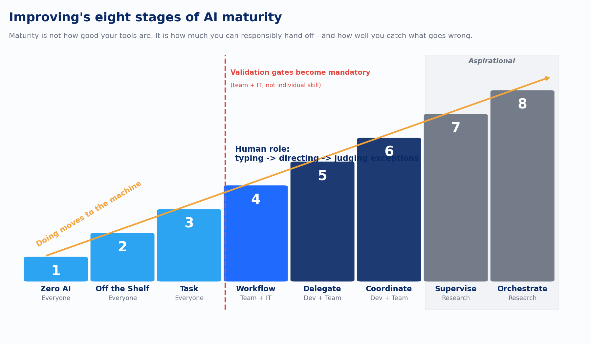

Most organizations are thinking about AI like a woodshop. Fix the mistake as it happens. Watch every cut. The craftsperson is in the room and the craftsperson is the quality system. That model is being replaced. Not by choice in most cases, but by competitive pressure, by the math of what agentic systems can actually do, and by the growing gap between organizations that have built operating infrastructure and those that haven't.

We are moving into the factory model. The factory doesn't depend on the craftsperson watching every step. It depends on the systems built around the work: quality gates, audit trails, defined roles, and clear escalation when something goes wrong.

Maturity is not how good your tools are. It is how much you can responsibly hand off. And how well you catch what goes wrong.

AI adoption gets discussed as a binary state. You either use AI or you do not. You are either AI-enabled or behind. That framing produces bad decisions because it skips the question that actually matters: how much authority are you ready to delegate, and what does each level of delegation require from you?

The idea that autonomy comes in graduated levels predates the current AI wave by decades. Thomas Sheridan and William Verplank mapped ten levels of automation for human-machine systems at MIT in 1978, running from full manual control to machines that act and inform the human only if asked. Their insight transfers directly. The question is never whether to automate. The question is how much authority to delegate, and what supervision each level of delegation demands.

The 8-Stage AI Trust Evolution is that insight applied to modern agentic AI. It describes where you are, what changes when you move to the next stage, and what the infrastructure requirements are at each level.

*Improving's eight stages of AI maturity. Stages 1–3 are achievable by everyone. Stage 4 requires team and IT. Stages 5–6 require development skill. Stages 7–8 are research-grade and aspirational.*

## The Eight Stages

### Stage 1: Zero AI

No AI involvement in the workflow. All output is human-generated through human effort. The human is executor and quality authority.

This is a position. For many organizations and many workflows it is the correct current position. The risk is remaining here past the point where it produces competitive disadvantage. If you are here, the question is not whether to move. It is which workflows to start with, and what responsible movement requires.

### Stage 2: Off the Shelf

You use AI the way it shipped. You type prompts. You get something back. You review every word, accept or reject every output, make every decision. Slow. Controlled. A marginal performance gain. That is fine, because this is where the skills are built.

Most organizations that claim to use AI are here. The tools are ChatGPT, Copilot, Claude, accessed individually, used ad hoc, reviewed every time. The tell that you are in Stage 2: you are retyping the same instructions from memory each session, or you have a notes file somewhere with your good prompts. Your opinions, standards, and process are not captured in a repeatable form. They are in your head, and every session you start over.

A harder version of Stage 2 is toy usage: AI for things that feel impressive but don't move any business needle. AI-generated images in the Friday all-hands deck. Summaries of things you already know. Sentences rewritten by a tool you didn't need to ask. Fun. Not why you bought the tools.

Stage 2 is not a failure state. You cannot skip it. The skills built here, learning to prompt well, understanding where AI succeeds and where it stops, developing judgment about output quality, are exactly what Stage 3 demands. There is no light switch moment between them. The transition is the skill.

### Stage 3: Task Agents

This is the autonomy inflection point. It is where adoption stalls for almost everybody.

At Stage 3, you define a task agent with explicit opinions, constraints, and standards, and you let it execute a single defined task without step-by-step approval. You review the output of that step. Not the process it used to get there. AI starts doing work you will be held accountable for. That is a fundamentally different relationship with the tool.

A task agent is more than a prompt. It has opinions: the approach it should take, the patterns it should follow, the format it should produce. It has constraints: what it is not allowed to do, what data or systems it should never touch. It has standards: what good enough looks like, the quality threshold that constitutes done. Everything you carry in your head or retype from memory gets captured once, in a form the agent uses every time.

The workflow mapping discipline that makes this concrete: draw your primary work process as boxes and arrows on a whiteboard. Each step in the process is a box. Each connection is an arrow. AI agents will help in the boxes. Stage 3 is the boxes, one at a time. Start with the easiest box: where Stage 2 is already giving you decent results, where inputs and outputs are well-defined, where the cost of a mistake is low. Build the agent for that box, run it on real work, and apply the five percent rule. If the output repeatedly meets 95% of expected quality, the agent is working. If it doesn't, fix the agent, not the output. Manual edits to output are a signal the agent definition is incomplete. Fix the agent and every future run improves. Fix the output and you have just added permanent overhead.

This transition also requires building the factory infrastructure before you deploy anything. Not after. The woodshop doesn't need systematic error-catching because the craftsperson is watching every cut. The factory does. Agent boundaries, quality gates, audit trails, and error handling protocols have to exist before Stage 3 agents run on real work. Most teams that try to reach Stage 3 without building this infrastructure fail. The agents are capable. The environment for running them was never built.

Expect a stabilized Stage 3 agent to take roughly 18 hours of refinement: building it, running it on real work, fixing the definition, and repeating until it consistently clears the quality bar. Accessible to everyone. No development background required.

### Stage 4: Workflow Agents

If Stage 3 is the boxes, Stage 4 is the arrows. Multiple validated Stage 3 agents connected into an end-to-end workflow, with handoffs between steps, branching logic, and the agent managing the flow.

The design requirements change materially. You need deterministic validation between steps so errors don't compound. You need human punch-out points: places in the workflow where a human is required regardless of what the agent can technically do. Accounts payable is the clean example. AI can identify and prepare an invoice payment. Most organizations don't want money going out the door without a human in the loop, and they shouldn't. You need adversarial controls: test sufficiency gates, compliance checks, security scanning. You need an audit trail, because when something goes wrong in a 15-step workflow, the audit trail is what makes it debuggable.

The biggest mistake at Stage 4 is attempting it before the Stage 3 boxes are solid. If a Stage 3 agent needs regular manual cleanup, that error compounds through every connected step downstream. A Stage 4 workflow built on unreliable Stage 3 agents is not faster. It is a slop cannon. The errors just travel further before someone catches them. Get the boxes solid first.

Stage 4 is not a solo endeavor. The outputs of one person's agents become the inputs for someone else's. The team has to agree on standards: coding conventions, output formats, quality definitions. AI agents working to different standards than the humans they collaborate with create conflict loops that are hard to untangle. Team alignment is a prerequisite. Requires team and IT to execute. Plan for about 172 hours of refinement to reach stable Stage 4.

### Stage 5: Delegate

Stages 5 through 8 are forward-looking. Most organizations that are honest about where they operate don't live here yet. Building Stages 3 and 4 correctly is the prerequisite for getting here without catastrophic compounding errors.

At Stage 5, the human assigns work across connected workflows and manages by exception. Agents orchestrate and detect errors across workflows rather than executing the steps. The human is no longer watching each run. They are notified when something requires judgment and re-engaged at defined escalation points. This is the first stage where the process flow starts to look different from the human flow, because the error conditions that matter in an autonomous system are not the same checkpoints humans naturally use.

Stage 5 without solid Stage 4 is faster dangerous. Racing without brakes. You need cross-workflow validation gates, version-controlled AI artifacts, adversarial sufficiency checks, and incident logs. You are delegating to a process running in the background. It has to self-report accurately when it goes wrong. Expect 1,000 to 1,200 hours of refinement. Every discovery at Stage 5 typically cascades back as rework through Stages 3 and 4. Requires development skill and team coordination.

### Stage 6: Coordinate

Multiple agents working concurrently on isolated sub-problems in a shared system. The coordination logic operates at agentic speed. Work separation, isolation, branching and merging strategies, conflict arbitration, distributed tracing: all the team coordination problems humans have managed for decades, now happening faster than humans can intervene.

Two agents assigned to related work will find the same foundational problems and duplicate effort. Agents committing to a shared branch simultaneously will fight over state. A misconfiguration at Stage 6 can burn a thousand dollars of tokens in under an hour. The distributed tracing and conflict arbitration that look like overhead are what make recovery possible when something goes wrong. Something always goes wrong.

Requires roughly 95% confidence in autonomous end-to-end runs before concurrent coordination is safe. Over 6,000 hours of refinement to reach. This is not where most practitioners are today. That is not a judgment. It is a state of the industry. Requires development skill and team coordination.

### Stage 7: Supervise

Agent swarms operating under team-governed policies, with some agents supervising other agents and adjusting subordinate workflows based on observed performance. Cross-domain transfer of evidence: a failure in a testing workflow that traces back to a design decision, triggering an update to the design workflow. Predictive accuracy about when autonomous operation will succeed versus when to escalate to a human.

This is aspirational for the whole industry. The research is in preprint. The tools that would enable this at scale don't exist outside of narrow experiments. The governance infrastructure from Stages 3 and 4 is what makes it theoretically reachable, which is why those stages are where the real investment goes.

### Stage 8: Orchestrate

The system mutates its own workflows. Auto-generated evaluations. A governance framework for system-initiated change with change logs, reversions, and full lineage. Human input at the intent layer: defining goals, establishing constraints, making decisions that require judgment about values or strategic direction. Everything else is executable by the system.

Doing moves to defining. Building moves to orchestrating. Intent is the irreducible human contribution. The question stops being what you built and becomes what you set in motion. Five to ten years out. We are building toward it.

## Where the Argument Could Break

Two objections to staged trust models deserve a direct answer.

The first comes from Lisanne Bainbridge's 1983 paper "Ironies of Automation," still the sharpest critique of supervisory control ever written. As automation improves, the human's remaining job gets harder: monitoring a system that rarely fails is something humans are demonstrably bad at, and the skills needed to intervene atrophy precisely because intervention is rare. Applied here, the worry is that Stages 5 through 8 quietly assume a vigilant human who will not exist. The map's answer is that it never asks for vigilance. The transitions are gated on infrastructure: quality gates, audit trails, exception thresholds, and rollback procedures that catch failures structurally. A Stage 5 operation that depends on a human watching closely is a Stage 2 operation wearing a costume.

The second is that eight stages is a suspiciously tidy number, and the boundaries between Coordinate and Supervise will blur in practice. They will. The stages are a shared vocabulary for diagnosing where you actually are and what to build next. A vocabulary earns its keep by being usable. The alternative is the binary framing, and the binary framing is how organizations end up believing things about themselves that the next section shows are false.

## The Most Important Observation

Most organizations are at Stage 2 and believe they are at Stage 4. The diagnosis: ask what happens when the AI system encounters an unexpected input. At Stage 2, the human is watching and adapts in real time. At Stage 4, the quality gates catch it. If there are no quality gates and the human is still watching continuously, you are at Stage 2 regardless of how sophisticated the agents are.

The journey from Stage 2 to Stage 3 is the hardest transition on the map. The difficulty sits in the operating environment, which has to exist before the agents can be used. Most of the investment comes before most of the return. Organizations that take this seriously and build the infrastructure first arrive at Stage 4 and beyond with systems they can actually trust. Organizations that skip it stay effectively at Stage 2.

You cannot buy your way past this. You cannot jump a stage by purchasing a more sophisticated tool. The trust has to be earned incrementally, the same way you earn trust with any new team member: start small, observe carefully, extend responsibility based on demonstrated performance. The woodshop is becoming a factory. The question is whether you are building it.
