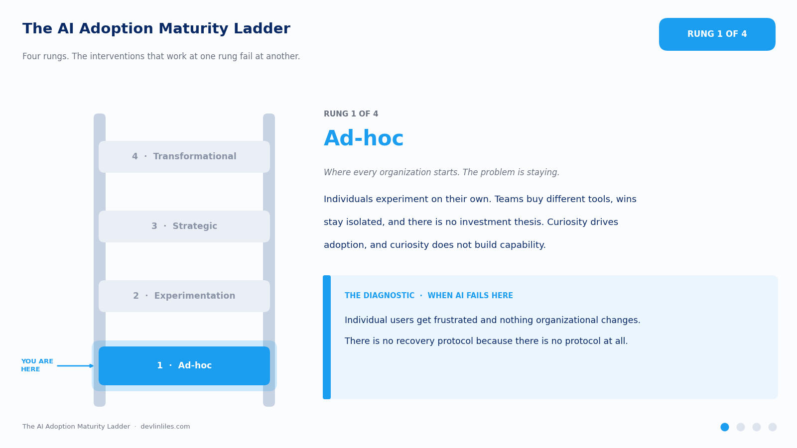
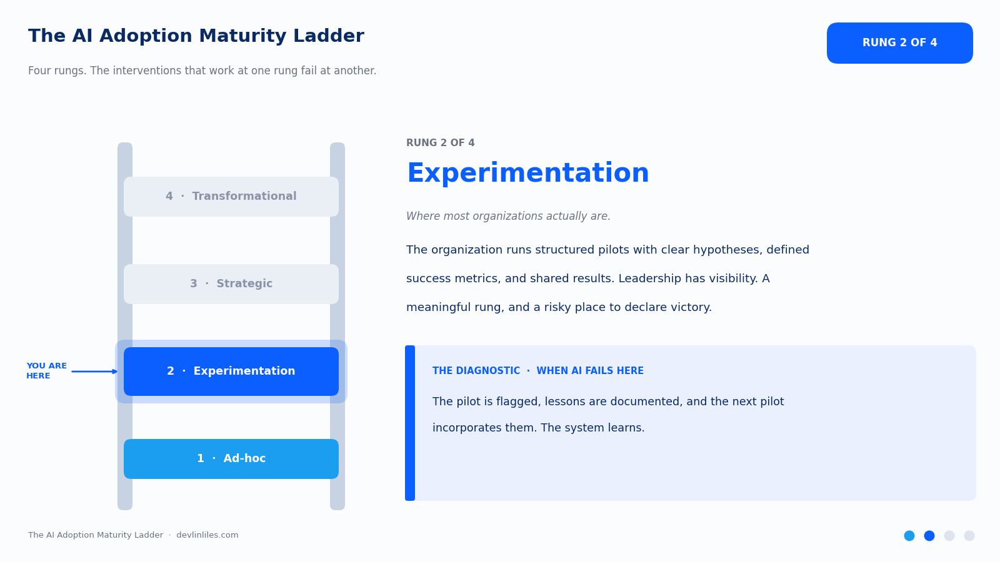
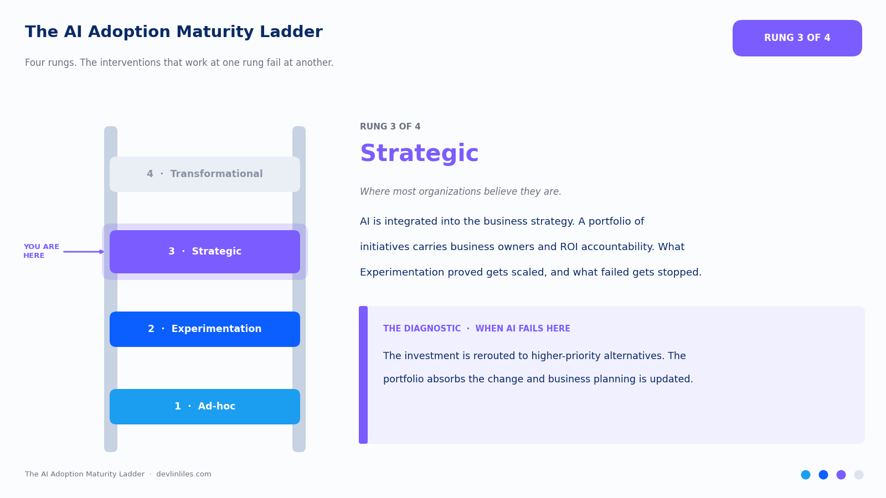
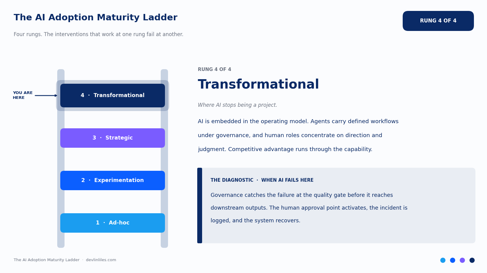

Organizations consistently overestimate their AI maturity stage. They run a few experiments and call it strategic. They deploy one tool and call it transformational. They name an AI champion and call it an AI capability.

Maturity ladders are an old instrument with a good track record. Philip Crosby published a five-stage quality management maturity grid in 1979, and Watts Humphrey adapted the idea into the Capability Maturity Model at Carnegie Mellon's Software Engineering Institute a decade later. The premise held up across both: organizations advance through recognizable stages, the interventions that work at one stage fail at another, and the most common error is misdiagnosing your own stage. AI adoption follows the same shape, with four rungs. Most organizations are on rung two and believe they are on rung three.

## The Four Rungs

**Rung 1: Ad-hoc**

Individuals experiment with AI independently, with no coordination, no shared learning, and no organizational alignment. This is where every organization starts, and it is where many remain for far longer than they realize.

The characteristic signs of Ad-hoc: different teams have purchased different AI tools based on individual preference. No one has a clear picture of what AI is being used for across the organization. There are isolated wins that no one is learning from systematically. There is no investment thesis for AI; it is happening because individuals are curious.

Ad-hoc is the natural starting point, and there is nothing wrong with beginning there. The problem is staying. Ad-hoc adoption produces marginal, disconnected improvements. It does not produce capability.

**Rung 2: Experimentation**

The organization has recognized that AI matters and has begun investing in structured pilots. There is intentional learning: pilots have clear hypotheses, defined success metrics, and mechanisms for sharing results. Different teams are beginning to learn from each other.

The characteristic signs of Experimentation: there is an AI steering group or working group. Pilots are documented and their results are communicated. There is a growing shared vocabulary for what works and what does not. Leadership is engaged and has clear visibility into what is being tested.

Most organizations that believe they are taking AI seriously are at Experimentation. It is a meaningful rung. The risk is treating it as the destination.

**Rung 3: Strategic**

AI is integrated into the business strategy. It has stopped being a separate technology initiative. Investment is prioritized against business value, there is a clear framework for evaluating which AI investments produce the most leverage, and resources are deployed accordingly.

The characteristic signs of Strategic: AI appears as a line item in business planning conversations, beyond the technology conversations. There is a portfolio of AI initiatives with defined business owners and clear ROI accountability. The organization has operationalized what it learned in Experimentation: the patterns that worked are being scaled, and the patterns that did not are being stopped. AI capability is part of how the organization measures its business differentiation.

**Rung 4: Transformational**

AI is embedded in the operating model. The organization has stopped running AI as a project and now operates it as a built capability. The Intelligence Operating System is running: autonomous agents handle defined workflows, governance infrastructure is in place, and human roles concentrate on direction and judgment while agents carry the execution.

The characteristic signs of Transformational: the organization's competitive advantage is meaningfully shaped by its AI capability. New business models become available, whole categories of offering or efficiency that the previous operating model could not support. The workforce has reorganized around AI-native ways of working. The organization is on the right side of the productivity gap relative to AI-naive competitors.

## The Diagnostic Question for Each Rung

The most reliable way to assess your actual rung, as opposed to your desired rung, is to ask what happens when AI does not work.

- **Ad-hoc:** Individual users are frustrated; nothing organizational changes. There is no recovery protocol because there is no protocol at all.
- **Experimentation:** The pilot is flagged as unsuccessful. Lessons are documented. The next pilot incorporates the learnings. The system learns.
- **Strategic:** The AI investment is rerouted to higher-priority alternatives. The portfolio absorbs the change. Business planning is updated.
- **Transformational:** Governance systems catch the failure at the quality gate, before it affects downstream outputs. The human approval point activates. The incident is logged. The system recovers.

The level of resilience in your AI operation is a good proxy for your actual maturity.

## The Gap Between Belief and Reality

Organizations overestimate their maturity for a predictable reason: they measure activity. Tools deployed, conversations happening, champions identified. Capability is the better measure: reliable value creation, systematic learning, business integration.

The gap matters because the interventions that move you from Ad-hoc to Experimentation are completely different from the interventions that move you from Strategic to Transformational. Applying Stage 4 thinking to a Stage 2 organization produces expensive failures. Applying Stage 2 thinking to a Stage 3 organization leaves massive value unrealized.

## Where the Argument Could Break

Maturity models attract two fair criticisms, and both apply here.

The first is that stage models are linear fictions. Real organizations are uneven: the finance team can be at Strategic while the field organization is still Ad-hoc, and a single rung number flattens that texture. True. The ladder diagnoses the organization's center of gravity, and the right unit of analysis is often the business unit. The misdiagnosis problem the ladder exists to solve shows up at that level too.

The second is that stage discipline is too slow for a technology moving this fast, the same critique the agile community leveled at the Capability Maturity Model in the 1990s. Why climb rungs when competitors are leaping? Because the record of leaping is bad. The interventions that move an organization from Ad-hoc to Experimentation are cheap and fast; skipping them relocates their cost into expensive Stage 4 failures. The ladder is a sequencing claim, and sequencing is how you move fast without repeating other people's wreckage.

Know your rung. Then take the step to the next one.
