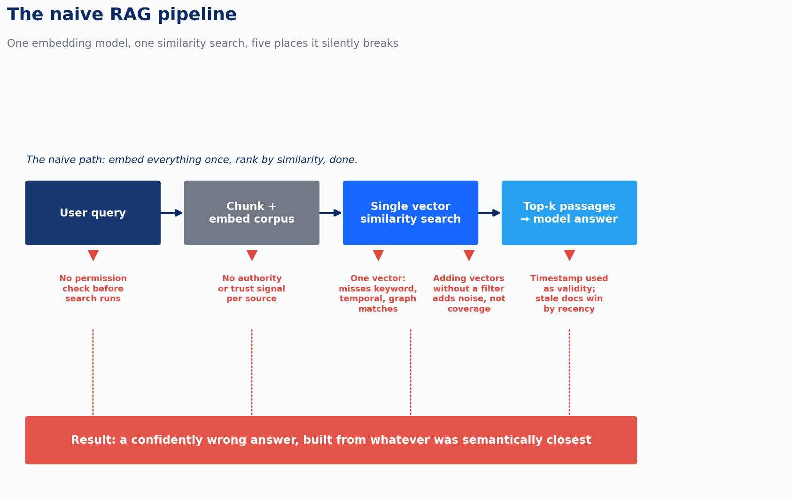
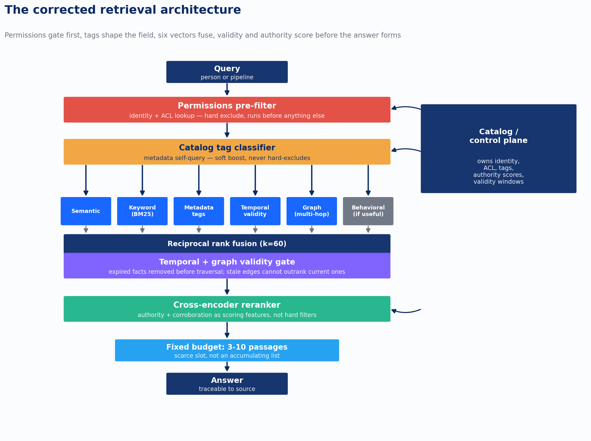
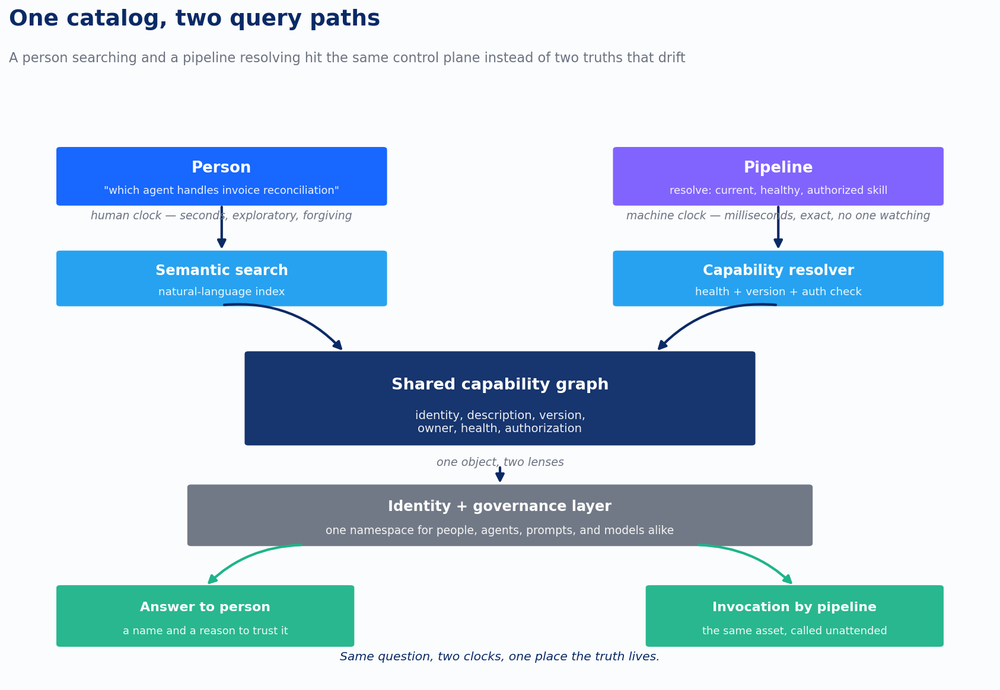

Every enterprise knowledge project I’ve scoped in the last year starts the same way. Someone asks for “semantic search.” What they actually need, once you get past the kickoff deck, is a pipeline: a hard gate that runs before search, six retrieval methods arguing with each other, a validity check that knows the difference between a document’s date and a fact’s truth, and a reranker whose job is telling the other six when they’re wrong.

None of that is exotic anymore. Hybrid search plus a cross-encoder reranker is the baseline, not the differentiator. What still separates a system that holds up under real use from one that quietly leaks information or confidently cites a stale policy is a single design habit: treating retrieval as a sequence of distinct gates, each with its own failure mode, instead of one big similarity search with some filters bolted on the side.

I’ve built this pattern three times now, in a gas pipeline compliance system reconciling fifteen thousand regulations, a healthcare distribution client’s SharePoint documentation, and a contract-analysis tool that has to answer questions no single clause can. The domains have nothing in common. The failure modes are identical every time, and there are exactly five of them.

## Why naive RAG fails, and fails the same way every time

The standard pitch for retrieval-augmented generation is one sentence: embed the documents, embed the query, retrieve by similarity, hand the result to a model. Every enterprise team that ships this version discovers the same five holes in it, usually in production, usually with a client watching.

The first hole is permissions. A naive pipeline [treats access control as a filter you apply to search results after they come back](https://www.devlinliles.com/permissions-are-not-tags-the-pre-filter-problem-nobody-names/), the same way you’d filter by department or document type. That’s backward. An access permission isn’t a preference, it’s a fact independent of the query: either this person can see this document, or they can’t. When permissions run as a post-filter, a semantically perfect match that the user isn’t authorized to see has already been scored, ranked, and in some architectures partially surfaced before anything catches it. Run the filter after retrieval and you’re one caching layer, one debug log, one truncated response away from a real incident.

The second hole is authority. Six vectors and a reranker will find you the passages most relevant to a question. Nothing about relevance tells you which of those passages you should believe. An enterprise corpus states the same claim with wildly different authority behind it: [the approved policy document, the wiki page paraphrasing it from memory, and the Teams message](https://www.devlinliles.com/policy-doc-or-teams-message-measuring-authority-in-a-knowledge-base/) where someone typed out what they remembered the policy saying three months ago. A relevance score treats all three the same if the wording is close enough. Left unscored, a naive system will happily rank the offhand comment next to the governed record, because nothing in its architecture distinguishes a claim from a source.

The third hole is oversaturation. Once a corpus grows past what the first working version was tuned on, relevance starts to degrade, and [the instinctive fix is to add another retrieval method](https://www.devlinliles.com/the-oversaturation-problem-why-more-search-vectors-make-retrieval-worse/). That instinct is exactly backward. Every vector has to earn its place by resolving cases the existing ones get wrong. Past that point, a new vector doesn’t add coverage, it adds noise for something downstream to sort through, and the corpus gets harder to filter to relevance exactly as it grows large enough to need filtering most.

The fourth hole is time. A naive pipeline [treats a document’s publish date as a proxy for whether its contents are still true](https://www.devlinliles.com/time-is-not-a-timestamp-fixing-temporal-and-graph-retrieval/). A regulation published in 2018 can state a requirement that stayed valid until a 2022 amendment superseded it. A report filed in 2023 can describe an event from 2020. Score relevance off the document’s timestamp and the system will confidently retrieve the superseded document for a question about current requirements, and the answer will look completely reasonable, because nothing about a wrong-but-plausible retrieval looks broken from the outside.

The fifth hole is structure. Most knowledge graphs built for AI retrieval are dumps: entities and relationships extracted from documents and stored flat, with no logical hierarchy connecting them. That works for lookup. It falls apart the moment the task requires reasoning, applying a general rule to a specific case that no single document states outright, because a flat graph has no dependency order for a system to reason through. It has nodes, not a curriculum.

Here’s the diagram worth keeping in your head before we fix each one. Every failure below sits at a specific stage in the naive pipeline, and every one of them is invisible from the outside until something goes wrong.

*retrieval-arch-01-naive-pipeline*

## Fix one: permissions are a gate, not a filter

Access control has to run as a hard exclude, before relevance scoring starts, with no soft version. There’s no ambiguity to resolve. A user’s identity and a document’s access control list determine eligibility independent of what the query says, and that answer doesn’t change based on how the question is phrased. The cost of getting it wrong runs one direction: a document that should have been excluded and wasn’t is an incident. A document that was excluded and shouldn’t have been costs you a worse search result, nothing more. That asymmetry is the entire reason permissions get gated before anything else touches the candidate pool.

Metadata and tag filtering looks identical in an architecture diagram, narrow the field before search runs, and it is a completely different mechanism wearing the same clothes. Nobody hands the system a clean tag. A user asks “what’s our standard process for X” in plain language, and something has to infer which tags that question implies before a tag filter can do anything. The standard pattern now is a self-query approach: an LLM reads the natural-language query against a schema of available metadata fields and extracts which filters apply. It works well, and it’s still a classifier, which means it’s wrong some fraction of the time in a way a permissions lookup never is.

That’s the operational decision that actually matters: does a wrong filter guess exclude candidates outright, or just deprioritize them. A misclassified permission has no acceptable soft version. A misclassified tag should almost never hard-exclude, because if the system infers “SOP” from a question that was actually about a contract clause and hard-filters out every contract document before search runs, the user gets a confidently wrong answer built entirely from the wrong category of content, with no signal anywhere that tells them something went wrong. Soft-boost the tag instead. A wrong tag inference costs you ranking precision. A wrong hard-exclude costs you the correct answer entirely.

Same mechanism, opposite risk posture, depending on what’s being filtered. Build the permissions gate once, correctly, and leave it alone except when the org chart or a document’s classification changes. Build the tag filter expecting to be wrong occasionally, and design it so being wrong costs precision, not the answer.

## Fix two: authority is a reranker feature, not a data-quality project

The highest-leverage fix for authority isn’t exotic, and it’s mostly free. Tag every document at ingestion with structured metadata: which system it came from, its governance or approval status, whether someone with the authority to do so signed off on it, its valid-from and valid-until dates. Bake that into the ranker so an approved, audited record outranks a draft by default. Most enterprise content platforms already carry this information. SharePoint approval workflows, Confluence spaces marked official versus working, document management systems with version and sign-off status. The work is surfacing authority that already exists in the metadata, not building a new pipeline to compute it.

A second source of authority comes from a system you’re probably already building for a different reason: the graph vector. Authority research treats trust the way PageRank treated web links, importance propagates from how connected and referenced something is. If forty documents and Teams threads cite the official pricing policy and nothing cites a single offhand comment making a similar claim, that’s a centrality score computed from the graph you already built for multi-hop retrieval. You don’t need a separate authority pipeline. You need a second output from the graph you have.

A third layer, distinct from both, is corroboration. A claim repeated independently across a policy document, a wiki page, and three unrelated Teams threads carries more evidential weight than a claim from one source that happens to get cited often. Structural authority and corroboration measure different things, one is about how connected a source is, the other is about how many independent witnesses agree, and a mature system tracks both.

The harder failure case is the one most people don’t picture: a stale policy doc outranking a Teams message that happens to be right. Authority-tier weighting on its own will occasionally suppress the correct answer with total confidence, because a static trust score has no mechanism for noticing that the high-authority source is the one that’s wrong this time. I built explicit contradiction detection into a document-processing system for exactly this reason, on a project reconstructing medical record timelines from thousands of pages of scanned documents. The system flags when two entries in the same case say different things, an injury date recorded two different ways being the case that comes up constantly, and it puts that disagreement in front of the person whose judgment is equipped to resolve it. Automatic suppression by authority tier would have quietly chosen one date and never told anyone there was a second one on record. An unresolved flag is a better outcome than that, because the flag at least tells you where to look.

That’s the design principle worth keeping: authority informs ranking, it doesn’t decide truth. Contradiction surfaces where a person can see it and weigh in. The moment a system starts silently picking winners between disagreeing sources based on tier alone, it has traded a transparent uncertainty for a confident wrong answer, and confident wrong answers do the most damage, because nothing about them looks like it needs checking.

## Fix three: earn every vector, and stop before you’re past the point of earning

[The six vectors worth having](https://www.devlinliles.com/the-six-vectors-and-the-reranker-that-actually-matters/) are semantic embeddings, keyword search, metadata tags, temporal validity, graph relationships, and behavioral signal, and each one earns its place by resolving cases the others get wrong. Semantic search finds documents by meaning but is genuinely bad at proper nouns, part numbers, and statute citations. Keyword search, the old BM25 approach, covers exactly that gap. Production data across mixed enterprise corpora is consistent: BM25 alone lands around 65% recall@10, dense vectors alone land around 75 to 80%, the two combined land at 88 to 92%. Neither on its own gets you there, which is why the combination is table stakes now, not a differentiator.

The differentiator is what happens after retrieval returns fifty to a hundred candidates and before any of them reach the model. Every one of the six vectors is a bi-encoder problem at heart, score how similar A is to B without ever letting A and B look at each other directly. A cross-encoder reranker breaks that constraint. It reads the query and each candidate together, full attention, and scores relevance the way a person would if you handed them both documents side by side. Anthropic’s own published numbers on contextual retrieval make the size of this concrete: starting from a baseline embedding search, context-aware chunking cuts top-20 retrieval failures by 35%. Adding BM25 fused via reciprocal rank fusion takes that to 49%. Adding a cross-encoder reranker on top takes it to 67%. The reranker contributes more than any other single addition, on top of an already-hybrid system, not instead of one.

But this is exactly where the instinct to keep adding turns into the oversaturation problem. There’s a real mechanism behind why more doesn’t help past a certain point, not just an operational hunch. Language models handling long retrieved context show a documented “lost in the middle” effect: performance on information landing mid-context degrades by more than thirty percent compared to the same information positioned at the start or end. Every additional chunk you stuff into the prompt has a real chance of burying the passage that actually answers the question underneath passages that don’t, even when all of them are nominally relevant. The same failure shows up one layer earlier, in retrieval itself. A signal being conceptually correct isn’t the same as a signal being discriminative. A tag, a vector, an entity link can be accurate and still not help distinguish a good match from a bad one in the specific cases where a system is currently getting it wrong.

The production pattern that’s converging across every serious enterprise retrieval build confirms this from the opposite direction: retrieve broadly, fuse with reciprocal rank fusion at k=60, rerank hard, then keep a fixed, small budget of passages in the final prompt, typically three to ten, not everything that scored above some relevance threshold. That fixed budget isn’t a cost-saving shortcut. It’s the actual fix for saturation, because it forces every stage upstream of it to compete for a scarce slot instead of accumulating. Graph retrieval earns its cost on multi-hop questions and gets skipped everywhere else. Behavioral signal only pays off at consumer-scale query volume, which is why most internal knowledge bases are better off leaving it out entirely. None of the six vectors are default-on. Each is a deliberate answer to a specific failure mode, added because a case existed that nothing else caught.

## Fix four: validity lives on the fact, not the document

Temporal and graph retrieval don’t behave like the other four vectors, and treating them the same way is where I’ve seen the most expensive mistakes happen. Semantic and keyword search score how well text matches text. Temporal and graph retrieval score something the text itself doesn’t fully contain: when a fact stopped being true, and how a fact connects to other facts nowhere near it in the document.

Most temporal retrieval implementations do the obvious thing: sort by document date, decay older results, done. That works until a regulation published in 2018 states a requirement that stayed valid until a 2022 amendment superseded it, or a 2023 filing describes an incident from 2020 with the actual effective date buried in paragraph four. The fix that holds up is treating validity as a property of the fact, not the document. Capture, at ingestion, when a specific claim became true and when it stopped being true, independent of when the container document was published. A requirements database that only knows document dates will merge a superseded rule and its replacement into one undifferentiated blob the moment they’re semantically similar enough to retrieve together. A database that knows fact-level valid-from and valid-until can tell you which one applies to the date in the question, which is usually the actual question being asked. The practical version of this is a reranking step that hard-removes expired facts before they reach the model, boosts anything explicitly time-bounded to the query’s date, and only falls back to a general recency decay when nothing more specific is available. Recency decay is the fallback, not the strategy.

Graph retrieval earns its cost on a narrower set of questions than most pitches admit: multi-hop reasoning, entity relationships across documents, sensemaking where the answer is a synthesis rather than a lookup. “Is this contractor’s certification equivalent to what a different, larger operator requires under a different regulatory framework” gets answered by walking a relationship between two entities that live in entirely different documents, and no single passage, however well matched, will have that answer sitting inside it. Where it doesn’t earn its cost: single-fact lookups, where hybrid vector and keyword search already outperforms a graph traversal, and narrow domains where the extraction step needed to build the graph introduces more noise than it removes.

The two vectors need each other, and this is where the temporal fix and the graph fix become one fix. A superseded rule still has strong connections in the graph to everything it used to govern. Those edges don’t disappear when the rule does. A graph that traverses through an expired fact and treats it as live produces an answer that’s structurally sound and factually wrong, which is worse than an answer that’s obviously incomplete, because nothing about it looks broken. Fact-level validity has to run before graph traversal gets to use its results, not after. Get the temporal layer right first. The graph is only as trustworthy as the facts sitting on its nodes.

## Fix five: build the graph like a textbook, not a warehouse

The fourth and fifth fixes both point at the same underlying gap: a system that only retrieves by similarity is doing case-based reasoning with better math, matching a new question to the nearest thing it’s seen before. It has no mechanism for applying a general rule to a case it hasn’t seen. Fixing that requires the knowledge graph itself to carry logical structure, not just entities and edges.

A textbook doesn’t organize a subject as a flat list of facts. It [sequences foundational principles first](https://www.devlinliles.com/structuring-ai-knowledge-systems-around-principles-lessons-from-building/), then the concepts those principles govern, then the processes that apply them, then specific examples, and that sequencing reflects the logical dependency structure of the knowledge itself. You can’t reason about electromagnetism without a working model of calculus. Ingesting later material before earlier material produces a graph where the edges exist but the nodes underneath them aren’t grounded in anything. Building a knowledge graph the same way means mapping foundational dependencies explicitly before ingestion, so a domain that depends on another domain isn’t added until the dependency is established. The payoff is a graph that can answer questions by applying a principle to a novel case, rather than failing to find a similar enough example and returning nothing, or worse, returning something misleading.

The same discipline shows up one layer down, in how a system knows what it actually knows. [The obvious way to measure whether a system has relevant knowledge is string matching](https://www.devlinliles.com/the-limits-of-string-matching-in-knowledge-coverage-metrics/): extract the concepts in a query, look for those strings in the knowledge store, count matches. It fails in a specific, instructive way. A system with extensive knowledge about gravity, Newton’s laws, orbital mechanics, gravitational potential energy, correctly organized and linked, will report zero coverage on a query that says “gravity” if the knowledge store only contains the formal term “Universal Gravitation.” The knowledge was there. The string didn’t match. A layered matching architecture fixes this: exact matching first, then stemmed matching for morphological variation, then a synonym map derived from which terms actually co-occur in the same principle clusters, then graph traversal for concepts one hop away from something that does match. Each layer contributes a confidence-weighted amount of coverage credit, which lets a system report partial coverage honestly instead of collapsing to zero the moment an exact match isn’t available.

The reason this matters for retrieval, not just for a purpose-built learning engine, is that both failures come from the same root cause: treating a knowledge base as a bag of facts to match against, instead of a structured domain with dependencies and terminology that a system has to actually understand. Search-index retrieval and string-matching coverage are the same architecture applied twice, and they fail the same way twice.

## The composed architecture

Put all five fixes in the pipeline and the sequence looks like this. A query arrives from a person or a system. Permissions gate first, a hard, deterministic exclude with no soft version. The catalog’s tag classifier narrows the field next, soft-boosting the inferred category without hard-excluding anything, because a classifier is wrong sometimes and a wrong guess here should cost precision, not the answer. Six vectors run against whatever survives that gate, semantic, keyword, metadata, temporal, graph, and behavioral where the query volume justifies it, and get fused by reciprocal rank fusion rather than compared on incompatible raw scores. A temporal and graph validity gate runs before anything downstream trusts a traversed relationship, stripping expired facts so a stale edge can’t outrank a current one. A cross-encoder reranker scores what’s left, with authority and corroboration built in as features the model weighs, not thresholds that silently exclude. A fixed budget, three to ten passages, is all that reaches the model that actually answers the question.

*retrieval-arch-02-corrected-architecture*

Every stage in that diagram is a gate with its own failure mode and its own acceptable direction of error. That’s the discipline underneath all five fixes: don’t build one filter and hope it’s right, build a sequence of gates, know which ones can afford to be wrong quietly and which ones can’t, and put the ones that can’t be wrong first.

## The catalog is the control plane, and it answers two different clocks

Everything above assumes the thing being retrieved is a document. The same architecture governs a different problem that enterprises building AI asset libraries are running into right now: finding the right prompt, agent, or model version, not the right paragraph.

Ask a person which agent handles invoice reconciliation. Ask a workflow engine the same question in machine terms: give me the current, healthy, authorized version of the invoice-reconciliation skill. Those two answers should be identical, and in most organizations building an AI asset library today, they come from two different systems that nobody has checked for agreement. [A person typing a question into a search box is doing capability resolution on a human clock](https://www.devlinliles.com/a-person-and-a-pipeline-are-asking-the-same-question/), seconds, exploratory, forgiving of an imperfect match because a person reads the result and decides. A workflow engine resolving a skill mid-pipeline is doing the same operation on a machine clock, milliseconds, exact, with no one in the loop to catch a stale or unauthorized answer before it executes. Same underlying operation. Different tolerance for being wrong, which is precisely the pattern that separated permissions from tags earlier in this piece.

Two older fields already solved their half of this, from opposite directions, long before AI assets needed discovering. [Knowledge management spent two decades turning static catalogs into active metadata](https://www.devlinliles.com/the-catalog-already-learned-to-talk-to-machines/): descriptions, lineage, and quality signals wired directly into the systems that generate them, so discovery becomes graph traversal combined with semantic search instead of keyword matching against a data dictionary someone typed up eighteen months ago. Distributed systems spent the same two decades learning that [a name alone was never enough](https://www.devlinliles.com/name-resolution-was-never-enough/). DNS resolves a name to an address. It says nothing about whether the instance behind that address is healthy, which version is running, or whether you’re authorized to call it. The registries that came after, Consul, etcd, Zookeeper, added the piece that was actually missing: a live, health-checked index, capability-first rather than name-first, because a prompt or an agent doesn’t map cleanly to one deployable thing the way a service name once did.

The market answer to whether these need to be one system or two arrived this year, decisively, from four vendors that don’t coordinate with each other. Databricks widened Unity Catalog to cover models, agents, and MCP services under the same namespace it already used for tables. Microsoft gave agents an identity substrate, Entra Agent ID, so an agent is now a principal inside the identity system, governed the way a human account has always been governed, with Purview extending its audit trail to cover prompt chains and tool calls the same way it already tracked data lineage. AWS and Google shipped equivalent agent registries the same year. Read across all four and one pattern holds: [nobody serious is building a separate silo for AI assets](https://www.devlinliles.com/nobody-is-building-a-separate-silo-for-ai-assets-anymore/) next to the one they already have for data. One identity layer, one governance layer, one discovery layer, both kinds of assets inside it.

That’s the same design principle as the retrieval pipeline, applied to a different kind of object. A person and a pipeline shouldn’t query two descriptions of the same asset that happen to agree today and drift tomorrow. They should query one shared capability graph, identity, description, version, owner, health, and authorization, through two different lenses. The chat interface reads it for a person. The resolver reads it for a machine. Neither one owns the truth. The catalog does.

*retrieval-arch-03-person-vs-pipeline*

There’s a real shortcut on the table now for crossing an organizational boundary this architecture can’t reach on its own, a published specification called Agentic Resource Discovery that lets an organization list its available tools and agents in a file at a known path, crawled and indexed by an external registry. It solves a genuine problem this architecture doesn’t: how an agent finds a capability that lives on the other side of a boundary neither party controls. It doesn’t solve the problem this piece has been describing. [A crawled entry is self-reported, batch-published metadata](https://www.devlinliles.com/publishing-a-catalog-is-not-the-same-as-running-a-registry/), precisely the kind active metadata replaced years ago inside a single organization, and the specification explicitly hands off to the tool’s native protocol once a capability is selected, which means nothing in the crawl tells you whether the endpoint is healthy right now or authorized for unattended use. Federation is a feed into the graph. It isn’t a replacement for one.

## The one discipline underneath all of it

Five failure modes, one governing pattern. Every stage in a retrieval architecture is making a bet about how wrong it’s allowed to be. Permissions can never be wrong in the direction of exposure, so they run as a hard gate, built once, touched rarely. Tags are inference, so they run as a soft boost, built expecting to be wrong sometimes, designed so that being wrong costs precision instead of the answer. Authority is a ranking signal, not a verdict, so it feeds a reranker and defers to a person the moment sources actually disagree. Time is a property of a fact, not a document, so validity has to be captured at the level where the claim lives, not the container it arrived in. And a knowledge graph that’s supposed to reason, not just retrieve, has to carry the same dependency structure a textbook uses to teach a subject in the right order.

None of these five is a nice-to-have layered onto vector search after the fact. Each one is the answer to a specific way naive retrieval breaks, and the discipline that separates a system that holds up from one that quietly fails is knowing which gate handles which kind of wrongness, and building each one for the failure mode it will actually encounter, not the one that’s easiest to code.

---

**Sources:** [Permissions Are Not Tags](https://www.devlinliles.com/permissions-are-not-tags-the-pre-filter-problem-nobody-names/); [Policy Doc or Teams Message](https://www.devlinliles.com/policy-doc-or-teams-message-measuring-authority-in-a-knowledge-base/); [The Oversaturation Problem](https://www.devlinliles.com/the-oversaturation-problem-why-more-search-vectors-make-retrieval-worse/); [The Six Vectors and the Reranker That Actually Matters](https://www.devlinliles.com/the-six-vectors-and-the-reranker-that-actually-matters/); [Time Is Not a Timestamp](https://www.devlinliles.com/time-is-not-a-timestamp-fixing-temporal-and-graph-retrieval/); [A Person and a Pipeline Are Asking the Same Question](https://www.devlinliles.com/a-person-and-a-pipeline-are-asking-the-same-question/); [The Catalog Already Learned to Talk to Machines](https://www.devlinliles.com/the-catalog-already-learned-to-talk-to-machines/); [Name Resolution Was Never Enough](https://www.devlinliles.com/name-resolution-was-never-enough/); [Nobody Is Building a Separate Silo for AI Assets Anymore](https://www.devlinliles.com/nobody-is-building-a-separate-silo-for-ai-assets-anymore/); [Publishing a Catalog Is Not the Same as Running a Registry](https://www.devlinliles.com/publishing-a-catalog-is-not-the-same-as-running-a-registry/); [Structuring AI Knowledge Systems Around Principles](https://www.devlinliles.com/structuring-ai-knowledge-systems-around-principles-lessons-from-building/); [The Limits of String Matching in Knowledge Coverage Metrics](https://www.devlinliles.com/the-limits-of-string-matching-in-knowledge-coverage-metrics/)
