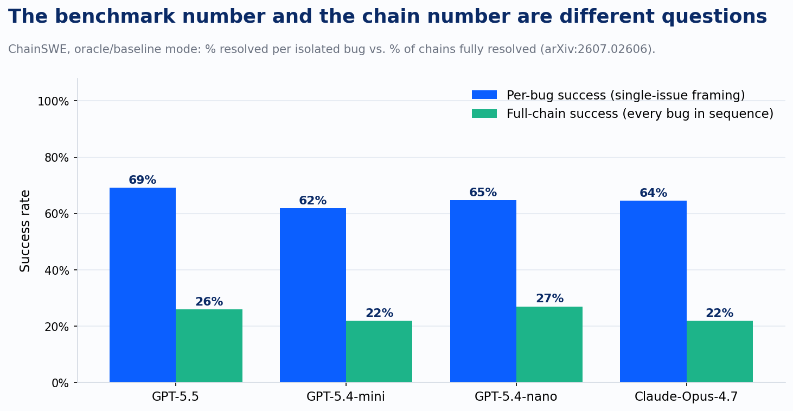
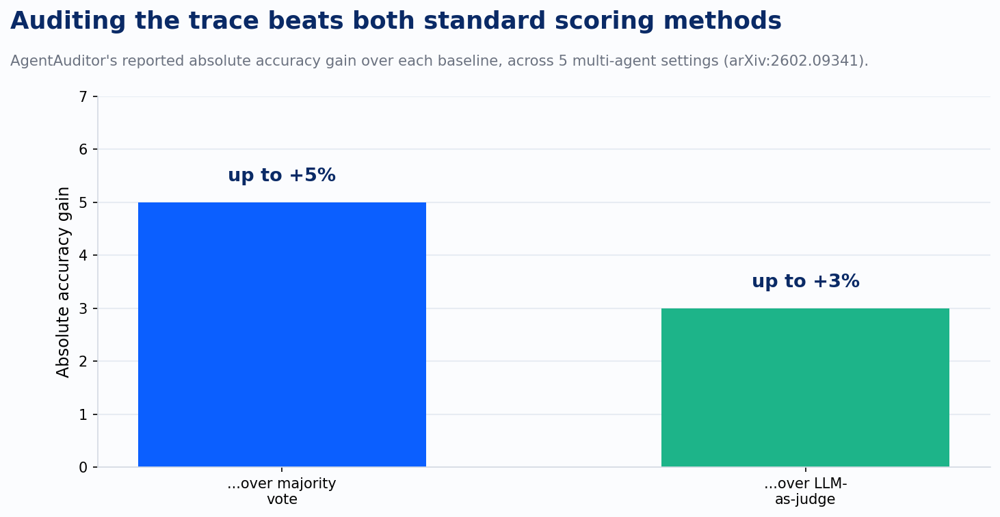

Pull up whatever evaluation got your last agent deployment signed off. The number that convinced the room was almost certainly a benchmark score for the model, or a per-task success rate measured with the environment reset between runs. Neither number describes what that same model does across ten or twenty steps with nothing reset in between, and a run of research through the first half of 2026 makes the gap embarrassingly precise.

Start with ChainSWE, a benchmark built specifically to expose it. Every coding-agent benchmark in the SWE-bench family evaluates one bug at a time: the repository resets, the agent reads the codebase fresh, the fix passes or fails in isolation. ChainSWE instead mined 304 issues across 54 Python projects into chronological chains, the same repository carrying forward from one fix to the next the way a real maintenance backlog actually works. Run GPT-5.5 against that chain and it resolves 69.1% of individual bugs, a number that would read as a strong single-task result in any vendor report. Ask the same run to complete the entire chain, every bug in sequence, and the success rate is 26.0%. Claude-Opus-4.7 shows the identical shape: 64.5% per bug, 22.0% for the full chain. The model didn't get worse. The question changed from "can it fix a bug" to "can it fix a bug without breaking the next five," and that second question is the one production actually asks.

The reason standard evaluation misses this isn't an oversight. It's a category error in what the tools measure. A 2025 paper called UProp took apart how uncertainty quantification works for language models and found that every method in wide use estimates what the authors call internal uncertainty: how unsure the model is about the decision sitting in front of it right now, built on a single-turn question-answering template. None of them account for extrinsic uncertainty, the doubt a decision should inherit from everything that came before it in the chain. UProp had to build a new estimator for that inherited term because the existing toolkit simply didn't have one. A benchmark that only measures per-step confidence is measuring the half of the problem that doesn't compound, and skipping the half that does.

CHARM found the same blind spot inside retrieval-augmented pipelines, and named it precisely enough to build a taxonomy around it: cascading hallucination, where a small retrieval error at an early stage propagates through several rounds of reasoning and lands as a fully confident, fully wrong final answer. That confidence is the trap. A grader looking only at the final answer sees one fluent, well-supported-sounding response and one wrong response, with nothing in the surface presentation to tell them apart. CHARM's answer is architectural rather than evaluative: verify facts at each stage, track consistency across stages, monitor how confidence propagates from one stage to the next, and trigger a human checkpoint the moment a high-confidence cascade is detected, instead of after it ships.

Multi-agent systems have their own version of the mistake, and it shows up in how they decide which agent to believe. The dominant method is majority voting, which quietly assumes each agent's errors are independent, borrowing the Condorcet Jury Theorem's founding assumption from eighteenth-century voting theory. LLM agents trained on similar data with similar alignment processes don't fail independently. A February 2026 paper titled, without much subtlety, "Auditing Multi-Agent LLM Reasoning Trees Outperforms Majority Vote and LLM-as-Judge" names what happens instead: confabulation consensus, where several agents converge on the same wrong rationale because they share the same blind spot, and a vote counts that convergence as confidence rather than catching it as correlated error. The paper's fix, AgentAuditor, doesn't vote and doesn't ask a single judge model to read every trace end to end either. It builds a reasoning tree out of every agent's trace, finds the exact point where the branches diverge, and audits the evidence at that one point instead of the whole trajectory. Across five multi-agent benchmark settings, that produced up to a 5-point absolute accuracy gain over majority vote and up to 3 points over a straight LLM-as-judge.

Four research groups, working on software maintenance, retrieval pipelines, uncertainty math, and multi-agent adjudication, landed on the same prescription without citing each other: stop grading the answer, start auditing the trace. That's also, not coincidentally, where the eight-stage AI maturity model we use with clients draws its hardest line. Stage 4, Workflow, is the first stage that requires deterministic validation, adversarial checks, and human punch-out points on every chained process, precisely because the math changes the moment steps connect to each other. What this year's research adds isn't a new argument for the gate. It's evidence for how to build the gate correctly: the check has to sit at the divergence points inside the chain, not at the finish line, and it has to be evidence-based rather than a headcount, because a vote among agents that share the same blind spot isn't a check at all.

The pattern across all four papers is the same quiet correction to how confidence gets assigned. A benchmark score, a majority vote, a fluent final answer: all three measure agreement or surface polish, and none of them measure whether the reasoning that produced the answer actually held together end to end. What's really being tested when a chain-level or trace-level gate gets built isn't the model anymore. It's whether the organization running it can tell the difference between an agent that got the right answer and an agent that got the right answer by accident.

---

*Sources: Duan et al., "UProp: Investigating the Uncertainty Propagation of LLMs in Multi-Step Agentic Decision-Making" (arXiv:2506.17419); "ChainSWE: Benchmarking Coding Agents on Multi-Bug Software Maintenance" (arXiv:2607.02606); "Cascading Hallucination in Agentic RAG: The CHARM Framework for Detection and Mitigation" (arXiv:2606.04435); Yang et al., "Auditing Multi-Agent LLM Reasoning Trees Outperforms Majority Vote and LLM-as-Judge" (arXiv:2602.09341).*
