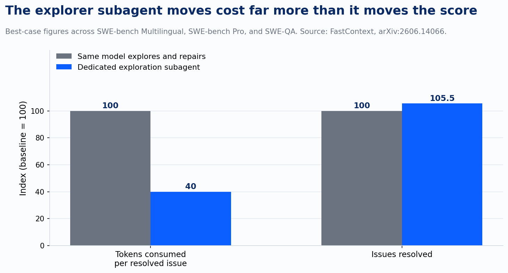
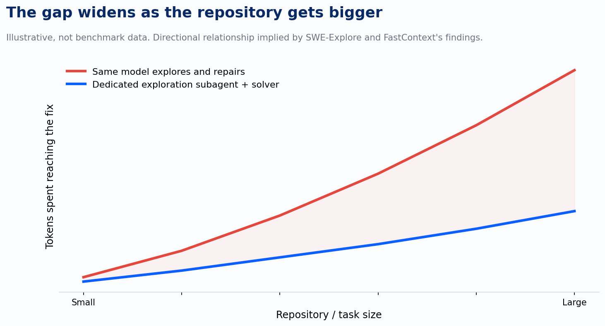

Ask a client team why their coding agent pilot is burning through budget on a modernization sprint and the answer is almost always the same: the model. Swap Sonnet for GPT, GPT for Gemini, whichever one had the best demo last quarter. I've sat in enough of these conversations to know it's the reflex, and it's aimed at the wrong layer of the stack.

Two research papers published within a week of each other this June pin down what the actual bottleneck is: finding the code in the first place, not reasoning quality.

The first, SWE-Explore, built a benchmark specifically to isolate repository exploration from everything else a coding agent does. Give it a repository and an issue, and it asks an explorer to return a ranked list of relevant code regions under a fixed line budget. The researchers pulled 848 real issues across 10 languages and 203 open-source repositories, then derived line-level ground truth from the actual trajectories of agents that had already solved each issue. That last detail matters. They didn't guess at what "relevant" means. They looked at what successful agents actually read on the way to a fix, and used that as the answer key.

What they found cuts against the story most teams tell themselves about why agents fail. File-level localization, meaning does the agent open the right file at all, is already strong across modern methods. That problem is largely solved. The gap that actually separates a good coding agent from a great one is line-level coverage and ranking efficiency: once you're in the right file, do you find the right sixty lines, and do you find them in the first few reads instead of the fifteenth. The paper shows this more precisely than file-hit-rate ever could, because it tracks coverage and ranking directly against downstream repair success. Exploration quality is the metric that predicts whether the bug gets fixed.

That reframes the whole problem. Most conversations about agent failure jump straight to reasoning: did the model understand the bug, did it write a correct patch. SWE-Explore says look earlier. An agent can understand a bug perfectly and still fail, because it spent its budget skimming the wrong forty lines three times before finding the right six.

The second paper, FastContext, out of Microsoft Research, takes that finding and turns it into an architecture decision. Most coding agents today use one model for everything: the same context window that explores the repository also has to reason about the fix, which means every exploratory read, every dead-end search, every file opened and discarded sits in the solver's history, diluting the context it needs when it's actually time to write the patch. FastContext splits the job. A dedicated exploration subagent, built on models spanning 4 billion to 30 billion parameters, gets invoked on demand, fires off parallel tool calls across the repository, and hands back a short, cited list of file paths and line ranges. The solver never sees the dead ends. It only sees what the explorer found.

Tested across SWE-bench Multilingual, SWE-bench Pro, and SWE-QA with Mini-SWE-Agent as the host, the split architecture cut token consumption by up to 60 percent while improving end-to-end resolution by up to 5.5 percent, with marginal added overhead from the extra hop.

Read those two numbers side by side and the takeaway is about economics, not intelligence. A 5.5-point resolution gain is real, but it's modest next to a 60 percent cost reduction. The primary win here is cost, with a secondary bump in accuracy. If a vendor pitches you this architecture as a capability leap, that's the tell to push back on. What it actually buys is the same repair quality at a fraction of the token spend, plus a little room to spare.

The economics work because of where the split puts the expensive part of the job. A 4B-to-30B exploration model is cheap to run and well suited to breadth: fire off a dozen searches in parallel, don't worry about being wrong on the first try, just cast wide. A frontier solver model is expensive per token and well suited to depth: reason carefully about a small, already-curated set of code. Today, most agents pay frontier prices for both jobs, because the same model does both. Splitting them means you pay cheap-model prices for the search and frontier prices only for the reasoning that actually needs it.

I want to flag something the research digest that pointed me to this paper didn't catch, because it's exactly the kind of thing worth checking before a number like this goes in a client deck. As of this week, the FastContext paper's listing on arXiv shows it withdrawn by the lead author, with the stated reason being unresolved product IP issues pending re-approval. The abstract, author list, and the numbers above are all still visible and consistent with the earlier versions, and the code and evaluation data are public on GitHub under Microsoft's own account. The empirical claim looks sound. But if you go looking for the full paper today to check a methodology detail, you'll hit a withdrawal notice instead of a PDF, and that's worth knowing before you cite page nine of something you can't currently open.

There's a second limit worth naming plainly. Both papers benchmark against SWE-bench-style tasks: a described issue, an open-source repository, a fix that resolves it. That's a cleaner problem than most of what shows up in an enterprise modernization engagement, where the "bug" is often a business rule scattered across three services with no ticket describing it and no clean acceptance test waiting at the end. Whether the exploration-repair split holds up when the hard part isn't finding code but finding undocumented intent is a real question, not a settled one. I'd want to see it tested against that kind of work before I'd call it proven at enterprise scale.

None of that undercuts the architecture pattern itself. For a client running agentic coding at scale, this reframes where to spend the model upgrade budget. The instinct is to point one expensive frontier model at the entire task, from first repository search to final patch. The evidence here says split the job instead. Let a cheap, narrow model do the wide, repeated work of finding candidate code. Reserve the expensive model's context for the part of the task that actually requires it: deciding what the fix should be. Repository exploration looked like the boring part of the work. It turned out to be the part quietly setting the ceiling on everything after it.

---

*Sources: *[*SWE-Explore: Benchmarking How Coding Agents Explore Repositories*](https://arxiv.org/abs/2606.07297?ref=devlinliles.com)*; *[*FastContext: Training Efficient Repository Explorer for Coding Agents*](https://arxiv.org/abs/2606.14066?ref=devlinliles.com)
