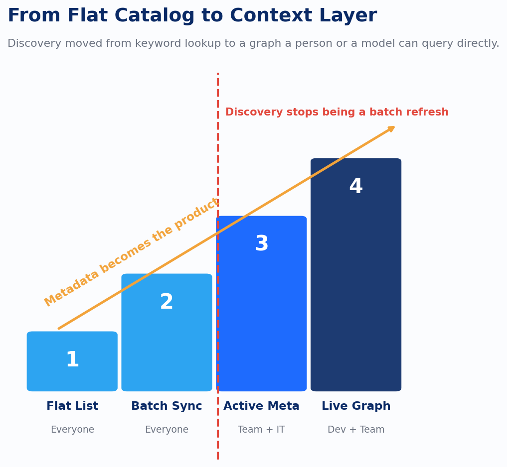

Every AI asset library needs a way for a person to ask, in plain language, for the prompt or agent they need, or the library just becomes another place things go to get lost. That's not a new problem. Enterprise data catalogs spent most of the last decade being catalogs nobody could actually search unless they already knew what they were looking for. Type the exact table name and it turned up. Describe the underlying problem instead, and the search returned nothing, because the catalog was a flat list of names and descriptions someone had typed in months earlier, and the search bar over it was keyword matching against a data dictionary.

Knowledge management had already diagnosed this failure once, in a different context, before AI assets ever showed up. The field spent years arguing over controlled vocabulary versus emergent tagging: does a librarian or a data steward assign the official taxonomy, or does usage generate its own folksonomy that ends up describing how people actually search better than the official terms do. Both approaches share a weakness nobody likes to say out loud. They are only as current as the last time a human sat down and updated them. A taxonomy from eighteen months ago describes systems as they existed eighteen months ago.

The response to that weakness is the part worth taking seriously now. The industry moved from static catalogs, refreshed in batches whenever someone remembered, to active metadata: descriptions, lineage, and quality signals that update continuously because they're wired directly into the systems that generate them. OpenMetadata, DataHub, and Atlan converged on the same underlying idea despite competing on everything else. Build a metadata knowledge graph that links every asset to its owner, its usage, its quality signals, and every other asset it touches, and discovery stops being a keyword search against a flat table. It becomes graph traversal combined with semantic search: find the node, then walk its relationships.

That convergence points at something more specific than a better search bar. Atlan frames its version of this as a context layer. OpenMetadata describes its own positioning as context for humans, AI assistants, and agents. Both are naming the same requirement: the catalog itself has to be as retrievable by a model as it is searchable by a person typing keywords into a box, and neither vendor is treating that as optional. That's the detail that makes a natural-language chat interface over an asset library tractable at all. Retrieval-augmented generation over the catalog's own metadata graph, the descriptions, the relationships, the lineage, the ownership, is what answers "which agent handles invoice reconciliation." Retrieval over the content of the prompts and agents themselves answers a different question entirely, and confusing the two produces a system that can quote a prompt back to you but can't say who owns it or whether it's still authorized to run.

The relationship modeling underneath this matters more than it looks like it should. A prompt template is bound to a specific model version, to the grounding data it was tuned against, to the agent that invokes it, and often to the other prompts it hands off to inside a longer workflow. A flat catalog entry can describe the prompt sitting alone in its folder. Only a graph can represent what that prompt is actually connected to. That distinction is invisible until someone needs to answer a question like which model and prompt version produced a specific output six weeks ago. In a flat catalog, that answer gets reconstructed by hand from logs, if the logs still exist and someone has the patience to trace them. In a knowledge graph, it's a query.

The folksonomy-versus-taxonomy argument resurfaces here too, in a new form. Someone has to decide whether a prompt's capability description is written by the person who built it or inferred from how it actually gets used and what it actually returns. Controlled vocabulary written by the author tends to be optimistic and quickly stale. Usage-derived description tends to be accurate and harder to govern. Neither answer is free. The organizations that get this right treat it as an active, continuously reconciled question, not a one-time decision made when the catalog first goes live.

None of this required AI to exist as a problem. Knowledge management fought through the human-facing half of asset discovery for data long before anyone needed to discover a prompt or an agent. What it produced, a graph that a person and now a model can both query, turns out to be exactly the substrate this newer problem needs. Distributed systems fought a parallel, decades-long argument over the half of this problem that runs on a machine clock, in a different field entirely, and it ended up in a strikingly similar place.

---

*Sources: *[*What Is an AI Registry? Enterprise AI Governance Guide | Atlan*](https://atlan.com/know/what-is-ai-registry/?ref=devlinliles.com)*; *[*What Is Metadata Knowledge Graph & Why It Matters in 2026 | Atlan*](https://atlan.com/know/metadata-knowledge-graph/?ref=devlinliles.com)*; *[*OpenMetadata: The Open Context Layer*](https://open-metadata.org/?ref=devlinliles.com)*; *[*Context Management: The Missing Piece for Agentic AI | DataHub*](https://datahub.com/blog/context-management/?ref=devlinliles.com)*; *[*Data Catalog Tools 2026 comparison | StackFYI*](https://www.stackfyi.com/guides/data-catalog-tools-atlan-collibra-datahub-openmetadata-2026?ref=devlinliles.com)
