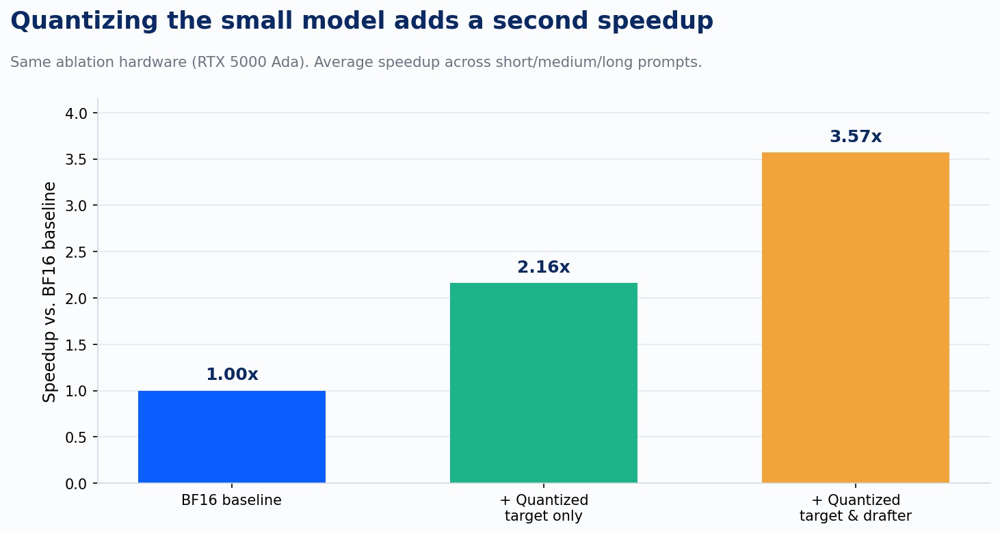
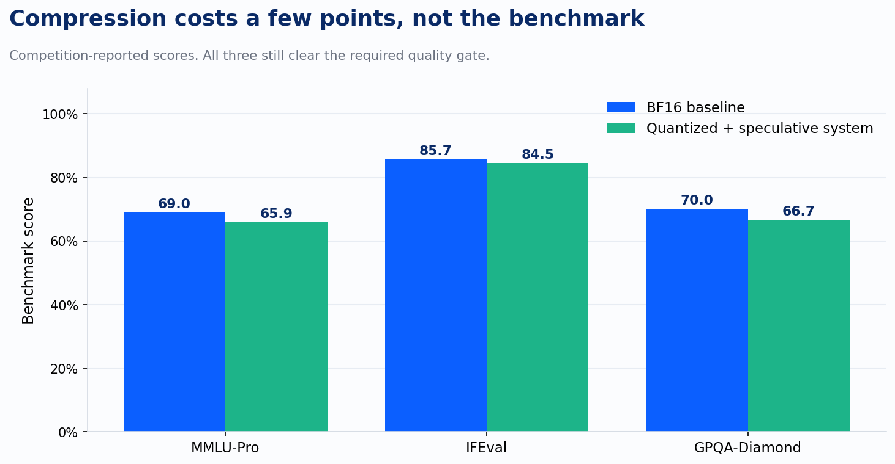

Ask most teams running speculative decoding on constrained hardware what they've quantized, and they'll tell you about the big model. Shrink the target model to INT4, keep the draft model at full precision, ship it. That's the instinct, and it leaves a second speedup sitting on the table because the two models in that pipeline don't carry the same risk.

A technical report out of Nota Inc., published as part of an efficiency competition built around Qwen3.5-4B, makes that point with numbers I haven't seen laid out this cleanly before. The competition's constraint was deliberately unglamorous: get the lowest latency you can out of a single NVIDIA A10G, a 24GB inference card, not a hyperscaler cluster. That's the hardware profile that matters to a client running a mid-size open-weight model on infrastructure they actually own, not the profile in a frontier lab's press release.

The team's approach had two halves. First, they quantized the target model to INT4 using AWQ, then ran quantization-aware distillation to claw back the accuracy that quantization alone costs them. Second, and this is the part worth sitting with, they also quantized the draft model, the small model whose only job is proposing candidate tokens for the target model to check. Speedup from the target-only compression: 2.16x over the BF16 baseline. Add the quantized draft model on top, with a sliding-window attention trim to cut its per-step cost further, and the same pipeline reaches 3.57x in their own ablation study, on the same GPU class. The official competition leaderboard entry, measured on the actual A10G hardware, posted 6.978x.

Here's why the second half of that number is close to free while the first half isn't. In speculative decoding, the draft model never gets the final word. It proposes a run of tokens, and the target model verifies every one of them against its own distribution, accepting the ones that match and rejecting the ones that don't. A worse draft model just produces more rejected guesses, costing you some of your speedup back, while the target model still decides what's correct. That asymmetry is what let the Nota team compress the drafter aggressively without paying for it: their quantized draft model's mean acceptance length, a direct measure of how often the target accepts what it proposes, moved from 5.03 to 4.98 across three benchmarks. That's a rounding error, not a tradeoff.

The target model doesn't get that same discount, and the paper is upfront about it. Raw INT4 quantization on the target dropped its IFEval score below the competition's own required quality gate before any correction was applied. Recovering that required quantization-aware distillation, and even after recovery, the final shipped system still trails the BF16 baseline on all three required benchmarks: MMLU-Pro, IFEval, and GPQA-Diamond.

Every one of those scores still clears the threshold the competition required. But the honest read is that compressing the model whose output the user actually sees costs something real, and compressing the model that only proposes candidates for a stricter judge to check costs almost nothing. Those are two different engineering problems wearing the same word, quantization, and a team that treats them identically is either leaving latency on the table or eating an accuracy hit it didn't need to.

I keep coming back to how narrow the setting was here: a single 24GB card, a 4-billion-parameter model, a competition leaderboard rather than a hyperscaler's internal benchmark suite. That narrowness is the point. Most of the inference-efficiency research that gets attention this year comes out of labs optimizing for GPU fleets most of Improving's clients will never operate at that scale. This result came out of exactly the kind of constrained environment a client actually deploys into, and it still found a second, nearly-free lever sitting inside a technique most teams think they've already fully exploited.
