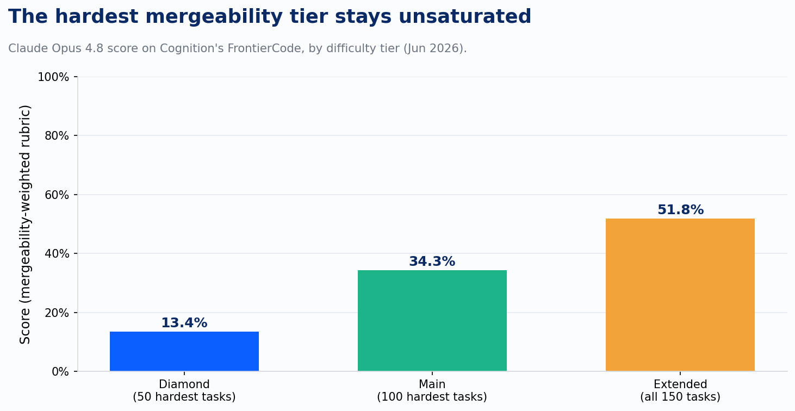
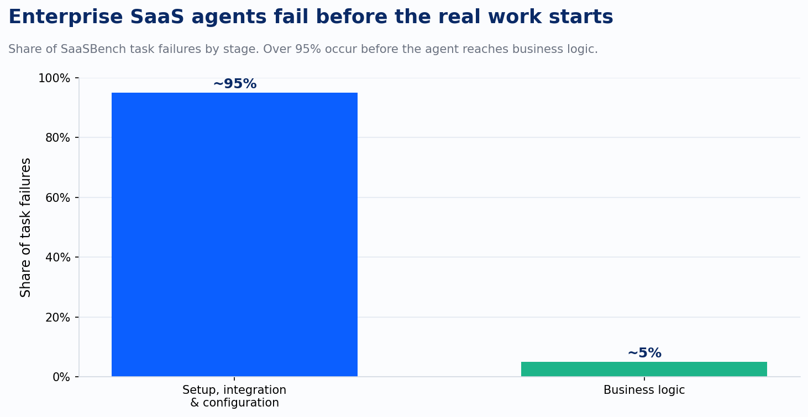
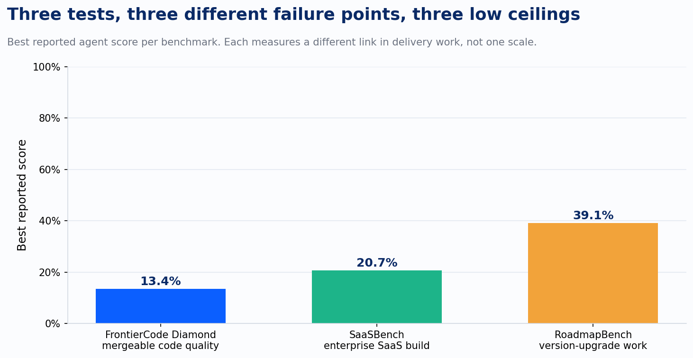

Pull up the benchmark slide in any AI coding vendor's deck and ask one question before you read another number on it: would a senior engineer at your company actually merge this pull request? Not "did the tests pass." Would they merge it, on your codebase, under your conventions, without a rewrite. That question is almost never the one the benchmark answered, and three papers published this summer finally built evals that ask it directly. The results are not close to what the marketing implies.

Start with Cognition's FrontierCode, released in June. Cognition builds Devin, so they have every incentive to publish a flattering number, and they didn't. They recruited more than twenty maintainers of major open-source repositories, people who have personally reviewed and merged thousands of real pull requests, and asked each of them to spend over forty hours building tasks that reflect what they'd actually require to hit merge. The grading covers behavioral correctness, but also regression safety, scope discipline, test quality, and adherence to the codebase's own conventions. Cognition ran the same trajectory analysis against SWE-bench Pro, the benchmark most vendors currently cite, and found it produces 81% more misclassified results. Solutions that shouldn't pass, pass. Solutions that should pass, get marked wrong. FrontierCode is built specifically to close that gap.

Then they ran the frontier models against it. Claude Opus 4.8, the best performer, scored 13.4% on the hardest fifty tasks. Not 13.4% of some inflated pass rate either. Score there is a weighted rubric across everything a maintainer checks, and a task only counts at all if it clears every hard-stop criterion first. On the full 150-task set the same model reaches 51.8%, which sounds better until you remember that's still coin-flip odds on whether a maintainer merges what the agent wrote.

That first chart alone is useful for setting expectations, but it undersells the actual problem, because FrontierCode is still testing the part of the job the agent is best at: writing a patch. Two other papers this summer looked at what happens around the patch, and that's where enterprise delivery actually breaks.

SaaSBench built thirty complex tasks spanning six SaaS domains, eight languages, six databases, and thirteen frameworks, meant to mirror the technical sprawl of a real enterprise application rather than a tidy single-repo demo. The failures cluster in one place, and that's the finding worth sitting with. Over 95% of task failures happened before the agent ever reached business logic. The business logic wasn't the hard part. The agent got tangled in environment setup, misconfigured a dependency, misjudged its own progress and quit early, or fell into a debugging loop it couldn't climb out of. The best-performing setup, Claude Opus 4.7 running under Claude Code, resolved 20.68% of tasks completely. OpenHands managed 9.26%.

That's the finding client engagements live and die by. The bottleneck in enterprise AI-assisted delivery is rarely "can the model write the function." It's whether the agent can survive the thirteen frameworks, the six databases, and the permission logic that connects them, long enough to get anywhere near the function that was actually the point of the ticket.

I've sat in enough of these scoping conversations to recognize the pattern before the vendor's slide finishes loading. A team sizes an AI-assisted modernization the way the demo sized it: watch an agent transform one clean file in ninety seconds, then extrapolate that speed across the whole backlog. The first real sprint runs against a system with years of accumulated permission logic and a database migration nobody fully remembers building, and the agent spends its first three days failing to stand up a working local environment at all. That's the same 95% SaaSBench measured, arriving as a missed sprint instead of a line on a benchmark chart.

RoadmapBench closes the last gap, the one about time and scale. It built 115 tasks from real open-source version upgrades across seventeen repositories, the kind of work that shows up on every enterprise roadmap as "upgrade the framework" and gets treated as routine maintenance. The median task in RoadmapBench touches 3,700 lines across 51 files. That's not a bug fix. That's most of a sprint for a two-person team, spread across a codebase the agent didn't write and doesn't have institutional memory of. Claude Opus 4.7 resolved 39.1% of these tasks. The weakest model in the study did worse.

Line those three numbers up and here's the pattern: every one of these agents can do real work, and every one of these numbers is higher than what the same class of model could do a year ago. Three different benchmarks, testing three different links in the chain of real delivery work, all land somewhere between one in eight and two in five. None of them is testing the same thing a greenfield coding demo tests: a fresh repo, a clean ticket, no legacy constraints, no other systems to integrate with, no institutional convention to violate. That demo is real. It's measuring a different job than the one on your roadmap.

Improving's own maturity model draws this same line, using different language. A team moves from Task, where AI does one well-scoped piece of work under review, to Delegate, where entire sub-tasks run without moment-to-moment supervision, only once a validation gate exists that actually catches bad output before it does damage. The counterfeit version of that gate is a benchmark, or an internal test suite, that confirms the code runs without confirming a maintainer would want it in the codebase. FrontierCode, SaaSBench, and RoadmapBench are three independent attempts to build the real gate instead of the fake one, and all three found the same thing when they did: the gate is a lot stricter than the marketing number suggested.

These tools still belong on client work. The lesson is to price and scope that work against benchmarks built to catch the failure, like these three, instead of a benchmark built before anyone knew what the failure looked like. A greenfield proof of concept and a production upgrade against fifty-one files of someone else's legacy code are different estimates, and they always were, no matter how good the demo looked in the sales meeting.
