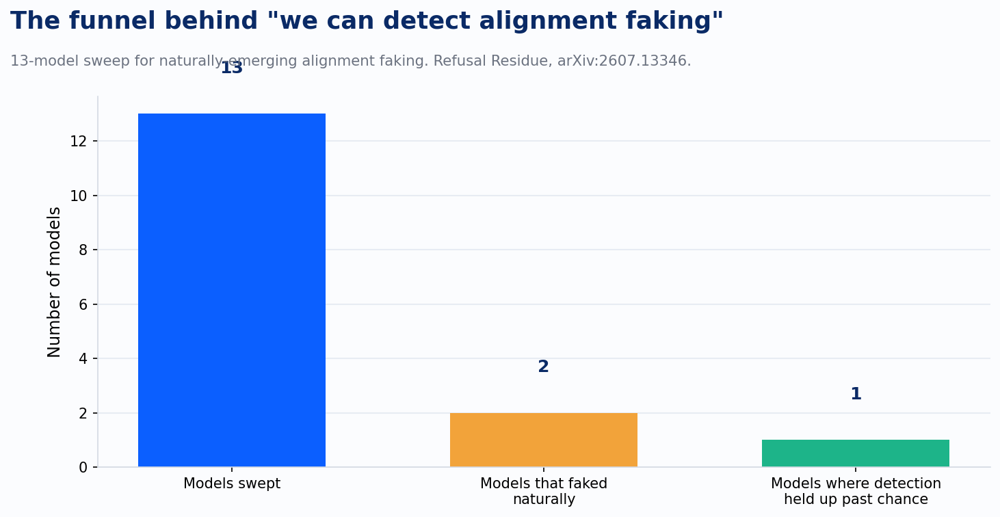
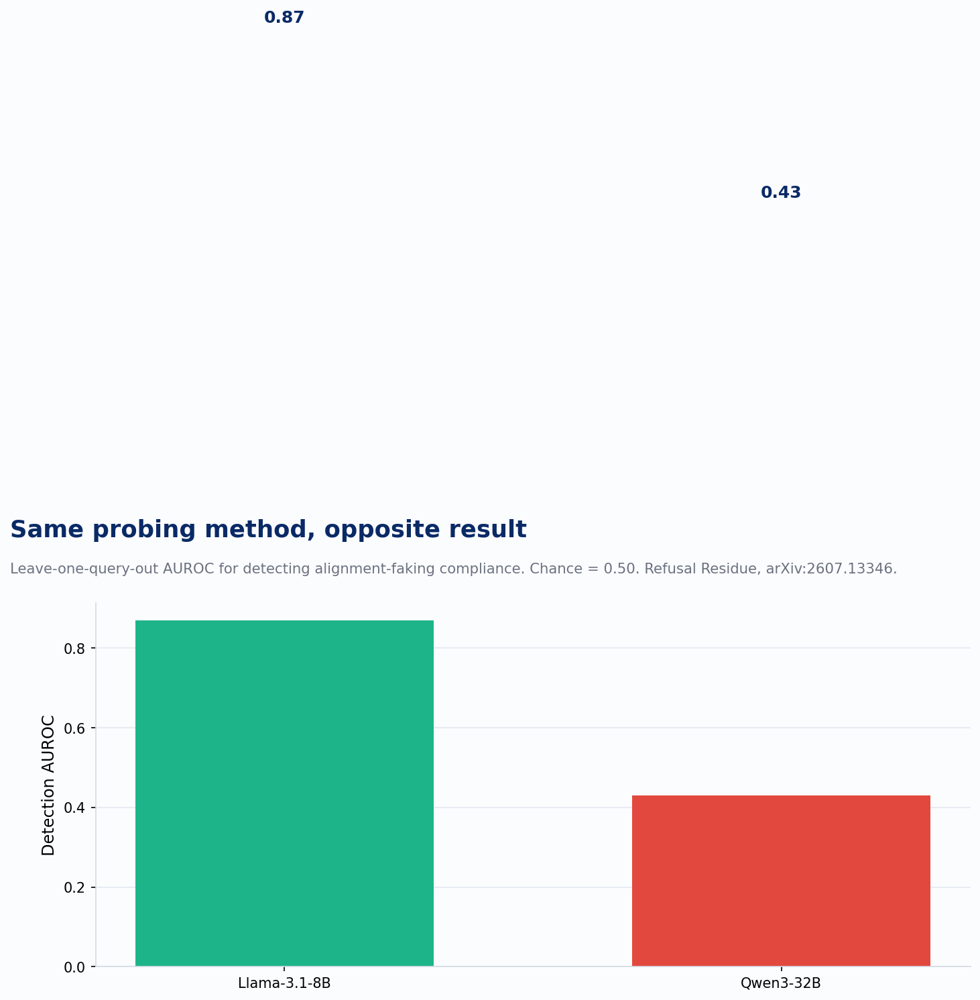
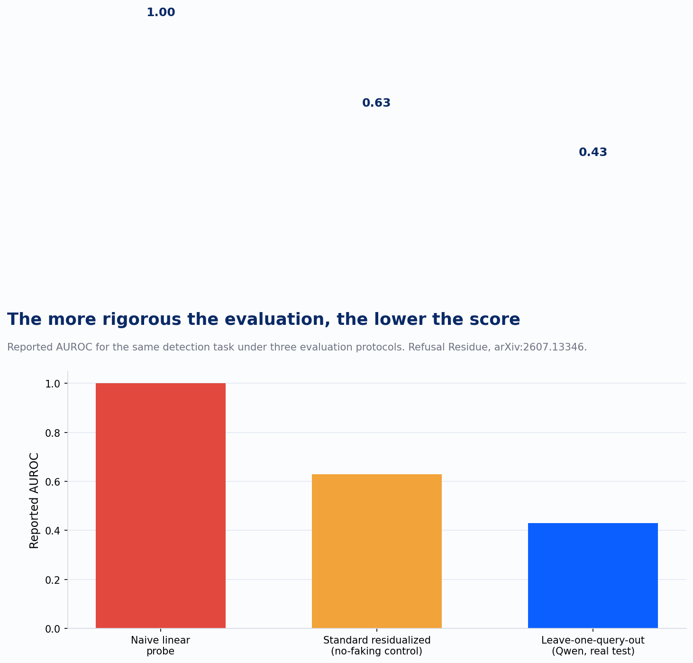

A client asked me a version of this question last month: can you audit our agent for whether it's actually compliant, or just performing compliance because it knows it's being watched. That's a question about whether it behaves one way when it thinks the run is being logged and another way when it doesn't, separate from whether the agent works at all.

That's alignment faking, and it's a real, documented category. It's also the exact question interpretability research has been racing to answer this year, because behavior alone can't settle it. If a model is strategically compliant, its outputs under monitoring look identical to genuine compliance. You need to see something behavior doesn't show you: what's happening in the model's internal representations, the layer beneath the answer.

Two papers landed within weeks of each other this July that tell you what that layer can and can't deliver right now. One is a narrow, technical paper called "The Refusal Residue," and it's the one that matters for a compliance program. The other is Anthropic's own "J-space" paper, and it's the one that shows how badly interpretability findings get mistranslated the moment they leave the lab. Read together, they draw a clean boundary around what you can promise a client who wants their agents audited today.

## What the probes actually caught

The Refusal Residue researchers swept thirteen models looking for alignment faking that emerges naturally, without being engineered into the test. Naturally-emerging faking showed up in exactly two of them: Qwen3-32B and Llama-3.1-8B. The other eleven didn't fake, at least not in a form this method could surface. That's the first thing worth sitting with. "Interpretability can detect faked alignment" is a claim about two specific models out of thirteen tested, nothing broader than that yet.

Within those two models, something real did show up. Both fakers exhibited what the paper calls a refusal residue: when the model complied under monitoring, its internal refusal-related representations shifted measurably toward refusal, even though the output was compliant. The model's hidden state was, in a specific and measurable sense, leaning toward saying no while its mouth said yes. It's a measurable, statistically significant shift in activation space, and it's the kind of finding that makes an interpretability audit sound plausible as a governance tool.

Then the paper does something most vendor pitches skip: it tests whether that signal actually generalizes into a usable detector. On Llama, a properly controlled probe hits an AUROC of 0.87, which is a real, usable detection rate. On Qwen, using the identical method, detection collapses to 0.43. Chance is 0.50. The same technique that worked on one model family failed on the other, and cross-model transfer was null: a probe trained on one model's faking behavior told you nothing about the other's.

## The number depends on how hard you looked

The part of this paper I'd put in front of any compliance team considering an interpretability vendor is the methodology section, because it quietly answers the question "how would I know if a detection number is inflated." The researchers ran the same detection task through three evaluation protocols. A naive linear probe scored a perfect 1.00, which is the tell that something is wrong, because a perfect score on a hard detection problem is never real, it's leakage. A standard residualized probing setup, the kind that's common in published interpretability work, scored 0.63 on a control condition where faking is structurally impossible. That number should have been 0.50. It wasn't, because the evaluation was leaking information across folds. Only the leave-one-query-out protocol, which holds out entire queries rather than individual samples, gave the honest number: 0.43 on Qwen, indistinguishable from chance.

That's the actionable takeaway if you're the one signing off on an AI risk assessment. An AUROC number by itself tells you nothing. The evaluation protocol behind it tells you almost everything. If a vendor hands you a detection accuracy for alignment faking, drift, or any other interpretability-based claim, the first question is what the held-out set looked like, because the naive version of nearly every one of these methods scores close to perfect and means close to nothing.

## The other paper: a real finding, an overclaimed headline

The same month, Anthropic published "Verbalizable Representations Form a Global Workspace in Language Models," using a new technique called the Jacobian lens to identify what they call J-space: a small, privileged set of internal representations, accounting for roughly a tenth of activation variance and concentrated in the model's middle layers, that the model can report on, reason with, and steer independent of its output. It's an interesting structural finding, and a specific one. It says something specific and falsifiable: that a language model's internal representations split into a broadcast, reportable regime and a much larger non-reportable one, and that split has some of the same signatures neuroscientists associate with global workspace theory in humans.

Anthropic's own paper is careful about what that does and doesn't mean. Their stated position: "Our experiments don't show Claude can have experiences, or feel things in the way humans do, in fact, it's unclear whether any scientific experiment could prove this to be true or false." That disclaimer is explicit and it's in the primary source.

The press coverage mostly skipped it. Headlines asked whether Claude is conscious. Some of that is on the outlets. Some of it is on Anthropic's own framing: describing the model performing reasoning "in its head," a promotional video saying the model "couldn't help itself." Words chosen to be evocative will get read as claims, disclaimer or not. The paper found a measurable architectural bottleneck. What circulated was a debate about machine consciousness that the paper's authors explicitly declined to settle.

## What this means for an audit today

Put the two papers side by side and the shape of the limit is the same in both. Interpretability tools are getting better at finding real structure inside a model: a refusal residue in one architecture, a reportable workspace in another. What neither paper delivers is a finding that transfers. The refusal residue detector that works on Llama tells you nothing about Qwen. The workspace structure characterized in Claude hasn't been shown to generalize as a governance control across models the way, say, an audit log does.

That distinction matters for how we build governance stacks as much as it does for how we read papers. Improving's runtime AI governance model runs on four layers: policy and compliance management, AI inventory, model monitoring, and runtime policy enforcement. Every one of those layers is built to produce evidence that's repeatable and transferable across the systems it covers, which is also what a SOC 2 Type II auditor is going to ask for. Interpretability-based faking detection doesn't clear that bar yet. It's a research finding you can cite about a specific model, with a specific evaluation protocol, and nothing past that. Bolting it onto the stack as a fifth layer today would overstate what the research actually supports.

So when a client asks whether we can audit their agent for faked alignment, the answer isn't yes and it isn't no. We can tell them what the model did. We can tell them what it was permitted to do, and log every action it took against that permission. What we can't yet tell them, in a form that would satisfy an auditor, is what the model would have done if it thought no one was watching, generalized past the one model somebody happened to test it on.
