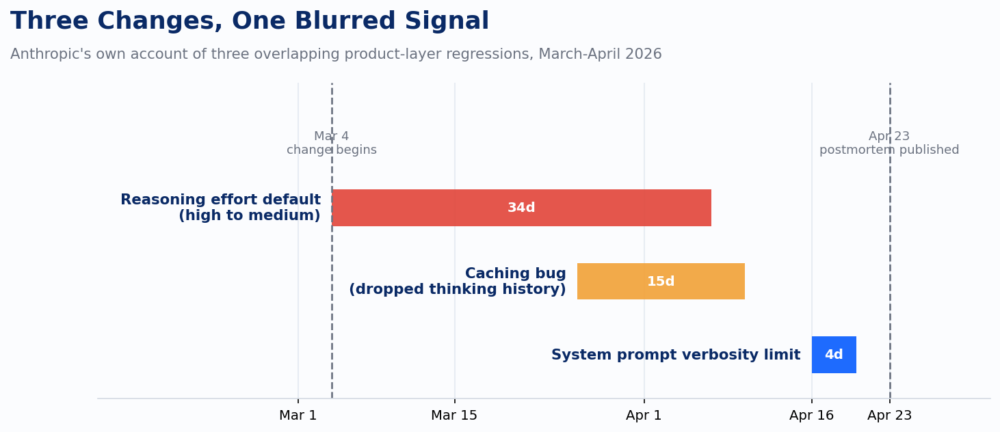
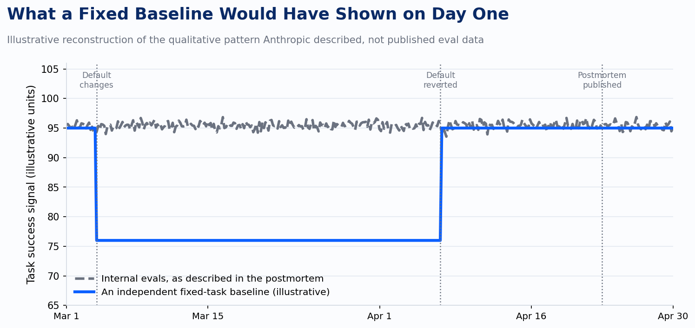

Open Anthropic's April 23 postmortem and look for the sentence where they say the model got worse. It isn't there. The model never changed. Something upstream of it did, for thirty-four days, and it took Anthropic's own engineers most of a month to find it inside their own product.

Here's what actually happened, in Anthropic's own words. On March 4, they changed Claude Code's default reasoning effort from high to medium. The reason was reasonable on its face: at high effort, Opus 4.6 would occasionally think long enough that the interface appeared frozen, and users were complaining about the latency, not the quality. Anthropic's internal evals told them medium effort gave "slightly lower intelligence with significantly less latency for the majority of tasks." That's a real tradeoff, and they made a defensible call on it, then explained the change through an in-product dialog. What they didn't do was flag it publicly as a quality change, because internally it didn't read as one. It read as a latency fix with a small, acceptable cost.

Users disagreed immediately. Anthropic's own account says people started reporting that Claude Code "felt less intelligent" soon after the rollout. That's the part worth sitting with: this wasn't a slow-burn mystery nobody noticed. Individual users noticed the same day. What took weeks wasn't detection. It was confirmation, because two other changes shipped into the same window and blurred the signal past the point where anecdote could isolate a cause.

On March 26, a caching optimization meant to clear stale reasoning history once per idle session instead cleared it every turn for the rest of that session, so Claude kept acting without any memory of why it had made its own prior decisions. That shipped past code review, unit tests, end-to-end tests, and dogfooding, and it took over a week to isolate once Anthropic went looking. Then on April 16, a system prompt change capping response length to reduce Opus 4.7's verbosity shipped after weeks of internal testing with no flagged regressions, and a broader ablation later found it cost three points on Anthropic's own evals. Three unrelated changes, three different rollout dates, three different fix dates, one aggregate impression from the outside: Claude Code got worse and nobody would say why. Anthropic's own words for the difficulty: "neither our internal usage nor evals initially reproduced the issues."

That line is the real finding, more than any of the three bugs individually. Anthropic runs Claude Code on itself constantly. It has usage telemetry most vendors would envy and an eval suite built specifically to catch this class of problem. None of it caught a live, confirmed regression in its own flagship coding product for over a month. The reasoning effort change alone ran for thirty-four days before the April 7 revert, and Anthropic didn't publish an explanation of any of it until April 23, seven weeks after the first change and sixteen days after the last one was fixed. The company that built the model was working with the same kind of evidence its clients were: a rising pile of "this feels off" reports, and no fast way to turn feeling into a confirmed root cause.

The detail that changes how I'd build against this isn't the bug. It's where the bug lived. Anthropic was explicit that the API was never touched. Reasoning effort is a parameter the Messages API accepts directly. Claude Code, the product, chooses a default value and sends it on your behalf. The regression sat entirely in that second layer, the one that picks a default so you don't have to think about it. Anyone calling the API directly with an explicit effort value never saw this particular problem, because there was no default for Anthropic to quietly move. Anyone running on the product surface inherited whatever Anthropic decided that week, with no way to know it had changed short of the model suddenly feeling worse.

That's the part worth building a habit around, and it isn't specific to Anthropic. Every hosted agent product sits on top of an API that has more explicit controls than the product exposes by default. A model version, a reasoning effort or thinking-budget parameter, a system prompt, a tool-calling policy: each of these can move at the product layer without a version bump anywhere a client would think to check. Pin what the API lets you pin. Where a parameter has a name, set it yourself instead of accepting whatever the vendor decided was the right default for the average user this month, because the average user's tradeoff is not automatically your production system's tradeoff.

Pinning parameters closes the door on one failure mode, not all of them. A model can still be deprecated, quietly re-tuned within a version string, or paired with a harness change on the vendor's side that touches behavior you didn't pin. The only reliable way to catch that is to stop depending on anyone else's telemetry to tell you something changed. A fixed, versioned suite of tasks that looks like your actual production workload, run on a schedule against your production configuration, with a locked baseline from before the vendor touched anything, would have shown a drop on March 4 and a recovery on April 7, on day one of each, not week five.

The suite worth running isn't a public benchmark. Anthropic's own postmortem is indirect proof of that too: their internal evals, built by the people who know Claude Code best, missed all three regressions on the first pass. A benchmark built by someone else, scored on someone else's tasks, is even less likely to catch a regression specific to how your agent actually uses the model. Build the suite from your own production traces instead, a hundred or so representative tasks pulled from real runs, graded against a fixed rubric, re-run on a schedule tight enough to catch a change within days rather than a billing cycle. Track more than pass or fail while you're at it. Reasoning-effort and token-budget changes tend to show up first in the reasoning trace itself, a shorter chain of thought, fewer tool calls, a faster but thinner response, before they show up as a wrong final answer. A monitoring setup that only grades the last message will catch this the same way Anthropic did: after enough users complain that the pattern becomes impossible to ignore.

None of this makes Anthropic's postmortem look bad. It's an unusually detailed, unusually honest account of exactly what broke and when, and most vendors never publish anything close to it. That's precisely why it's useful. If a company willing to write thirty-four days and three root causes down in public still needed its own users to force the investigation, no client running a production agent on any vendor's stack should be planning around the assumption that the vendor will notice first. The postmortem is a gift. The independent monitoring it argues for is still homework nobody else is going to do for you.

---

*Source: Anthropic, "An update on recent Claude Code quality reports," April 23, 2026 (anthropic.com/engineering/april-23-postmortem).*
