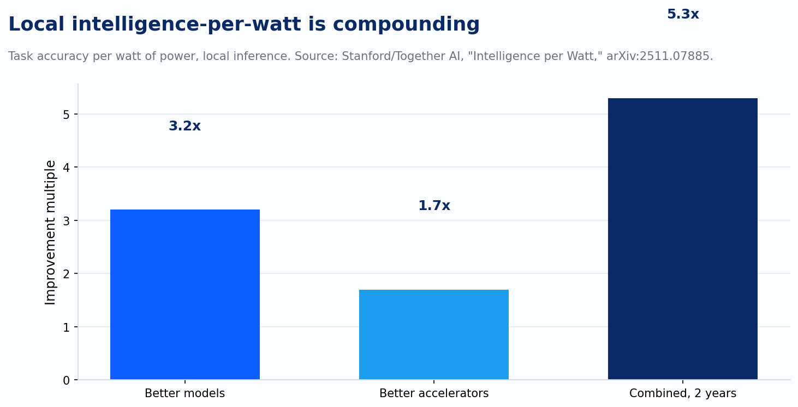
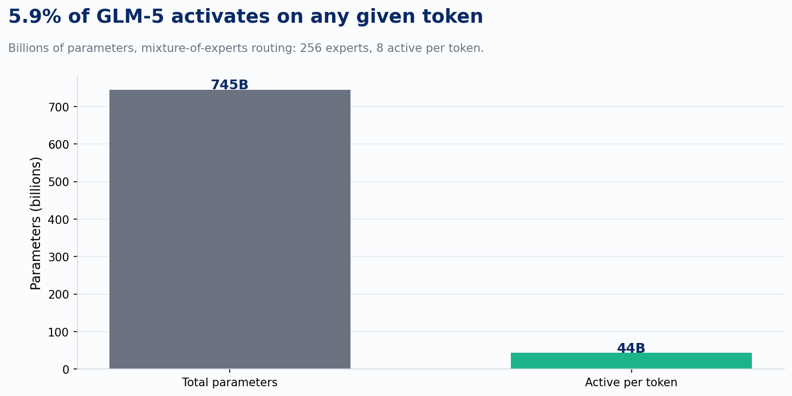
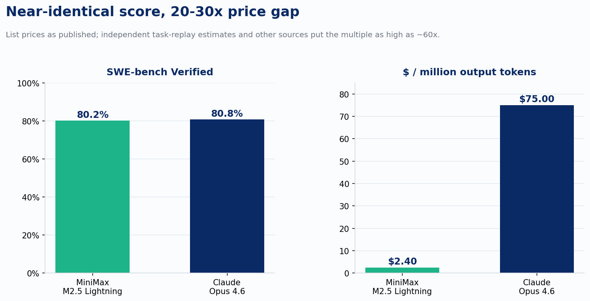

Name the last open-weight model that topped a coding leaderboard. Now try to remember which one still held that spot two weeks later. Kimi K2.5 gave way to K2.6, then K3. GLM-5 became 5.2, then 5.5. DeepSeek V4 landed somewhere in the middle of all of it. Every release shipped with a chart claiming parity with, or a win over, Claude Opus. I've written elsewhere about why I stopped taking those vendor charts at face value: the harness moves the score more than the model does, and most of the "wins" don't survive an independent rerun.

Underneath that churn sits a real body of efficiency research, and it has nothing to do with who's ahead this week. Four pieces of it matter more than any single leaderboard position, because unlike a benchmark score, none of them reset when the next model ships.

Start with the metric itself. A Stanford and Together AI paper this year proposed measuring local inference not by raw capability but by capability per watt: task accuracy divided by the power it took to get there. That framing matters because it names the actual constraint a client hits when they self-host. The question was never whether the model can reason. It's whether it can reason on hardware the client already owns, at a power draw they're willing to pay for. The paper's finding: local models already handle 88.7% of single-turn chat and reasoning queries, and local intelligence-per-watt improved 5.3x over two years, roughly 3.2x from better models and 1.7x from better accelerators.

That 5.3x is a compounding number, not a one-time jump, and it's the number that belongs in a self-hosting business case instead of a benchmark percentile. A model running two points behind the frontier on a leaderboard, at a fraction of the power draw, is a different conversation than the leaderboard alone tells you.

Sparsity is the second piece, and GLM-5 is the clearest version of it running in production. It's a mixture-of-experts model with roughly 745 billion total parameters, but only 8 of its 256 experts activate per token, about 5.9% of the network doing the work on any given pass. Pair that with the sparse attention mechanism it uses for long-context handling, and the result is a model that can process 200,000 tokens of context without paying full dense-attention compute for every one of them.

That's the architectural decision, not the parameter count, that determines whether a 745-billion-parameter model is a research curiosity or something a client can actually afford to point at a large codebase. A number like "745 billion parameters" sounds like a cost problem until you learn that 94% of it sits idle on any given token.

MiniMax M2.5 makes the same case from the inference side. Its Lightning Attention is a linear-attention variant built to avoid the quadratic cost ordinary transformer attention pays as context grows. The published results put M2.5 at roughly 80% on SWE-bench Verified, within a point of Claude Opus 4.6, while pricing out at around $0.30 per million input tokens and $2.40 per million output tokens against Opus's list price near $75 per million output tokens.

Different sources put that multiple anywhere from 20x to something closer to 60x, depending on whether you're comparing list price, blended cost, or an independent task-replay estimate. I'd treat the exact figure the same way I treat every other vendor number this year: real, directionally, and not worth repeating to three significant figures until someone outside the vendor has rerun it. What doesn't move with the exact multiple is the mechanism producing it. Linear attention changes the cost curve of long-context inference in a way that holds regardless of which specific benchmark run produced this week's number.

The fourth piece matters most for anyone deciding whether to self-host at all: does a fine-tuned open model actually close ground on a general-purpose frontier model, or does it just look good on a narrow test built to flatter it. SWE-Dev took a 32-billion-parameter open model, applied targeted training and inference-time scaling rather than more pretraining, and got it to 36.6% on SWE-bench Verified, in range of what GPT-4o scored on the same benchmark. That's not a frontier number. It's a fraction of what Claude Opus or GLM-5 post today. But it's a 32B model, small enough to run on hardware a mid-size engineering org could reasonably own, closing ground that used to require a model ten times its size. The technique, targeted training and inference-time scaling applied to a small base model, is the transferable finding. The 36.6% is a snapshot the next SWE-Dev paper will improve on.

That's the pattern across all four. Intelligence per watt gives you a metric that survives model churn because it's about the hardware relationship, not the model's rank. Sparse activation and sparse attention give you an architectural reason a 745-billion-parameter model can be cheaper to run than its parameter count implies. Linear attention gives you a reason cost and context length stop scaling together. Targeted fine-tuning at small scale gives you a reason a 32B model can close ground on something much larger without matching its parameter budget. The number attached to each technique will keep moving. The technique itself is what a client is actually buying.

For a client weighing open-weight self-hosting against frontier API spend, the leaderboard question is the wrong one to lead with, and for the same reason I don't hand a client a vendor's own benchmark slide without checking it first: whoever's on top this week is likely to be replaced within the same release cycle, sometimes within the same month. The question that survives the cycle is which of these four techniques actually applies to the workload in front of you. A workflow bottlenecked by long-context retrieval cares about sparse and linear attention. A workflow bottlenecked by narrow, repetitive task types cares about whether targeted fine-tuning on a small model gets close enough. A workflow constrained by power and rack space, not by API budget, cares about intelligence per watt more than either. Match the technique to the constraint, and the model underneath it becomes a much smaller decision than the leaderboard makes it look.

---

*Sources: "Intelligence per Watt: Measuring Intelligence Efficiency of Local AI" (Stanford/Together AI, arXiv:2511.07885); GLM-5 architecture reporting on mixture-of-experts routing and sparse attention; MiniMax M2.5 Lightning Attention benchmark and pricing coverage; "SWE-Dev: Building Software Engineering Agents with Training and Inference Scaling" (arXiv:2506.07636).*
