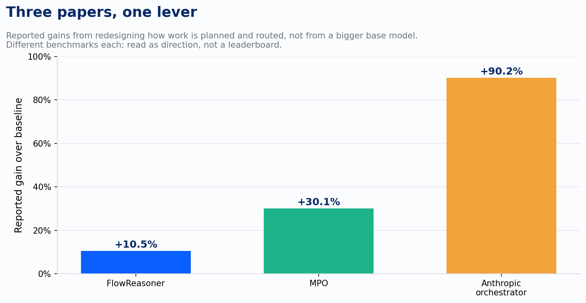
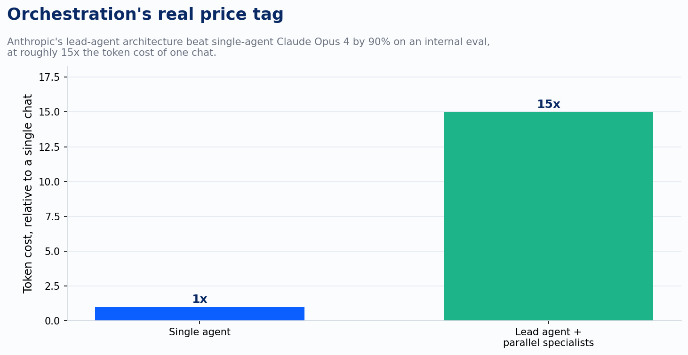

Watch a client team debug a disappointing agentic pilot and you can predict the first thing they'll ask for: a better model. GPT to Claude, Claude to Gemini, whichever model is newest this quarter. It's the reflex, and it's usually answering the wrong question.

I've been reading through a cluster of papers published this year that all landed on the same finding from different directions, and none of them found it by making the underlying model smarter. They found it by changing how the work gets planned.

Start with FlowReasoner, out of a team including Sea AI Lab researchers. Most multi-agent systems today are built once, as a fixed pipeline: one plan, one sequence of specialist agents, applied to every query that comes through the door. FlowReasoner throws that out. It trains a meta-agent, distilled from DeepSeek R1 and then sharpened with reinforcement learning against real execution feedback, to design a new multi-agent flow for every individual query. A simple lookup question gets a lean flow. A gnarly, multi-part engineering problem gets a flow built for that shape of problem, decided at query time, not baked in at design time. On engineering and competition-code benchmarks, that query-specific redesign beat o1-mini's fixed approach by 10.52 percent across three benchmarks. Nobody swapped in a stronger base model to get that number. They rebuilt the org chart for every question instead of using the same one for all of them.

MPO, out of Peking University, attacks the same weak point from the planning side rather than the routing side. Give an agent a plan and it will often hallucinate steps that sound plausible and aren't grounded in what's actually happening in the environment. MPO's fix is a meta plan: high-level guidance that sits above the agent's own step-by-step reasoning, and that gets revised continuously based on what happened the last time the agent tried to execute it. Fail a step, and the meta plan updates before the next attempt, not after a human notices the pattern and retrains something. The part worth sitting with is what this bought in practice. Llama-3.1-8B, an eight-billion-parameter open model, paired with an MPO-optimized planner, beat GPT-4o-mini by 30.1 percent on interactive planning benchmarks. Move up to Llama-3.1-70B with the same planning layer and you get a new state-of-the-art average of 83.1 on ALFWorld and SciWorld combined. A smaller model with a better planning architecture beat a larger, more expensive one running without it. That is the whole argument in a single result.

A third paper, STEP-HRL, comes at the identical weak point from a different angle again: not routing, not planning revision, but the architecture of the plan-execute relationship itself. Most agent frameworks make every decision by conditioning on the entire interaction history, which means the model has to re-read everything it's already done before deciding what to do next. That gets expensive fast, and unfiltered history buries the signal that actually matters under everything that doesn't. STEP-HRL splits the job into two policies sharing one backbone: a high-level policy that tracks what's been completed and decides the next subtask, and a low-level policy that only ever sees the current subtask, the current observation, and a compressed summary of local progress. Neither one re-reads the whole trail. On ScienceWorld and ALFWorld, the paper reports the split substantially outperforms single-policy baselines while using meaningfully fewer tokens to do it. I'll flag directly what I can and can't verify here: the paper's own framing is about escaping the cost of full-history conditioning, not the credit-assignment language some secondary coverage uses to describe it. The architecture is the same story regardless of which label you put on the problem it solves: separate the planner from the executor, and the planner gets better without the executor's model getting bigger.

Three independent research groups, three different benchmarks, one shared conclusion: the fixed pipeline was the ceiling, not the model running inside it.

Anthropic didn't wait for the academic literature to converge before shipping the commercial version of this. Their research system runs a lead agent that reads a query, decides how to break it apart, and spins up somewhere between one and more than ten subagents in parallel depending on how much the query actually branches, each one working a piece independently without visibility into what the others are doing. That last detail is deliberate. A subagent that can't see its siblings can't get pulled into cross-talk, which is what lets the lead agent's own context stay clean enough to actually synthesize what comes back. On Anthropic's internal evaluation, that architecture beat a single Claude Opus 4 agent working the same problem alone by 90.2 percent.

That number needs its other half stated just as plainly, because this is exactly the kind of place a vendor's own case study leaves out the cost line. Running the orchestrated version costs roughly fifteen times the tokens of a single chat. Anthropic's own guidance reflects that: one agent for a simple fact-finding query, two to four for a direct comparison, ten or more reserved for research that genuinely branches into that many independent threads. The lever is real. It is not free, and treating it as free is how a pilot that looked great in a demo turns into a line item nobody budgeted for in production.

I've used the phrase boxes and arrows to describe agentic workflows for a while now: AI agents get good at the boxes, the individual tasks, well before they get good at the arrows, the handoffs and sequencing decisions between them. What these three papers and Anthropic's own product both confirm is that the arrows were never a soft problem waiting on a smarter box to solve it by accident. They're a distinct engineering surface, with their own research literature and their own architecture decisions, and they respond to direct investment in a way that swapping models does not.

For anyone running an agentic pilot right now, that reframes the diagnostic question worth asking when results disappoint. Not which model. Who, or what, is deciding how this query gets broken up, which specialist handles which piece, and what happens when the first attempt at a step doesn't work. If the honest answer is "the same fixed sequence, every time, regardless of what comes in," the fix on the table isn't a model upgrade. It's an orchestration layer that was never built.

---

*Sources: *[*FlowReasoner: Reinforcing Query-Level Meta-Agents*](https://arxiv.org/abs/2504.15257?ref=devlinliles.com)*; *[*MPO: Boosting LLM Agents with Meta Plan Optimization*](https://arxiv.org/abs/2503.02682?ref=devlinliles.com)*; *[*Hierarchical Reinforcement Learning with Augmented Step-Level Transitions for LLM Agents (STEP-HRL)*](https://arxiv.org/abs/2604.05808?ref=devlinliles.com)*; *[*How we built our multi-agent research system, Anthropic*](https://www.anthropic.com/engineering/multi-agent-research-system?ref=devlinliles.com)
