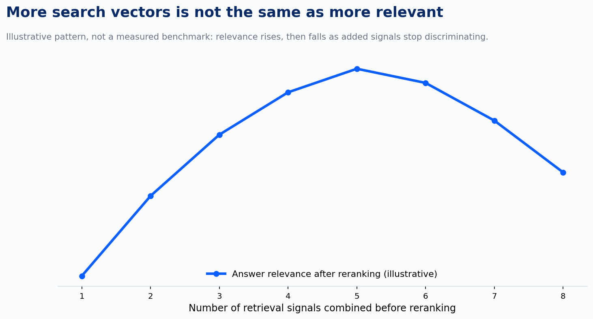

I've spent this series walking through six retrieval vectors, a reranker, two kinds of pre-filter, and a way of measuring authority. Every one of them earns its place by fixing a specific failure mode the others don't catch. The natural next move, once you have six working vectors, is to reach for a seventh. That instinct is exactly backward, and it's the mistake I see enterprise knowledge projects make most often once the basics are working.

## The corpus grows, and the fix people reach for is more search

The pattern shows up on a predictable schedule. A knowledge system launches, works well on a modest corpus, and then the corpus grows, more regulations, more documents, more edge cases, and relevance starts degrading. The instinctive response is to add another retrieval method: another embedding model, another signal, another layer of scoring, on the theory that more information going into the ranking must produce a better ranking coming out.

It doesn't, and there's a specific line in the reference architecture I built for a pipeline safety compliance system that states the actual fix plainly: the metadata tagging layer beats semantic saturation as the corpus grows. Not another search vector. A tighter filter, applied earlier, on the same volume of content. That system processes roughly fifteen thousand published regulations, and the lesson from building it wasn't that four retrieval methods, keyword, semantic, temporal, and graph, needed a fifth to stay accurate as the corpus scaled. It was that letting the corpus grow without a strong tagging layer in front of retrieval is what breaks relevance, because everything starts looking similar enough to everything else that even four well-combined vectors can't tell the difference anymore.

## What the research says happens when you keep adding

There's a real mechanism behind why this fails, not just an operational hunch. Language models handling long retrieved context show a documented "lost in the middle" effect: performance on information that lands mid-context degrades by more than thirty percent compared to the same information positioned at the start or end. That's a property of how attention and positional encoding work, and it means every additional chunk of retrieved text you stuff into the prompt has a real chance of burying the passage that actually answers the question underneath passages that don't, even when all of them are nominally relevant. Simply appending more retrieved text doesn't guarantee better answers. Past a certain point it reliably produces worse ones, because the noise floor rises faster than the discrimination the extra text was supposed to add.

The same failure shows up one layer earlier, in retrieval itself rather than generation. Research on entity-based ranking signals found that adding more features that are conceptually correct doesn't reliably improve real-world discrimination, because a signal being correct isn't the same as a signal being discriminative. A tag, a vector, an entity link can be accurate and still not help distinguish a good match from a bad one in the specific cases where your system is currently getting it wrong. Every vector you add has to earn its place by resolving cases the existing ones get wrong. If it doesn't, it's added noise the reranker now has to sort through, not neutral, and that costs latency and cost without moving accuracy.

That's the shape of the curve worth keeping in your head: relevance climbs as you add the first few genuinely discriminative signals, and falls once you're past the point where a new signal is telling the system anything it didn't already know. The corpus growing is exactly what makes this worse, not better. A bigger corpus needs sharper filtering before search runs, not a longer list of things search has to weigh.

## The discipline that actually holds at scale

The production pattern that's converging across every serious enterprise retrieval build right now confirms this from the opposite direction: retrieve broadly, fuse with reciprocal rank fusion, rerank hard, and then keep a fixed, small budget of passages in the final prompt, typically three to ten, not everything that scored above some relevance threshold. That fixed budget is the actual fix for the saturation problem, not a cost-saving shortcut, because it forces every stage upstream of it to compete for a scarce slot instead of accumulating.

That maps directly onto what governance-minded enterprise deployments are converging on more broadly this year: bounded, purpose-fit combinations of retrieval methods rather than maximal ones. Graph retrieval earns its cost on multi-hop questions and gets skipped everywhere else. Behavioral signal only pays off at consumer-scale query volume, which is why most internal knowledge bases are better off leaving it out. Authority and contradiction detection matter specifically where sources disagree; the rest of the time, they stay quiet. None of these are default-on. Each is a deliberate answer to a specific failure mode, added because a case existed that nothing else caught, not added because it was available.

## Where this leaves the six vectors

Six vectors, a reranker, two kinds of pre-filter, and a way of measuring authority isn't a checklist to implement in full on every project. It's a set of tools, and the discipline that separates a system that stays accurate as it scales from one that degrades is knowing which tools a given corpus actually needs, and having the restraint to leave the rest on the shelf until a real failure mode shows up that demands them.

The corpus doesn't get harder to search because it's bigger. It gets harder to search because everything you added to handle its size looks relevant to everything else in it. The fix has always been a sharper filter, not another vector, asked to do less, applied earlier, so that everything downstream of it has less to sort through and more room to be right.
