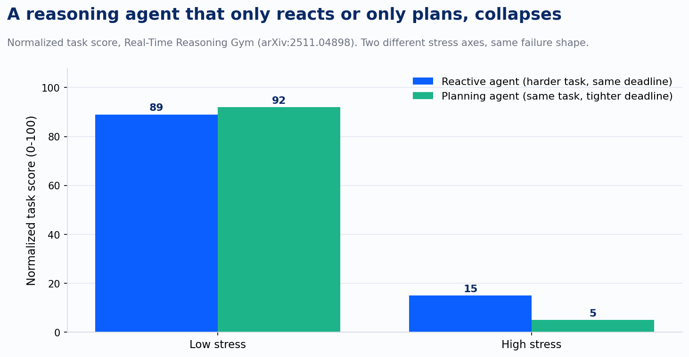
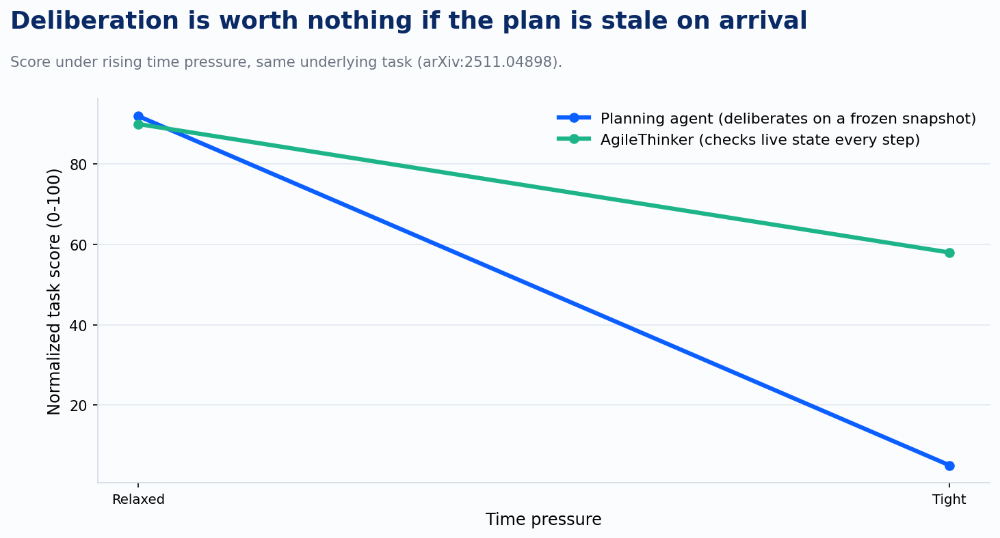
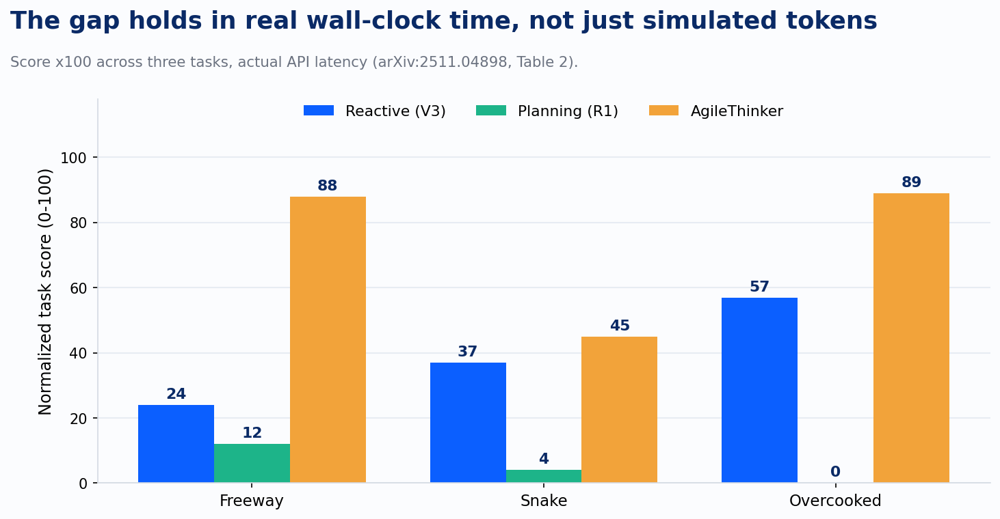

Hand a long-running coding agent a multi-file refactor and walk away. Come back in twenty minutes. The plan it built at minute one assumed a repo that, by minute five, two of your teammates had already changed. It is still executing that plan, confidently, against a codebase that no longer exists.

Nobody designed this failure on purpose. It falls out of an assumption baked so deep into how we build and test these systems that it is easy to miss: the world holds still while the agent thinks. Every static benchmark makes that assumption, because a benchmark has to be reproducible, and reproducibility means freezing the state you're grading against. SWE-bench freezes a repo snapshot. Most agent evaluations pause the environment clock until the model produces its answer. That is the right design choice for a benchmark. It is the wrong assumption for production, where the ticket queue, the codebase, and the infrastructure state keep moving whether or not your agent has finished reasoning about them.

A paper out of Stanford, Tsinghua, Shanghai Jiao Tong, and Georgia Tech names this gap directly. "Real-Time Reasoning Agents in Evolving Environments" builds a testbed, the Real-Time Reasoning Gym, out of three real-time games: Freeway, Snake, and a single-agent version of Overcooked. The design detail that matters: the environment steps forward on a fixed clock regardless of whether the agent has finished thinking. If the agent hasn't produced an action, a default action fires anyway. That is a small change to how you evaluate an agent, and it changes everything about what you find.

## Two ways to fail, and they fail from opposite directions

The researchers tested two standard agent designs. Reactive agents keep a hard token budget so they always respond before the clock ticks, trading depth for speed. Planning agents get to reason as long as they want, then execute a multi-step plan, trading speed for depth. Neither survives contact with a moving environment.

Push task difficulty up while holding time pressure constant, and the reactive agent's score falls from 89 to 15. It has no room to think ahead, so it walks into predictable traps: it grabs the nearest reward and doesn't notice the wall it's about to back into. Hold difficulty constant and tighten the clock instead, and the planning agent's score falls from 92 to 5, a near-total collapse. The paper's case study is the clean version of the coding-agent problem: the planning agent is still reasoning about where the snake was two steps ago when it commits to a move, and the move it commits to walks the snake into a wall that wasn't there when the plan was made. The plan wasn't wrong. It was stale.

That distinction is the whole point. The plan was executed correctly. The world just moved before it finished.

## The fix is not a bigger token budget

The instinct in production coding tools is usually to bolt on a checkpoint: poll the repo state periodically, and if the diff since planning started crosses some threshold, throw the plan out and replan from scratch. It is a reasonable patch. It is also not what the paper's own numbers reward.

The researchers' answer, AgileThinker, runs two threads at once instead of one thread with a tripwire. A planning thread deliberates continuously on the long-term objective, uninterrupted. A reactive thread, running under a strict time budget on every single step, checks the latest observation and reads the planning thread's partial, still-unfinished reasoning trace. It never waits for the plan to finish. It never waits for a threshold to trip. It is always looking at the current state, informed by whatever the slower thread has worked out so far, and it can override the plan's next step the moment the world disagrees with it.

Under the same tightening time pressure that collapsed the planning agent from 92 to 5, AgileThinker held at 58. That's the difference between a system you can put into a production loop and one you can only demo.

## They validated it against real API latency

The most credible part of this paper is the part most research doesn't bother with: the authors didn't stop at simulated token budgets. They measured actual API latency against DeepSeek's official endpoint, found a near-perfect linear relationship between token count and wall-clock time (R² of 0.9986), and reran the three games in real time using that measured rate.

The pattern holds. In Overcooked, the planning agent scored a flat zero in real time, because a plan negotiated with a scripted partner is worthless the moment that partner does something the plan didn't anticipate, and by the time the plan finishes computing, the partner already has. AgileThinker held at 89. This is the detail that keeps the paper from being a clever benchmark result that evaporates outside the lab.

## What I can't verify, and what I'd want to see next

The paper names a real limitation plainly: every experiment runs on DeepSeek V3 and R1, because those are the only model family the authors could get complete reasoning traces from. OpenAI, Google, and Anthropic don't expose the raw reasoning stream that AgileThinker's reactive thread depends on to check the planner's work mid-flight. The mechanism that makes this architecture work has, as of this paper, only been demonstrated on open-weight models. The authors name the open question themselves: whether it transfers to the closed frontier models most enterprises actually run in production.

That gap matters more than it might seem. The whole appeal of the dual-thread design is that the fast thread reads the slow thread's live, in-progress reasoning. If your platform's reasoning model doesn't expose that stream, you're back to something closer to the coarser checkpoint-and-replan pattern, and you inherit its tradeoffs: you're reacting to drift you've already accumulated, not preventing it in the first place.

None of this shows up on a leaderboard built on a frozen repo snapshot. A model can post excellent numbers on a static benchmark while carrying an architecture that has never once been tested against a world that keeps moving underneath it. The benchmark was never trying to measure this. Production is where the ticket gets reprioritized, the dependency gets bumped, and the PR merges out from under the agent that's still reasoning about the version of the codebase it started with. The failure mode was always there. We just hadn't built a test that could see it.
