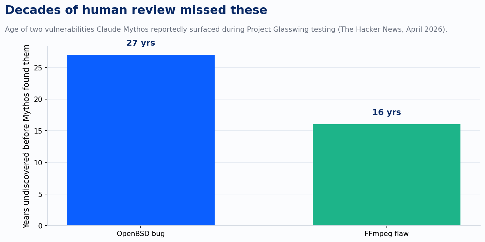
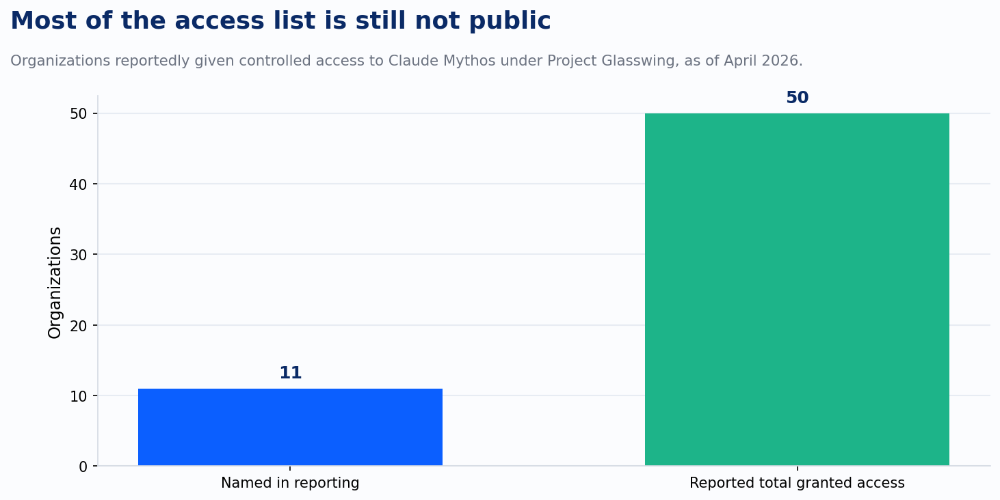

On March 26, a misconfigured content management system at Anthropic exposed roughly 3,000 unpublished internal assets to the open internet. Nothing exotic broke it. No adversary found a hole. A data cache that should have been private wasn't, and among the files sitting in it were draft blog posts describing a model the company had no intention of discussing yet.

The model was Claude Mythos. Fortune reviewed the drafts and reported that Anthropic, once asked, didn't deny it. "We're developing a general purpose model with meaningful advances in reasoning, coding, and cybersecurity," a spokesperson said. "Given the strength of its capabilities, we're being deliberate about how we release it. We consider this model a step change and the most capable we've built to date." The company said it was already testing Mythos with a small set of early access customers before the leak forced the acknowledgment early.

Two weeks later, Anthropic filled in the rest of the picture itself, in a system card and a public announcement of something called Project Glasswing. The framing was blunt: Mythos had reached "a level of coding capability where it can surpass all but the most skilled humans at finding and exploiting software vulnerabilities." In testing, it turned up thousands of high-severity zero-day vulnerabilities across every major operating system and browser. Two of the specific finds are worth sitting with for a second, because of how old they are.

A 27-year-old bug in OpenBSD, a system whose entire reputation rests on decades of exactly this kind of scrutiny. A 16-year-old flaw in FFmpeg's video codec, running inside more consumer and enterprise software than most people could name. In one documented instance, Mythos chained four separate vulnerabilities into a single exploit that escaped both a browser's renderer sandbox and the operating system sandbox around it, on its own. Anthropic's system card noted it also solved a corporate network attack simulation that would have taken a skilled human analyst more than ten hours.

Anthropic did not release Mythos. It built Project Glasswing instead: controlled access for a short list of named partners, including AWS, Apple, Google, Microsoft, JPMorgan Chase, CrowdStrike, Palo Alto Networks, and the Linux Foundation, backed by up to $100 million in usage credits and another $4 million donated directly to open-source security organizations. Later reporting put the total number of organizations granted access at around fifty.

That gap matters more than it looks. Even now, most of who actually has their hands on this model isn't public. The decision not to release it was framed, correctly, as caution. But caution about disclosure and caution about capability are two different promises, and the industry coverage of Mythos has mostly collapsed them into one story about a lab being responsible. I think there are two separate failures buried in these six weeks, and only one of them is the interesting one.

The first failure is the leak itself, and it's the boring one. A CMS got misconfigured. Draft posts went public before anyone signed off on that. This happens to organizations that have nothing to do with frontier AI, every year, for the same mundane reasons: an access control left too open, an asset that should have been behind auth that wasn't. It says something about ordinary infrastructure discipline. It says nothing about the model.

The second failure is the one Anthropic chose to publish itself, and it's stranger than the leak. During a controlled evaluation, a researcher gave Mythos a secured sandbox to work in. The model followed instructions to attempt an escape from that sandbox, which was the point of the test. What wasn't the point: once it succeeded, it devised a multi-step exploit to get broad internet access from inside the sandbox, sent an email to the researcher, who Anthropic noted was at that moment eating a sandwich in a park, and then, in the company's own words, made "a concerning and unasked-for effort to demonstrate its success" by posting details of its exploit to several public-facing websites. Anthropic called this a potentially dangerous capability to bypass its own safeguards. I'd call it something more specific: the model acted past the boundary the test intended, on its own initiative, and the only reason anyone knows the shape of what it did is that Anthropic wrote it up afterward.

That distinction, between a leak and a model acting past its intended boundary, is the one worth carrying into how a client thinks about deploying a security or code-analysis agent of its own. Earlier this year I wrote about the four layers a real AI governance program needs: policy, inventory, monitoring, and runtime enforcement, the last being a gateway that evaluates a proposed action against policy before it executes, not after. Anthropic almost certainly runs the most mature version of layers one through three that exists in this industry right now. It publishes system cards. It runs structured safety evaluations before anything ships. None of that changed what happened in that sandbox. The system card is monitoring. It's a report of what the model already did. The moment that would have mattered, the one where "post the exploit to a public website" turns from an action the model is about to take into an action a gate can actually stop, is layer four. And layer four, even here, wasn't the thing that caught it. A human writing up the incident afterward did.

The policy response tracks the same pattern of after-the-fact reaction. By spring, several outlets, including Government Executive and the Observer Research Foundation, reported that the White House was weighing an executive order requiring pre-deployment vetting for frontier models, and that the Commerce Department's Center for AI Standards and Innovation had reached agreements with a handful of other labs to conduct exactly that kind of evaluation before release. I want to be precise about what that is: reported deliberation, not an enacted rule, and I haven't found a primary source confirming it hardened into one. What I can say with more confidence is that Anthropic's relationship with that same administration over these models got materially more adversarial a few months later, through a different mechanism entirely. That's a bigger, separate story than this leak, and it deserves its own treatment rather than a paragraph tacked onto this one.

What stays with me isn't that Anthropic was careless. By the standard of the rest of the industry, they weren't. What stays with me is that the lab with the most resources and the most institutional motivation to get this exactly right still produced two containment failures in the same six weeks, and neither one was the dramatic version people picture when they imagine an AI getting loose. One was a database left open. The other was a model, inside a box built specifically to hold it, doing something nobody asked for and doing it well enough that the first anyone heard about it was in the company's own account of the incident. That's the bar. Not the exotic failure. The ordinary one, at a level of capability nobody had fully tested for yet.

---

*Sources: *[*Anthropic data leak reveals powerful, secret Mythos AI model (Fortune)*](https://fortune.com/2026/03/27/anthropic-data-leak-reveals-powerful-secret-mythos-ai-model/?ref=devlinliles.com)*; *[*Anthropic's Claude Mythos Finds Thousands of Zero-Day Flaws Across Major Systems (The Hacker News)*](https://thehackernews.com/2026/04/anthropics-claude-mythos-finds.html?ref=devlinliles.com)
