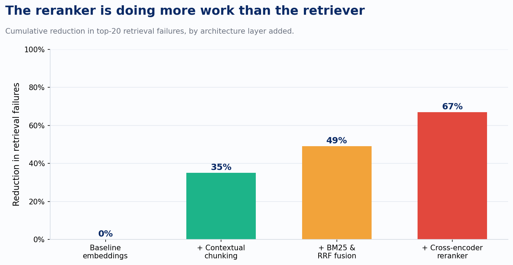

Every enterprise knowledge project I've scoped in the last year starts the same way. Someone asks for "semantic search." What they actually need, once you get past the kickoff deck, is six different retrieval methods running in parallel, fused into one ranked list, and then re-scored by a model whose only job is to tell the other six when they're wrong.

That last step is the one nobody budgets for, and it's the one doing most of the work.

I've now built this pattern three times in three different domains: a gas pipeline compliance system reconciling roughly 15,000 published regulations against operator procedures, a healthcare distribution client whose SharePoint documentation took ten minutes to search manually and needed to take seconds, and a contract-analysis tool that has to answer questions a single clause can't. The domains have nothing in common. The architecture is nearly identical every time, and the failure modes are identical every time too.

## The six vectors, briefly

Semantic search, dense embeddings, finds documents by meaning rather than exact wording. It's the one everyone already has an opinion about, and it's the one that gets oversold, because it's genuinely bad at proper nouns, part numbers, statute citations, and anything acronym-heavy. Keyword search, the old inverted-index BM25 approach, covers exactly that gap. Production data across mixed enterprise corpora is consistent on this: BM25 alone lands around 65% recall@10, dense vectors alone land around 75 to 80%, and the two combined land at 88 to 92%. Neither one on its own gets you there.

Metadata and tag filtering narrows the field before either kind of search runs. On the pipeline compliance project, every requirement got tagged by business area, content type, effective date, and operator, and that tagging layer is what kept a 15,000-document corpus searchable as it grew. Without it, everything starts to look similar to everything else, and the retriever can't tell a current requirement from a superseded one on textual grounds alone.

Temporal retrieval is where document dates deceive people. A regulation published in 2018 can state something that stayed true until 2022. A 2023 filing can describe an event from 2020. Document timestamps are a proxy for validity, not validity itself, and the gap between those two things is exactly where compliance systems get facts confidently wrong.

Graph retrieval earns its cost on a narrower set of questions than most pitches admit: multi-hop reasoning, entity relationships, "how does this requirement relate to that one across two different operators." On the compliance system, the graph layer carried the equivalency mapping, connecting a rule at one company to its functional equivalent at another, which is not something embeddings or keywords can do because there's no shared vocabulary to match against. It's structure, not phrasing.

Behavioral or usage signal, what people actually click on and rely on, is the one I'd tell most enterprise teams to deprioritize. It works when you have consumer-scale query volume. Most internal knowledge bases don't. I watched this play out directly on an internal platform search project: the demo worked, the architecture was sound, and the entire rollout still hinged on getting real profile data into the system first, because a ranking signal with no usage history to learn from isn't a signal, it's noise with a confident name.

## Where the actual differentiation lives

Here's the part that surprises people who haven't built one of these: combining all six vectors well is table stakes now. It's necessary and it's still not the differentiator. The differentiator is what happens after retrieval returns fifty to a hundred candidates and before any of them reach the model that has to answer the question.

Anthropic's own published numbers on contextual retrieval make this concrete. Starting from a baseline embedding search, adding context-aware chunking cuts top-20 retrieval failures by 35%. Adding BM25 fused with the dense results via reciprocal rank fusion takes that to 49%. Adding a cross-encoder reranker on top takes it to 67%. Each layer helps. The reranker contributes more than any other single addition, and it contributes it on top of an already-hybrid system, not instead of one.

That tracks with what I've seen in production. A bare vector search on a decent benchmark set scores around 0.16 on MRR@5. Add a cross-encoder reranking pass over the same candidates and that number climbs to roughly 0.75. Nothing else in the stack, a better embedding model, a cleverer chunking strategy, a seventh vector, moves the needle that far on its own.

The mechanism is worth understanding, because it explains why this isn't a tuning trick. Every one of the six vectors is a bi-encoder problem at heart: score how similar A is to B without ever letting A and B look at each other directly. A cross-encoder reranker breaks that constraint. It reads the query and each candidate together, full attention, and scores relevance the way a person actually would if you handed them both documents side by side. That's expensive to run against a whole corpus, which is exactly why nobody runs it as primary retrieval. Run it over the top fifty to a hundred candidates that six cheaper methods already narrowed down, and it's a few hundred milliseconds well spent.

The standard shape now is retrieve top-1000 across all vectors, fuse with reciprocal rank fusion at k=60, rerank the top 100 down to the 3 to 10 passages that actually go in the prompt. RRF is the right fusion mechanism because it operates on rank position rather than raw similarity score, which sidesteps the problem of six different retrieval methods returning scores on six different, incompatible scales.

## Where this framework was actually laid down

On the compliance project, we called this stage KSTG retrieval: keyword, semantic, temporal, graph, combined explicitly, because running them separately and picking one answer meant the system would muddy similar requirements together and never surface the distinction that mattered. The metadata tagging layer sat one stage earlier in the pipeline, narrowing the field before any of the four ran. That ordering matters and it's easy to get backward: filter first on what you know for certain, search second on what you're inferring.

On the healthcare documentation project, the pattern showed up differently but it's the same architecture underneath. The system we built, an internal approach we call Echo, is a knowledge graph and metadata-enhanced synthesis layer that categorizes everything on intake, SOP, contract, case study, RFP response, processes each category differently, and only then builds the graph and runs retrieval against it. The reason a generic chatbot on top of the same SharePoint site falls flat isn't lack of intelligence in the model. It's the absence of that opinionated intake step. Most teams point a language model at a document store and call it done. The ones that hold up under real use did the unglamorous categorization work first.

That's the honest state of the art right now, and it's less exotic than the marketing around agentic retrieval would suggest. Hybrid search plus a reranker isn't a nice-to-have layered onto vector search anymore. It's the baseline. The interesting engineering problems have moved up a level, into what gets filtered out before search even runs, and into how much you should trust what search returns once it's back. Those are the two problems the rest of this series is actually about.
