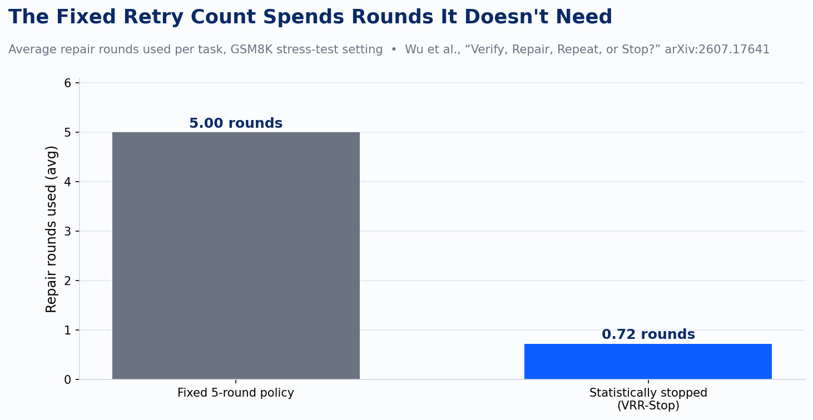
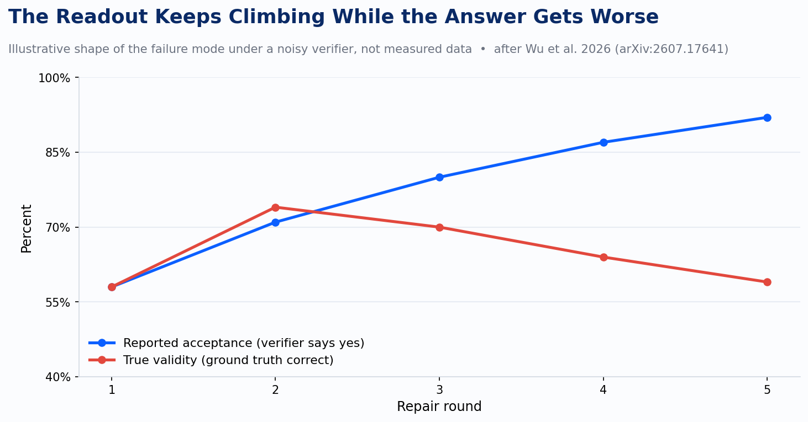

Every coding agent harness I've configured this year ships with the same buried setting: a repair loop with a round limit. Three tries. Five tries. Ten, if whoever set it up was feeling generous. Nobody measured that number into existence. It's the default that came with the framework, or the count that felt right after the demo passed twice in a row.

Verify-repair loops are how agents self-correct across code generation, math, and tool use. The agent produces something, a verifier checks it (a test suite, a linter, another model acting as judge), and if the check fails, the agent tries again. Repeat until it passes or the round budget runs out. It's a sound idea. The problem is the part nobody built: a rule for knowing when repair has stopped helping and started hurting.

A paper out this July, "Verify, Repair, Repeat, or Stop?" (Wu, Shen, Yang, Peng, and Hu, arXiv:2607.17641), puts a number on that gap. On a GSM8K stress test, replacing a fixed five-round repair policy with a statistically grounded stopping rule improved final true validity by 60.6 percentage points, while spending an average of 0.72 repair rounds instead of five. Read that twice: more correct and cheaper at the same time, because most of those five rounds were buying nothing, and some of them were actively making things worse.

The mechanism behind that number is the part worth sitting with. Verifiers are noisy. A test suite has blind spots. An LLM-as-judge misjudges. When the verifier isn't perfect, and the model doing the repairing isn't perfect either, the paper's authors show something specific happens: reported acceptance keeps climbing round over round, while true validity, the actual ground-truth correctness of the output, can fall. The dashboard says the agent is converging. The code is getting worse.

That's the trap. A repair step doesn't only fix bugs. It can damage a plan or a solution that was already correct, and a noisy verifier can still wave that damaged version through. Run that same round again and the error compounds: more chances for the repairer to break something good, more chances for the verifier to miss it. A bigger fixed round count doesn't fix this. It just buys more rounds for the compounding to happen in.

Picture the ordinary version of this. An agent writes a function, the test suite passes, and the harness moves to the next task. Two rounds later, on an unrelated failure, the repair step touches a shared helper that first function depended on. The test suite for the original function doesn't get re-run, or it does and happens not to cover the edge the repair broke. The verifier reports green the whole way through. The code that was correct two rounds ago no longer is, and nothing in a fixed-round policy was ever checking for that, because a fixed-round policy isn't checking anything. It's just counting.

The paper's fix, VRR-Stop, doesn't try to perfectly measure the verifier's error rates or the repairer's damage rate. It only needs to know the sign of the expected gain from one more round, whether the next repair is likely to help or hurt, which it estimates from a running belief built out of repeated verification votes. When that expected gain turns negative, the loop commits to what it has instead of repairing again. That's a materially lighter statistical bar than the field has assumed self-correction requires, and it's most of why the loop gets both more correct and cheaper at once.

There's a real limit here, and the authors state it plainly, which is the part of this paper I trust the most. When the verifier's discrimination approaches zero, meaning the check genuinely can't tell a right answer from a wrong one, the belief estimate itself stops being reliable, and the stopping sign can flip on estimation error alone. Their answer is a second, more conservative mechanism (VRR-Guard) that only swaps in a new candidate when the verification margin clears a real threshold, not just a favorable estimate. Translated: no stopping rule, however well built, rescues a verify-repair loop whose verifier is guessing. Fix the verifier's reliability before trusting any policy built on top of it.

Worth being precise about what 60.6 points and 0.72 rounds actually describe. That result comes from a GSM8K stress setting, meaning the authors deliberately cranked up verifier and repairer noise to see where a fixed policy breaks down, not a claim about every production coding agent running today. The honest reading is narrower and still worth the number: the industry has been running verify-repair loops for a year without a principled answer to when repair should stop, and the first paper to formalize that question found a gap this large under adversarial conditions. Whatever the real gap is in a specific harness with a specific verifier, it is very unlikely to be zero.

That distinction maps onto something I wrote about earlier this year with the ratchet pattern: quality metrics enforced to only move forward, never backward, so a merge that regresses coverage or introduces a lint violation gets blocked automatically. The ratchet works because the gauge is trustworthy. Coverage percentage and lint count are close enough to ground truth that enforcing "never worse" against them actually protects the codebase. A verify-repair loop's gauge is a different animal. It's a model, or a test suite with gaps, grading another model's output, and grading it under uncertainty. Running a fixed retry count against that kind of gauge is running a ratchet and hoping the noise averages out. The paper's core result is that it doesn't. It compounds.

None of this requires exotic tooling to act on. It requires treating two questions as measurable rather than assumed: how reliable is the verifier actually, checked against a held-out set of known-good and known-bad completions, and is the repair loop's stopping point a number anyone chose on purpose. Most teams running coding agents right now can answer neither question about their own setup. The five-round retry sitting in most agent configs is a default nobody revisited once the demo worked, and there's now a name and a measured cost for what that default is quietly spending: rounds burned buying nothing, some of them spent making the answer worse while the pass-rate readout said otherwise.
