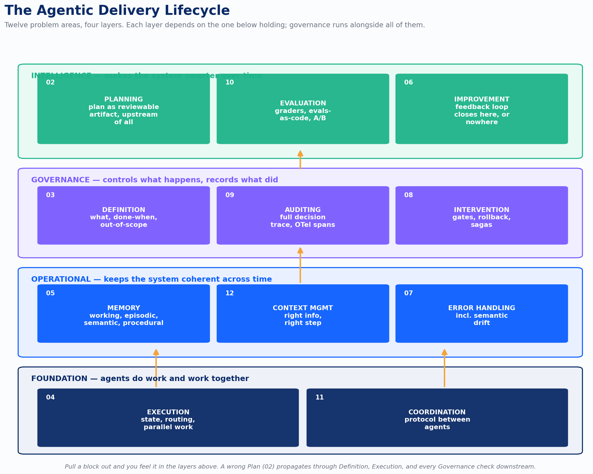
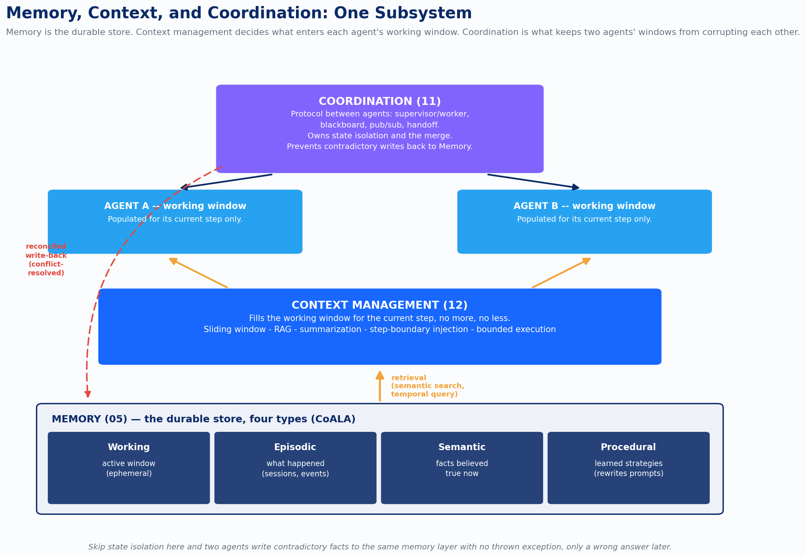
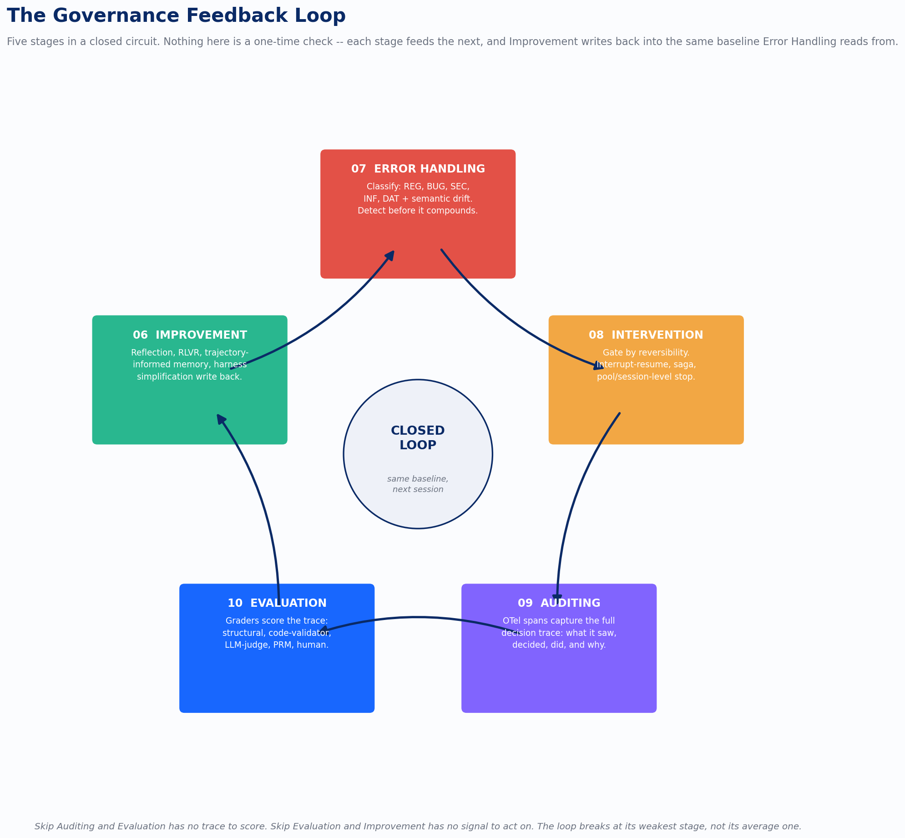

A team picks up an agent framework, points it at a problem, and ships something that works in the demo. Six months later they’re debugging a production incident and discover the tool they bought only ever solved one of twelve problems standing between a demo and a system that holds up under real traffic. Nobody told them there were twelve. They found out by living through the gap.

I’ve spent 2026 [mapping this space one problem at a time](https://www.devlinliles.com/agentic-development-is-eleven-problems-not-one/), and the finding underneath all of it is simple to state and expensive to ignore: agentic development is not one discipline, it’s twelve, and they compound. Not in the sense that solving one helps the others. In the sense that failing to solve one shows up as a symptom in a completely different layer, and the team debugging the symptom has no idea the root cause lives somewhere else. A team that skips Definition finds their Execution confidently wrong. A team that skips Auditing finds their Evaluation has no trace to score. A team that skips Memory finds their Improvement has nowhere to write down what it learned. The failure doesn’t announce itself at its source. It shows up two or three layers downstream, wearing a different symptom’s clothes.

That’s the argument this piece is built around: reliability in an agentic system is not a property of any single component. It’s a property of the architecture connecting all twelve. You can have excellent execution, a well-tuned model, and a slick orchestration layer, and still ship something that fails in production, because the failure was never going to originate in the layer you invested in. This is a full-lifecycle architecture piece. Twelve stages, four layers, one connected system. Let’s walk through it.

*agentic-lifecycle-arch-01-full-system.png*

## The shape of the problem

Picture the lifecycle as four layers stacked on top of each other, each depending on the one beneath it holding.

**Foundation** is where agents actually do work: Execution and Coordination. This is the layer everyone builds first, because it’s the layer that produces a visible result. **Operational** sits above it and keeps the system coherent across time and failures: Memory, Context Management, Error Handling. **Governance** wraps around both, controlling what happens and recording what did: Definition, Auditing, Intervention. **Intelligence** sits on top, and it’s the layer that makes the investment pay off over time instead of just running reliably: Planning, Evaluation, Improvement.

The order I’ve listed the layers in is not the order you build them in. Planning and Definition come conceptually first, before a single line of execution code runs, because a wrong plan or a misspecified task propagates through everything built on top of it. But most teams build Foundation first because it’s the layer that ships a demo, then discover months later that they built three stories on a foundation with no Governance and no Intelligence layer poured underneath it. The building doesn’t collapse. It just never gets better, and eventually someone asks why the agent is still making the same mistake it made in March.

Here’s the mental model that’s actually useful: this isn’t a sequence, it’s a set of Lego bricks in four layers. Blocks in the same layer connect naturally to each other. Layers stack, and upper layers depend on what’s below. But you don’t have to assemble in a fixed order. What matters is knowing which blocks you have, which ones you’re missing, and which specific downstream symptom each missing block is currently causing you to misdiagnose.

## Where the lifecycle starts: Planning and Definition

Every agent lifecycle begins with two questions that sound similar and aren’t. [Planning](https://www.devlinliles.com/the-plan-is-a-first-class-artifact/) answers how. [Definition](https://www.devlinliles.com/the-defect-is-in-the-definition/) answers what. Get the order backwards, plan before you’ve defined the goal precisely, and you get a well-structured plan for the wrong thing.

Most engineers describe their agent’s decision process as “it reasons through it.” That’s ReAct: reason, act, observe, reason again. It’s the default in most frameworks because it’s the simplest thing to implement, and it works fine for short, bounded tasks. It breaks in a specific and predictable way on long ones. Each step is locally optimal given what came before, but nothing evaluates whether the accumulated path is still heading toward the actual goal. By step fifteen of a fifty-step task, the agent has drifted. No single step was wrong. No step had visibility into the whole.

Plan-then-Execute fixes this by separating the two phases entirely. The plan is produced first, as a structured, reviewable artifact, before anything in the real world changes. Someone, human or automated gate, approves it. Only then does execution begin. This matters for one reason above every other: it creates a decision point between intent and consequence. You cannot approve or reject something that doesn’t exist as an artifact, and ReAct never produces one.

For tasks where a wrong first move is expensive and hard to walk back, Tree of Thought and Language Agent Tree Search go further, generating and evaluating multiple candidate plans before committing to one. LATS in particular runs Monte Carlo tree search with an LLM value function, sampling paths and back-propagating value estimates across the tree. It’s the right tool when the cost of discovering you were wrong, and undoing it, is high. It’s overkill for anything you can fix with a quick retry.

Definition is the layer most teams get wrong at the detail level while believing they got it right at the headline level. “Implement the authentication flow” is a goal. It’s also fifteen unanswered questions: which auth methods, which user types, what happens on failure, what’s the session lifetime. An agent will answer all fifteen itself, using whatever assumption is most natural from its training, and some of those answers will be confidently wrong. A well-defined task states four things explicitly: the goal, the acceptance criteria, what’s out of scope, and the assumptions being made going in.

Out-of-scope declarations deserve their own emphasis because they’re the one most teams skip entirely. Agents are completion-seeking. That’s the point of using them, and it’s also the failure mode. A developer asks an agent to update an API endpoint. The agent updates it, notices the tests are outdated, updates those, notices the documentation doesn’t match, updates that too, and in the process discovers a related endpoint with a similar issue. Six steps later the agent is three layers removed from the original task, and every step along the way was technically correct. None of it was what was asked for. Scope boundary confirmation, stating explicitly what’s out of bounds before execution starts, is the fix, and it’s almost never done, for the same reason people skip writing a clear ticket: they’re confident the task is obvious right up until the result comes back wrong.

## Where the work happens: Execution and Coordination

Once a plan exists and the task is defined, the Foundation layer is where it becomes action. [The orchestration model you choose here](https://www.devlinliles.com/the-orchestration-model-you-pick-is-the-architecture-decision-you-cant-undo/) is not a preference, it’s an architecture decision you don’t get to easily undo later. It determines what error handling you can build, how you checkpoint state, and whether you can debug the system when it breaks.

Stateful graph execution, the LangGraph model, treats workflows as directed graphs with typed, checkpointed state at every node. It’s the most capable model available for complex workflows, and the capability comes from checkpointing: you can pause at any node, inspect state, modify it, and resume without restarting. Role-based crew execution gets a prototype running faster, mapping agents onto roles like researcher, writer, reviewer, but it doesn’t expose the state machinery to pause and inspect mid-execution. Event-driven execution, where agents publish and subscribe to events, decouples agents from each other elegantly and makes debugging a matter of reconstructing an event chain across potentially many agents, which is exactly as painful as it sounds without dedicated observability.

The pattern that shows up across all three models, because it’s a design choice rather than a framework feature, is supervisor and subagent: a coordinator decomposes tasks and delegates to specialist workers, tracking completion and merging results. The coordinator knows the full problem and none of the domain; the specialists know the domain and none of the full problem. The failure mode to watch for is a coordinator that starts doing substantive domain reasoning instead of routing. That’s the seam where the separation blurs and the system gets hard to debug and hard to replace.

Reliability compounds downward through this layer in a way that’s easy to underestimate. A single agent completing a task at 95% reliability sounds solid. Chain twenty of those steps and you’re at a 36% chance the whole thing succeeds. That’s not a performance detail. It’s why circuit breakers, worktree isolation, and bounded sessions are basic correctness requirements for multi-step workflows, not optimizations you add later if you have time.

[Coordination](https://www.devlinliles.com/your-multi-agent-system-has-a-coordination-problem/) is the layer that only exists once you have more than one agent, and it’s where a new category of failure appears: problems at the boundary between agents rather than inside any single one. There are six coordination models in production use, and they differ on the axes that matter: debuggability, resilience, and coupling. Supervisor / worker is the most common and the most debuggable, because when something breaks you trace it to the supervisor’s routing decision and the specific worker involved. Peer-to-peer mesh is more resilient and much harder to debug. Blackboard, publish/subscribe, GroupChat, and handoff / swarm each trade structure for flexibility in different ways. Start with supervisor / worker. Move to something else only when your requirements genuinely demand the tradeoff.

The Model Context Protocol matters here for the same reason REST and OpenAPI mattered a decade ago: it decouples the things that evolve fast, models and frameworks, from the things that evolve slowly, enterprise data sources and business tools. An MCP-compliant connector works with any MCP-compliant agent, which means the tool you build today survives the next framework migration.

## Keeping the system coherent: the operational layer

This is the layer that determines whether an agent compounds value over time or resets to baseline every session, and it’s the layer where most production complaints originate: “it keeps making the same mistakes.”

The agent isn’t broken. It has no place to put what it learns. [Memory](https://www.devlinliles.com/why-your-agent-forgets-everything-every-morning/) in agentic systems breaks into four types, borrowed from cognitive science under the CoALA framework: working memory (the active context window, ephemeral), episodic memory (what happened, temporal and event-anchored), semantic memory (facts currently believed true, largely atemporal), and procedural memory (learned strategies, the hardest to implement and the highest-leverage when it works). Most deployed systems implement only working memory, which is functionally the same as having no memory at all once the session ends.

The evaluation benchmark for this space, MemoryAgentBench, found that no current system masters all four memory competencies it probes, and selective forgetting is the hardest of them. Every other memory operation, retrieval, consolidation, is additive. Forgetting requires the system to identify what it should no longer believe. The practical consequence is specific: agent memory systems don’t lose facts, they stockpile outdated ones. Tell an agent in January the team uses Postgres and in April that it migrated to CockroachDB, and without selective forgetting the agent holds both beliefs at once and picks unpredictably between them.

[Context Management](https://www.devlinliles.com/the-context-window-is-not-a-filing-cabinet/) is the discipline most teams underinvest in because it doesn’t fail dramatically. It fails as gradual, hard-to-attribute degradation: the agent was good last month, it’s worse now, nobody changed the model or the prompts. What changed is that the context got messier. Three specific problems show up here. Context window saturation is what happens when the window fills with irrelevant prior steps, a selection problem disguised as a capacity problem. Context pollution is subtler: old, contradicted, or irrelevant information misleads the agent even when there’s technically enough room, and it looks like a model error when it’s actually a hygiene problem. Retrieval latency is the operational cost of pulling context at runtime, worst in its multi-hop form, where the agent needs fact A to retrieve fact B to retrieve fact C, three round trips deep and fragile at every hop.

The mental model that actually helps: treat the context window as a whiteboard, not a filing cabinet. A whiteboard holds what’s useful for the current problem and gets erased when the problem changes. A filing cabinet accumulates everything and makes you search through it. Sliding windows, RAG, summarization compression, context injection at step boundaries, and bounded execution are five different ways to keep the window behaving like the whiteboard. None of them work if you skip the planning discipline that tells you, in advance, what each step actually needs.

[Error Handling](https://www.devlinliles.com/the-error-your-stack-trace-will-never-catch/) in agentic systems requires a different classification than the exceptions software engineers are trained on. The field has converged on five error types: Regression (behavior that used to work and stopped), Bug (a new defect with no baseline to compare against), Security (urgency overrides blast radius, always a P1), Infrastructure (transient, handled by bounded retries), and Data, the most insidious of the five. A retrieval layer returning stale embeddings doesn’t throw an exception. The agent receives the data, finds it plausible, proceeds, and produces output that’s consistently wrong across sessions. Nothing fails. The system reports success. The error is silent until someone compares output to ground truth.

None of the five types is harder to catch than semantic drift, which isn’t in the taxonomy because it isn’t an error type so much as a description of what agentic failure actually looks like: the divergence between what the agent is doing and what it was originally asked to do, accumulating one individually-defensible decision at a time. Infrastructure failures get caught immediately. Semantic drift gets caught last, often only when a human reviews the final output and realizes it doesn’t resemble the original ask. The cost is proportional to how many steps happened after the drift started, which is exactly why pre-execution gates, test sufficiency analysis, scope validation, pre-flight checks, matter more than any runtime safeguard. Catching it before execution starts is cheaper than catching it after.

## What controls the system: the governance layer

Governance is the layer most teams build just enough of to satisfy a compliance requirement, usually auditing, and then stop. That’s the failure pattern I see most consistently: solid Foundation, minimal Governance, and a stall right at the point where the system could start compounding.

[Auditing](https://www.devlinliles.com/if-you-cant-reconstruct-what-the-agent-did-you-dont-have-a-system/) for an agentic system needs to capture something a traditional audit log never had to: not just what happened, but what the agent saw, what it decided, why, and what it did as a result. The chain of reasoning, not just the chain of effects. The emerging standard is OpenTelemetry’s GenAI semantic conventions, which define four span operation types, `create_agent`, `invoke_agent`, `invoke_workflow`, `execute_tool`, giving every agent action a parent span and structured metadata. The strategic case for betting on OTel-compliant traces is interoperability: they flow into any supporting backend, so switching observability vendors doesn’t mean re-instrumenting your entire system. Session genealogy, the parent-to-child record of how tasks decompose across subagents, is what lets you trace a bad output back to the specific delegation decision that produced it. Context snapshots, point-in-time captures of what the agent’s working context contained at each decision, are what make replay possible at all.

[Intervention](https://www.devlinliles.com/how-to-stop-an-agent-thats-gone-wrong/) is what you build so that when a session goes wrong, and it will, you have a mechanism ready rather than one you’re improvising during the incident. The governing question is reversibility. Reading a file is reversible. Sending an email is not. Writing to a production database requires a compensating action; moving money requires a compensating action and a conversation. The gate placement principle follows directly: the more irreversible the action, the earlier the oversight needs to happen. “Approve before irreversible” is the right default, because it doesn’t tax every step, only the ones where being wrong is expensive to undo.

LangGraph’s interrupt-and-resume is the most powerful version of this: pause at any graph node, expose state to a human, accept modifications, resume from the modified point. It works because the execution model checkpoints state at every node, so there’s always a clean point to return to. For actions that genuinely cannot be rolled back, an email sent, a payment processed, the saga pattern borrowed from distributed systems defines a compensating action for every step up front, so that if step three fails, steps one and two get unwound in reverse order. Teams that skip this design conversation discover the gap during an incident, which is the worst possible time to discover it.

Definition, covered above as part of the intelligence-adjacent starting point, also belongs structurally to governance: it’s the control on what gets asked for in the first place, and it’s worth restating here that of the three governance capabilities, definition is the cheapest to get right and the most commonly skipped, because writing a precise task feels like overhead until the ambiguous one comes back wrong.

## What makes the system smarter: the intelligence layer

This is the layer that justifies the whole investment, and it’s the one most teams never build past a superficial gesture, because it’s the hardest to build and the least visible in a demo. A system with no feedback loop is expensive software that does the same thing next month that it does today. The pitch for agentic AI is compounding value. That pitch is only true for systems with a loop actually closed.

[Evaluation](https://www.devlinliles.com/you-cant-improve-what-you-cant-measure-agentic-evaluation-done-right/) has to exist before improvement can mean anything, because you can’t close a loop you can’t measure the start of. The mistake most teams make is reaching for human review first, because it’s the most familiar option. It’s also the slowest and most expensive, and it doesn’t scale. The right approach layers graders by cost and signal. Structural graders are rule-based and free: does the output have the required fields, is the length in range. They should run on everything, always. Code-validator graders check whether code compiles and tests pass, objective signals requiring no model judgment. LLM-as-judge handles subjective quality, reasoning soundness, tone fit, at the cost of documented biases, positional and length bias among them, that require calibration before you trust the results. Process Reward Models score intermediate reasoning steps rather than waiting for the final output, catching an error at step three before it compounds through steps four, five, and six.

The structural practice that makes evaluation durable rather than a one-time event is evals-as-code: definitions, graders, and test cases stored as version-controlled artifacts next to the prompts and workflows they test. Run the suite on every change and regression detection comes free, inside minutes, instead of arriving as the next production incident. A test suite without adversarial cases, ones that actively try to manipulate the agent, isn’t production-ready, and that’s the coverage gap that shows up most often in teams who felt confident right up until they weren’t.

[Improvement](https://www.devlinliles.com/agentic-systems-that-dont-improve-are-just-expensive-software/) is where the loop actually closes. Reflection, the agent reviewing and critiquing its own output before finalizing, is the simplest mechanism and the most widely deployed, but it’s bounded by the fact that an agent can only critique from its own perspective. Reflexion extends this by storing verbal memories of past mistakes and injecting them into future prompts, a bridge between within-session reflection and the memory-backed learning that persists across sessions. Reinforcement Learning with Verifiable Rewards, the approach DeepSeek R1 demonstrated at scale in January 2025, is the practical path for application-layer teams: for tasks with objectively verifiable outcomes, code compiles or it doesn’t, tests pass or fail, the environment itself is the reward signal, no annotation pipeline or trained reward model required.

Trajectory-informed memory takes the complementary approach to most improvement mechanisms, which are failure-oriented by default. Instead of only cataloging what went wrong, it stores complete action sequences from successful runs and retrieves similar past trajectories as strategy templates for new tasks. A system that only avoids known mistakes converges on caution. A system that also compounds proven approaches gets better along a curve that looks meaningfully different at month six than month one.

The improvement pattern that sounds least exciting and consistently outperforms the exotic ones is harness simplification: systematically removing dead instructions, outlived constraints, and formatting rules the model is gaming rather than following, and measuring adherence before and after. Prompt complexity is frequently the primary obstacle to better performance, ahead of model upgrades. It’s unglamorous work, which is probably why most teams reach for a bigger model before they reach for a smaller prompt.

## The three problems that don’t fit in a stack diagram

Memory, Context Management, and Coordination deserve to be pulled out and looked at together, because a layered stack diagram understates how entangled they actually are. Memory is the durable store. Context management decides what enters an agent’s working window at any given moment, pulling from that store through retrieval. Coordination is what keeps two agents’ working windows, and their writes back to shared memory, from corrupting each other. None of the three functions correctly in isolation from the other two.

*agentic-lifecycle-arch-02-memory-context-coordination.png*

The failure mode that only shows up at this intersection is shared state corruption: two agents write contradictory facts to the same memory layer, or two agents modify the same file, or two agents call the same external API with conflicting payloads. None of these throw an exception. They produce a subtly wrong output and a debugging session that eventually traces back to a race condition nobody was watching for, because it doesn’t look like a coordination bug from the outside. It looks like a memory bug, or a context bug, depending on which symptom you happen to see first.

State isolation is the architectural answer: each agent operates in its own lane, isolated working memory, a dedicated file system through git worktrees, a session context that doesn’t bleed into siblings. The coordinator owns the merge, collecting outputs from isolated workers and reconciling them deliberately, so conflicts get caught at a defined seam instead of buried in shared state where nobody’s looking. The rule that falls out of this: agents share context through explicit, versioned handoffs. Any coordination model built on a shared store, blackboard or shared memory, needs a conflict resolution strategy designed in from the start. Any model built on explicit handoffs gets that resolution structurally, without extra engineering.

## The governance loop, closed

Error Handling, Intervention, Auditing, and Evaluation look like four separate governance capabilities if you read about them one at a time. They function as a single closed loop, and Improvement is the fifth stage that determines whether the loop actually accomplishes anything or just spins.

*agentic-lifecycle-arch-03-governance-feedback-loop.png*

Error Handling classifies what went wrong and detects it, ideally before it compounds into something more expensive to unwind. Intervention acts on that classification, gated by how reversible the situation already is. Auditing is what makes the whole sequence reconstructable after the fact, the OTel-based trace of what the agent saw, decided, and did. Evaluation takes that trace and scores it against defined criteria, structural checks first, LLM-judges and Process Reward Models where the stakes justify the cost. Improvement takes the score and writes it back into the system, whether that’s a reflection prompt, a retrained baseline, or a simplified harness, and the next time Error Handling runs, it’s running against a system that’s different from the one that produced the original error.

That closing arrow, Improvement back to Error Handling, is the one most teams never draw. They build the first four stages because a compliance requirement or an incident forced the issue, and they treat Improvement as a separate, optional initiative for later. It isn’t separate. Without it, you have Auditing that produces evidence nobody acts on, and Evaluation that produces scores nobody feeds back into behavior. You have a very well-documented version of a system that never gets better.

The loop breaks at its weakest stage, not its average one. A team with excellent Auditing and no Evaluation has full documentation of a system whose quality nobody is actually measuring. A team with excellent Evaluation and no Auditing has scores with no trace data behind them, which means when a score drops, nobody can say why. The five stages are not independently valuable. They’re valuable because they’re connected, in that specific order, in a circuit that returns to where it started carrying something it didn’t have on the last pass through.

## The argument, restated

Twelve problems, four layers, one architecture. The team that builds a strong Foundation and stops there has a system that works until the first hard case, and no way to know it’s coming. The team that adds just enough Governance to pass an audit has a system that can tell you what happened and nothing about whether it’s getting better. The team that reaches Intelligence, Planning that produces reviewable artifacts, Evaluation with real graders, Improvement that writes back into the system, has something that compounds instead of merely running.

None of the twelve problems is optional. Some of them you can defer, sequence around, or solve with a lighter-weight version than the one described here. But deferring a block doesn’t remove its cost. It moves the cost downstream, into whichever layer depends on it, where it will surface as a symptom that looks nothing like its actual cause. Knowing that in advance is the entire value of mapping the twelve as one architecture instead of twelve separate tools to evaluate. The map doesn’t make the work smaller. It tells you which gap you’re actually looking at when something breaks.

---

*Sources: this piece synthesizes the following posts from “The Agentic Stack” series:*

1. [Agentic Development Is Eleven Problems, Not One](https://www.devlinliles.com/agentic-development-is-eleven-problems-not-one/)
2. [The Plan Is a First-Class Artifact](https://www.devlinliles.com/the-plan-is-a-first-class-artifact/)
3. [The Defect Is in the Definition](https://www.devlinliles.com/the-defect-is-in-the-definition/)
4. [The Orchestration Model You Pick Is the Architecture Decision You Can’t Undo](https://www.devlinliles.com/the-orchestration-model-you-pick-is-the-architecture-decision-you-cant-undo/)
5. [Why Your Agent Forgets Everything Every Morning](https://www.devlinliles.com/why-your-agent-forgets-everything-every-morning/)
6. [Agentic Systems That Don’t Improve Are Just Expensive Software](https://www.devlinliles.com/agentic-systems-that-dont-improve-are-just-expensive-software/)
7. [The Error Your Stack Trace Will Never Catch](https://www.devlinliles.com/the-error-your-stack-trace-will-never-catch/)
8. [How to Stop an Agent That’s Gone Wrong](https://www.devlinliles.com/how-to-stop-an-agent-thats-gone-wrong/)
9. [If You Can’t Reconstruct What the Agent Did, You Don’t Have a System](https://www.devlinliles.com/if-you-cant-reconstruct-what-the-agent-did-you-dont-have-a-system/)
10. [You Can’t Improve What You Can’t Measure — Agentic Evaluation Done Right](https://www.devlinliles.com/you-cant-improve-what-you-cant-measure-agentic-evaluation-done-right/)
11. [Your Multi-Agent System Has a Coordination Problem](https://www.devlinliles.com/your-multi-agent-system-has-a-coordination-problem/)
12. [The Context Window Is Not a Filing Cabinet](https://www.devlinliles.com/the-context-window-is-not-a-filing-cabinet/)
