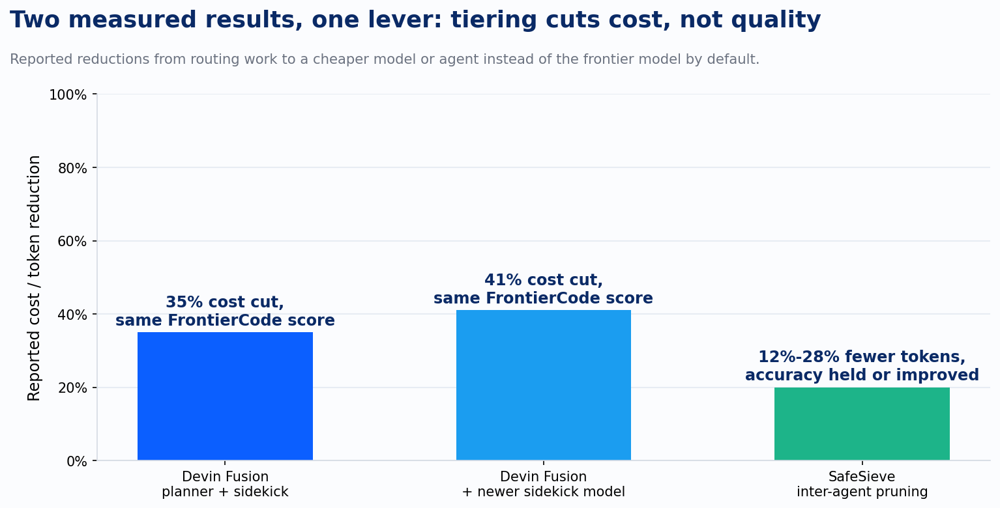
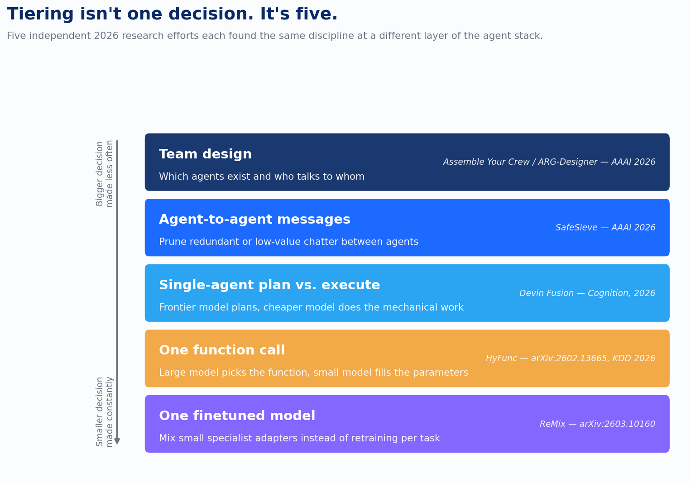

Ask a team running agents in production how they picked their model, and most give the same answer: the frontier model, because it's the best one on the market. That used to be a defensible position. Five pieces of research published in 2026 make it look like an expensive habit wearing the costume of a strategy.

The habit is understandable. When an agent system misses a step or produces a bad tool call, the first diagnosis is usually a capability gap, and the reflexive fix is a stronger model. What the 2026 research keeps finding instead is a routing gap. Most systems hand one expensive model every piece of a task, start to finish, when a large share of that work never needed it.

Cognition built the clearest demonstration of this into Devin Fusion, the harness behind its Devin coding agent. Fusion runs two models at once. A frontier model plans the work, works out what an ambiguous instruction actually means, and checks the result once it's done. A cheaper "sidekick" handles the mechanical work whenever the instructions are already unambiguous enough not to need judgment: editing files, running the test suite, following through on what's already been decided. The frontier model reads only what it has to and defaults to delegating. On Cognition's FrontierCode benchmark, that split cut cost by 35% against running the frontier model alone, at equivalent performance. Swap in a newer sidekick model and the cut reaches 41%, still at equivalent performance. Eighty-eight percent of internally merged pull requests during the rollout were driven entirely by the automated routing, with no human overriding the split.

One detail in the design matters more than the headline number. A naive version of this idea would have the frontier model resend its whole context every time it delegates to the sidekick, which erases the savings within a few calls. Fusion keeps each model's context cached separately, so delegation doesn't reset the meter. That's the real design principle: two models sharing the work without paying twice for the same context.

The same tiering shows up a level down, inside a single function call. Every agent that uses tools spends tokens three times over: it reads a long list of candidate functions before it can even pick one, runs a large model through an entire predictable token sequence just to write the call, and then produces boilerplate parameter syntax the model has already produced a thousand times. HyFunc, accepted to KDD 2026, attacks all three by keeping the frontier model in every request and asking less of it at each step. The large model compresses the user's intent into a single soft token. A lightweight retriever uses that token to narrow the function library down to a handful of candidates. Then a small, prefix-tuned model generates the actual call. On the BFCL benchmark, the result is 0.828 seconds of latency and 80.1% accuracy, ahead of every model of comparable size. What changes here is how much of the call each model is asked to do, not which model touches it.

Zoom out from a single agent to a team of them, and the lever becomes which messages agents send each other in the first place. Multi-agent systems generate enormous internal chatter: agents restating context, confirming receipt, relaying information a third agent already has. SafeSieve, presented at AAAI 2026, prunes that chatter by scoring each communication link on semantic relevance and accumulated performance, then clustering agents so the links that survive preserve coherent working groups instead of just cutting the weakest-looking connection one at a time. Across benchmarks it cut token consumption 12.4% to 27.8% while holding accuracy steady or improving it by as much as 2.22 points. In deployments mixing model tiers, clustering agents by cost profile cut spend a further 13.3%. That last number is the tiering point in miniature: cheap agents end up talking mostly to other cheap agents, on a topology the system worked out for itself, something no engineer sat down and sketched.

One layer above message pruning sits a harder question: which agents should exist at all, and who should be allowed to talk to whom. Most multi-agent frameworks answer that with a fixed template, a graph a person designed once and reuses for every task. Assemble Your Crew, an AAAI 2026 paper built around a system called ARG-Designer, throws the template out. Given a task description in plain language, it generates the team from scratch: how many agents, what role each plays, and which communication links actually need to exist, one agent and one link at a time. Modifying a fixed template carries forward whatever redundancy was baked into the template. Building the graph fresh, sized to the task, doesn't.

The fifth layer sits underneath all of these, inside a single model's weights, and it's the one place this pattern isn't a runtime routing decision at all. Teams increasingly build one finetuned model out of a mixture of small, cheap LoRA adapters instead of training a separate model per task, the same tiering instinct applied to training rather than inference. Researchers kept finding that the routers assigning weight to each adapter collapse in practice: one or two adapters end up dominating almost every decision, and the rest sit idle, defeating the point of having several cheap specialists in the first place. ReMix fixes this with a router that can't be trained by ordinary gradient descent, because its routing weights aren't learnable in the usual sense, so it estimates the gradient through a reinforcement-learning technique, a leave-one-out policy gradient, that forces every active adapter to actually contribute. The saving here shows up nowhere on an inference bill. It shows up in finally getting the value out of an architecture that, on paper, should already have been cheap.

None of this is free in the way a settings toggle is free. Building Fusion's dual-context caching, HyFunc's retriever and prefix-tuned model, SafeSieve's clustering, ARG-Designer's graph generator, or ReMix's reinforcement-learned router is real engineering, in some cases a research paper's worth of it. The 35%, the 41%, the 12 to 28%, are measured against benchmarks and internal rollouts, not guaranteed outcomes for every task distribution a client happens to run. Copying the headline number without doing the equivalent measurement is the same mistake as copying a single frontier model into every task: substituting someone else's evaluation for your own.

No shared technique ties these five results together. They use five different methods, at five different points in the stack, built by teams that in most cases weren't citing each other. What ties them together is a shared refusal to treat "which model" as a single answer applied once. Team design, message pruning, plan versus execution, the function call itself, the weights of a single finetuned model: tiering shows up at every layer someone bothered to measure it. A fixed AI budget doesn't get spent more efficiently by finding a smarter frontier model. It gets spent more efficiently by asking the tiering question five times instead of once, and building the discipline to answer each one with evidence instead of a default.
