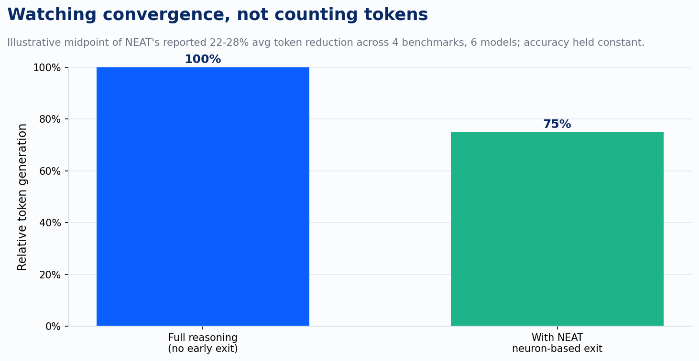
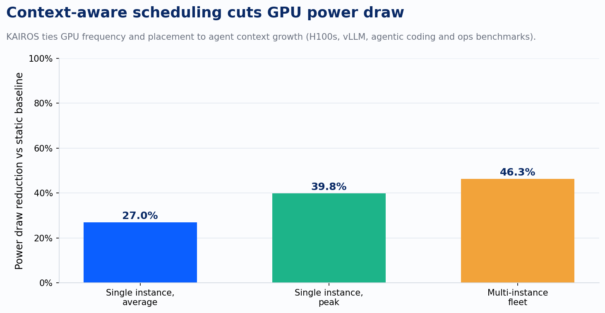
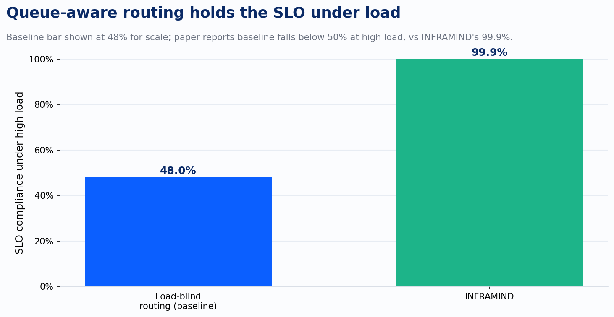

Ask a client why their self-hosted agent deployment costs three times what the model's own pricing page implied, and the first three answers are always about the model. Wrong model. Wrong prompt. Wrong context window. Almost nobody points at the layer sitting underneath the model, and that's usually where the money actually went.

A survey published this spring, "Taming the Titans," maps that layer in detail. The authors catalog the real cost and latency levers inside LLM inference serving: at the instance level, model placement, request scheduling, decoding length prediction, and storage management; at the cluster level, GPU deployment topology, multi-instance load balancing, and disaggregating prefill from decode. None of that is model selection. All of it is engineering that sits between the weights and the token that shows up in the response, and all of it decides whether a GPU is earning its rental rate or idling while a scheduler that doesn't know any better makes it wait.

Three papers published since then put numbers on exactly how much that engineering is worth.

Start with NEAT, because it attacks the simplest version of the waste: a reasoning model that keeps talking after it already has the answer. Most early-exit methods try to fix this by training a separate model to guess when to stop, which adds its own compute bill on top of the one it's trying to cut. NEAT does something more direct. It identifies a small set of neurons whose activation pattern tracks whether the model has actually converged on a solution, then watches those neurons live, and exits the moment convergence shows up, whether that's after two reasoning steps or fifty. No separate training pass, no added inference cost to decide when to stop. Across four reasoning benchmarks and six models of different scale, that shaved 22 to 28 percent off token generation on average, with accuracy held constant. The easy query gets a short answer. The hard one still gets the full chain. That's the distinction the flat per-token pricing model can't see and NEAT can.

KAIROS goes after a different line item: the power bill, and by extension the GPU capacity you can actually squeeze out of a fixed rack. Agentic workloads don't look like chat traffic. A coding agent or an ops agent runs long, tool-interleaved turns where context grows steadily across the session, and the naive fix, lowering GPU clock speed to save power, backfires here in a specific way the paper names directly: agentic serving can enter a thrashing regime where dropping frequency worsens both latency and power at the same time, because the GPU ends up doing more total work at a slower rate to finish the same turn. KAIROS's fix is to make the agent's own context growth the control signal instead of a fixed clock speed, jointly adjusting GPU frequency, per-instance concurrency, and where requests get placed across the fleet. Tested on H100s running vLLM across SWE-bench Verified, DABStep, and Terminal-Bench 2.0, that discipline cut average power draw 27 percent on a single serving instance, up to 39.8 percent at peak, and 46.3 percent once KAIROS was coordinating placement across a multi-instance fleet.

INFRAMIND closes the loop at the orchestration layer, where multi-agent systems decide which model handles which piece of work. The gap it found is almost embarrassingly simple once you see it: existing orchestration methods pick a model based on task fit and model capability, and then ignore the fact that the "best" model for the job might already have a ten-request-deep queue behind it while an equally capable model sits idle. INFRAMIND feeds queue depth, KV-cache pressure, and real per-model latency into the planning, routing, and scheduling decisions directly. At high load, that holds SLO compliance at 99.9 percent while every load-blind baseline the paper tested drops below 50 percent, and it delivers up to seven times lower latency along the way. At low load it also picks up 7.6 percentage points of accuracy over the strongest baseline, for the same reason: a planner that can see the queue stops routing work to a model that looks good on a leaderboard and is actually backed up.

Here's what that means for the decision most clients are actually weighing, which is managed inference against self-hosting. Azure OpenAI and Bedrock aren't just selling you a model endpoint. They're selling you this exact engineering, already built and amortized across every tenant on the platform: the scheduler, the KV-cache management, the queue-aware routing, the fleet-level power tuning. When a client self-hosts an open-weight model on their own GPU cluster, whether that's on Azure VMs or bare metal, they inherit the serving-layer problem themselves. Unless their platform team is prepared to build something in the neighborhood of what these three papers describe, they're likely paying full price for a serving layer that never got built, on hardware that's earning less than it should.

That reframes the due-diligence question. Instead of asking a vendor which model they run, or a platform team which GPUs they've provisioned, ask what's actually happening underneath. What's real GPU utilization under this specific traffic pattern, not an average blended across every other tenant on the box. Is prefill disaggregated from decode, and does the scheduler treat a short lookup differently than a long agent turn. What's the SLO compliance number under a load spike, not the median-case number from a quiet Tuesday. Who owns KV-cache eviction policy, and what happens to it when a session's context grows past whatever it was tuned for. A vendor or an internal platform team that can answer those specifically is telling you they've done the engineering. One that answers with the model's name is telling you they haven't looked yet.

The model is the part everyone argues about, because it's the part everyone can see and compare on a leaderboard. The serving layer is the part that actually decides the invoice, and it's usually the part nobody in the room signed off on building.

---

*Sources: *[*Taming the Titans: A Survey of Efficient LLM Inference Serving*](https://arxiv.org/abs/2504.19720?ref=devlinliles.com)*; *[*NEAT: Neuron-Based Early Exit for Large Reasoning Models*](https://arxiv.org/abs/2602.02010?ref=devlinliles.com)*; *[*KAIROS: Stateful, Context-Aware Power-Efficient Agentic Inference Serving*](https://arxiv.org/abs/2604.16682?ref=devlinliles.com)*; *[*INFRAMIND: Infrastructure-Aware Multi-Agent Orchestration*](https://arxiv.org/abs/2606.11440?ref=devlinliles.com)
